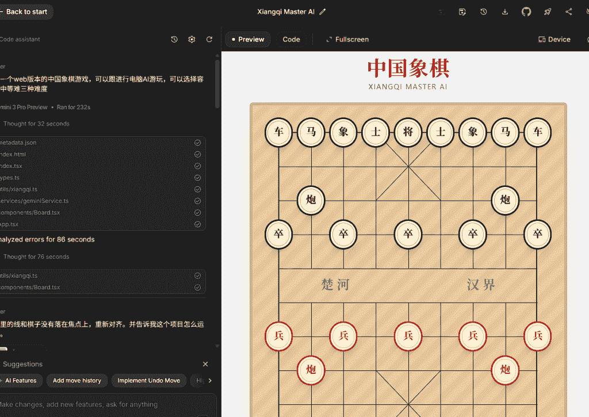
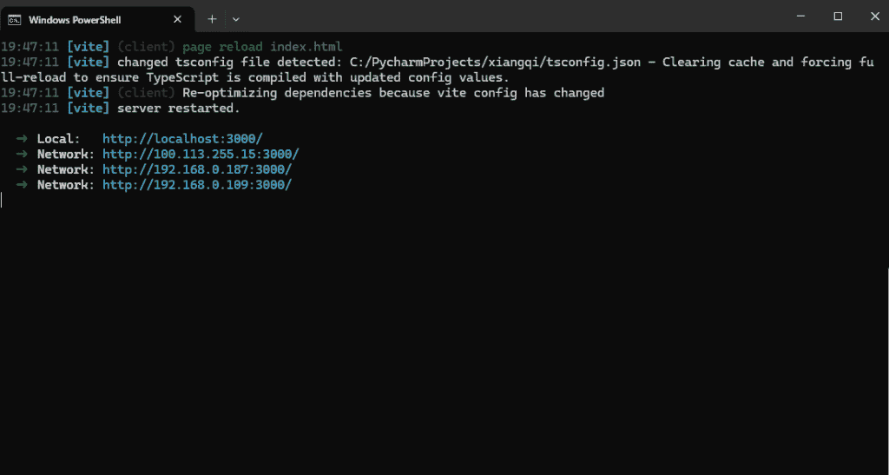
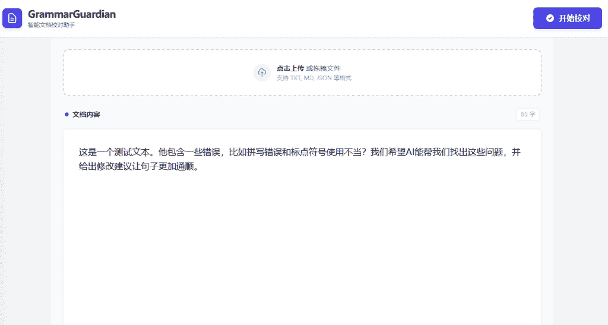
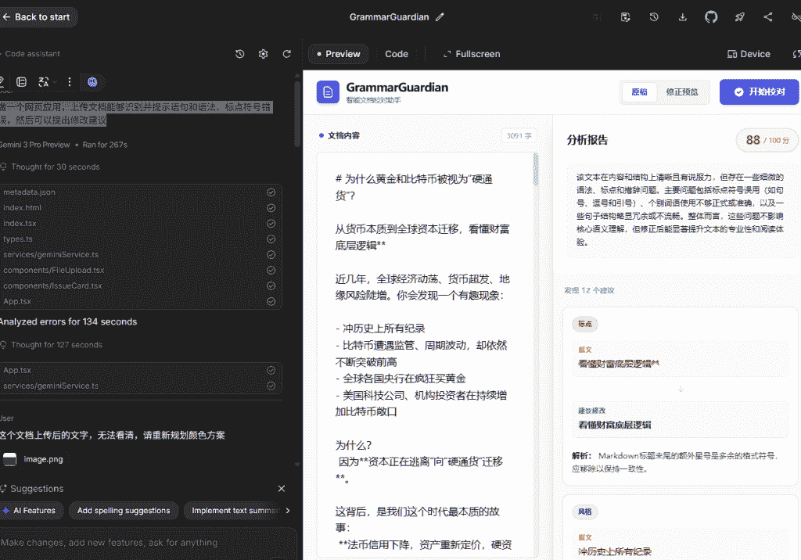
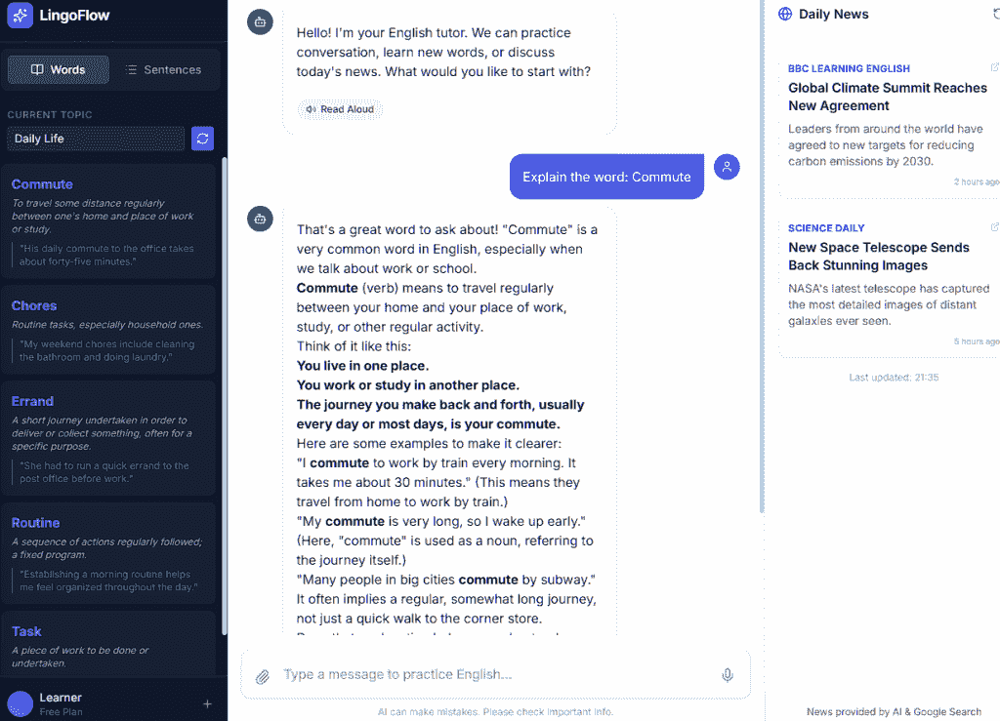

# Gemini3实践，几分钟就能开发出属于自己的应用

> 来源：[https://qqs7y1hozd1.feishu.cn/docx/YbScdRzxYoDwK7x76lVcTwSIn8b](https://qqs7y1hozd1.feishu.cn/docx/YbScdRzxYoDwK7x76lVcTwSIn8b)

众所周知，最近google出的gemini3模型爆火，彻底引起了AI在绘图和代码领域的技术革命。

今天咱们就来尝试一下，到底能带来哪些AI绘图和编写代码上的惊喜：

## Gemini3AI生图

> 首先打开官网：https://gemini.google.com/app

> 这里我尝试上传两张图片，一个是我在midjourney生成的未上色建模龙头，一个是网站的摩托车主题截图，如下所示:

在gemini的输入框中输入如下提示词：

> 提取图2的主题摩托车部分，并将其改为图1风格，并进行分解说明并进文字标注

不一会儿，模型就会按照要求生成符合要求的图片，官网上如下图所示：

这是生成的效果：

可以看到，最后生成的图片能够准确地将提示词的意思进行合理的表达，并在摩托车增加了龙纹似的纹理，然后

将摩托车拆分成各个部件，并用汉字进行标注。

最主要的关键还是模型**免费** 可以畅玩。

## Gemini3模型写代码

官网地址：https://aistudio.google.com/apps

点击左侧的build即可创建：

gemini3也可以用来写代码，我用它尝试了3个生成的要求，分别是生成中国象棋、文章校对、英语学习网站三个应用。

**中国象棋**

> 建一个web版本的中国象棋游戏，可以跟进行电脑AI游玩，可以选择容易中等难三种难度

Gemini会进行分析并通过 gemini api 添加电脑端的AI操作，从而实现与玩家的在线对弈。

当然该项目可以实现在本地部署，点击上图右侧下载至本地，解压后得到该项目的文件。

只需要在该项目目录下打开CMD，安装依赖：

npm **install**

运行：

npm run dev

等cad内出现如下所示：

点击链接：http://localhost:3000/ 即可在线体验这款中国象棋游戏。

该项目的Github地址：[ghostgorge/Chines](https://link.csdn.net/?target=https%3A%2F%2Fgithub.com%2Fghostgorge%2FChineseChess%3Flogin%3Dfrom_csdn)eChess: ChineseChess

**文章校对**

> 做一个网页应用，上传文档能够识别并提示语句和语法、标点符号错误，然后可以提出修改建议

它会基于vite和node进行编辑，依然可以通过如上方式进行本地部署在浏览器访问访问，如图所示：

我上传一篇文档来进行测试：

从图中可以看出，该工具能够准确的进行标点、错别字和漏字情况的识别和纠正，同样的，修正预览里可以看到修正后的文字。

该项目的Github地址：ghostgorge/jiaoyan: 校验文字

**英语学习网站**

需求：

> 生成一个学习英语的网站，画面布局类似chatgpt左侧能有单词学习、典型例句和对话回顾，中间可以和AI对话，并能够跟着朗读文字，右侧有即时的英语新闻，具有美观的界面，

按照**需求，g**emini能够生成如下的英语网站，右侧是最近的英语新闻，左侧是可复习的单词以及词义解析，可以点击进行单词和短句的复习，当然中间可以通过AI问答的方式与其进行交流，点击 Read aloud实现在线阅读，提高自身的英语口语能力，

