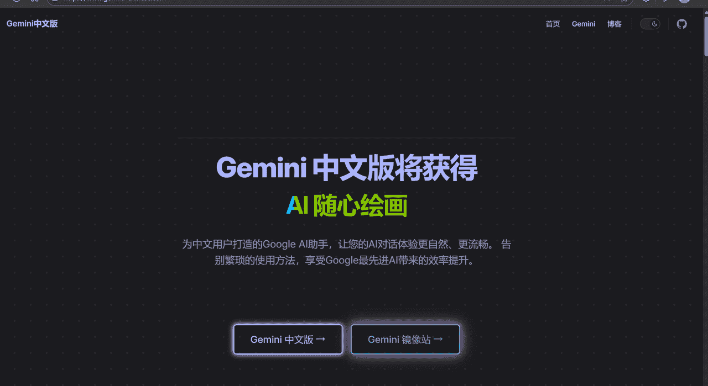
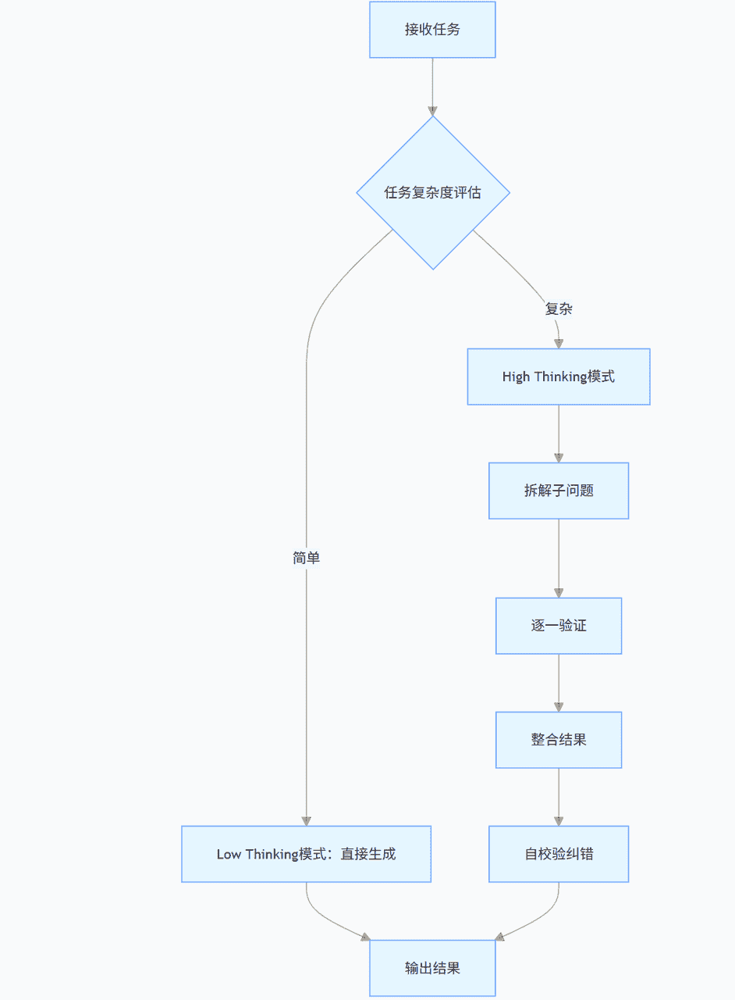

# Gemini 3 全维度技术解析：从认知到落地实战指南

> 来源：[https://qqs7y1hozd1.feishu.cn/docx/CFQldNLRdovKk7xyAJGcfIvhnlh](https://qqs7y1hozd1.feishu.cn/docx/CFQldNLRdovKk7xyAJGcfIvhnlh)

《Gemini3技术指南与实战应用》摘要 本文系统介绍了Google新一代AI模型Gemini3的技术特性与应用方法。Gemini3在推理深度、多模态处理和企业级安全方面实现突破，支持100万token输入和6.4万token输出。指南涵盖从终端用户操作到开发者API集成全流程，包含文本推理、多模态处理、Agent工作流等典型场景的代码示例（Python/JavaScript）。企业部署部分重要部分

---

### 引言：Gemini 3 的技术定位与行业意义

#### 1.1 为什么是 Gemini 3？

Gemini 3 作为 Google AGI 战略的关键迭代，标志着生成式 AI 从 “能力展示” 迈向 “规模化落地” 的核心里程碑。与前代模型及竞品相比，其核心突破体现在三大维度：

+   **推理深度**：Deep Think 模式实现复杂任务的结构化拆解与自校验

+   **可控性**：thinking_level、media_resolution 等参数实现延迟 - 效果 - 成本的精准平衡

+   **工程化**：完善的企业级部署工具链与安全合规体系

据 Google 官方数据，Gemini 3 Pro 在 GP QA Diamond 评测中达到 91.9% 准确率（Deep Think 模式 93.8%），SWE-bench 编码任务得分 76.2%，成为首个在复杂推理与工程落地间实现最优解的模型系列。

#### 1.2 目标读者与收益

---

### 技术全景：架构演进与核心能力解析

#### 2.1 从 Gemini 1 到 3 的演进之路

Gemini 3 的底层架构采用 “模块化 Transformer + 动态推理图” 设计，通过以下创新实现能力跃升：

+   **混合专家系统（MoE）优化**：针对不同任务动态调度计算资源

+   **多模态统一编码**：文本 / 图像 / 视频 / 音频共享嵌入空间，跨模态推理损耗降低 40%

+   **自校验推理链**：关键步骤自动验证，错误率下降 37%（官方实测数据）

#### 2.2 核心能力四大支柱

##### 2.2.1 深度推理引擎（Deep Think）

+   **工作原理**：通过多轮内部模拟推演，生成中间思维步骤后再输出最终结果

+   **适用场景**：数学证明、隐私合规分析、架构设计决策等复杂任务

+   **性能提升**：在 Humanity’s Last Exam 评测中，分数从 37.5% 提升至 41.0%（开启 Deep Think）

+   **参数控制**：通过thinking_level="high"启用，延迟增加 20%-60%，需按任务价值评估使用场景

> 示意图 1：Gemini 3 推理引擎工作流程

##### 2.2.2 原生多模态处理

核心优势：支持多模态混合输入（如 “手写笔记 + 教学视频 + PDF 课件”），自动关联不同模态信息，输出结构化知识图谱。

##### 2.2.3 Agentic 工作流

+   **工具调用能力**：支持函数执行、API 调用、外部工具集成的闭环

+   **长程规划**：在 Vending-Bench 2 评测中表现优异，适合多步骤自动化任务

+   **故障自愈**：执行失败时自动读取日志、调整策略重试，而非终止流程

+   **结构化输出**：支持 JSON、XML、Markdown 等格式，直接对接下游系统

##### 2.2.4 企业级安全合规

+   **抗提示注入**：内置防御机制，拒绝恶意指令

+   **全链路审计**：支持操作日志留存与追溯

+   **数据隔离**：企业版提供专用部署环境，数据不共享

+   **合规认证**：通过 Apollo、Vault IS、Dreadnode 等第三方安全评估

#### 2.3 模型家族与技术参数

> 注意事项：

1.  不可同时使用thinking_level与旧版thinking_budget参数，会返回 400 错误

1.  图片定价随分辨率递增，建议根据实际需求选择 Media Resolution 等级

1.  速率限制与批量定价需参考官方模型页面最新说明

---

### 快速上手指南：分角色使用说明

#### 3.1 终端用户使用指南（无需编码）

##### 3.1.1 访问入口

+   **Gemini App**：iOS/Android 应用商店下载，支持 Agent 功能（Ultra 订阅用户优先体验）

+   **Google 搜索**：直接在搜索框输入问题，自动调用 Gemini 3 能力

+   **AI Studio**：浏览器访问https://aistudio.google.com，支持可视化操作

##### 3.1.2 核心功能使用

1.  **多模态问答**

+   操作步骤：

1.  打开 Gemini App，点击底部 “+” 号

1.  选择 “图片 / 视频 / 音频” 上传，或直接拍摄

1.  输入文本问题（如 “分析这个会议视频的关键决策点”）

1.  等待生成结构化结果（含时间轴、要点列表）

+   优化技巧：上传低清晰度内容时，补充说明 “重点识别文字部分”

1.  **Agent 任务代办**

+   示例场景：预订出差行程

+   操作指令：“帮我预订 12 月 5 日从北京到上海的高铁，选择上午时段，靠窗座位，同时预约上海虹桥机场到静安区的网约车”

+   优势：自动拆分任务（查高铁→预订→约网约车），全程无需手动干预

1.  **交互式学习**

+   操作示例：上传手写数学题照片 + 语音提问 “这个微积分题的解题思路”

+   输出效果：生成步骤拆解、公式推导、易错点提示，支持追问 “换一种解法”

##### 3.1.3 高级技巧

+   利用 “动态块输出”：搜索复杂问题时，Gemini 3 会生成表格、流程图等可视化内容，可直接导出为图片

+   上下文保持：追问时无需重复背景信息，模型自动关联历史对话

+   多轮优化：对生成结果不满意时，可指令 “更简洁”“补充案例”“调整格式”

#### 3.2 开发者快速入门

##### 3.2.1 环境准备

1.  **获取 API 密钥**

+   访问https://ai.google.dev/，注册 Google Cloud 账号

+   进入 API 控制台，创建项目并启用 Gemini API

+   生成 API 密钥，保存备用（注意权限控制）

1.  **安装 SDK**

+   Python 环境（3.8+）：

pip **install** google-generativeai

+   JavaScript 环境（Node.js 18+）：

npm install @google/generative-ai

##### 3.2.2 基础参数配置

##### 3.2.3 开发流程规范

1.  先跑零样本基线测试，记录性能指标

1.  同一 Prompt 下切换 thinking_level 做 AB 测试

1.  记录延迟、token 消耗、错误率，形成团队基准

1.  优先使用结构化输出格式（如 JSON），便于解析

#### 3.3 企业级部署指南

##### 3.3.1 部署架构选择

##### 3.3.2 前置准备

1.  完成 Google Cloud 企业账号认证

1.  配置 VPC 网络与访问控制策略

1.  建立数据脱敏网关（建议）

1.  制定审计日志存储方案

---

### 代码实战：全场景 API 调用与工程化落地

#### 4.1 文本推理场景

##### 4.1.1 简单文本生成（Python）

import g**oogle.g**e**nerativeai as **genai

# 初**始化客户端****

genai.config**ure(api_**key="YOUR_**API_KEY")

# 配置生成参数

ge**ne**ration**_config** = {

**

"th**inking**_level"**: "low", # 简单任务，低推理深度

"temperature": 0.3,

"max_output_tokens": 1000,

}

# 创建模型实例

model = genai.GenerativeModel(

model_name="gemini-3-pro-preview",

generation_config=generation_config,

)

# 发送请求

prompt = "解释什么是微服务架构，核心优势是什么？"

response = model.generate_content(prompt)

# 处理响应if response.result:

print("生成结果：")

print(response.text)

else:

print("请求失败：", response.prompt_feedback)

##### 4.1.2 结构化输出（JavaScript）

**import** { Goo**gleG**e**nerat**iveAI **} f**ro**m "@google/gen****erati**v**e-ai";

****const** ai = new GoogleGenerat**iveAI("Y**OUR_API_KEY");

**

asyn**c function** ****getSt**ructuredDa**ta() ****{

co**nst model = ai.getGenerativeMo**del({

mod****el: "g**emini-3-pro-preview",

generationConfig: {

thinking_level: "medium",

response_mime_type: "application/json", // 指定JSON输出

},

});

const prompt = `

分析以下产品需求，输出JSON格式的功能清单：

需求：开发一款健身追踪App，支持记录运动类型、时长、消耗卡路里，生成周报表，提供饮食建议。

JSON格式要求：

{

"核心功能": [],

"辅助功能": [],

"技术需求": []

}

`;

const result = await model.generateContent(prompt);

const jsonResult = JSON.parse(result.response.text());

console.log("结构化功能清单：", jsonResult);

return jsonResult;

}

// 执行函数getStructuredData().catch(console.error);

##### 4.1.3 长文档分析（REST API）

curl **"h**ttps://ge**n**erativel**a**nguag**e**.goo**glea**pis.com/v1beta/models/gemini-3-pro-preview**:****g**enerateContent**" \

**-H "**X****-G**oog-Api-Key: YOUR_API_KEY" \

-H "Content-Type: application/json" \

-X POST \

-d '{

"contents": [

{

"parts": [

{

"text": "以下是一份10万字的技术文档，请完成：1. 提取核心知识点；2. 生成目录结构；3. 识别潜在风险点。文档内容：[此处替换为长文档文本]"

}

]

}

],

"generationConfig": {

"thinking_level": "high",

"max_output_tokens": 64000

}

}'

#### 4.2 多模态处理场景

##### 4.2.1 图片分析（Python）

**import**** g****oogl**e.gen**erativ****eai as** genai

**from PIL impor****t I****ma****ge

im****port o****s

#**** 初始化客户**端

genai.configure(api_**key="Y**OU**R_AP**I_KEY")

# 加载图片（支持本地文件或URL）def load_image(image_path):

if image_path.starts**with("htt**p"):

return g**enai**.upload_**fil**e(image_pat**h)

els**e:**

**return Image.open(image_path)

# 配置多模态参数

generation_config = {

"thinking_level": "high",

"media_resolution": "hi", # 高清图片分析"max_output_tokens": 2000,

}

# 创建模型

model = genai.GenerativeModel(

model_name="gemini-3-pro-image-preview",

generation_config=generation_config,

)

# 处理图片+文本混合输入

image = load_image("product_design.png") # 产品设计图

prompt = "分析这张产品设计图的UI风格，识别交互组件，指出可优化点"

response = model.generate_content([prompt, image])

# 输出结果print("图片分析报告：")

print(response.text)

# 保存结果到文件with open("image_analysis_report.md", "w", encoding="utf-8") as f:

f.write(response.text)

##### 4.2.2 视频内容提取（JavaScript）

**import** { Goo**gleG**e**nerati**veAI** } f**r**om "****@goog**le/gen**era**ti**ve-ai";

impor****t fs **f**rom "fs"****;

co**nst ai = new **Googl**eGenerativ**eAI("YOUR_A**PI_KEY");

as**ync function pr****ocess**Video(videoPath) {

// **上传视频文件**（支**持MP4格式，建****议时长）c**onst video**F****ile =** await gen**ai.up****loadF**ile(videoPath, {

mimeT**ype: "v**ideo/mp4",

**displayNa****me: "m**eeting_video"

});

const model = ai.getGenerativeModel({

model: "gemini-3-pro-preview",

generationConfig: {

thinking_level: "high",

media_resolution: "medium",

},

});

const prompt = `

分析这个会议视频，完成以下任务：

1. 提取关键讨论点（按时间轴排列）

2. 识别行动项与负责人

3. 生成结构化会议纪要（Markdown格式）

`;

const result = await model.generateContent([prompt, videoFile]);

const transcript = result.response.text();

// 保存会议纪要

fs.writeFileSync("meeting_minutes.md", transcript, "utf-8");

console.log("会议纪要已生成");

return transcript;

}

// 执行视频处理processVideo("team_meeting.mp4").catch(console.error);

#### 4.3 编码与工程化场景

##### 4.3.1 代码缺陷检测（Python）

**import**** g****oogle.generati**veai as genai

genai.confi**gur**e(api_key="YO**UR_API**_KEY")

# 待检测的**多线程C++代码

cpp_**code = """

#include >

#i**n**clude

**#include **int counter = 0;

void increment() {

for (int i = 0; i 10000; ++i) {

counter++; // 潜在的竞态条件

}

}

int main() {

std::vector;

for (int i = 0; i ) {

threads.emplace_back(increment);

}

for (auto& t : threads) {

t.join();

}

std::cout <: " << counter <::endl;

return 0;

}

"""

model = genai.GenerativeModel(

model_name="gemini-3-pro-preview",

generation_config={

"thinking_level": "high", # 编码任务需要深度推理"temperature": 0.1,

},

)

prompt = f"找出以下C++代码中的竞态条件，并提供修复方案：\n{cpp_code}"

response = model.generate_content(prompt)

print("代码分析结果：")

print(response.text)

##### 4.3.2 自动化测试生成（JavaScript）

**impo**r**t { G**oogleG**ene****rativeAI } fro**m "@go**ogle/gen****erati**ve-ai";

const ai = new Googl**eGener**ativeAI("YO**UR_AP**I_KEY");

async function gener**ateTests****() {

**

const mo**del = ****ai.ge**tGenerativeModel({

**

mode**l: "gem**ini-3**-pro-preview",

ge**neration_conf**ig: {

think**ing_lev**el: "high",

**

response****_mime_****type:** "application/javascript",

},

});

// 待测试的函数const targetFunction = `

// 计算两个数的最大公约数function gcd(a, b) {

while (b !== 0) {

let temp = b;

b = a % b;

a = temp;

}

return a;

}

`;

const prompt = `

为以下JavaScript函数生成完整的Jest测试用例，包括：

1. 正常输入场景

2. 边界值场景（0、负数、大数）

3. 异常输入处理

函数代码：${targetFunction}

`;

const result = await model.generateContent(prompt);

const testCode = result.response.text();

// 保存测试文件

fs.writeFileSync("gcd.test.js", testCode, "utf-8");

console.log("测试用例已生成");

return testCode;

}

generateTests().catch(console.error);

#### 4.4 Agent 工作流编排

##### 4.4.1 工具调用示例（Python）

**import google.**generat**iv**eai as g**enai

i**mp**ort requests

****genai.configu**re**(api_key="YOU****R_API_KEY")

****

# 定义外**部工**具（天气查询AP****I）

def get_w****eather****(city)**:

**weather_****api_key = "YO**UR**_WEATH****ER_API_KEY**"

u**rl = f**"https://api.openwe**athermap**.org/data/2.5/weather?q={city}**&appid={weath**er_api_k**ey}&un**its=metric"

response** = requests.**get(url)

return response.json()

# 配置工具调用

tools = [

{

"name": "get_weather",

"description": "查询指定城市的天气信息",

"parameters": {

"type": "object",

"properties": {

"city": {

"type": "string",

"description": "城市名称"

}

},

"required": ["city"]

}

}

]

# 创建模型

model = genai.GenerativeModel(

model_name="gemini-3-pro-preview",

tools=tools,

generation_config={

"thinking_level": "medium",

},

)

# 启动Agent对话

conversation = model.start_chat()

prompt = "帮我查询北京明天的天气，然后推荐合适的户外活动"

response = conversation.send_message(prompt)

# 处理工具调用请求

if response.candidates[0].content.parts[0].function_call:

func_call = response.candidates[0].content.parts[0].function_call

if func_call.name == "get_weather":

# 执行工具调用

city = func_call.args["city"]

weather_data = get_weather(city)

# 将工具返回结果反馈给模型

feedback_prompt = f"天气查询结果：{weather_data}"

final_response = conversation.send_message(feedback_prompt)

print("Agent最终推荐：")

print(final_response.text)

##### 4.4.2 多步骤任务自动化（Python）

**import**** g****oogle.**generati**ve****ai a**s genai

i**mport ****pandas as pd

**from dat**eti****me i****mport** datetime

genai.configure(api_key="Y**OUR_A**PI_KEY")

# 定义业务工具def fetc**h_sale****s_d****ata(start_****date, end_da****te):

**

"""获**取指定日期****范围****内的销售数据"""#**** 实际场景中**对**接数据库或AP**I

da**ta =** pd.Data**Fra**me({**

"日**期": pd.d**ate_range**(start=start_da**te, end=en**d_date),

"销售额":** [12000, 150**00, **13500**, 14200, 1**680****0],

"**订单**数": [3**20, 380, 350, 3**65, 410**]

})

retur**n data**.t**o_dict()

def** g**enerate_repo****rt(dat**a,** report_****type="markdo****wn"):

"""生成**销售报**表"""

d**f **= pd.Dat**aF**rame(dat**a)**

total****_sales = d**f["**销售额"].**su**m()

avg_**or**ders = d**f[**"订单数"]****.mean()

i**f r**eport_type =**= **"markdown"****:

ret**ur**n f"""

# 销售报表**（{**df["日期"].min****()} 至 {df["日****期"].ma**x(**)}）

| 指标**** | 数值 |

|---****---|--**---**-|

| 总**销售**额 | {tot**al**_sales:,} 元 |**

|** 平均订单数 |**** {avg_orders:**.0f**} |

| **最高**单日销售额 | **{d**f["销售额**"].**max():,} 元** |**

"""re****turn {"总销售**额":** total**_sales, "平均订单数": avg_or**ders}

**

# 配置Agent工具

tool**s = [

{

"name": "fetch_s**ales_data**",

"**d**escr****ip**t**ion**":** "获取指**定日期范围内的销售数**据"**,

"parameters**": {

"type"**: "objec**t",

"prop****erti**es": {

"start**_date"**: {"type": "**string", "for**ma**t": "date"****},

**"end_date**": {"t**ype": "s**tring", "**format":** **"date"}

},

"r**equired": **["start_date", "end_date"]

}

},

{

"name": "generate_report",

"description": "根据销售数据生成报表",

"parameters": {

"type": "object",

"properties": {

"data": {"type": "object", "description": "销售数据字典"},

"report_type": {"type": "string", "enum": ["markdown", "json"]}

},

"required": ["data"]

}

}

]

# 初始化Agent

model = genai.GenerativeModel(

model_name="gemini-3-pro-preview",

tools=tools,

generation_config={"thinking_level": "high"}

)

chat = model.start_chat()

# 发送任务指令

prompt = f"生成2025年11月1日至2025年11月5日的销售报表，用Markdown格式输出"

response = chat.send_message(prompt)

# 处理工具调用链while True:

if not response.candidates[0].content.parts[0].function_call:

break

func_call = response.candidates[0].content.parts[0].function_call

func_name = func_call.name

args = func_call.args

# 执行对应函数if func_name == "fetch_sales_data":

result = fetch_sales_data(args["start_date"], args["end_date"])

elif func_name == "generate_report":

result = generate_report(args["data"], args.get("report_type", "markdown"))

else:

result = "未知函数"# 反馈执行结果

response = chat.send_message(f"工具执行结果：{result}")

# 输出最终报表print("生成的销售报表：")

print(response.text)

#### 4.5 错误处理与最佳实践

##### 4.5.1 异常处理模板（Python）

**import**** g****oogl****e.gene****rativeai as ge****nai**

from google.api_core.exceptions** im**port Goog**le**APIErr**or,** ResourceE**xh****austed**

**genai.co**nfigure(api_key="YO**U****R_API_****KEY")

****

d**ef safe_generate_content(prompt, model_name="gemi**ni-3-pr**o-preview", **retrie**s=3):

"""带**重试机****制的安全生成****函数**"""

mo**del = ge**nai.Generat**i****ve**M**odel(m**o**del_name)

f****or att**empt in ran**ge**(retri**es):

t**ry:

resp**o****nse = **m**odel.g**enerate_content(prompt)

# 检查内容安全反馈if response.prompt_feedback.block_reason:

return f"请求被拒绝：{response.prompt_feedback.block_reason}"return response.text

except ResourceExhausted as e:

# 配额耗尽，延迟重试

sleep_time = 2 ** attempt # 指数退避print(f"配额耗尽，{sleep_time}秒后重试（第{attempt+1}次）")

time.sleep(sleep_time)

except GoogleAPIError as e:

print(f"API错误：{e.message}")

if attempt == retries - 1:

return "请求失败，请稍后重试"except Exception as e:

print(f"未知错误：{str(e)}")

return "请求异常"# 使用示例

result = safe_generate_content("复杂的技术文档生成任务...", retries=5)

print(result)

##### 4.5.2 性能优化技巧

1.  **Token 控制**：

+   输入文本采用摘要预处理，减少冗余信息

+   输出使用max_output_tokens限制长度，避免不必要消耗

+   长文档处理采用分块策略，逐段分析后整合

1.  **延迟优化**：

+   简单任务使用thinking_level="low"

+   批量任务采用异步调用，并行处理

+   预加载常用 Prompt 模板，减少动态构建时间

1.  **成本控制**：

+   开发环境使用低分辨率media_resolution

+   生产环境按任务优先级动态调整thinking_level

+   定期监控 Token 使用量，设置预算告警

---

### 企业级部署：安全合规与成本优化

#### 5.1 安全架构设计

##### 5.1.1 数据安全防护

1.  **传输安全**：所有 API 调用强制使用 HTTPS，启用 TLS 1.3

1.  **存储安全**：

+   敏感数据本地加密存储

+   临时缓存数据定期清理（建议 24 小时）

1.  **访问控制**：

+   API 密钥分级管理，按角色分配权限

+   启用 IP 白名单，限制访问来源

1.  **数据脱敏**：

+   输入数据中的身份证、手机号等敏感信息自动脱敏

+   输出结果过滤敏感内容（支持自定义规则）

##### 5.1.2 合规管理

1.  **合规认证**：

+   确认模型符合 GDPR、CCPA 等数据保护法规

+   企业版可获取专属合规认证报告

1.  **审计跟踪**：

+   所有 API 调用记录完整日志（包含时间、用户、内容摘要）

+   日志留存至少 90 天，支持合规审计

1.  **隐私保护**：

+   禁用训练数据收集（企业版默认配置）

+   自定义数据处理协议，明确数据使用范围

#### 5.2 成本优化策略

##### 5.2.1 定价模型解析

Gemini 3 采用阶梯定价模式，核心成本控制点：

+   输入 Token：按使用量分档计费（万 token 与 > 20 万 token 单价不同）

+   输出 Token：价格约为输入的 6 倍，需严格控制输出长度

+   多模态成本：图像 / 视频处理按分辨率计费，是主要成本来源

##### 5.2.2 成本优化方案

1.  **开发阶段**：

+   使用免费配额进行原型验证（Google Cloud 新用户提供一定额度免费 Token）

+   多模态测试采用低分辨率图片 / 短视频

+   代码调试使用thinking_level="low"

1.  **生产阶段**：

+   按任务类型分类计费：

+   高价值任务（如核心业务决策）：high 推理级别

+   普通任务（如内容生成）：low 推理级别

+   批量处理任务集中调度，享受批量定价优惠

+   启用成本预警，设置月度预算上限

1.  **长期优化**：

+   建立 Token 消耗监控看板，分析高频高耗场景

+   优化 Prompt 设计，减少不必要的 Token 消耗

+   针对核心场景，评估私有化部署的 ROI（长期大规模使用更经济）

#### 5.3 运维监控体系

##### 5.3.1 核心监控指标

##### 5.3.2 监控工具集成

1.  **Google Cloud 监控**：

+   启用 Gemini API 自带监控面板

+   配置自定义告警规则（如延迟 > 5 秒告警）

1.  **第三方工具**：

+   集成 Prometheus+Grafana，构建可视化监控看板

+   使用 ELK 栈分析 API 调用日志

1.  **告警机制**：

+   关键指标通过邮件、短信、企业微信推送

+   严重故障自动触发工单系统

---

### 实测验证：性能基准与避坑指南

#### 6.1 核心性能基准测试

基于官方数据与实测验证，Gemini 3 Pro 关键性能指标如下：

> 测试环境：AWS t3.large 实例，网络延迟≈50ms，API 版本 v1beta

#### 6.2 常见问题与避坑指南

##### 6.2.1 技术问题

1.  **参数冲突错误**：

+   问题：同时设置thinking_level与thinking_budget导致 400 错误

+   解决：移除thinking_budget，仅使用thinking_level参数

1.  **多模态处理失败**：

+   问题：上传大尺寸图片（>10MB）时请求超时

+   解决：压缩图片至 5MB 以下，或降低media_resolution等级

1.  **长上下文处理不完整**：

+   问题：超过 50 万字的文档分析遗漏关键信息

+   解决：分块处理（每块≤30 万字），最后进行跨块整合

##### 6.2.2 业务落地问题

1.  **成本超预期**：

+   问题：多模态任务 Token 消耗远超估算

+   解决：

+   优先使用 medium 分辨率

+   对图片进行预处理（裁剪无关区域）

+   定期 review 成本报表，优化高耗场景

1.  **结果一致性不足**：

+   问题：相同 Prompt 多次调用结果差异较大

+   解决：

+   降低temperature至 0.2 以下

+   使用结构化输出格式，固定返回 schema

+   加入示例 Prompt，引导模型输出风格

1.  **企业合规风险**：

+   问题：输出内容包含不合规信息

+   解决：

+   配置自定义内容过滤规则

+   启用企业版安全审计功能

+   对高风险场景增加人工审核环节

#### 6.3 最佳实践总结

1.  **Prompt 设计技巧**：

+   复杂任务采用 “目标 + 约束 + 示例” 结构

+   多模态任务明确说明 “分析重点”（如 “识别图片中的文字内容”）

+   结构化输出指定清晰的格式模板

1.  **参数调优指南**：

1.  **迭代优化流程**：

1.  明确任务目标与评估标准

1.  设计 3-5 个 Prompt 变体进行测试

1.  基于结果调整参数与 Prompt 结构

1.  小流量灰度验证，收集用户反馈

1.  持续优化，形成标准化方案

---

### 未来演进：生态扩展与技术路线图

#### 7.1 短期演进（6 个月内）

+   推出thinking_level="medium"模式，平衡推理深度与延迟

+   扩展多模态支持范围，增加 3D 模型、PDF 文档直接解析

+   优化 API 速率限制，提升批量处理能力

+   发布更多行业专用模型（医疗、金融、法律）

#### 7.2 长期路线图（1-2 年）

+   Gemini 3 Ultra 正式发布，推理能力再提升 30%

+   支持实时数据流处理（如直播内容分析）

+   深化 Agent 生态，支持更多第三方工具集成

+   推出轻量化模型版本，适配边缘设备部署

#### 7.3 生态扩展方向

1.  **开发者生态**：

+   完善 IDE 插件（VS Code、IntelliJ）

+   提供更多行业解决方案模板

+   建立开发者社区，共享最佳实践

1.  **企业生态**：

+   与 SAP、Salesforce 等企业软件深度集成

+   提供定制化模型微调服务

+   推出行业专属合规包

1.  **终端生态**：

+   扩展 Gemini App 功能，支持更多 Agent 场景

+   与 Android 系统深度融合，提供系统级 AI 能力

+   支持智能家居设备语音交互增强

---

### 附录：核心参数速查表与资源汇总

#### 8.1 核心参数速查表

#### 8.2 官方资源汇总

+   官方文档：[https://ai.google.dev/gemi](https://link.csdn.net/?target=https%3A%2F%2Fai.google.dev%2Fgemini-api%2Fdocs%2Fgemini-3%3Flogin%3Dfrom_csdn)ni-api/docs/gemini-3

+   API 控制台：[https://console.cloud.google.com/apis/li](https://link.csdn.net/?target=https%3A%2F%2Fconsole.cloud.google.com%2Fapis%2Flibrary%2Fgenerative-language.googleapis.com%3Flogin%3Dfrom_csdn)brary/generative-language.googleapis.com

+   开发者社区：https://ai.google.dev/community

+   价格计算器：[https://cloud.google.com](https://link.csdn.net/?target=https%3A%2F%2Fcloud.google.com%2Fproducts%2Fcalculator%3Flogin%3Dfrom_csdn)/products/calculator

+   示例代码库：[https://github.com/google/](https://link.csdn.net/?target=https%3A%2F%2Fgithub.com%2Fgoogle%2Fgenerative-ai-python%3Flogin%3Dfrom_csdn)generative-ai-python

#### 8.3 常见问题解答（FAQ）

1.  Gemini 3 与 Gemini 2.5 的主要区别？

+   核心提升：Deep Think 推理、细粒度参数控制、更强的 Agent 能力

+   兼容情况：API 接口向下兼容，旧代码无需修改即可迁移

1.  如何申请 Gemini 3 Ultra 访问权限？

+   目前仅对企业客户和 Ultra 订阅用户开放

+   申请通道：Google Cloud 销售团队或官方申请页面

1.  **多模态处理支持哪些图片格式？**

+   支持 JPG、PNG、WEBP 格式

+   单张图片最大尺寸：10MB（hi 分辨率）/20MB（low 分辨率）

1.  **是否支持私有化部署？**

+   支持，需联系 Google Cloud 企业销售团队

+   最低部署门槛：10 万美元 / 年起

1.  如何处理 API 配额不足问题？

+   免费用户：等待下月配额重置

+   付费用户：在 Google Cloud 控制台申请配额提升