# 实测Nano Banana Pro：甚至不想叫它AI，这是视觉层面的AGI！

> 来源：[https://qqs7y1hozd1.feishu.cn/docx/Ka2sdWZrroIJbFxkoAecBnwvnmL](https://qqs7y1hozd1.feishu.cn/docx/Ka2sdWZrroIJbFxkoAecBnwvnmL)

昨晚谷歌继Gemini 3 pro 后又扔出了王炸——Nano Banana Pro（核心就是 Gemini 3 Pro Image 模型）卧槽真的，兄弟们这一次，我真的词穷了昨晚谷歌继Gemini 3 pro 后又扔出了王炸——（核心就是 Gemini 3 Pro Image 模型）nano banana已经很厉害了，pro我直接跪了我看着屏幕，脑子里只有两个字在无限循环：离谱这是 Gemini

##### 文字与逻辑的“降维打击”：人类历史上最强的压缩算法

Nano Banana Pro 的渲染能力，让我觉得以前用的都是假 AI

**案例一：论文秒变板书**

直接把一篇枯燥的学术论文扔进去，要求把它变成教授讲课的白板。

提示词：把这篇论文变成教授的白板板书图像：要有图解、箭头、框图，以及解释核心概念的视觉说明。使用彩色绘制

这里我们把《Attention Is All You Need》论文扔进去，结果？你们自己看：

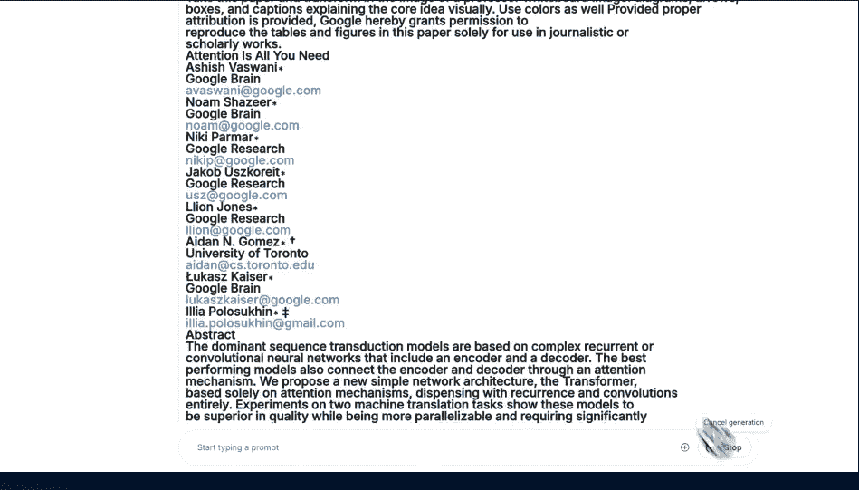

这不仅是画得像，它是真的读懂了论文！拼写**，箭头逻辑、核心概念解释**……！这基本上是人类历史上最强的压缩算法

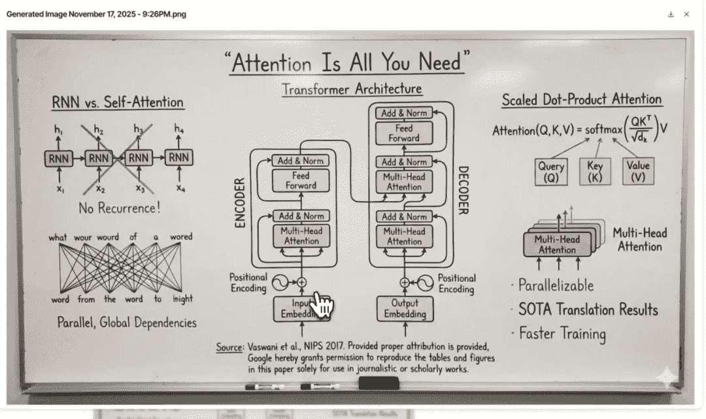

**案例二：代码直接变图**

更骚的来了，有人喂给它一段 Gemini 3 生成的 AI 计算提交记录的 原始 Graphviz 代码（DOT 语言代码）。注意，是代码！

它都不带喘气的，直接一次性渲染出了带 Logo 的完美图表

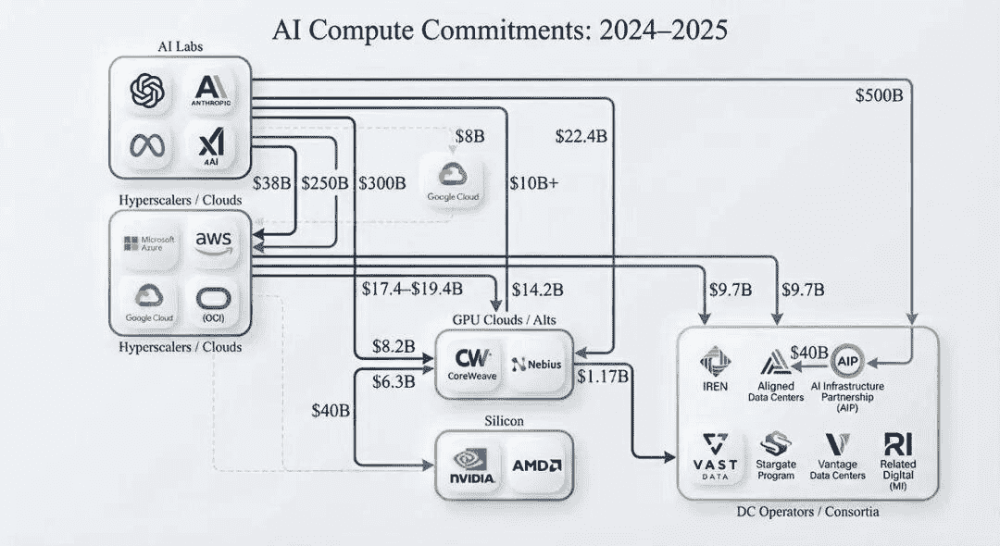

**案例三：博客变杂志**

文字排版能力也是天花板级别。把 Gemini 3 发布官方的技术博客扔进去，让它生成一张“放在桌上的精美杂志内页”

提示词：把整段文字逐字逐句地放入一张放在桌上的光面杂志文章照片中，要有照片、精美的排版设计、引语和大胆的格式

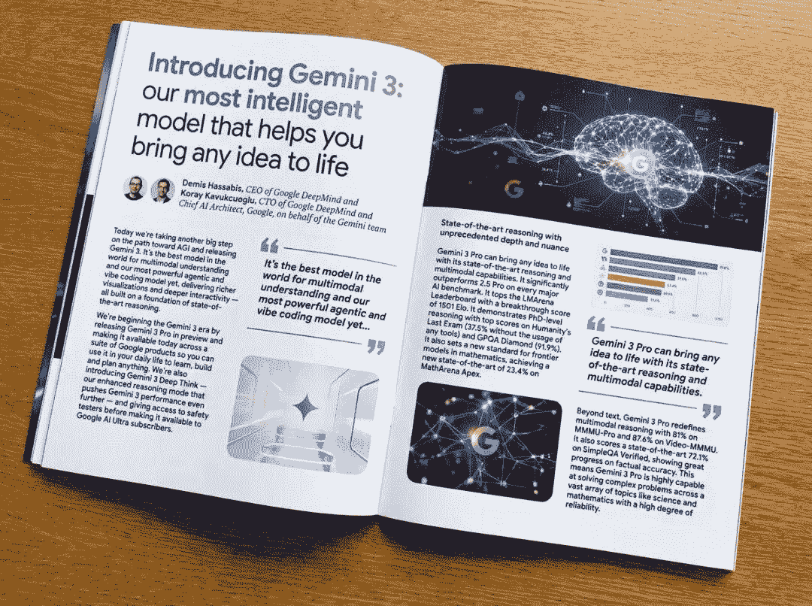

看这排版、这引语设计，你说这是设计大师排了一下午我都信

##### 它真的“懂”这个世界（硬核知识库）

以前的 AI 是瞎蒙，Nano Banana Pro 是真懂。因为它背后连着 Google Search 和 Gemini 3 的推理大脑

案例四 & 五：硬核工艺与生活幽默

看看这个关于「PCB电路板制造全流程」 的图。这可是硬核工业流程！

提示词：

E**xplain all the** st**eps** in PC**B manuf**a**ctur**ing:

1. Design & Output: C**reat**ion** of schema**ti**c and** layout (**Gerber f**iles).

2. DFM Check: Design for Manufactu**rability rev****iew **to catch errors.

3. Film Genera**tion**: Laser** plo**ttin**g of photo ****film****s f**or each l**ayer** (or Laser Direct Imaging).

4. ** Sur**face **Prep****aration**: **Cleanin****g and rough**ening the copper laminate.

5.  Inner Layer Imaging: Applying photoresist and exposing it to UV light to define traces.

6.  Etching: Chemical removal of unwanted copper, leaving only the circuitry.

7.  Resist Stripping: Removing the hardened photoresist.

8.  AOI (Automated Optical Inspection): Scanning inner layers for shorts or opens.

9.  Oxide Application: Chemical treatment to improve bond strength between layers. 10. Lamination: Stacking layers with epoxy (prepreg) and bonding them under heat and pressure.

11. Drilling: Computer-controlled drilling of vias and mounting holes.

12. Desmearing: Chemical removal of resin residue from drill holes.

13. Electroless Copper: Depositing a thin layer of copper to make hole walls conductive.

14. Panel Plating: Thickening the copper layer in the holes and on the surface.

15. Outer Layer Imaging: Applying photoresist to define the outer circuit pattern.

16. Pattern Plating: Plating additional copper onto exposed traces and holes, followed by Tin Plating (which acts as an etch resist).

17. Resist Stripping: Removing the photoresist to expose the unwanted copper.

18. Etching: Removing the unwanted copper (the tin protects the desired circuitry).

19. Tin Stripping: Chemically removing the protective tin layer.

20. Solder Mask: Applying UV-curable ink (usually green) and exposing it to define solderable areas.

21. Silkscreen: Printing component legends, logos, and text (white ink).

22. Surface Finish: Applying a conductive finish to exposed pads.

23. Electrical Testing: Checking for electrical continuity and isolation (Flying Probe or Bed of Nails).

24. Profiling: Cutting individual boards from the production panel (V-scoring or Routing).

25. Final QC: Visual and dimensional inspection before packaging.

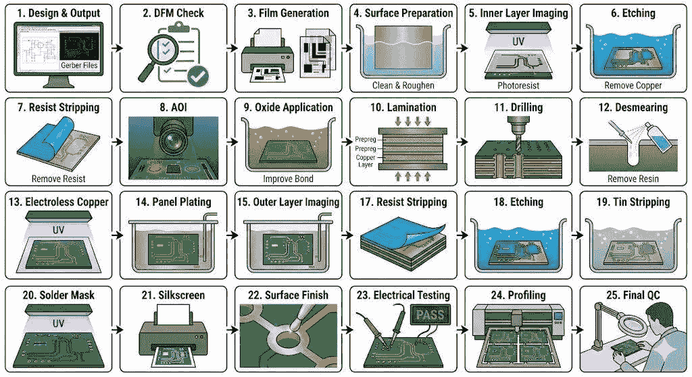

它不是在瞎画，它是真的把蚀刻、层压、钻孔等这25个步骤画对了！

反过来，让它画个无厘头的“如何烤面包”：

**提示词：** 我要个烤面包流程图，要多搞怪、多夸张、多复杂有多复杂

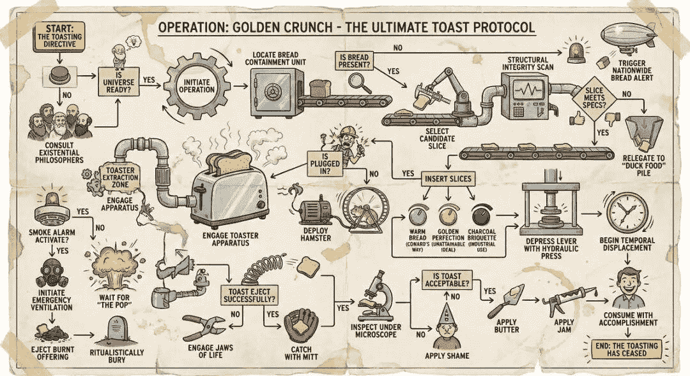

逻辑清晰，文字准确，甚至还自带幽默感！

**案例六：视觉版 AGI**

甚至在生物学领域，只说一句：“画一个T细胞激活的卡通图，展示信号级联。”

它自己上网查了资料，画出了完整的信号通路！

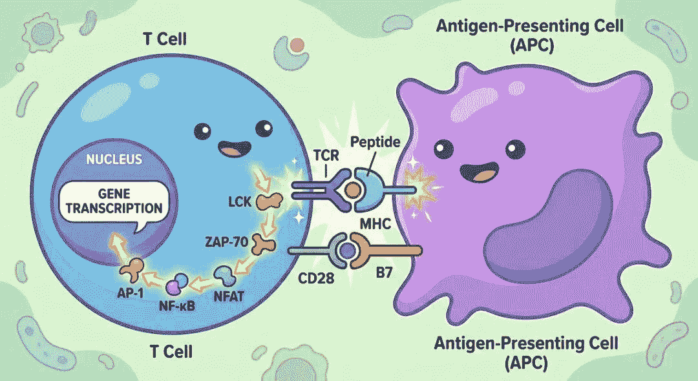

这就是为什么那位大神惊呼：**“这就叫视觉层面的 AGI！”**

**案例七：实时搜索能力**

还有这个 Datasette 开源项目的解释图。提示词只有9个单词：Infographic explaining how the Datasette open source project works，

它自己通过 Grounding with Google Search 搜到了Logo、UI界面，甚至连“Data Ingestion”这种专业术语都搞定了

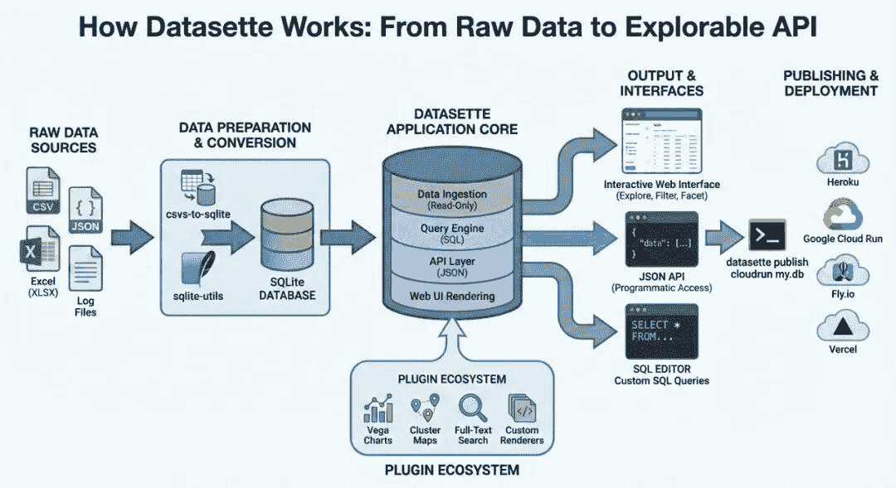

##### 生产力神器：最强“数据压缩机”

打工人们，这东西能救命。

**案例八：财报秒变图**

Nvidia Q3 几十页的财报 PDF，扔进去

结果： 一张精美的信息图

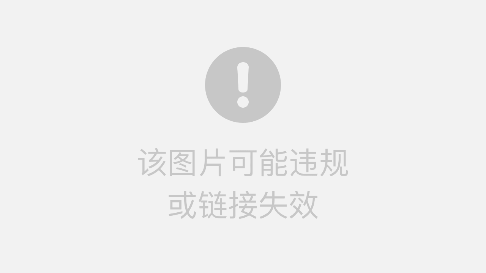

**案例九 & 十：万物皆可图解**

扔给它一张流体动力学的照片，问它“发生了什么物理现象？”它能给你出个图解说明

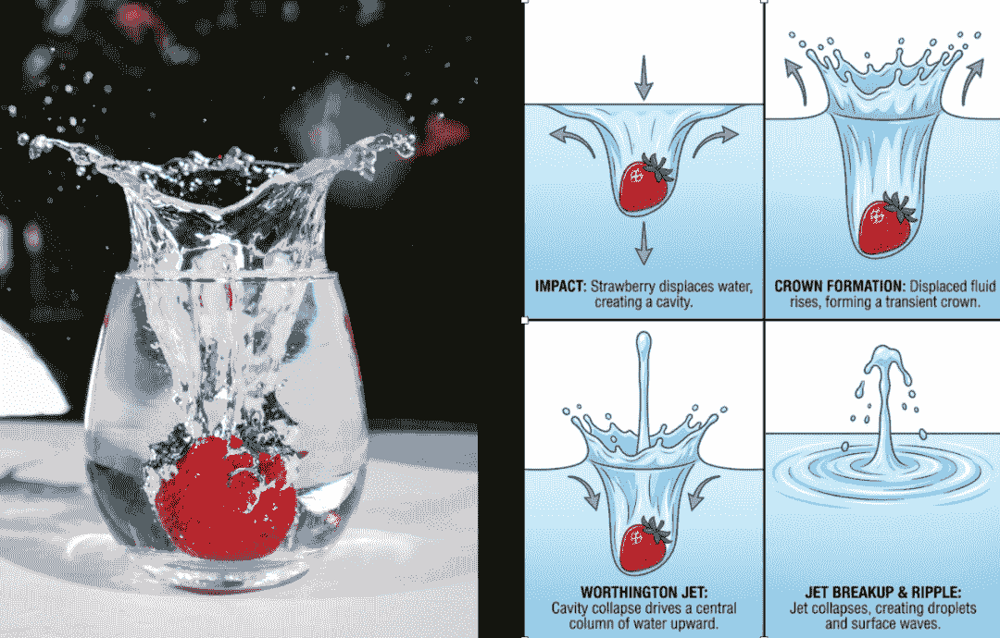

让它画个太阳系图表并给每个行星加个冷知识注释？

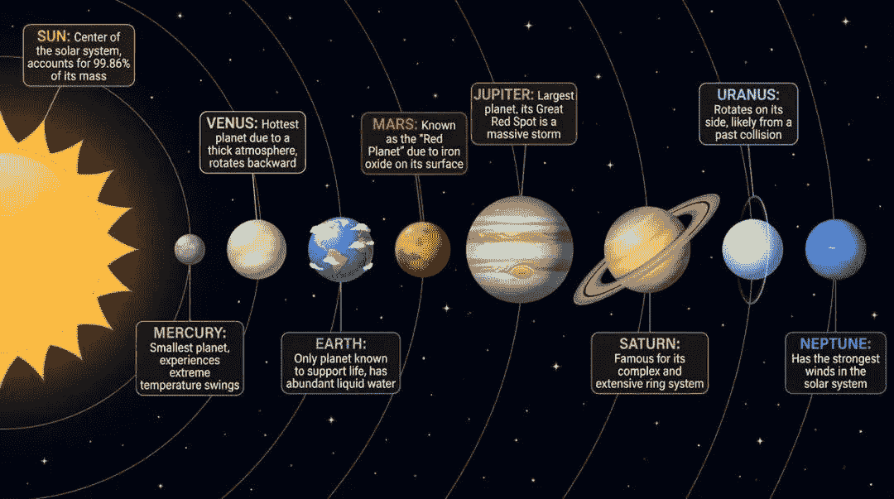

##### 创意与控制力：强迫症被治愈了

最后，聊聊对于创作者最重要的：**一致性** 和 **可控性**。

案例十一：14个角色的地狱级挑战

提示词要求生成 **14个** 毛茸茸的角色挤在沙发上看电视

提示词：中景镜头，14个毛茸茸的角色挤在一张破旧的米色布艺沙发上……整体氛围温暖、舒适且愉快

注意是14（最多支持14）个！

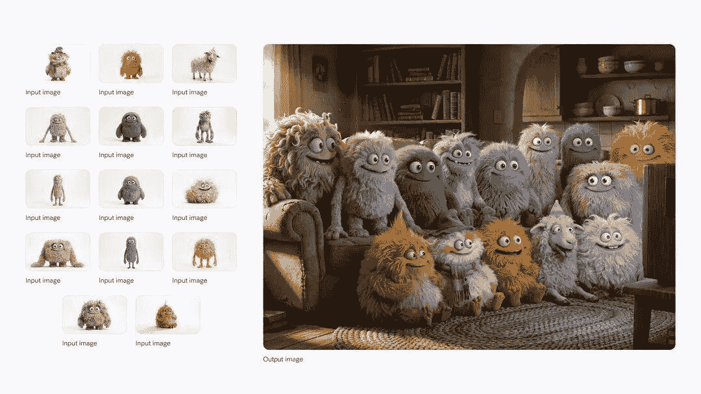

**案例十二：时间旅行与幽默感**

有个哥们让它生成一个人从出生到80岁的照片

**提示词：** "Generate the holiday photo of this person through the ages up to 80 years old"

最神的是，它给2020年的照片里的人戴上了口罩 😂。这细节，绝了！

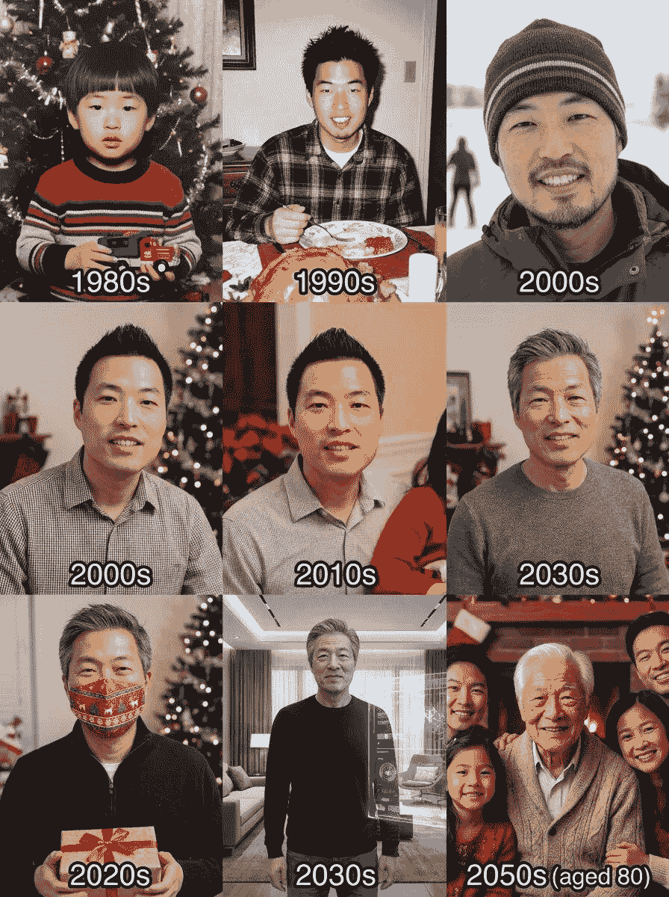

**案例十三：真实感**

如果不说，你可能以为这是照片。但这是 Gemini 3.0 Pro Image 生成的。角色一致性直接封神

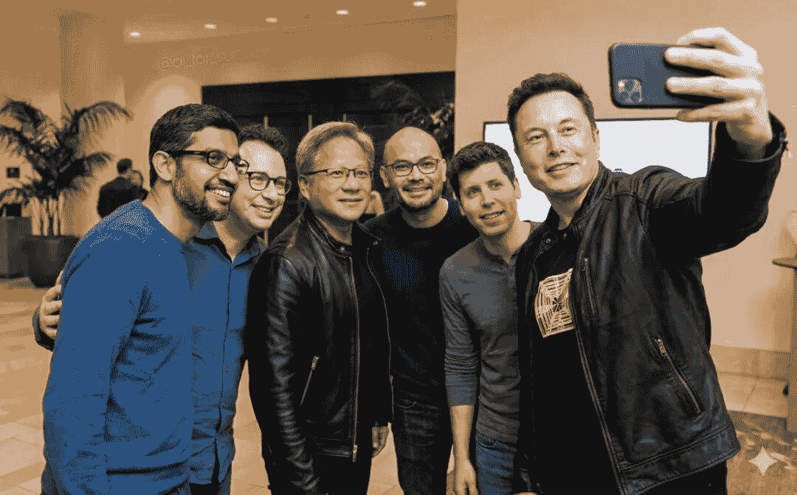