# 10 个 Nano Banana Pro 专业级生图技巧

> 来源：[https://qqs7y1hozd1.feishu.cn/docx/N7TKdJCKmoj2NMxDO6AcoqEwnJc](https://qqs7y1hozd1.feishu.cn/docx/N7TKdJCKmoj2NMxDO6AcoqEwnJc)

本篇我们再分享 10 个技巧，帮助你将生成的图片直接达到生产级别。

本篇主要内容整理自 Nano Banana Pro 官方转载的这篇文章：

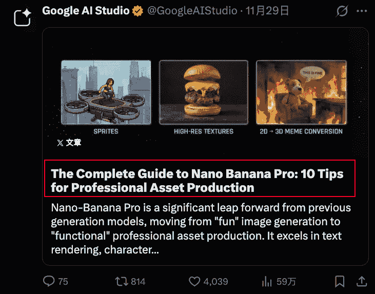

那就让我们开始吧！

10 年技术博主，最新资讯、前端知识、AI 干货，欢迎关注👸号：“冴羽” 或者搜索“yayujs”

### 1. 提示词的黄金法则

**N**ano Banana Pro 是一个“思考”模型，它不只是进行关键词匹配，还能理解意图、物理原理和构图。

这就意味着，如果要获得最佳的效果，不要使用传统的“标签堆砌”方式，而是要像一个创意总监一样思考和行动。

#### 1.1. 编辑，而不是重新生成

Nano Banana Pro 模型非常擅长对话式编辑，如果一个图像已经正确了 80%，那就不要再从头开始生成了，你只需要提出具体的变更就可以了。

✅：太棒了，但是把照明改成日落，并且把文字变成霓虹蓝。

#### 1.2. 使用自然语言和完整句子

与模型交流时，要像指导一位艺术家创作一样。使用正确的语法和描述性的形容词。

❌ 错误示范：“酷炫汽车，霓虹灯，城市，夜晚，8K”

✅ 正确示范：“一个电影风格的广角镜头，展现一辆未来主义跑车在雨夜的东京街道上飞驰。霓虹灯标志在湿漉漉的路面和跑车的金属车身上反射出光彩”

#### 1.3. 要具体和清晰的描述

模糊的提示词只会产生普通的结果，要定义主题、环境、光线和氛围。

❌ 描述主题：“一个女人”

✅ 描述主题：“一位穿着香奈儿复古套装的高雅老妇人”

✅ 描述质感： 描述纹理，比如“哑光表面”、“磨砂钢”、“柔软天鹅绒”、“皱巴巴的纸张”

#### 1.4. 提供上下文（为什么 / 为了谁）

Nano Banana Pro 是一个“思考”模型，给它上下文有助于它做出合理的艺术决策。

✅：“为一本巴西高端美食食谱创作一张三明治的图片”（模型将推断出专业的摆盘、浅景深和完美的照明）

### 2. 文本渲染、信息图和视觉合成

Nano Banana Pro 能够渲染清晰易读、风格化的文本，并将复杂的信息合成为视觉格式。

最佳实践：

+   **压缩**：要求模型将密集的文本或 PDF “压缩”成视觉辅助材料

+   **风格**：指定想要的风格，是“精致的社论风格”、“技术图表风格”还是“手绘白板风格”

+   **引用**：用括号明确指定你想要引用的文案

举个例子：

> 财报信息图（数据导入）：[输入谷歌最新财报的 PDF 文件] “生成一个简洁现代的信息图，概括这份财报的关键财务亮点。包含‘营收增长’和‘净利润’图表，并在风格化的引言框中突出显示 CEO 的关键语录。”

> 复古信息图：制作一张 20 世纪 50 年代风格的复古信息图，介绍美国餐馆的历史。信息图应包含“食物”、“点唱机”和“装饰”等独立部分。确保所有文字清晰易读，并符合当时的风格。

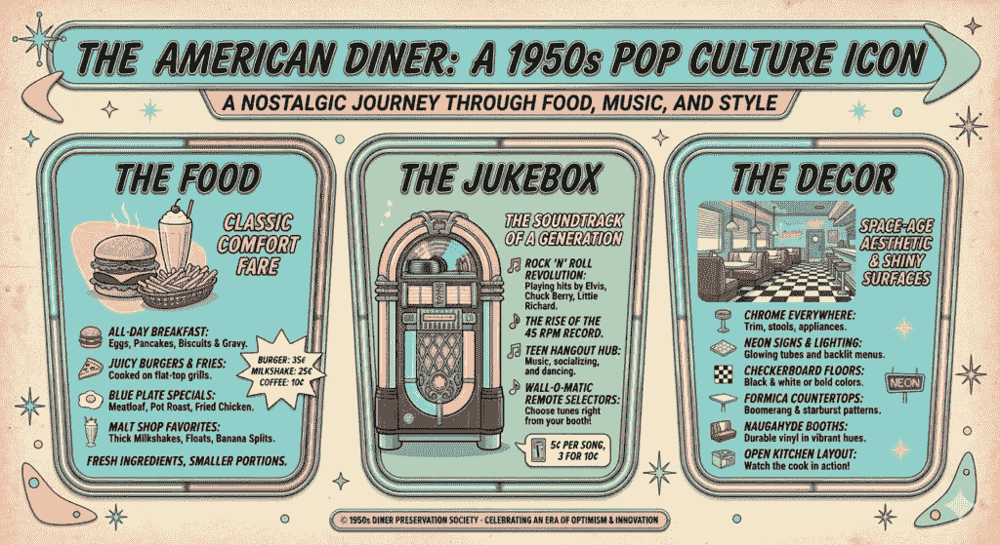

> 技术图纸：绘制一份正投影蓝图，以平面图、立面图和剖面图的形式描述该建筑物。使用专业建筑字体清晰标注“北立面”和“正门”。格式为 16:9。

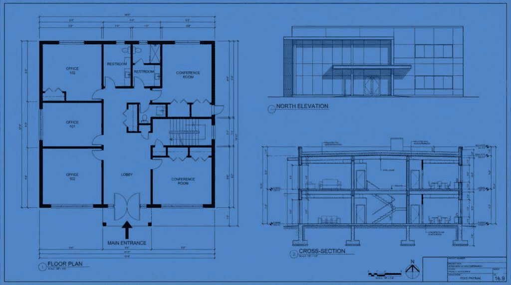

> 白板总结（教学用途）：请用手绘白板图的形式总结“Transformer 神经网络架构”的概念，使其适用于大学讲座。编码器和解码器模块请使用不同颜色的马克笔，并清晰标注“自注意力”和“前馈”。

### 3. 角色一致性与封面图

Nano Banana Pro 最多支持 14 张参考图像（其中 6 张为高保真图像）。这使得“身份锁定”成为可能——可以将特定人物或角色置于新的场景中，而不会造成面部变形。

最佳实践：

+   身份锁定：明确说明：“保持人物面部特征与图像 1 完全相同。”

+   表情/动作：描述情绪或姿势的变化，保持身份不变，

+   生成封面图：将主题与醒目的图形和文字一次性结合起来

举个例子：

> “封面图”（标识 + 文字 + 图形）：

> 使用图 1 中的人物设计一个封面图。

> 面部一致性：保持人物面部特征与图 1 完全相同，但改变其表情，使其看起来兴奋和惊讶。

> 动作：将人物置于画面左侧，手指指向画面右侧。

> 主题：在右侧放置一张美味的牛油果吐司的高清图片。

> 图形：添加一个醒目的黄色箭头，连接人物的手指和吐司。

> 文字：在中间叠加醒目的流行风格文字：“3 分钟搞定！”。使用粗白线和阴影。

> 背景：模糊明亮的厨房背景。高饱和度和高对比度。

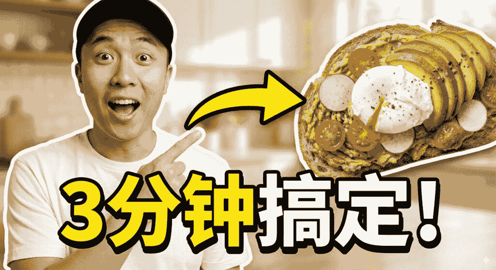

> “毛茸茸的小伙伴”场景（群体一致性）：

> [输入 3 张不同毛绒玩具的图片]

> “创作一个有趣的十页故事，讲述这三个毛茸茸的小伙伴去热带度假。故事跌宕起伏，充满情感高潮和低谷，最终以温馨的结局收尾。三个角色的服装和形象要保持一致，但他们的表情和角度在十张图片中要有所变化。确保每张图片中每个角色只出现一个。”

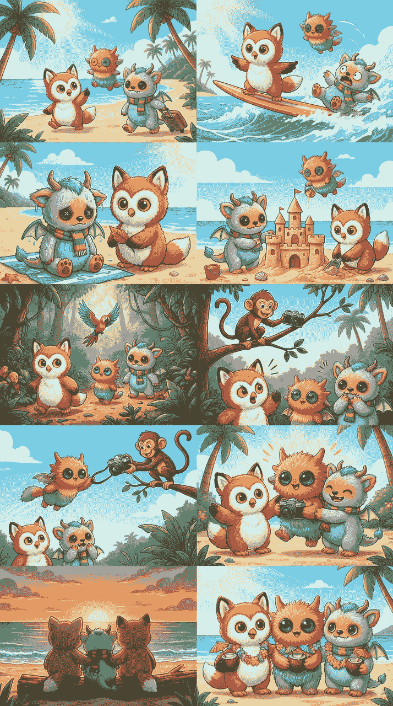

> 品牌素材创作：

> [输入 1 张产品图片]

> “创作 9 张精美时尚大片，风格如同获奖时尚大片。以此为品牌风格参考，但需在产品系列中加入细微差别和多样性，以展现专业设计感。请依次创作 9 张图片。”

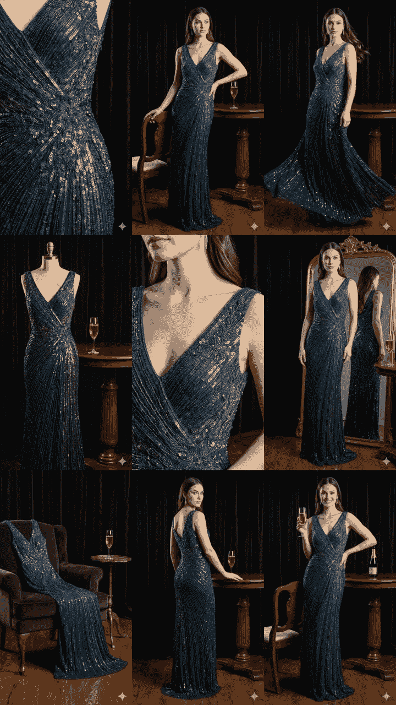

### 4. 使用谷歌搜索作为基础

Nano Banana Pro 使用 Google 搜索根据实时数据、时事或事实验证生成图像，从而减少对时事话题的幻觉。

最佳实践：

+   要求提供动态数据（天气、股票、新闻）的可视化图表。

+   模型会对搜索结果“思考”（推理）后生成图像。

举个例子：

> 活动可视化：

> “根据当前的旅游趋势，生成一张信息图，展示 2025 年游览美国国家公园的最佳时间。”

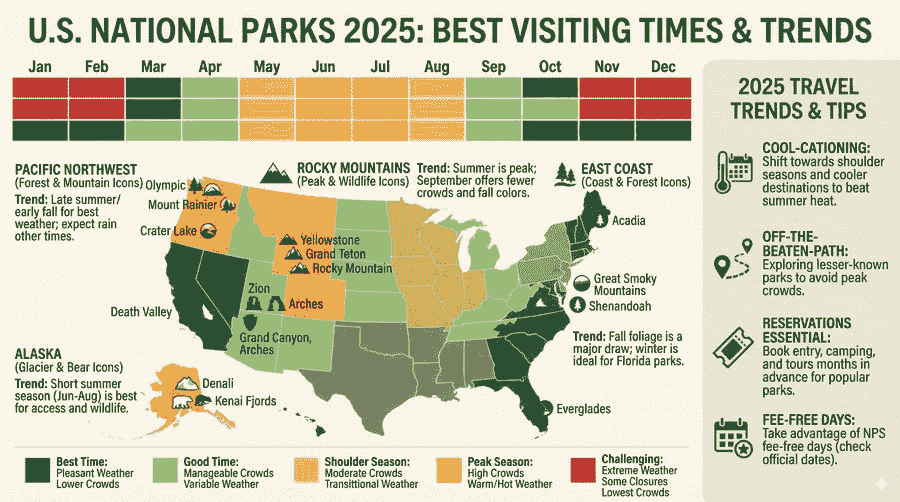

### 5. 高级编辑、修复和上色

模型擅长通过对话式提示进行复杂的编辑，包括“图像修复”（移除/添加对象）、“修复”（修复旧照片）、“上色”（漫画/黑白照片）和“风格互换”。

最佳实践：

+   语义指令：无需手动添加遮罩，只需自然地告诉模型要更改什么即可

+   物理理解：你可以进行复杂的更改，例如“将这个杯子装满液体”，以测试物理生成

举个例子：

> 物体移除与补全：

> “从这张照片的背景中移除游客，并用与周围环境相匹配的合理纹理（鹅卵石和店面）填充空间。”

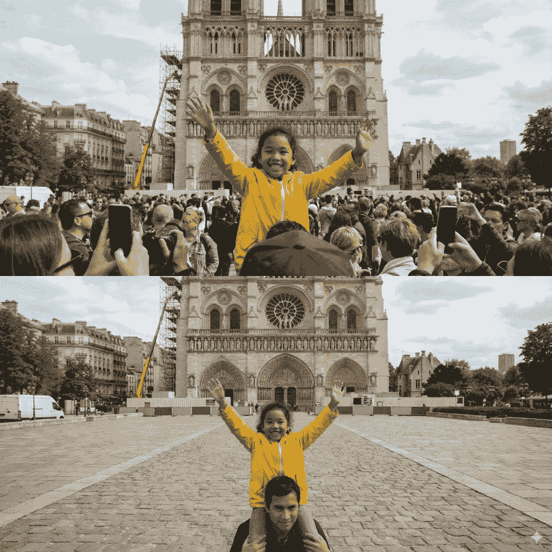

> 漫画/漫画上色：

> [输入黑白漫画分镜]

> “为这幅漫画分镜上色。使用鲜艳的动漫风格配色方案。确保能量光束的照明效果呈现霓虹蓝色，并且角色的服装颜色与其官方配色一致。”

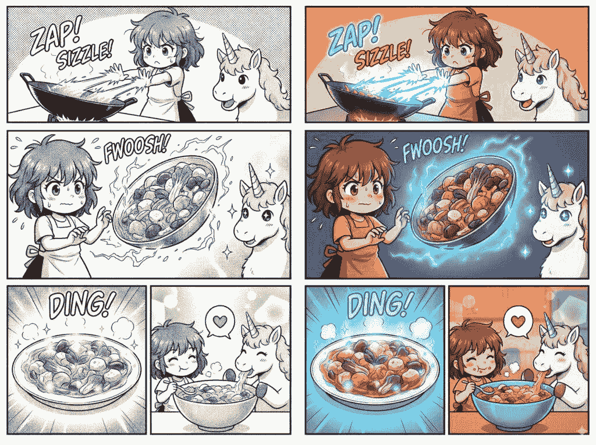

> 本地化（文本翻译+文化适应）：

> [输入一张伦敦公交车站广告的图片]

> “将此概念本地化到东京场景，包括将标语翻译成日语。将背景更改为夜晚熙熙攘攘的涩谷街道。”

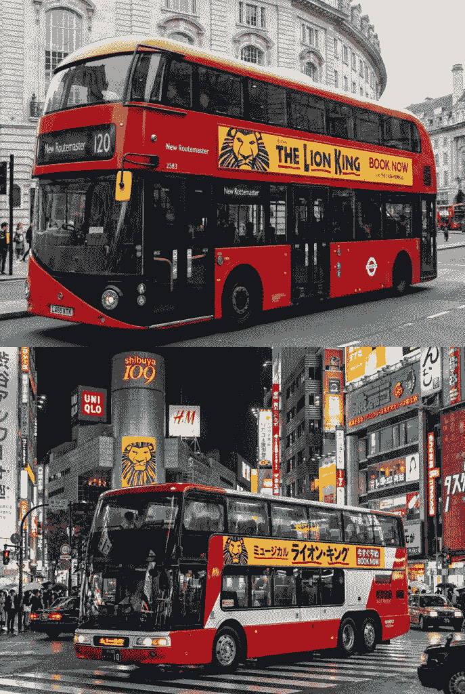

> 照明/季节控制：

> [输入一张夏季房屋的图片]

> “将此场景转换为冬季场景。保持房屋建筑结构完全相同，但在屋顶和院子里添加积雪，并将照明更改为寒冷阴沉的午后。

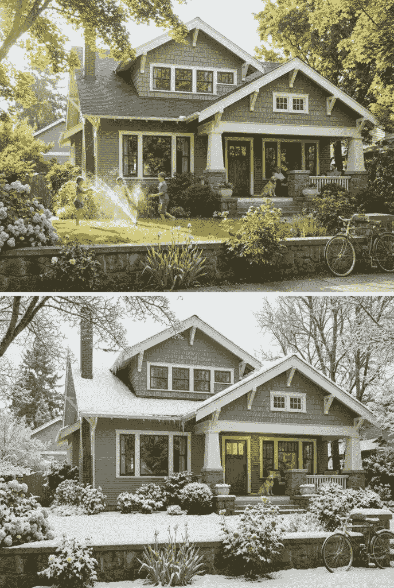

### 6. 维度转换（2D ↔ 3D）

Nano Banana Pro 一项强大的新功能是将二维示意图转换为三维可视化图像，反之亦然。

这对于室内设计师、建筑师和表情包创作者来说非常友好。

举个例子：

> 2D 平面图转 3D 室内设计效果图：

> 根据上传的 2D 平面图，生成一张专业的室内设计效果图。

> 布局：采用拼贴画形式，顶部为一张主图（客厅广角视图），下方为三张小图（主卧、家庭办公室和 3D 俯视图）。

> 风格：所有图片均采用现代简约风格，搭配温暖的橡木地板和米白色墙面。

> 质量：照片级渲染，柔和的自然光。

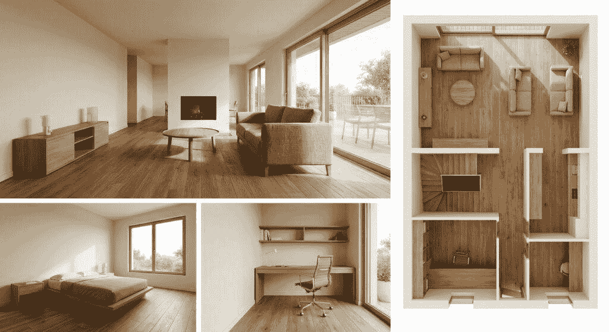

> 2D 转 3D 表情包转换：

> “将‘一切都好’狗狗表情包转换成逼真的 3D 渲染图。保持构图不变，但让狗狗看起来像毛绒玩具，火焰看起来像真实的火焰。”

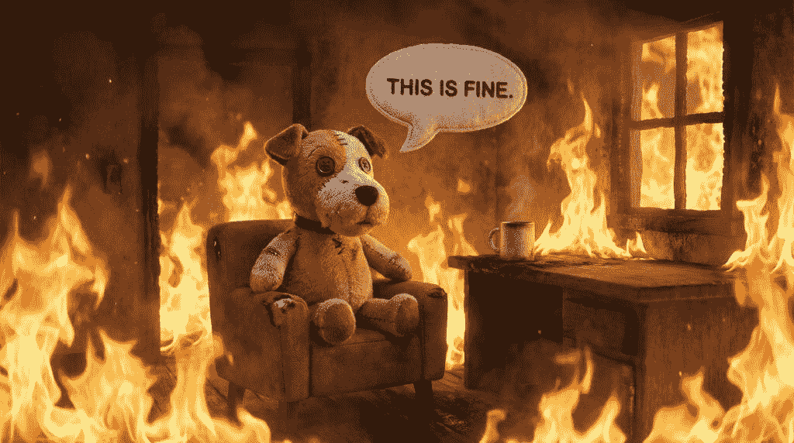

### 7. 高分辨率和纹理

Nano Banana Pro 支持原生 1K 至 4K 图像生成。这对于处理精细纹理或大尺寸打印作品尤为有用。

最佳实践：

+   如果 API / 接口允许，明确请求高分辨率（2K 或 4K）。

+   描述高保真细节（瑕疵、表面纹理）。

举个例子：

> 4K 纹理生成：

> “利用原生高保真输出，打造令人叹为观止、充满氛围的苔藓森林地面环境。掌控复杂的光照效果和细腻的纹理，确保每一根苔藓和每一束光线都以像素级分辨率渲染，完美适用于 4K 壁纸。”

> 复杂逻辑（思考模式）：

> “创作一幅超逼真的美食芝士汉堡信息图，将其拆解，展现烤过的奶油蛋卷面包的质地、肉饼煎至焦香的外皮以及闪闪发光的融化芝士。为每一层标注其风味特征。”

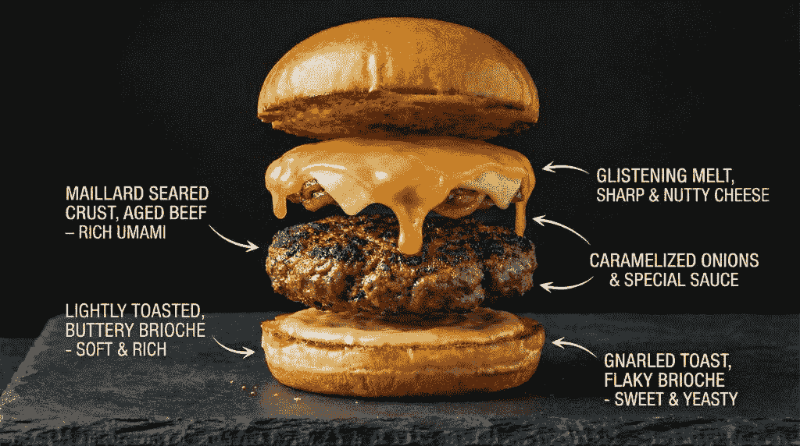

### 8. 思考与推理

Nano Banana Pro 默认采用“思考”模式，它会生成一些中间的思考图像（不计费），以便在渲染最终输出之前优化构图。这有助于进行数据分析和解决视觉问题。

举个例子：

> 解方程：

> “在白板上用 C 语言求解方程 log_{x(2+1}(x)4-1)=2。请清晰地写出解题步骤。”

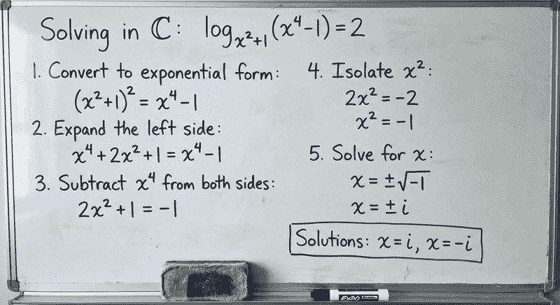

> 视觉推理：

> “分析这张房间图片，生成一张‘之前’的图片，展示房间在施工期间可能的样子，包括框架和未完成的石膏板。”

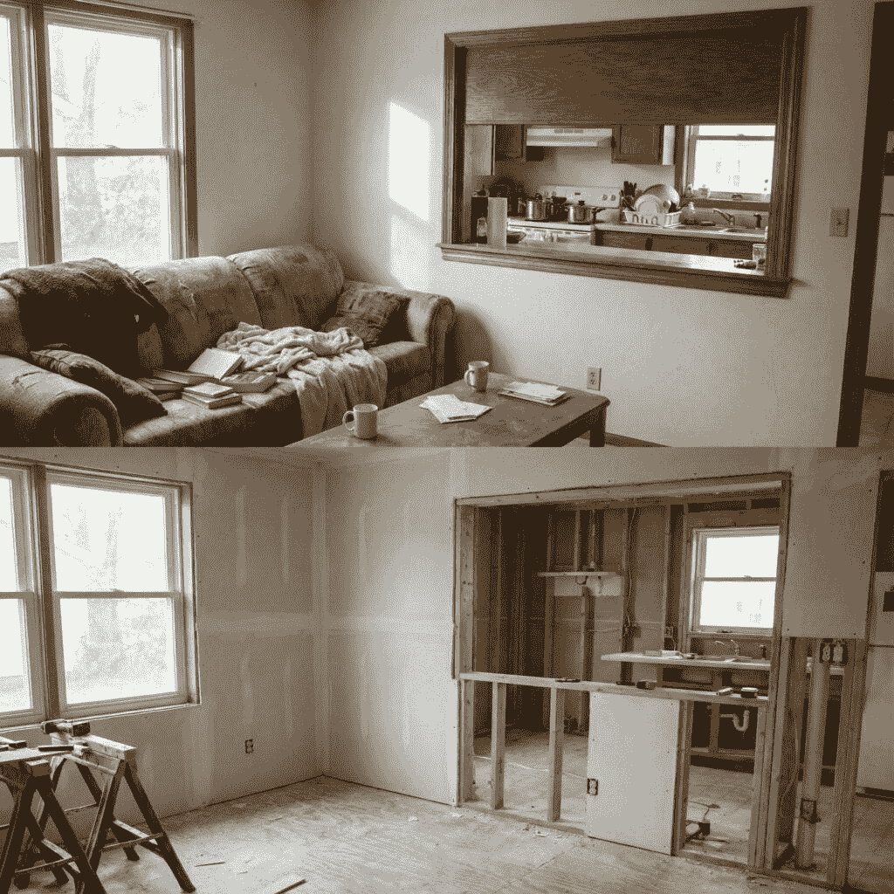

### 9. 一次性故事板和概念艺术

无需网格即可生成连续的艺术图或故事板，从而确保在一次操作中实现连贯的叙事流程。

举个例子：

> 请创作一个引人入胜的九部分故事，包含九张图片，故事中需出现一位女性和一位男性，他们正在拍摄一部屡获殊荣的豪华行李箱广告。故事应有跌宕起伏的情感，最后以一位女性手持品牌标识的优雅照片结尾。男女主角的身份和着装必须保持一致，但可以从不同的角度和距离拍摄。请逐一生成图片。请确保每张图片均为 16:9 横向格式。

### 10. 结构控制与布局指导

添加的输入图像不仅仅用于角色参考或待编辑对象，你也可以使用它控制输出图像的构图和布局。

这对于需要将草图、线框图或特定网格布局转化为精美素材的设计师来说，非常有用。

最佳实践：

+   草稿和草图：上传手绘草图，准确定义文本和对象的位置。

+   线框图：使用现有布局或线框图的屏幕截图来生成高保真 UI 模型。

+   网格：使用网格图像强制模型为基于图块的游戏或 LED 显示屏生成资源。

举个例子：

> 从草图到最终广告：

> “根据此草图为[产品]创作一个广告。”

> 根据线框图创建 UI 模型：

> “请按照以下准则为[产品]创建模型。”

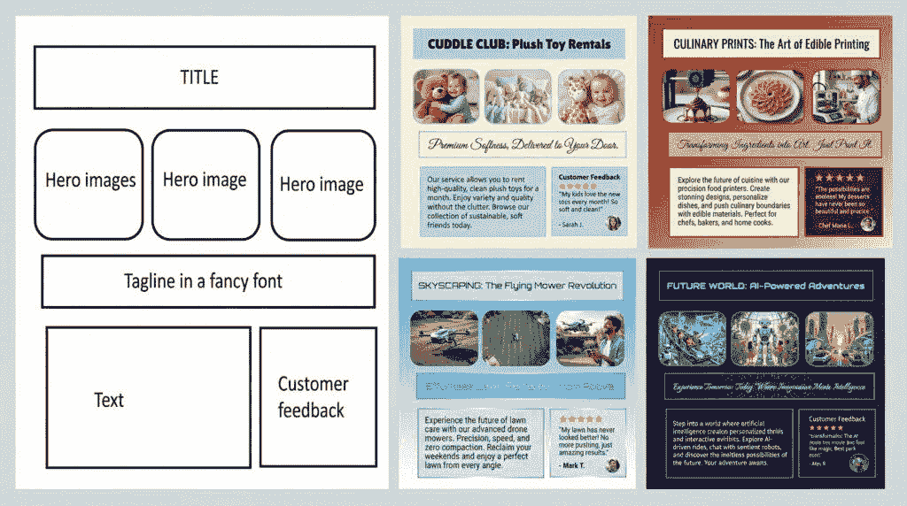

> 像素艺术与 LED 显示屏：

> “生成一个独角兽的像素艺术精灵，使其完美契合此 64×64 网格图像。使用高对比度颜色。”

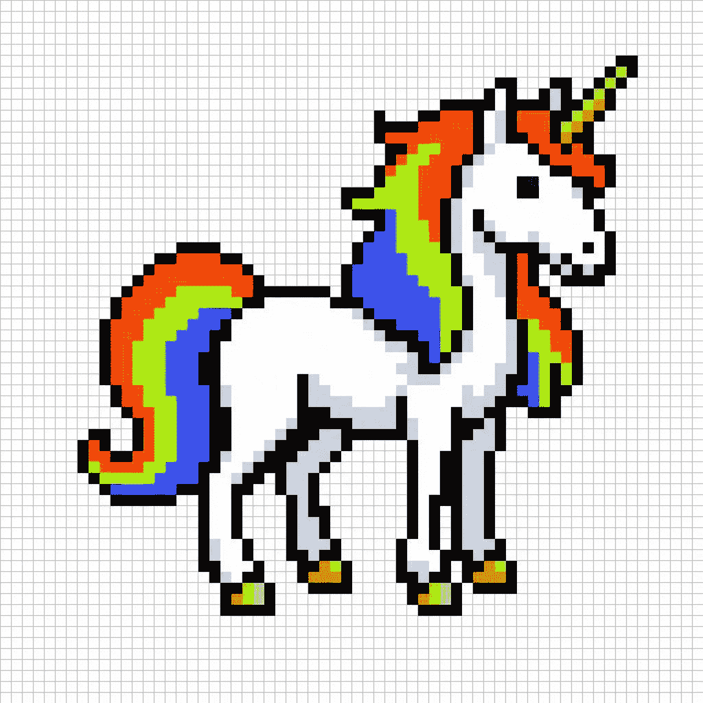

> 精灵图：

> “一位女性在无人机上做后空翻的精灵图，3×3 网格，序列式，逐帧动画，正方形宽高比。请严格按照附图的结构进行绘制。”（提示：你可以提取每个单元格并制作成 GIF 动画）

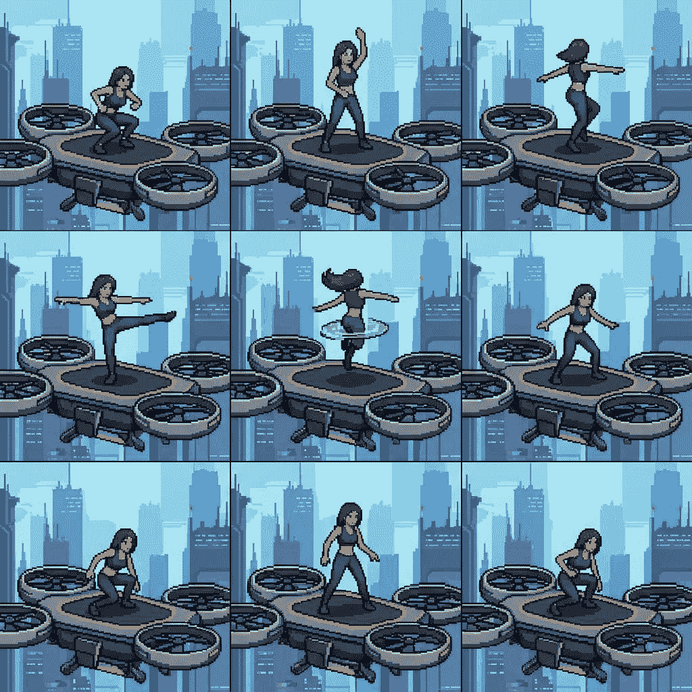