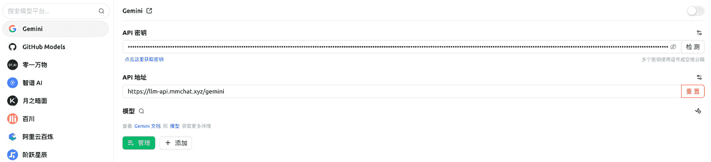
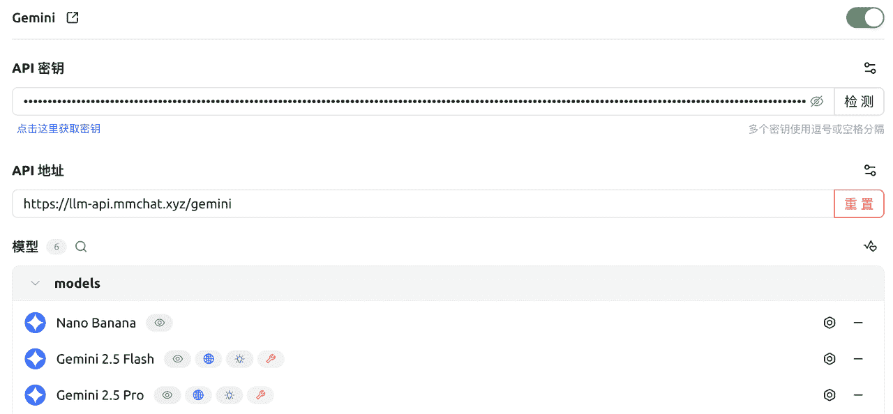
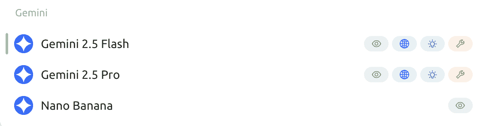

# 国内开发者怎么开通Gemini-3 Pro API，附详细攻略

> 来源：[https://qqs7y1hozd1.feishu.cn/docx/P5HddV28doqHfjxUFrTc07nCnMe](https://qqs7y1hozd1.feishu.cn/docx/P5HddV28doqHfjxUFrTc07nCnMe)

谷歌发布Gemini3系列和NanoBananaPro模型，在多模态理解、推理和Agent能力方面取得突破。Gemini3Pro在ScreenUnderStanding、长期任务测试和AGI推理表现优异；NanoBananaPro解决了图像生成中的文本渲染问题。MetaChat已第一时间接入这些模型，提供Web对话界面和API中转服务，国内开发者可通过注册账号、充值API密钥后使用。API支持标准

近日，Gemini 3发布，模型能力全方位突破。谷歌近期连续发布了Gemini 3 系列模型、Nano Banana Pro 图像模型，标志着多模态理解、推理与 Agent 能力的全面跃迁。1）Gemini 3 Pro多模态理解能力尤其是Screen UnderStanding能力登顶；推理与长期规划能力显著提升，在 Vending-Bench 2 长期任务测试中表现最佳；Deep Think 模式突破 AGI 相关推理：ARC-AGI评测高达 45.1%；Agentic 能力：编程和工具使用能力增强，更可靠执行多步骤任务。2）Nano Banana Pro：具备物理逻辑的图像生成，完美的解决图像生成中文本渲染错误痛点，与现实世界知识结合，支持专业视觉内容制作。

作为业界一流的AI模型聚合服务平台，MetaChat在第一时间完成了Gemini 3 Pro和Nano Banana Pro模型的接入，不光提供了Web对话界面，还同步提供了API中转服务，方便国内开发者使用。

开通方式很简单：

第一步，注册MetaChat账号，访问官网：https://metachat.fun

第二步，点击左下方头像区域，在弹出菜单中看到API，点击进入。

第三步，充值API，生成api 密钥，按照API接入文档 ( https://metachat.apifox.cn/ ) 说明进行配置即可使用Gemini 3 Pro和Nano Banana Pro了

Gemini

## 接入说明

## Gemini 官方接口

[MetaChat Gemi](https://link.csdn.net/?target=https%3A%2F%2Fai.google.dev%2Fapi%3Flang%3Dnode%26login%3Dfrom_csdn)ni API 支持标准的 Gemini 官方接口定义，API 服务地址如下：

> 主用: https://llm-api.mmchat.xyz/gemini

> 备用: https://llm-api.mmchat.dev/gemini

开发者可直接使用 Google Gen AI SDK (Python & Node.js) 接入，只需要将官方 API 服务的基础 URL 和官方 API Key 更换为 MetaChat Gemini API 服务地址和 API Key。

[AP](https://link.csdn.net/?target=https%3A%2F%2Fmetachat.apifox.cn%2F%25E6%25A6%2582%25E8%25BF%25B0-6864629m0%3Flogin%3Dfrom_csdn)I Key 获取方法请参考 概述 文档说明。

当采用 Gemini 官方接口接入时，MetaChat Gemini API 支持如下模型版本：

gemini-3-pro-preview

gemini-2.5-pro

gemini-2.5-pro-preview-06-05

gemini-2.5-flash

gemini-2.5-flash-preview-09-2025

gemini-2.5-flash-preview-05-20

gemini-3-pro-image-preview (Nano Banana Pro)

gemini-2.5-flash-image (Nano Banana)

imagen-4.0-generate-001

imagen-4.0-fast-generate-001

imagen-4.0-ultra-generate-001

imagen-4.0-generate-preview-06-06

imagen-4.0-ultra-generate-preview-06-06

imagen-3.0-generate-002

**调用样例**

cURL:

curl **"h**ttps://llm-api.m**mcha**t.xyz/gem**ini/v1beta**/mod**els/gem**ini**-2.5-f**la**sh:generateContent?**key=$METACHAT_API_KEY" \

-H 'Content-Type: application/json' \

-X POST \

-d '{"contents": [{"parts":[{"text": "Write a story about a magic backpack."}]

}]

}' 2> /dev/null

Python SDK：

**impo**rt os

from google impo**rt gena**i**

client =** genai.Client(api_key="s**k-liv**e-e**yJhbGciO**i**JIUz......",

**http_options={"base_url": "https://llm-api.mmchat.xyz/gemini"

}

)

response = client.models.generate_content(model="gemini-2.5-flash", contents="Explain how AI works in a few words"

)

print(response.text)

Node.js SDK:

**impo**r**t { GoogleGenAI**** } fr**om "@g**oog**le/genai";

const ai = new GoogleGenAI({ apiKey: "sk-**live-eyJ**hbGciOiJI**Uz...**...",httpOptions: {baseUrl: "https://llm-ap**i.mmchat.xyz/gemi**ni",

},

});

async function main() {const response = await ai.models.generateContent({model: "gemini-2.5-flash",contents: "Explain how AI works in a few words",

});

console.log(response.text);

}

main();

安全提示：上述样例为了简洁起见，将 API Key 以字符串形式硬编码在代码中，实际生产环境建议采用了环境变量（METACHAT_API_KEY）保存 API Key，并分别在 Python 和 Node.js 代码中引用。

## 配置方法

MetaChat Gemini API 采用标准 Google Gemini 官方接口规范，并支持 OpenAI 兼容接口。除了通过编程方式调用之外，同样支持在主流第三方 AI 聊天客户端应用、AI 编程助手工具中直接使用，例如 Cherry Studio、LobeChat、OpenCat、ChatWise、Cline 等。

用户只需要将 MetaChat Gemini API 服务地址和 API Key 填入各应用和工具的模型配置即可，详见下文示例。

## Cherry Studio

---

Cherry Studio 官网下载地址：https://www.cherry-ai.com/download ，支持 Windows、macOS 全平台。

打开 Cherry Studio，点击左下角设置按钮，进入「设置」界面，点击设置项第一个「模型服务」，进入模型设置界面。

在界面中间的模型平台和供应商列表中找到 Gemini，点击后右侧显示 Gemini 模型设置：

填写 API 密钥和 API 地址：

API 密钥：填入 MetaChat API Key

API 地址：填入 https://llm-api.mmchat.xyz/gemini

接下来点击「模型」-「管理」，在弹出的「Gemini 模型」选择框中选择需要的模型，点击模型右边的 +，将其添加进来。

目前 MetaChat Gemini API 支持的模型有：

gemini-3-pro-preview

gemini-2.5-pro

gemini-2.5-flash

gemini-3-pro-image-preview (Nano Banana Pro)

gemini-2.5-flash-image-preview (Nano Banana)

模型添加成功后，关闭模型选择框，返回 Gemini 模型设置界面，可以看到已添加的模型列表，配置完成后，别忘了点击右上角的开关按钮将 Gemini 模型启用。

返回聊天助手页面，点击「新建话题」，在聊天界面顶部的模型按钮可以切换不同的模型使用：

> Cherry Studio 暂不支持标准 Gemini Images API，因此无法使用 Imagen 4 / Imagen 3 模型生成图像。