# 谷歌Nano Banana Pro100+提示词

> 来源：[https://qqs7y1hozd1.feishu.cn/docx/BFXJdaqbKo6kP0xbgdgcoOyUnwf](https://qqs7y1hozd1.feishu.cn/docx/BFXJdaqbKo6kP0xbgdgcoOyUnwf)

继Gemini 3 Pro之后，谷歌的生图模型终于来啦！

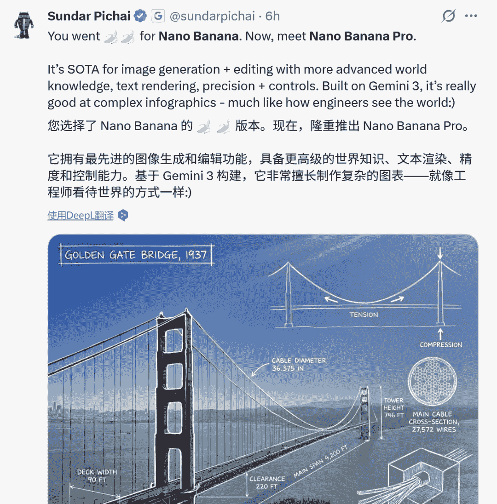

据介绍，Nano Banana Pro可以利用Gemini 3 先进的推理能力和世界知识，不仅是生成图像，更能理解复杂的指令和细微差别。

而且还能连接 Google 搜索知识库，生成包含实时信息（如天气、体育赛事、食谱）的视觉内容。

不仅如此，**还支持最多 14张输入图片 的混合，并能在复杂构图中**保持最多 5个人物 的面部和特征一致性。

最重要的是，Nano Banana Pro终于支持中文啦**！ 之前诟病的清晰度问题，这次**也解决了，可支持2K 和 4K 分辨率。

话不多说，直接进入我们的实测环节。

> 提示词：请给图片上这道菜所有食材的照片，并使用中文标明名称和数量。

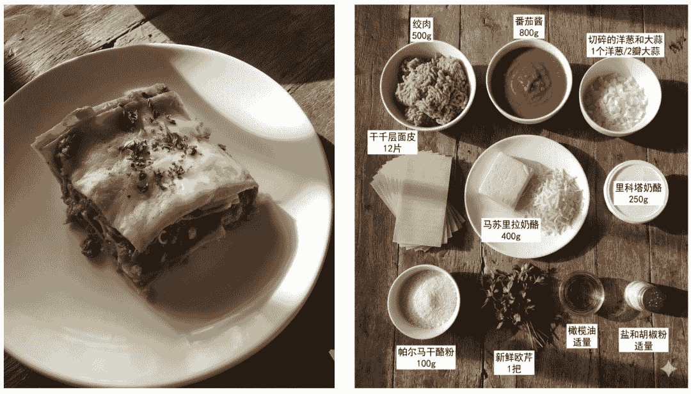

不过在后续的压力测试中我们发现，当画面有大量密集的中文小字时，文字边缘偶尔会出现轻微的粘连或模糊现象。

> 提示词：为这件衣服设计一个淘宝的购买网页

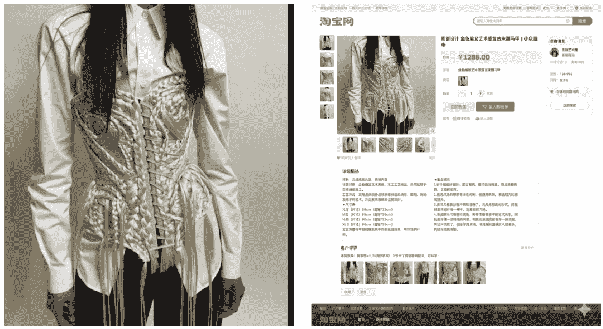

> 提示词：这是一张 “寻味山野” 主题的美食宣传海报，风格为自然写实与复古设计结合，以米黄、棕褐、翠绿为主色调，突出山野野生菌的原生态质感。 画面左侧，有大号的绿色书法字体 “寻味山野”，括号标注的 “（新鲜）（采摘）（野生菌）” 黑色文字。左下角有白色文字 “牛肝菌 Boletus”，其下是灰色英文 “Home-cooked dishes from the mountains and fields A natural gift on the tip of the tongue”。 画面右侧，是多株牛肝菌的写实图像：有大型的牛肝菌（棕褐色菌盖，菌柄纹理清晰，底部带泥土与苔藓）、中型牛肝菌（棕褐与米白相间的菌盖，菌柄洁白）、小型牛肝菌（棕褐色菌盖，菌柄较短），生长在绿色苔藓与褐色泥土上，质感逼真。菌菇周围环绕着绿色英文 “of the mountains and forests a concentrated present”，文字呈弧形排列。 整体元素将野生牛肝菌的写实图像与山野美食主题的文字结合，通过复古排版与自然色彩，传递出山野私房菜的新鲜、野生、原生态特点，风格兼具食欲感与自然氛围感。

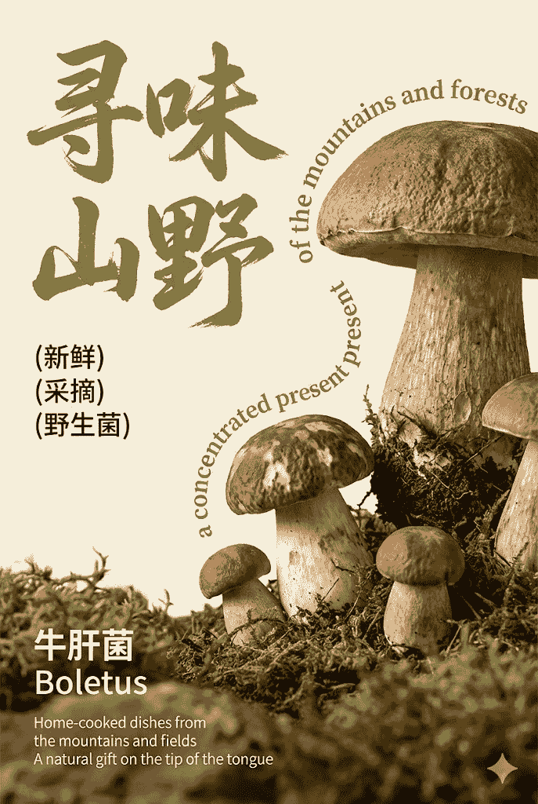

这效果已经达到了商业级海报，**画面主次分明，牛肝菌的苔藓与泥土**质感极其逼真，而且和复古的色调融合得很好，最重要的是排版很精美。

> 提示词：设计一个蓝莓流心可颂产品异型腰封设计，背景纯黑。腰封主体为蓝莓色色异形结构，顶部和底部呈长条形，中间区域异性突出展示产品轮廓。 核心展示两个蓝莓酱流心可颂，一个完整，一个切开，外皮酥脆金黄，内馅蓝莓酱流心浓郁蓝莓酱且流淌出，表面撒有糖粉，带有光泽感。 文字部分：顶部和底部用浅绿色字体标注“Bule berry Croissant”；中间显眼位置用白色和浅绿色组合字体呈现“蓝莓流心可颂”，左侧竖排标注“Bule berry Croissant”；下方用白色字体标注“酥脆 流心 蓝莓”，并搭配蓝莓装饰。 整体风格为美食产品包装设计，突出产品的美味诱人、质感精致，色彩以蓝莓蓝色、浅蓝色、金黄、黑色为主，营造高端且有食欲的视觉效果。

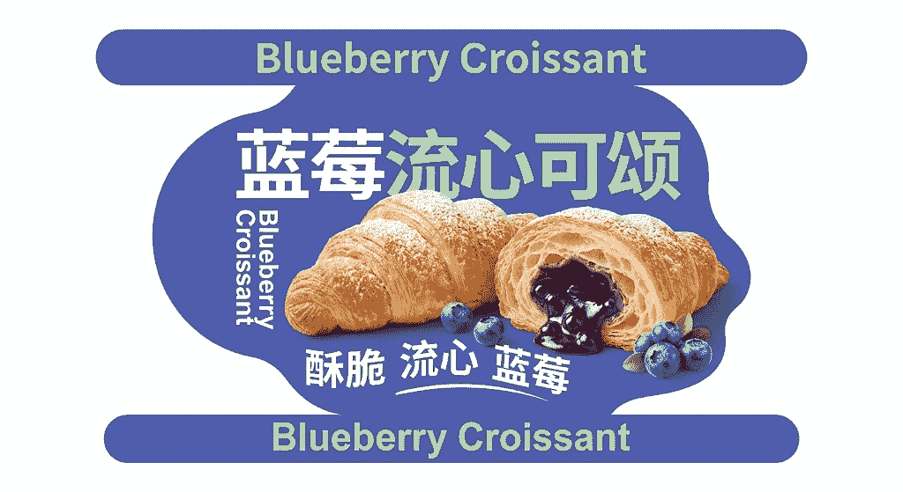

**再制作一个蓝莓流心可颂的宣传海报，金黄酥脆的可颂表皮**层次分明，蓝莓流心酱那种呼之欲出的浓郁黏稠感和光泽度，都被渲染得淋漓尽致。

隔着屏幕仿佛都能闻到香甜气息，整体质感非常抗打。

> 提示词：创建图像 中国传统制豆腐技艺，凹版印刷线稿，0.8mm粗线勾勒外轮廓，0.2mm细线刻画表面皮肤，纯白色背景，宋代院画，画面分别体现6道流程。 不分格，表现制作豆腐的工艺流程，搭配中文中字介绍

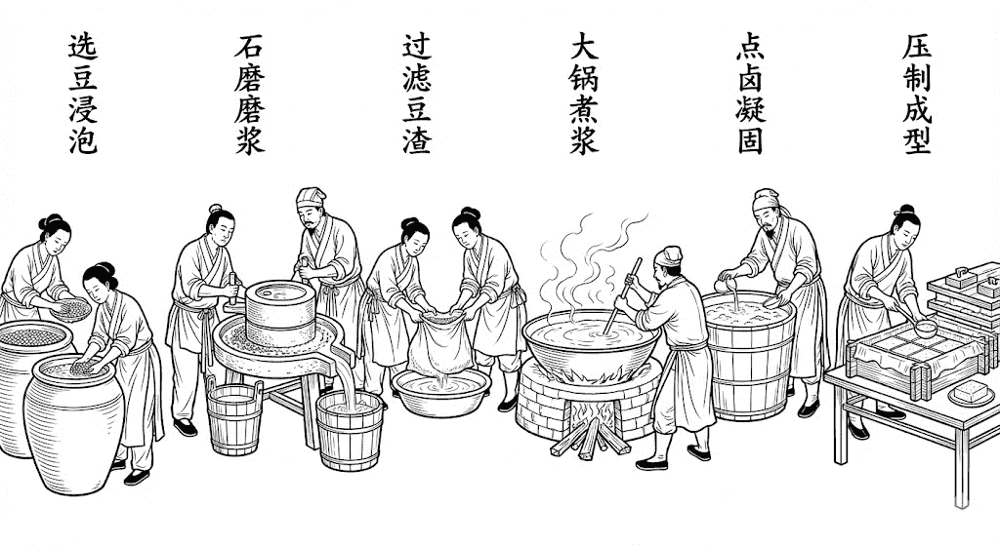

Nano Banana Pro依托Gemini 3 先进的推理能力，选豆-研磨-煮浆-点卤”等六道工序呈现的画面都及其还原。

话可以让它教我们如何制作Coffee。

> 提示词：制作一张信息图，展示如何制作coffee，使用中文说明

> 提示词：以蓝图的风格制作参考图中产品的设计草图。并包括尺寸和解释性文本注释。应使用线条和测量值来指示各个部位的尺寸，给草图以技术和详细的感觉。除了主要设计外，还包括显示不同角度的零散缩略图，立体景深

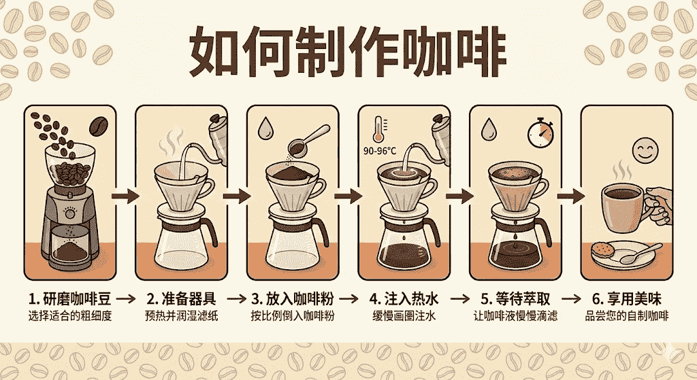

设计草图也能轻松拿捏，无论是尺寸标注线。还是不同角度的零件缩略图以及技术注释文本框。效果都非常不错。

> 提示词：底色淡黄，线描人物，迪丽热巴，特写，全身，手稿，铅笔线条，涂鸦，漫画，凌乱，插画，9：16

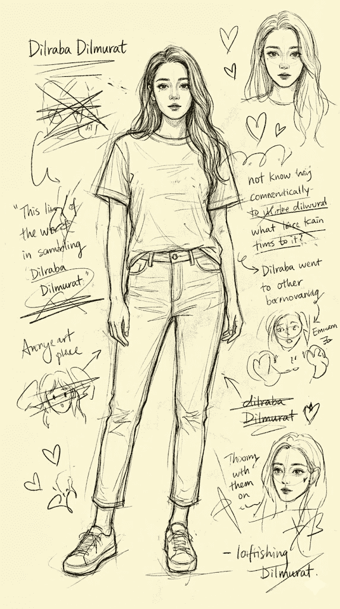

画线稿也很漂亮，不过值得注意的是，这张图片没有任何垫图，Nano Banana Pro会自动在网上搜索迪丽热巴的照片，然后再生成。

> 提示词：将漫画上色

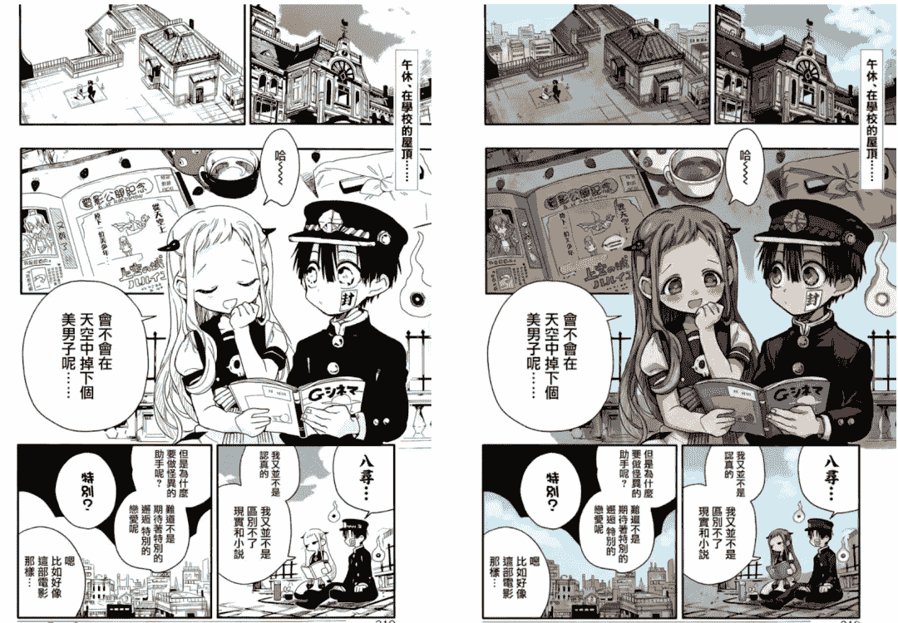

漫画上色依旧是强项，从效果来看，以后完全不用人为进行上色了，只需交给AI。

**不仅完美保留了原线稿的所有**细节和纹理，一致性非常好，而且还极其智能地进行了光影塑造。

> 提示词：英雄联盟的游戏界面截图，中路亚索正在用 Q 技能清理兵线。

**从**复杂的UI界面布局、小地图细节，到中路亚索释放Q技能时的动态特效和兵线位置，每一个元素都精确符合游戏逻辑。

即便是LOL 老玩家，乍看之下也难以分辨这玩意是AI生成的。

> 提示词：帮我搜索今天广州的天气，给我生成一张好看的天气卡片，玻璃质感

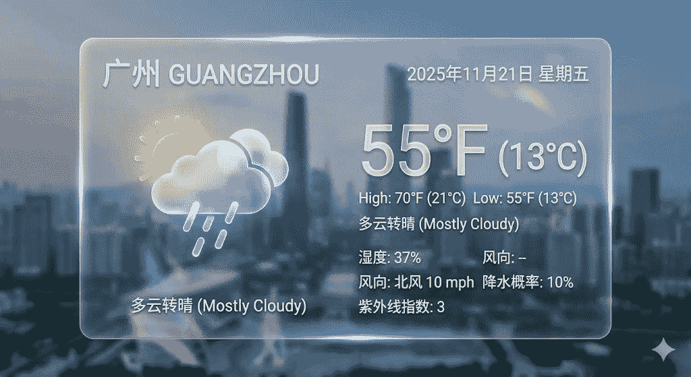

以后或许真的没有天气APP的事情了，查天气只需和AI说一下，然后就能生成可视化的页面，重要的还是实时的。

> 提示词：将这些图像合成一张16:9格式的适当电影图像

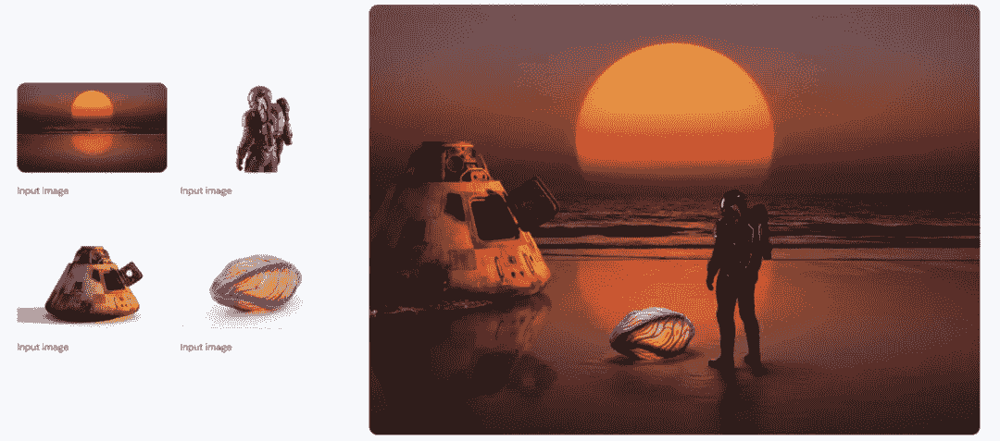

据介绍，Nano Banana Pro最多支持14张输入图片的混合，每张图片原有的特点都保存下来了，关键融合的效果十分真实。

> 提示词：为这个场景制作分镜

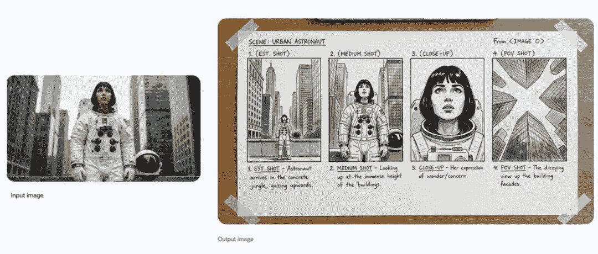

输出图像采用了极具真实感的手绘线稿风格，并在带有纹理的纸张上用胶带固定，配合手写的镜头描述和动作注释，专业度和质感拉满。

> 提示词：生成一个男生从1岁到80岁的照片

是不是有种模拟人生的既视感，上传一张图片，它就能生成你年轻到80岁的照片。

除了发布Nano Banana Pro外，谷歌还发布了一个新功能，用户可以直接验证某张图像是否由 Google AI 生成或编辑。

目前Nano Banana Pro已经全面上线，不过无法在ai studio中免费使用。

只能在Gemini APP 免费使用，不过分辨率只有 1K。

大家可以在 Lovart、Listenhub、Flowith、Youware、Trickle 等三方平台上使用。