# NanoBanana2 国内直连攻略

> 来源：[https://qqs7y1hozd1.feishu.cn/docx/CKHJdsHCcoYPvyx0ChAcWSYLnSb](https://qqs7y1hozd1.feishu.cn/docx/CKHJdsHCcoYPvyx0ChAcWSYLnSb)

### Nano Banana 体验如何

最近的AI圈如同过年般一样热闹。

Gemini 3.0 Pro刚刚发布，谷歌就迫不及待地把Nano Banana 2也端上了桌。

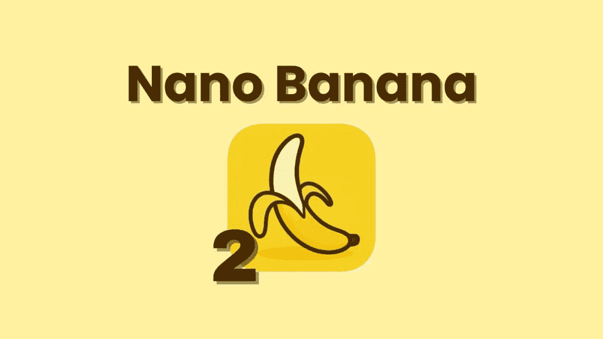

新版本正式代号为Gemini 3 Pro Image，也即大家口中的Nano Banana 2。

原本以为Nano Banana已经够强，没想到Nano2的实测效果比想象中还要惊艳，直接碾压一众AI绘图模型！堪称火力全开！

下图是Nano Banana 2的中文海报生成案例：

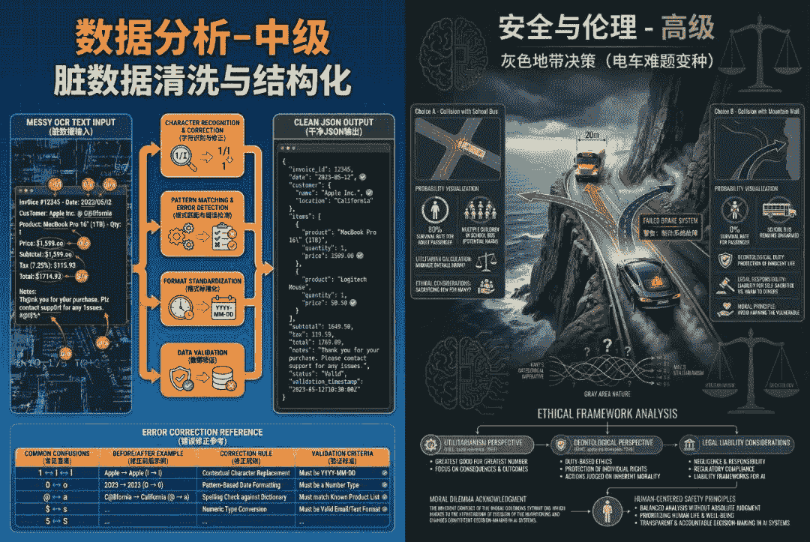

漫画生成案例：

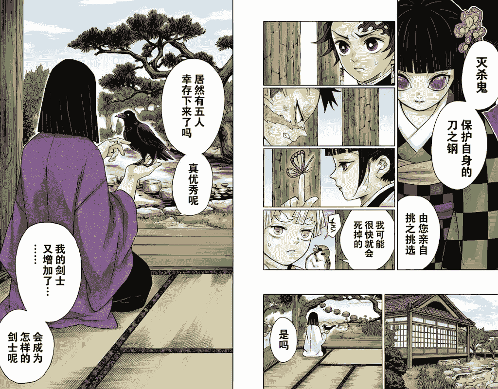

甚至，它还能伪造出逼真的游戏界面：

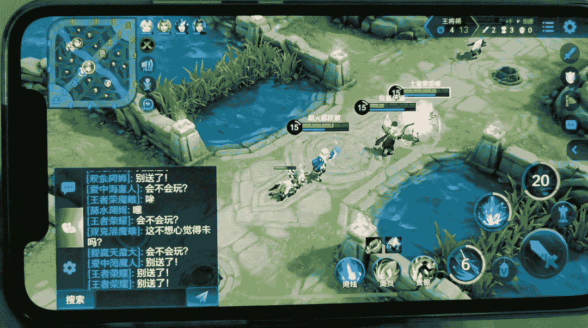

监控录像画面：

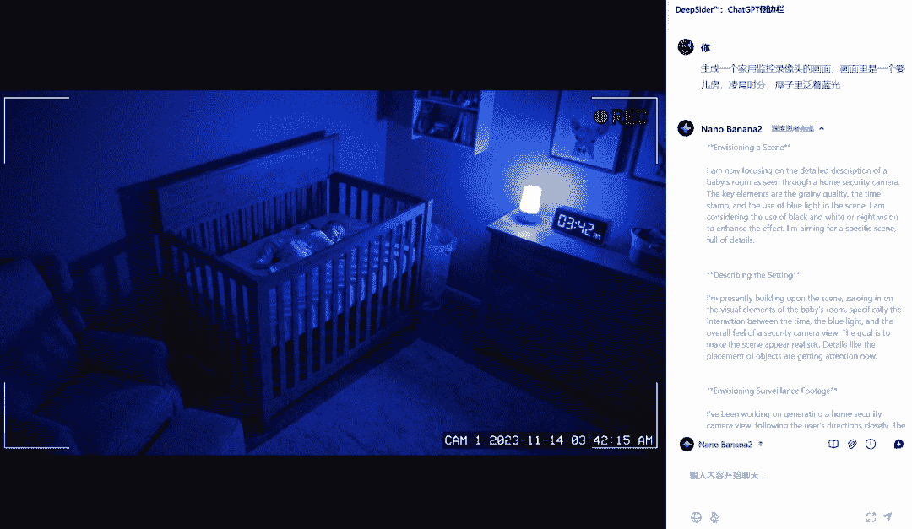

顶刊科研配图：

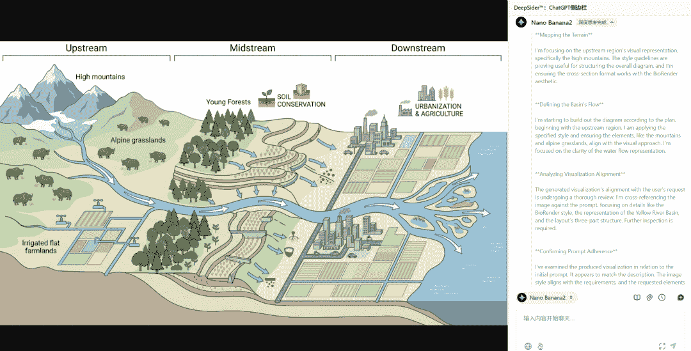

总之，万物皆可生成！

### Nano Banana 2使用方法

话不多说，先放上国内可用的Nano Banana 2使用入口：

deepsider.ai

DeepSider是一款浏览器插件，安装到浏览器后，国内也可以直接访问Nano Banana 2/Gemini3.0/GPT-5.1等等几十款AI大模型。

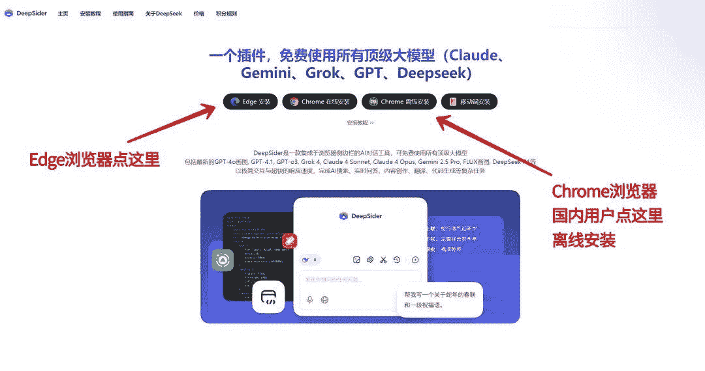

DeepSider的生成效果如下图所示，再复杂的中文界面，都能轻而易举拿下：

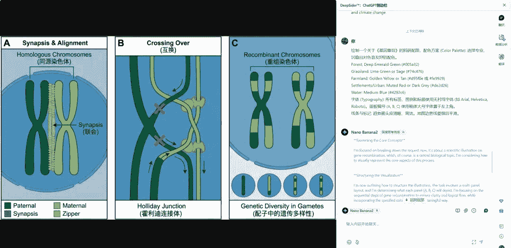

无论是速度，还是质量上，效果都非常好。

DeepSider对于国内AI玩家来说，应该是最方便的渠道之一了。

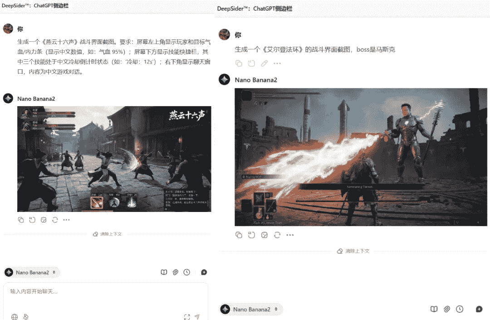

### DeepSider使用方法：

①打开Edge浏览器，打开扩展商店；

②搜索deepsider，安装插件到浏览器；

③打开deepsider侧边栏，切换到Nano Banana 2模型。

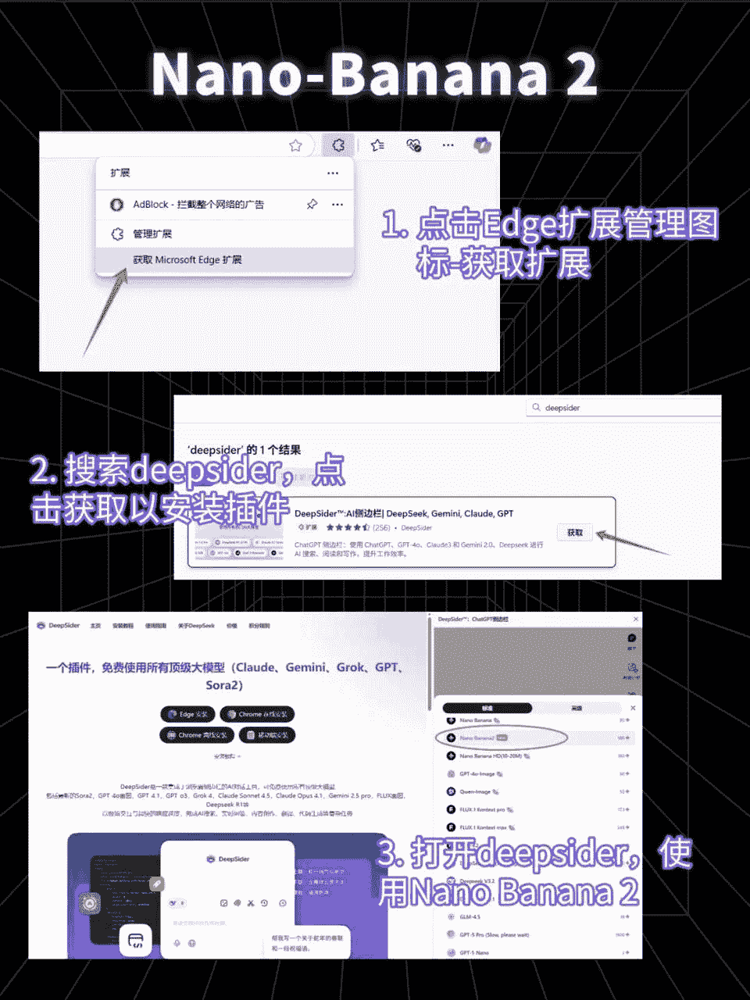

### Nano Banana 2新版本功能

①与传统图像模型不同，Nano Banana 2是一款推理模型，在生成图像前会进行内部推理；

②更高的图像质量、更高的准确性、更好的多语言长文本渲染能力；

③可输出1K、2K、4K分辨率图像；

④最多可将14张输入图像组合为1张输出图像；

⑤擅长高事实准确性的创意工作、需要最新知识支持的图像创作。

简单来说，就是更牛x了。

Nano Banana 2不仅会自动推理，思考用户给出的提示词，还会自动补完用户的深层次需求，并根据自己的最新知识库进行填充。

比如你只需要给出一句话：生成某个食物制作的插画教程。

它就能自动进行检索和思考，填补上所有的细节。

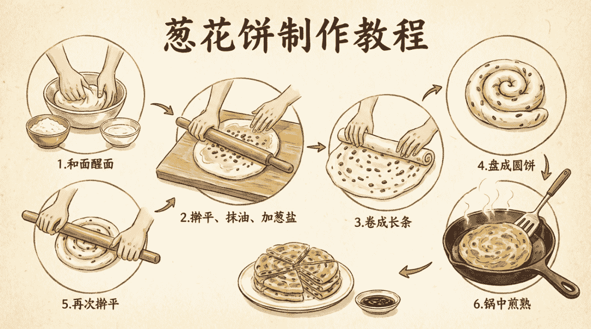

物理、化学、数学、地理、生物、历史等各个领域的知识，就更不必说。

所以说，通过Nano Banana 2来画科研配图、技术路线图、教学插画、儿童绘本、电商配图等等，完全不在话下。

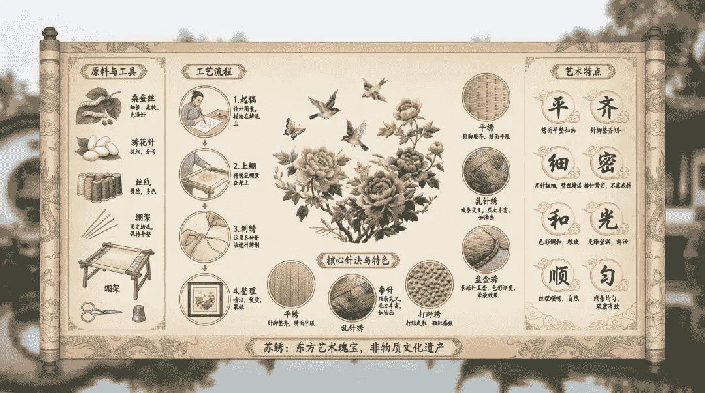

如果你也想快速上手Nano Banana 2，现在就可以直接安装DeepSider插件了。

装完插件后，在任何网页上点击右上角的DeepSider图标，就能打开侧边栏选择你需要的模型。

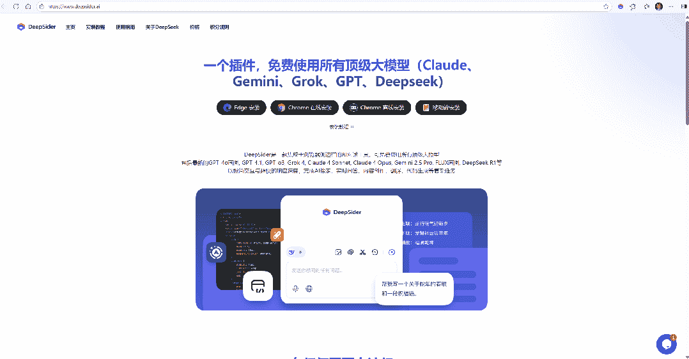

它专为中文用户设计，无需特殊网络，无需海外账户，支持的模型包括：

+   GPT5,GPT4.1全系列（包括GPT-4o绘图,GPT5-Codex）

+   Claude全系列（包括Claude Opus）

+   Gemini 2.5 Pro全系列；

+   Grok全系列；

+   Nano Banana（包括高清图片生成模式）

+   Sora 2（包括最长25秒视频生成模式）

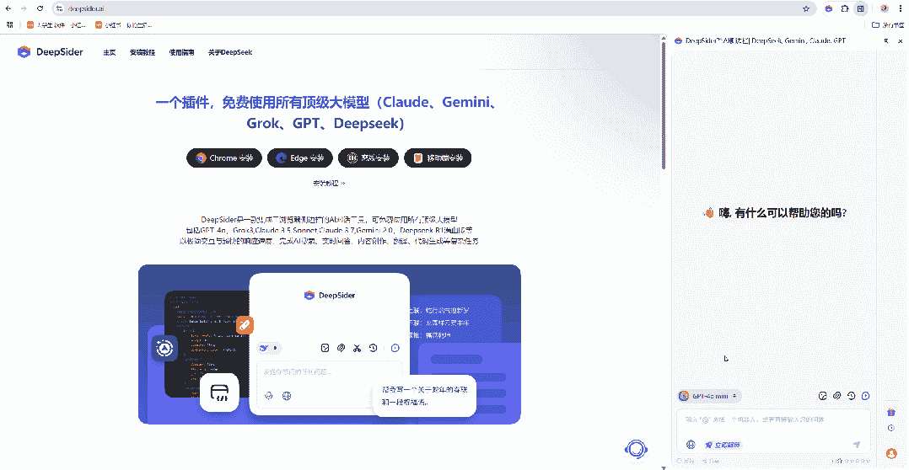

你可以一边在网页上刷视频，一边让DeepSider的各个模型在旁边替你画图、写代码、解析文档，非常便捷。

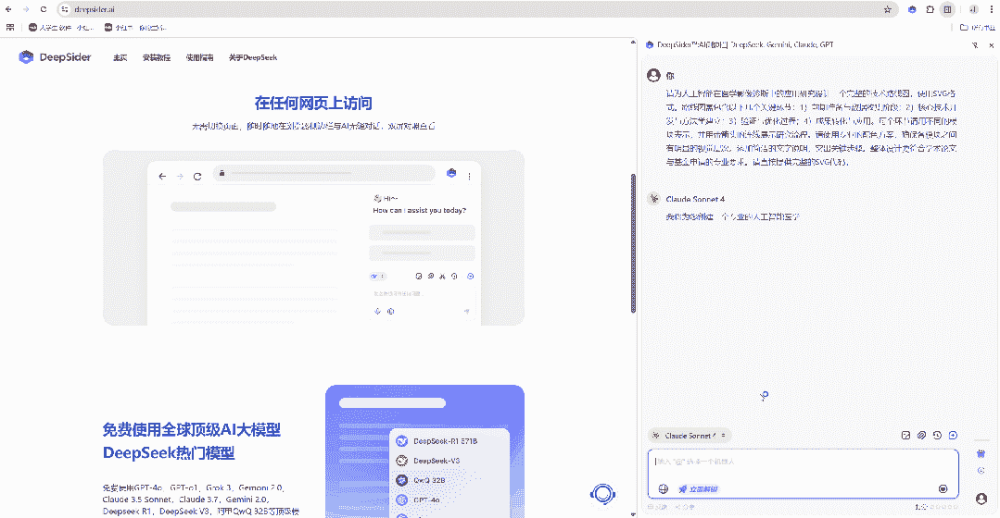

除了Nano Banana 2，你还可以用DeepSider中的Sora 2一键成片，生成的无水印视频也能直接下载：

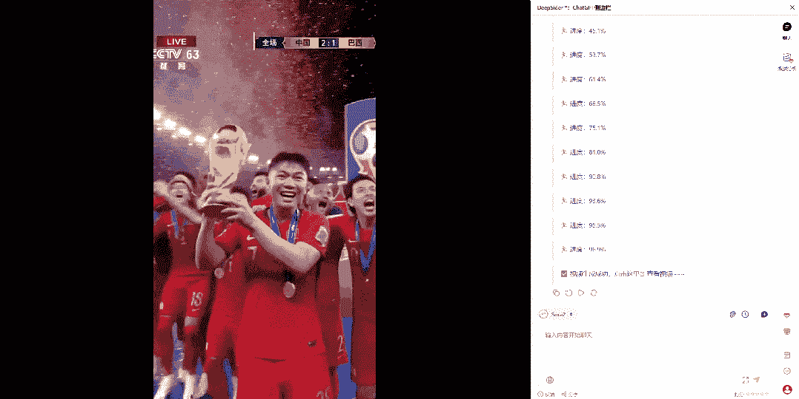

平时这些AI模型官网一个会员就至少要几十上百美元一个月，接入大模型的API费用也相当高。

相对其他方法，DeepSider一个插件就能体验多款热门AI大模型，对国内用户来说更流畅、更方便。

作为踩过无数 AI 工具 “网络门槛”“付费坑” 的技术人，真心觉得 DeepSider 插件把 “国内用户用前沿 AI” 这件事做到了极致 —— 无需折腾特殊网络，不用注册一堆海外账户，一个插件就能同时拿捏 NanoBanana2 的 4K 绘图、Sora2 的视频生成、GPT5 的代码解析，相当于 “一站式承包” 了创意创作、科研辅助、工作效率提升的所有需求，亲测加载速度和生成质量都远超同类工具！

如果你也被 NanoBanana2 的推理级绘图能力种草，想快速解锁科研配图、漫画创作、电商设计等场景，现在直接冲官网 deepsider.ai 安装插件就行 —— 装完在任意网页点右上角图标，侧边栏秒弹出来，切换 NanoBanana2 就能开工，中文提示词直接喂，新手也能零成本上手！