# 基于 AiOnly 一键调用 Claude 4.5 + Gemini 3 Pro 修复老照片

> 来源：[https://qqs7y1hozd1.feishu.cn/docx/RmlMdBg58otdguxmf2VcCo6Rnsg](https://qqs7y1hozd1.feishu.cn/docx/RmlMdBg58otdguxmf2VcCo6Rnsg)

## 摘要

AI文物复活馆是一款创新性多模态AI应用，通过集成AiOnly平台的Claude 4.5和Gemini 3 Pro模型，为用户提供文物数字化复活体验。应用采用React 18+TypeScript+Vite技术栈，结合Framer Motion动画和Zustand状态管理，实现了从文物图片上传、AI智能分析、历史背景故事生成到高清修复图像创建的完整流程。用户只需上传残缺文物或古画图片，系统便能自动识别文物年代、地域、艺术风格及材质特征，生成300-500字的历史背景故事，并创建1024x1024分辨率的高清复原图像，最终通过双屏对比设计直观展示文物修复效果。整个应用依托AiOnly平台提供的一站式大模型服务，解决了开发者面临的模型碎片化、高成本和复杂集成等痛点问题。

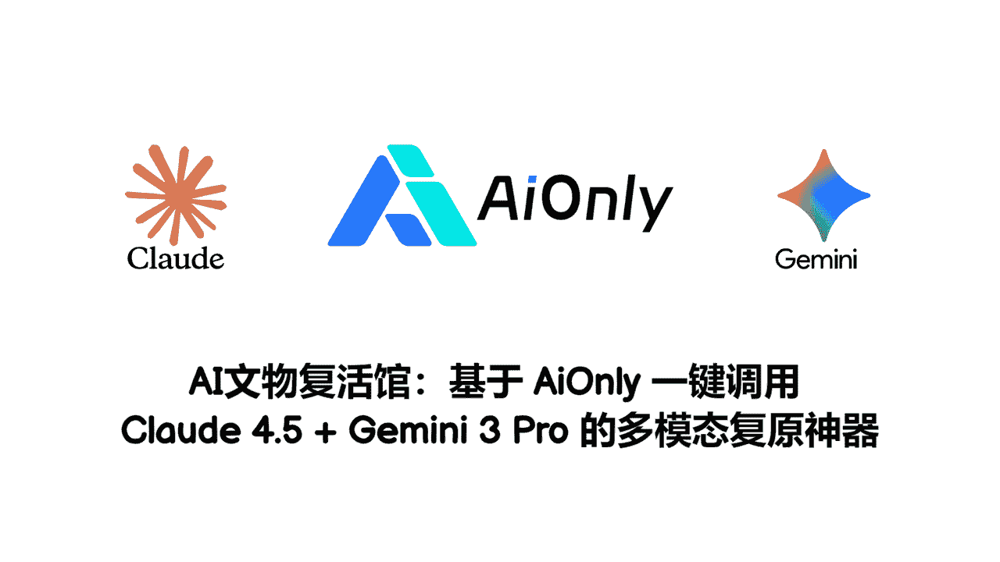

## 一、AI文物复活馆应用展示

### (一) 应用简介

AI文物复活馆是一个运用人工智能多模态技术让残缺文物重焕生机的创新应用。本项目由Claude Code+AiOnly平台提供的Claude 4.5 模型进行开发，并且应用中集成了最新的gemini-3-pro-image-preview模型和gemini-3-pro-preview模型。用户只需上传文物或古画的残损图片，系统就能gemini模型进行多模态智能分析生成历史悠久的背景故事，并且调用gemini生成完整的修复图像。应用采用React 18 + TypeScript + Vite架构，集成了Framer Motion动画、Zustand状态管理和现代化的UI设计，为用户提供流畅的文物数字化复活体验。整个流程包括图片上传、AI分析、智能修复和对比展示，让珍贵的历史文物在数字世界中重获新生。

### (二) 首页

[进入到首页优先](https://link.csdn.net/?target=https%3A%2F%2Fwww.aionly.com%2FkeyApi%3Flogin%3Dfrom_csdn)输入AiOnly Maas平台的API KEY，并且会检查API KEY是否有效。

### (三) 上传文物图片

API密钥配置好之后就进入到图片上传界面

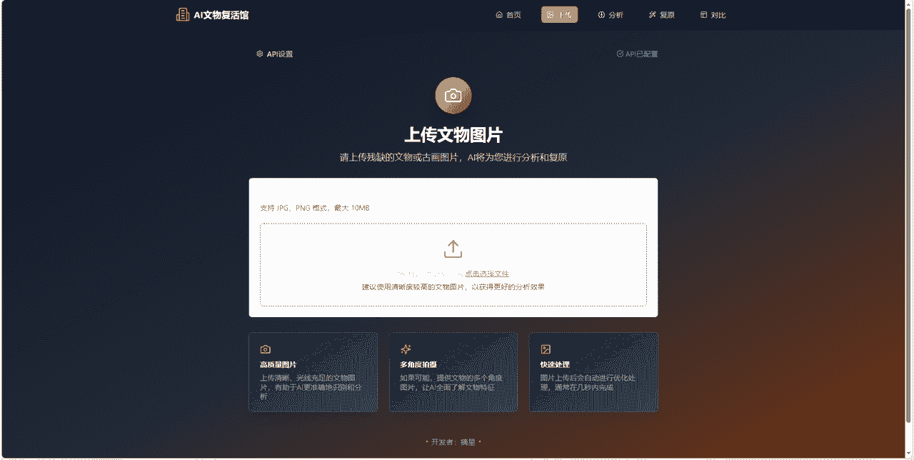

这里我准备好了一张测试图片：

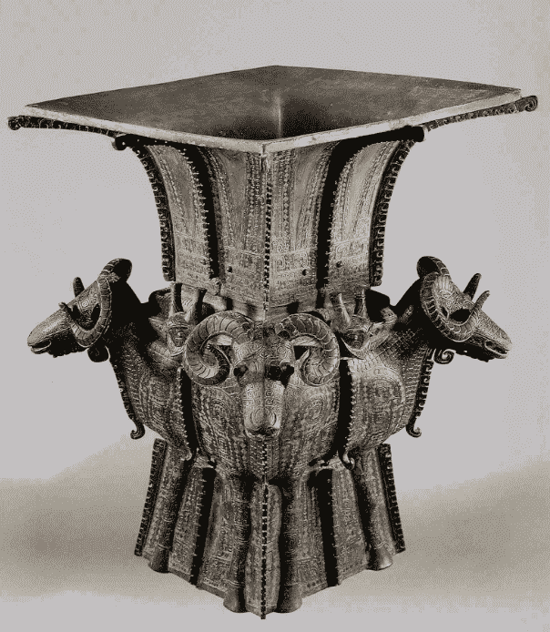

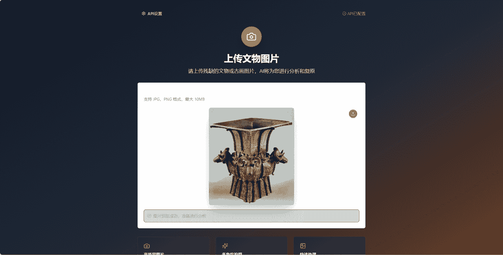

### (四) AI智能分析

图片上传完毕之后，应用会调用gemini模型进行图片理解和故事生成

### (五) AI复原生成

紧接着应用会将原图、图片分析内容、历史背景内容一起打包给gemini模型，生成一副高清的修复画像。

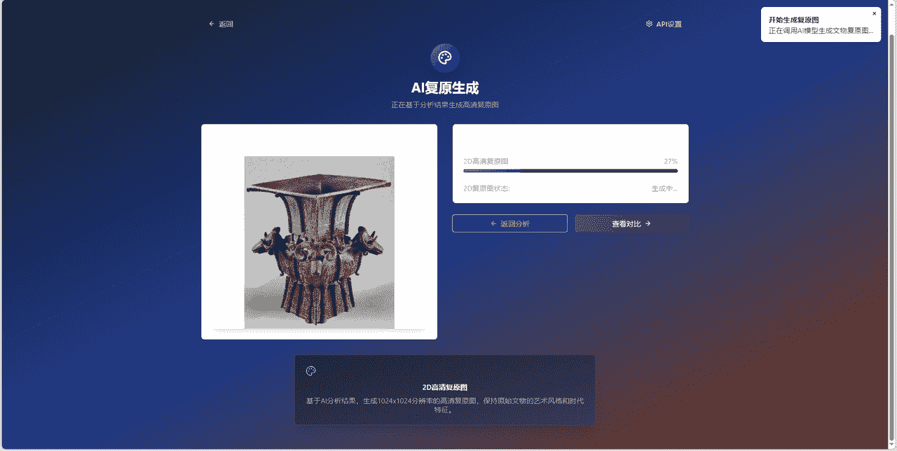

### (六) 对比展示

可以看到整个画面是十分精美的

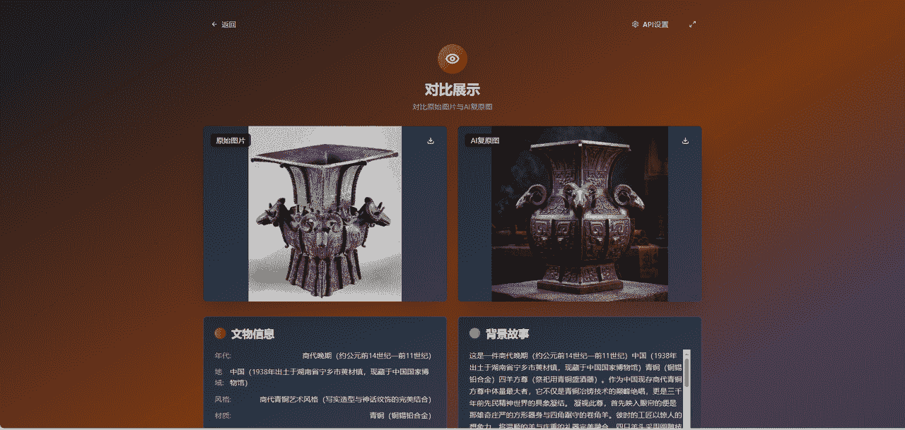

并且提供了图片下载功能

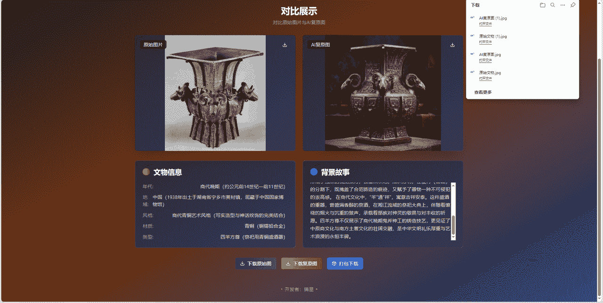

## 二、AiOnly：全球顶尖大模型MaaS平台

作为常年与大模型“相爱相杀”的技术从业者，我最近发现了一个能解决开发者痛点的宝藏平台——AiOnly。它并非简单的模型聚合工具，而是一个深度融合“高效开发”与“成本控制”的大模型服务平台。今天，我将，从背景、核心优势、功能设计到模型生态，为你拆解这个可能改变你工作流的工具。

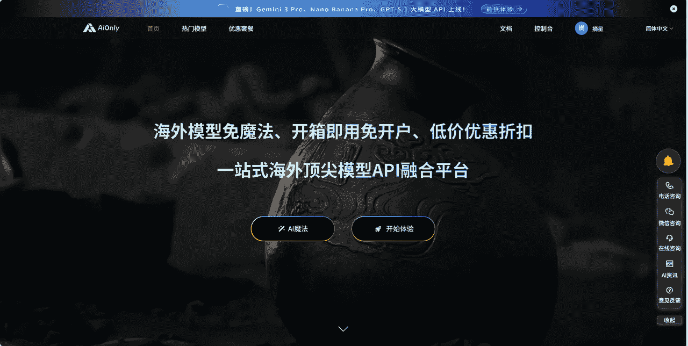

---

### (一) 为什么需要 AiOnly？—— 大模型时代的“碎片化”困境

当前，大模型生态呈现出“多而散”的特点：

+ 海外模型（如 GPT、Claude）需单独注册、复杂配置，甚至面临网络延迟问题；

+ 国内模型（如 Qwen、DeepSeek）又缺乏统一管理入口，开发者需在多个平台间反复切换；

+ 成本不可控：官方定价高、计费模式单一，中小企业或个人开发者难以承受。

AiOnly 的诞生，正是为了打破这种碎片化局面。它以“一站式”为核心理念，将国内外主流模型整合为标准化服务，让开发者从“到处找模型”转向“专注于业务逻辑”。

### (二) 核心优势：不止是聚合，更是效率革命

#### 开发者的“时间黑洞”终结者

+ 无需跨平台注册：海外模型（Claude、GPT 系列）免开通订阅，国内模型（DeepSeek、Hailuo）一键接入；

+ API 接口标准化：所有模型兼容原厂参数，只需配置环境变量即可调用，省去 80% 的适配时间；

+ 高速专线支持：海外模型访问延迟降低 50% 以上（实测数据），尤其适合需要实时响应的场景。

个人体验：之前调用 Claude 需要注册 AWS 账号 + 申请 API Key，现在在 AiOnly 平台 3 分钟完成配置，开发效率直接拉满。

#### 价格策略：把“成本焦虑”变成“真香现场”

+ 价格低于官方定价：例如 GPT 的调用成本比 OpenAI 官方低 15%~20%；

+ 灵活计费模式：

这种“先用后付”模式非常适合 MVP 阶段的项目验证，避免前期投入风险。

#### 模型覆盖：从文本到多模态，拒绝“偏科”

+ 文本：Claude 4.5、GPT-5.1、Gemini 3 Pro；

+ 图像：Gemini 3 Pro Image（Nano Banana Pro）GPT-image-1；

+ 视频：VEO 3.1、Sora 2（测试中）；

+ 语音：支持多语言 TTS 与语音合成。

行业洞察：目前平台已上架80+ 模型，且持续更新，覆盖了 90% 以上主流场景，甚至包括一些小众但实用的垂直模型。

### (三) 产品功能：不止是“模型仓库”，更是“开发加速器”

#### 模型广场：你的大模型“控制中心”

+ API Key 管理：统一创建、监控调用情况，避免 Key 泄露风险；

+ 可视化调用监控：实时查看 Token 消耗、响应延迟，定位性能瓶颈；

+ 模型对比功能：直接在同一界面测试不同模型的输出效果（比如 GPT-4o vs Claude 3.5）。

#### 体验中心：零代码玩转大模型

+ 支持文本对话、图片生成、语音合成等能力的在线体验；

+ 提供Prompt 优化建议，比如输入“写一个 Python 爬虫”，平台会自动提示结构化指令模板。

#### 未来规划：AIGC 创作中心（值得期待）

+ 据官方透露，将上线多模态内容生成工作流，例如“文本→图片→视频”自动化流水线，适合内容创作者和营销团队。

### (四) 技术生态：三方集成，让工具链“丝滑”起来

AiOnly 的真正亮点，在于它与主流开发工具的深度整合：

+ AI对话助手：Cherry Studio、Chatbox等，支持平台多模型调用协作

+ VSCode 插件：Claude Code、Cline 插件直接调用模型，写代码时实时生成注释；

+ 浏览器插件：Sider、Clarity 支持在网页中一键调用模型（比如总结长文）；

+ WPS AI：在文档中直接生成报告、PPT，适合非技术场景。

实战案例：我用 Cline 插件在 VSCode 中调试代码，模型自动识别错误并提供修复建议，效率提升 30% 以上。

### (五) 谁适合用 AiOnly？—— 我的推荐清单

+ 个人开发者：用 1 元体验包快速验证模型能力，避免踩坑；

+ 中小企业：通过“企业认证”领 500 元，低成本接入多模型；

+ 学生党：学生认证领 50 元 + 邀请奖励，足够完成毕设项目；

+ 技术团队：利用 API 统一管理，减少跨平台沟通成本。

### (六) API调用示例

[如果需要](https://link.csdn.net/?target=https%3A%2F%2Fwww.aionly.com%2Fdocument%3Flogin%3Dfrom_csdn)调用API，AiOnly也提供了详细的文档，参考官方的帮助文档

```
{&quot;type&quot;: &quot;image_url&quot;, &quot;image_url&quot;: {&quot;url&quot;: &quot;https://help-static-aliyun-doc.aliyuncs.com/file-manage-files/zh-CN/20241022/emyrja/dog_and_girl.jpeg&quot;}},
```

```
curl --location 'https://api.aiionly.com/v1/chat/completions'
--header "Authorization: gemini-3-pro-preview"
--header 'Content-Type: application/json'
--data '{
  "model": "qwen-vl-max",
  "messages": [
  {
    "role": "system",
    "content": [
      { "type": "text", "text": "You are a helpful assistant." }
    ]
  },
  {
    "role": "user",
    "content": [
      { "type": "text", "text": "图中描绘的是什么景象?" }
    ]
  }],
  "stream": true
}'
```

## 三、AiOnly接入Claude Code

### (一) 专属链接注册免费领取Token

注册AiOnly平台即可获取价值15元的Token：

### (二) 开通AiOnly

1. 登录[AiOnly平台](https://link.csdn.net/?target=https%3A%2F%2Fwww.aionly.com%2F%3Flogin%3Dfrom_csdn)

2. 点击[模型广场](https://link.csdn.net/?target=https%3A%2F%2Fwww.aionly.com%2FmodelSquare%3Flogin%3Dfrom_csdn)，开通模型

3. 选择Claude 4.5，Claude 4.5 在广泛的使用场景中展现出接近前沿的性能，并且作为最佳的编程和代理模型之一脱颖而出——其速度和成本恰到好处，能够为免费产品和高流量用户体验提供支持。

4. 开通之后查看开通管理

5. 创建API KEY

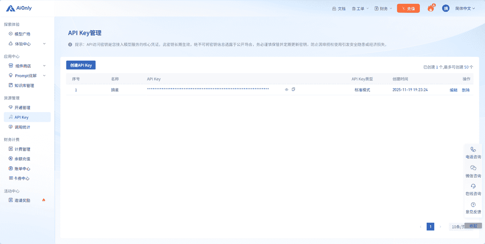

### (三) 安装Claude Code

```
npm install -g @anthropic-ai/claude-code
```

`claude`

### (四) 配置环境变量

`ANTHROPIC_API_KEY`或`ANTHROPIC_AUTH_TOKEN`均可作为接入认证，只需要设置其一即可。本文以`ANTHROPIC_API_KEY`为例。

```
#将 AIOnly 的 API 密钥存入系统环境变量，伪装成 Anthropic 的密钥供应用程序读取。setx ANTHROPIC_API_KEY sk-1d20bbed6409fa995d0d3df7b08d26602eaff87db2722e8f091c5d05cbcb99f3
#将 Anthropic API 的默认请求地址替换为 AIOnly 提供的兼容代理接口地址。setx ANTHROPIC_BASE_URL https://api.aiionly.com
#指定应用程序调用时使用的模型名称为 AIOnly 平台上名为 gemini-3-pro-preview 的模型（尽管名称含 &quot;Gemini&quot;，实际由 AIOnly 托管，并非 Google 官方模型）。setx ANTHROPIC_MODEL glm-4.6
```

#### ❕ 端点设置

✅ 正确的设置-基础 URL https://api.aiionly.com❌ 错误的设置-完整端点：https://api.aiionly.com/v1/messages

claude-code 内部会自己拼接路径（如 `/v1/messages`）它会发请求到：

https://api.aiionly.com/v1/messages/v1/messages

#### 重启命令行，查看是否配置成功

```
echo %ANTHROPIC_API_KEY%echo %ANTHROPIC_BASE_URL%echo %ANTHROPIC_MODEL%
```

#### 进入到claude code后查看模型

`/model`

[https://i-blog.csdnimg.cn/img_conv](https://i-blog.csdnimg.cn/img_convert/e093893f148ad4458a1ade2c0c122cd6.png)ert/e093893f148ad4458a1ade2c0c122cd6.png

## 四、Claude Code开发实践

### (一) 开发提示词

准备好下方的提示词，输入给claude code

```
{&quot;type&quot;: &quot;image_url&quot;, &quot;image_url&quot;: {&quot;url&quot;: &quot;https://help-static-aliyun-doc.aliyuncs.com/file-manage-files/zh-CN/20241022/emyrja/dog_and_girl.jpeg&quot;}},
```


## 需求描述

开发一个叫做 `AI文物复活馆` 的应用，功能是：

1、页面中有一个上传图片的功能，可以上传残缺文物或古画
2、上传完图片之后调用 `gemini-3-pro-preview` 多模态能力分析图片，识别文物年代、地域、艺术风格、材质等关键信息。
3、识别完图片之后，继续调用 `gemini-3-pro-preview` 基于识别结果，生成一段 300–500 字的中文背景故事，风格兼具历史准确性与文学性（如“这是一件南宋龙泉窑青瓷……”）。
4、最后调用 `gemini-2.5-flash-image` 以原始图片 + Gemini 生成的文本描述为联合提示 (`prompt`)，生成一张完整、高清、风格一致的文物复原图（分辨率为 1024x1024），展示在网页。双屏对比设计：左 "残缺原图" vs 右 "AI 复原图"。
5、以上的模型 API 调用均由 `AiOnly` 平台提供，我会将调用示例代码放在后方，但是需要用户提供 `AiOnly` 的 `API_KEY`，进入应用之前需要优先输入密钥，并且存放在 `localStorage` 中。
6、上传文件、识别图片 + 背景故事、高清修复图、`API_KEY` 上传，这些模块分别用四个页面展示，要求有精美的 UI 和流畅的 UX。

`gemini-3-pro-preview` 调用示例：

```bash
curl --location 'https://api.aiionly.com/v1/chat/completions' \
--header "Authorization: Bearer API_KEY" \
--header 'Content-Type: application/json' \
--data '{
  "model": "gemini-3-pro-preview",
  "messages": [
    {"role": "system", "content": [{"type": "text", "text": "You are a helpful assistant."}]},
    {"role": "user", "content": [{"type": "text", "text": "图中描绘的是什么景象?"}]}
  ],
  "stream": false
}'
```

`gemini-2.5-flash-image` 调用示例：

```bash
curl -X POST https://api.aiionly.com/v1/images/generations \
-H "Authorization: Bearer API_KEY" \
-H "Content-Type: application/json" \
-d '{"model": "gemini-2.5-flash-image", "input": {"prompt": ""}}'
```

理解我的需求之后生成一份 `claude.md` 文件，我要确保你完全理解我的意思，理解错的我会自己的改动或者让你继续改动。

## (二) 项目开发文档

`Claude Code` 会按照我们的要求优先生成一份 `claude.md` 项目文档，如果有什么不满意的地方，再跟 `Claude Code` 继续交流直至项目开发文档满足你的所有需求。

### AI文物复活馆 - 产品需求文档

#### 项目概述

`AI文物复活馆` 是一个基于人工智能技术的文物数字化复原应用，通过多模态 AI 技术为用户提供文物识别、背景故事生成和 AI 复原图生成的一站式服务。

#### 核心功能需求

##### 1. API密钥管理

- **功能描述:** 用户首次进入应用需要输入 `AiOnly` 平台的 `API_KEY`
- **存储方式:** 使用 `localStorage` 本地存储 `API_KEY`
- **验证机制:** 输入密钥后才能使用后续功能
- **UI要求:** 简洁优雅的密钥输入界面，包含输入框和确认按钮

##### 2. 图片上传功能

- **功能描述:** 支持用户上传残缺文物或古画图片
- **文件格式:** 支持 `JPG`、`PNG`、`JPEG` 格式
- **文件大小:** 建议限制在 10MB 以内
- **UI要求:**
  - 拖拽上传区域
  - 文件选择按钮
  - 上传进度显示
  - 图片预览功能

##### 3. AI文物识别分析

- **功能描述:** 调用 `gemini-3-pro-preview` 多模态能力分析上传的图片
- **识别内容:**
  - 文物年代（如：南宋、唐代、明代等）
  - 地域特征（如：景德镇、龙泉窑、汝窑等）
  - 艺术风格（如：青瓷、白瓷、青花瓷等）
  - 材质信息（如：瓷质、陶质、青铜等）
- **API调用:** 使用 `AiOnly` 平台提供的 `gemini-3-pro-preview` 接口
- **结果展示:** 以卡片形式展示识别结果
- **UI要求:**
  - 识别进度显示

##### 4. 背景故事生成

- **功能描述:** 基于识别结果生成 300–500 字的中文背景故事
- **内容要求:**
  - 历史准确性：基于真实历史背景
  - 文学性：语言优美，富有文化韵味
  - 故事性：有情节、有温度，引人入胜
- **API调用:** 继续使用 `gemini-3-pro-preview` 生成故事
- **展示方式:** 文本卡片，支持复制功能
- **UI要求:**
  - 识别进度显示

##### 5. AI文物复原图生成

- **功能描述:** 基于原始图片和生成的背景故事，生成高清复原图和 3D 复原模型图
- **技术要求:**
  - 2D 复原图：分辨率 1024x1024，保持原始文物风格一致性
  - 3D 复原模型图：生成可交互的 3D 模型图片
  - 清晰度：高清无水印，细节丰富
- **API调用:**
  - 2D 复原图：使用 `AiOnly` 平台提供的 `gemini-3-pro-image-preview` 接口
  - 3D 模型图：使用 `gemini-3-pro-image-preview` 接口生成 3D 模型
- **生成流程:**
  - 先生成 2D 高清复原图
  - 基于 2D 复原图和文物信息生成 3D 模型图
  - 显示双进度条，分别显示 2D 和 3D 生成进度

##### 6. 三屏对比展示

- **功能描述:** 三屏对比展示 "残缺原图"、"AI 复原图" 和 "3D 复原模型图"
- **UI设计:**
  - 左侧：原始上传的残缺文物图片（30% 宽度）
  - 中间：AI 生成的 2D 高清复原图（40% 宽度）
  - 右侧：3D 复原模型图展示区域（30% 宽度）
  - 顶部：切换标签页，支持 "双屏对比" 和 "三屏对比" 模式
  - 底部：背景故事文本展示区域
- **布局模式:**
  - 双屏模式：仅对比原图和 2D 复原图
  - 三屏模式：同时展示原图、2D 复原图和 3D 模型
- **交互功能:**
  - 图片操作：支持缩放、平移、旋转（针对 3D 模型）
  - 对比工具：可拖拽分隔线调整各区域比例
  - 下载功能：
    - 单独下载 2D 复原图、3D 模型图
- **展示特效:**
  - 图片切换淡入淡出动画
  - 鼠标悬停高亮效果

### 技术架构

#### 前端技术栈

- 框架: `React 18` + `TypeScript`
- 状态管理: `Zustand`
- UI组件: `Tailwind CSS` + 自定义组件
- 路由: `React Router v6`
- HTTP客户端: `Axios`
- 图片处理: 浏览器原生 `File API`
- 3D渲染: `Three.js` + `React Three Fiber`
- 动画: `Framer Motion`
- 图标: `Lucide React`

#### 页面流程设计

1. 欢迎页 / API密钥输入页 (`/`)
2. 图片上传页 (`/upload`)
3. AI分析页 (`/analysis`)
4. 复原图生成页 (`/restore`)
5. 三屏对比展示页 (`/comparison`)
   - 支持双屏 / 三屏模式切换
   - 集成3D模型展示功能

### API接口规范

#### Gemini多模态分析接口

```http
POST https://api.aiionly.com/v1/chat/completions
Authorization: Bearer {API_KEY}
Content-Type: application/json

{
  "model": "gemini-3-pro-preview",
  "messages": [
    {
      "role": "system",
      "content": [{"type": "text", "text": "你是一个专业的文物鉴定专家，请详细分析图片中文物的年代、地域、艺术风格和材质等关键信息。"}]
    },
    {
      "role": "user",
      "content": [
        {"type": "image_url", "image_url": {"url": "图片base64或URL"}},
        {"type": "text", "text": "请详细分析这件文物的关键信息，包括年代、地域、艺术风格和材质。"}
      ]
    }
  ],
  "stream": false
}
```

#### Gemini 2D图像生成接口

```http
POST https://api.aiionly.com/v1/images/generations
Authorization: Bearer {API_KEY}
Content-Type: application/json

{
  "model": "gemini-2.5-flash-image",
  "input": {
    "prompt": "基于文物描述生成复原图的详细提示词"
  }
}
```

#### Gemini 3D模型生成接口

```http
POST https://api.aiionly.com/v1/images/generations
Authorization: Bearer {API_KEY}
Content-Type: application/json

{
  "model": "gemini-3-pro-image-preview",
  "input": {
    "prompt": "基于2D复原图和文物信息生成3D模型的详细提示词",
    "format": "glb",
    "style": "realistic"
  }
}
```

### UI/UX设计要求

#### 设计原则

- 文化感: 体现中华传统文化韵味
- 现代感: 简洁现代的界面设计
- 沉浸感: 深色主题，突出文物图片
- 流畅性: 页面切换动画，加载动画

#### 色彩方案

- 主色调: 深褐色 (`#8B4513`) - 象征古代文物
- 辅助色: 金色 (`#FFD700`) - 象征皇家尊贵
- 背景色: 深灰色 (`#2C2C2C`) - 突出图片展示
- 文字色: 米白色 (`#F5F5DC`) - 保证阅读体验

#### 字体选择

- 标题: 思源黑体 / 阿里巴巴普惠体
- 正文: 思源宋体 / 方正兰亭黑
- 数字: `Roboto Mono`

## 性能要求

- 首屏加载: < 3 秒
- 图片上传: < 5 秒（2MB 图片）
- AI分析: < 10 秒
- 2D图像生成: < 30 秒
- 3D模型生成: < 60 秒
- 3D模型加载: < 5 秒
- 页面切换: < 1 秒

## 错误处理

- 网络错误: 显示友好的错误提示，支持重试
- API限制: 提示 API 配额不足，引导用户检查 `API_KEY`
- 文件格式: 清晰提示支持的文件格式和大小限制
- 生成失败: 提供失败原因和重新生成选项
- 3D模型错误:
  - 模型加载失败提示
  - `WebGL` 不支持降级方案
  - 提供 2D 视图备选方案

## 安全要求

- `API_KEY`: 仅存储在客户端，不上传到服务器
- 图片处理: 所有图片处理在浏览器端完成
- 隐私保护: 不上传用户图片到第三方服务器

## 浏览器兼容性

- 支持浏览器: `Chrome 90+`、`Firefox 88+`、`Safari 14+`、`Edge 90+`
- `WebGL` 要求: 支持 `WebGL 2.0`（用于 3D 模型展示）
- 移动端: 支持 `iOS Safari` 和 `Android Chrome`
- 响应式设计: 适配桌面端、平板和手机
- 降级方案: 不支持 `WebGL` 的浏览器自动切换到 2D 模式

## 后续扩展功能

- 历史记录: 保存用户的复原历史
- 社交分享: 支持分享到微信、微博等社交平台
- 专家点评: 邀请文物专家对用户作品进行点评
- 语音导览: 为每件文物生成语音讲解
- AR展示: 支持增强现实查看 3D 模型
- 多人协作: 支持多人同时查看和讨论 3D 模型
- 模型编辑: 提供基础的 3D 模型编辑功能
- 材质库: 提供多种文物材质模板

## (三) AI开发交互

确认完毕项目开发文档之后，`Claude Code` 就可以参照 `claude.md` 进行全速开发

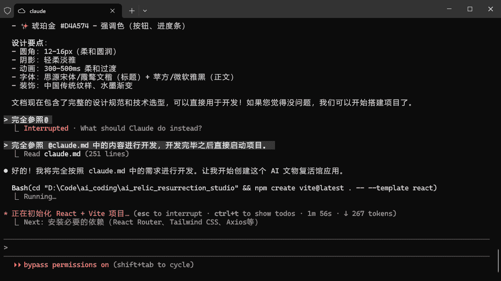

经过不停的迭代开发最后形成这样的网页：

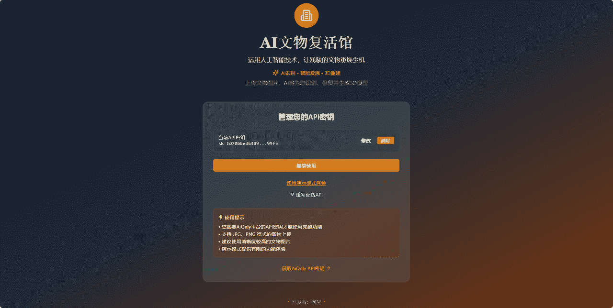

## 五、总结

`AI文物复活馆` 项目代表了 `AIGC` 技术在文化遗产保护领域的创新应用，其意义远超单纯的技术展示。通过将前沿的多模态 `AI` 技术与传统文物保护相结合，该项目为文物数字化保存和公众文化教育提供了全新思路。技术层面，应用成功整合了 `Claude` 和 `Gemini` 两大模型的优势，通过 `AiOnly` 平台实现了高效、低成本的模型调用，验证了 `MaaS`（模型即服务）模式在实际项目中的可行性。用户体验方面，精心设计的四步流程（`API_KEY` 配置、图片上传、`AI` 分析、对比展示）配合现代化 `UI/UX` 设计，使复杂的技术过程变得直观易用。这一项目不仅展示了 `AI` 在文化传承中的巨大潜力，也为开发者提供了如何利用平台化服务快速构建多模态 `AI` 应用的实践范例，预示着未来文物修复与数字博物馆建设的新方向。

## 六、参考资料

`AiOnly` 企业级 `MaaS` 平台官网：https://aionly.com

`GPT` / `Claude` / `Gemini` `API` 接入文档：https://aionly.com/document
