# Gemini 3 pro 两步生成产品原型图

> 来源：[https://qqs7y1hozd1.feishu.cn/docx/BZ6idhESjo9G6QxSdZDcB7Wlnvf](https://qqs7y1hozd1.feishu.cn/docx/BZ6idhESjo9G6QxSdZDcB7Wlnvf)

这套工作流分为两步，以下毫无保留做完整展示。

## 一、Gemini3生成C端原型图

先看最终成品，这审美和质感，能打几分？

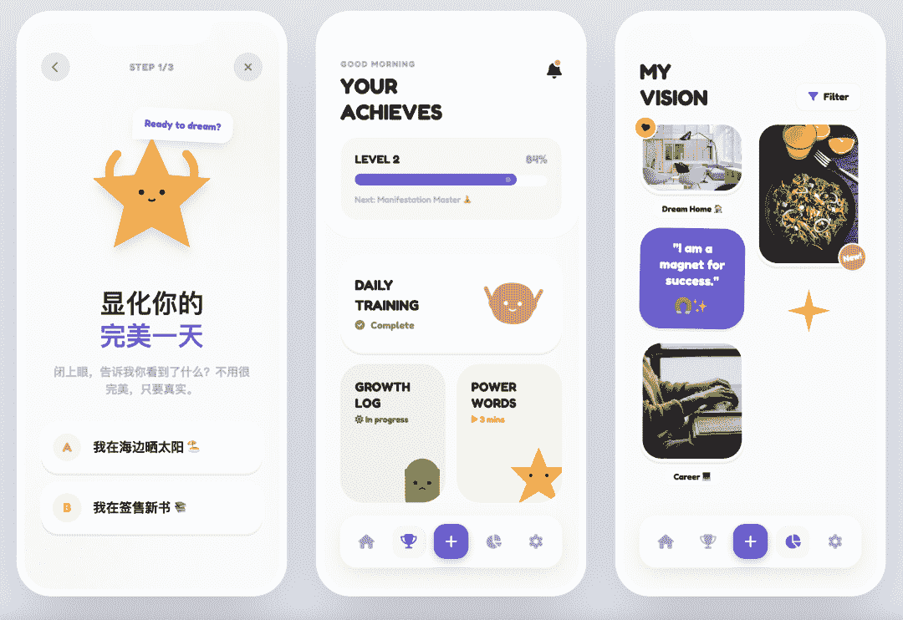

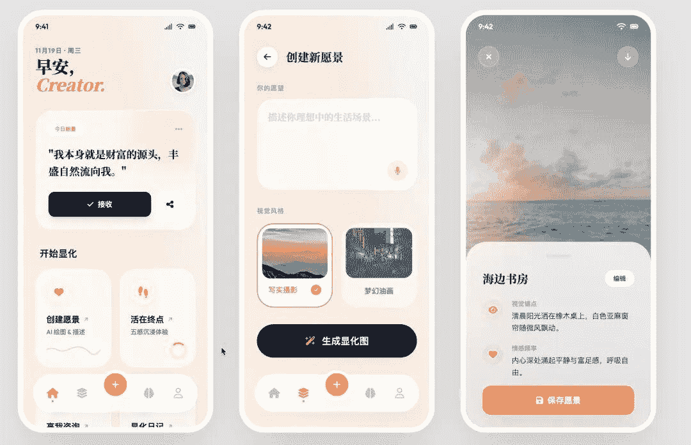

### Step 1：用“大师级提示词”奠定功能骨架

**首先需要一个万能基础的UI提示**词，它不是在命令AI，而是在赋予AI一个“设计总监”的角色。这个提示词包含了角色定义、产品需求、技术规格、风格指南四个核心部分。

#### **以下是实证效果满分的提示词**

```
你是一位顶级的 APP UI/UX 设计专家，现需根据以下产品需求创建 UI 方案，并直**接生成可交付的 HTML 完整代码**。你需要像一名经验丰富的设计**师一样思考，运用** ****HTML + **Ta**ilwind C**SS** + FontA**weso**me** 将产品需**求无缝转**化为 **像素级完**美、高度仿真、可交互** 的多界面 HTML 原型。

为完成此任务，你需要：
1.**深度分析**：理解应用的核心理念，并将其融入设计语言。
2.**规划流程**：基于用户旅程地图，确保页面间的跳转逻辑清晰、体验流畅。
3.**专业设计**：完成所有核心界面的 UI/UX 设计，包括配色、排版、动效等。
4.**代码实现**：直接编写高质量、结构清晰的 HTML/CSS/JS 代码。

## 产品需求：


## 技术规格：
*   单个 HTML 每行为 3 个横向排列的页面预览，可以有多行；代码需要包含所有功能页面。
*   单个页面可以上下滑动，滑动时底部标签栏需固定在底部。
*   画板尺寸：375x812（带 1px 描边模拟手机边框）。
*   **顶部状态栏**：每个页面顶部都需包含一个模拟的 iOS/Android 状态栏，显示时间（如 9:41）、网络信号和电池图标，以增强真实感。
*   **底部标签栏**：除“启动页”和“目标设定流程”外，所有核心页面都必须包含一个统一的底部标签栏（Tab Bar），提供应用内的主要导航。
*   必须包含：
    *   矢量图标系统（使用 `&lt;symbol&gt;` 定义）。
    *   动态折线图（`stroke-dasharray` 动画）。
    *   卡片悬浮效果（通过 `filter` 和 `transform` 实现）。
    *   图片占位使用 `&lt;image&gt;` 标签外链 Unsplash。
    *   增加一些高设计感SVG图片；


## UI风格精准总结：玻璃拟态风格
玻璃拟态背景：
使用半透明磨砂玻璃质感，背景模糊处理，搭配柔和的光影效果，营造未来感和高级感。
低饱和配色：
主色调采用温暖的米白色背景，搭配深色文字（如深灰），辅以橙色作为点缀色，整体配色高级且富有层次感。
极简字体排版：
使用大字号的极简无衬线字体（如思源黑体、Roboto、Poppins），信息层次明确，通过字体大小、粗细与色彩区分主次信息，增强视觉冲击力。
表单优化：
表单及输入框去除边框线，仅保留流畅圆角背景，减少视觉噪音，提升整体界面的简洁与精致感。
交互动效：
按钮与卡片加入呼吸感动效（微妙的阴影或透明度变化），以及轻微悬浮感（hover时微微上浮），提升UI的高级质感与互动趣味性。

## 期望结果
请基于上述优化后的提示词，设计出符合要求的高品质 UI 方案，并最终生成完整的 HTML 代码。
```

**这个是生成的结果：**

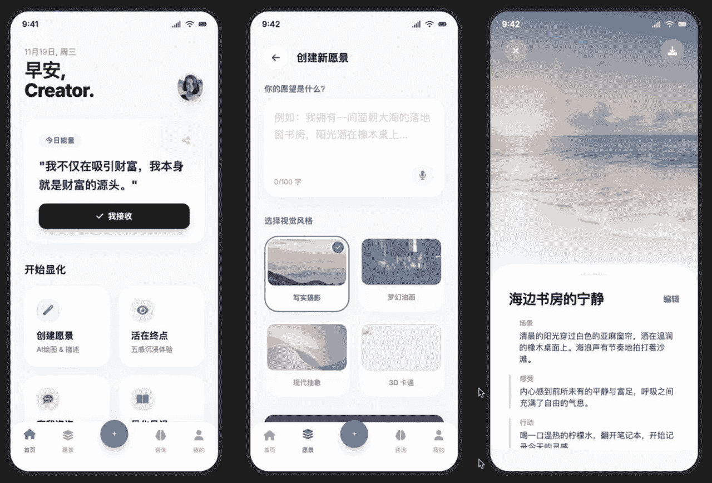

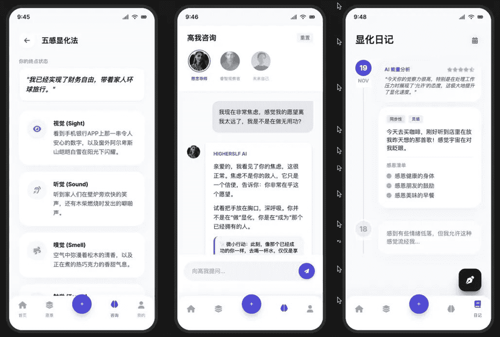

### Step 2：一张参考图注入“视觉灵魂”

可以在 Dribbble、Mobbin这些顶级设计网站上，找到任何你喜欢的UI风格截图。然后，把这张图喂给Gemini，并下达一个极其简单的指令（指令如图）：

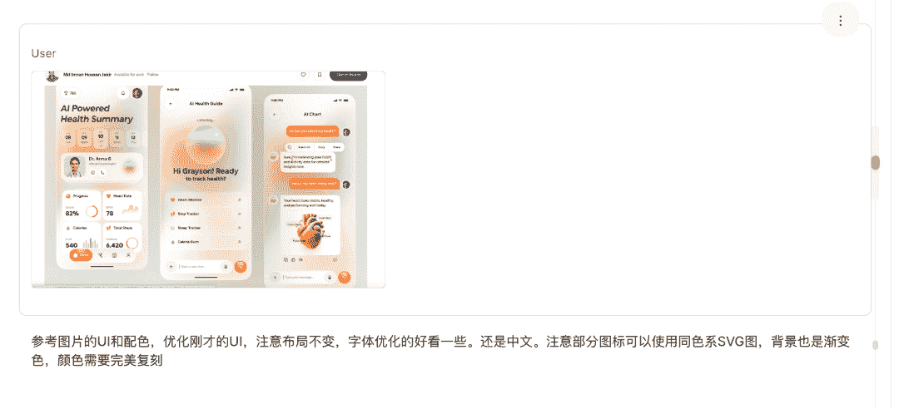

以下是最终生成的效果，还挺还原的：

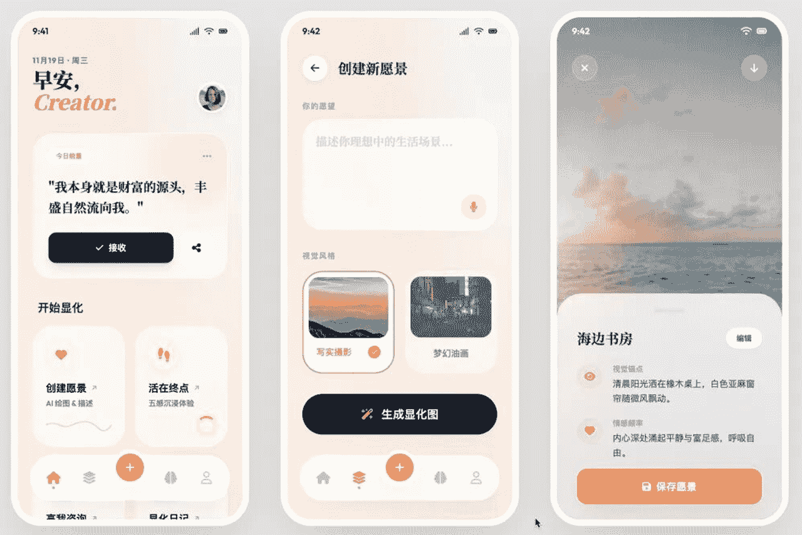

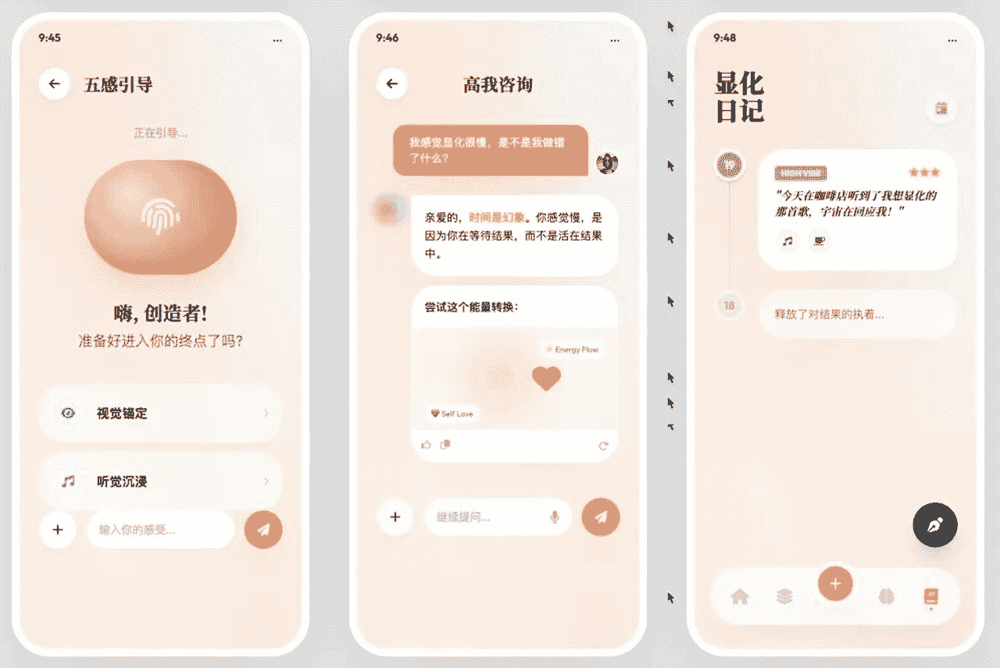

## 二、Gemini3生成B端原型图

#### 以一个典型的 B 端应用场景固定资产管理为例：

需要设计一套统计报表，内容包括资产预算、资产采购、资产入固及固定资产相关业务。现在需要根据不同的管理层级，展示公司资产状况，及当年度资产预算执行等信息。

**以下是展示的3个视角：**

1.  公司领导层视角，可能会关注公司支持的原值、净值、当年资本性支出的预算，当年新增资产价值等；以及关注公司各资产类别的占比；

1.  资产管理部视角，除了公司领导层关注的内容外，资产管理部还要关注自己部门相关业务数据。

1.  各资产管理业务部门，关注自己部门资产原值、净值、预算执行情况，资产类型占比。

### Step 1：确定业务逻辑框架，保证“骨架”

既然做资产管理，首先要明确区分资本性预算（CAPEX）和费用性预算（OPEX）。领导层可能会关注新增资产的结构，而业务部门更关心‘我还能买什么。

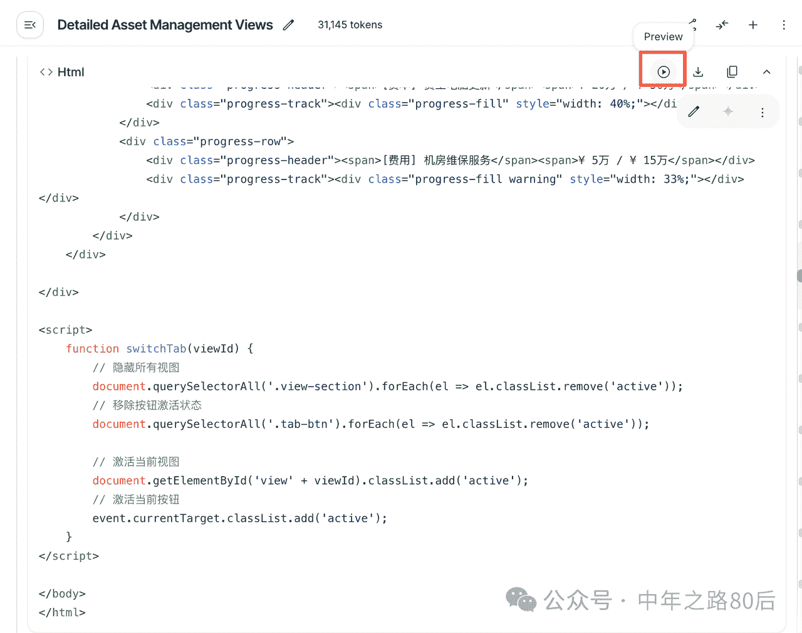

直接点preview，一个可以交互网页就打开了。

+   **布局清晰：**决策层、管理层、执行层分了三个 Tab。

+   **逻辑自洽：**预算执行率、资产占比，甚至连图表的配色都符合 B 端审美。

+   **可交互：**点击 Tab 是真的能切换页面的实现互动的。

**公司领导层视角**

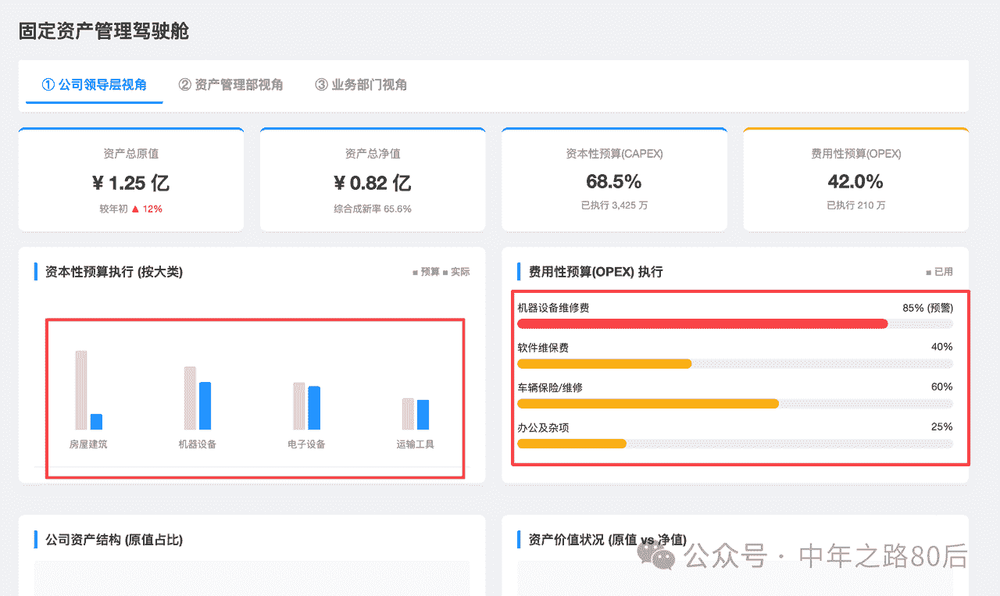

**资产管理部视角**

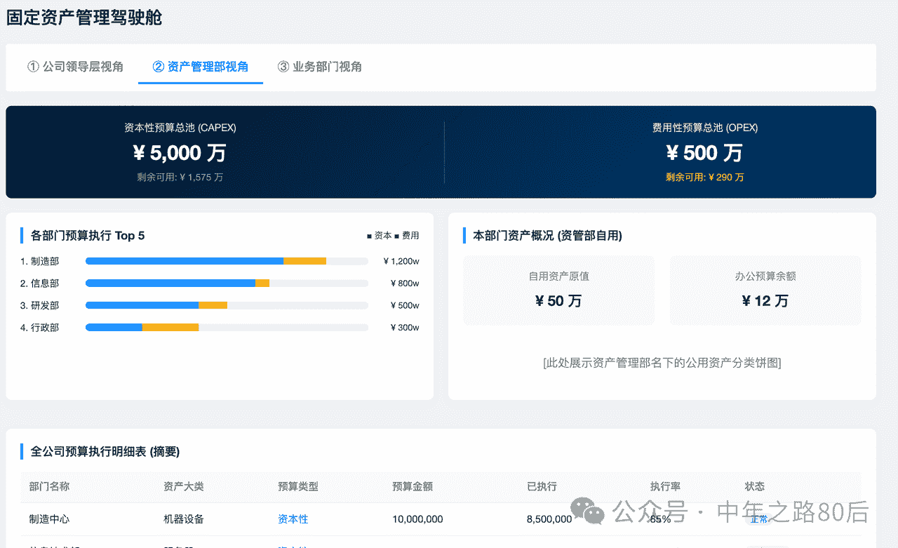

### Step 2：不断优化逻辑，完善需求

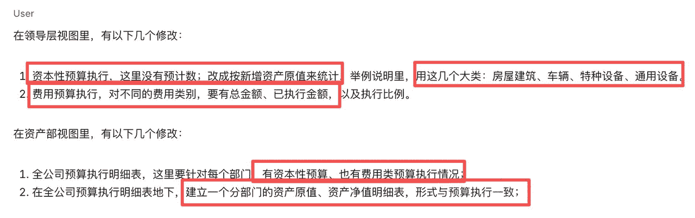

1.  **改口径：**领导层视图里，资本性支出要按“房屋建筑、车辆、特种设备、通用设备”分类统计新增原值。

1.  **加维度**：费用性预算（OPEX()）要单独列出来，除了执行比例，还要有具体的数值。

1.  **最难的一点**：在资产管理部视图里，我要一个**复杂的双表头表格**——同一行里，既要展示“资本性预算”的执行情况，又要展示“费用性预算”的执行情况，还要看“原值净值”。

**    这不仅考验 CS**S 布局能力，更考验它对“资**本性 vs **费用性”这个财务概念的理解。结果？它一次编译通过。

以下是最终交付的效果：

**公司领导层视角**

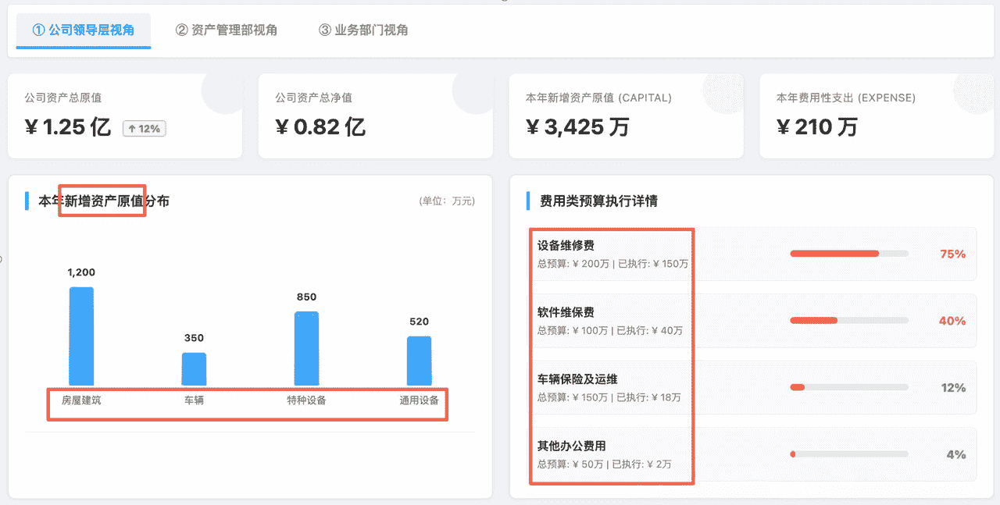

**资产管理部视角**

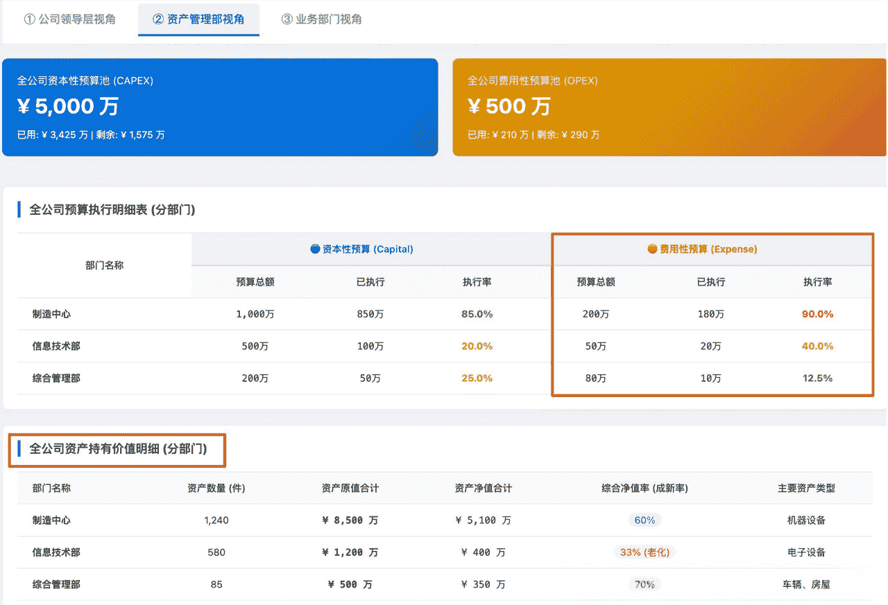

完美理解了指令意图：KPI 卡片特意用

+   **蓝色**和**橙色**区分了资本和费用；

+   那个复杂的表格，表头逻辑清晰，数据对齐完美；

+   甚至贴心地加上了“余额不足”的红色预警标签。