# Lovart AI+Nano banana输出年度PPT

> 来源：[https://qqs7y1hozd1.feishu.cn/docx/GCe1d5hZZoHzPZxg857cvAUKnNb](https://qqs7y1hozd1.feishu.cn/docx/GCe1d5hZZoHzPZxg857cvAUKnNb)

> 当AI设计工具纷纷比拼**模型参数和单图生成效果****时，真正的痛点却藏在“做完”而非“做出”—**—品牌要的不是一张好看的图，而是一**整套能快速落地、风格统一、随时可改的节日视觉方案**。Lovart没有陷入“选模型”的军备竞赛，而是以设计师的真实工作流为蓝本，用一句提示词直接交付从主视觉到多尺寸社媒图的完整设计套系，并让修改、延展与交付无缝衔接。在圣诞、跨年、新年密集切换的年底战场，它正重新定义：什么叫“把设计真正做完”。

#####

这一年里，**设计工具的更新速度明显快过了设计需求本身。模型越来越多、参数越来越强，但真正落到项目中，问**题反而变得更具体了：不是“能不能生成”，而是“能不能把一整件设计任务顺利做完”。

Lovart** 的产品形态**也**正**显现出差异，并没有把重点放在“帮用户选模型”上，而是直接承接设计任务本身。通过一句 prompt，生成的不再是零散素材，而是已经按照实际使用场景组织好的结果，从节日 KV、活动海报到多尺寸社媒图，整体结构和延展关系一开始就被考虑进去。

这种体验上的变化，并不来自某一个模型参数，而来自对设计流程的整体理解。设计思维、接近真实设计师的任务拆解与完成能力，加上始终可编辑的画布，共同构成了一条完整的设计工作流。

在 NanoBanana Pro 的加持下，Lovart 也成为目前使用这一模型最顺滑、最成熟的产品形态之一。短时间内积累的 1000 万 + 专业用户，意味着这种“直接把设计做完”的方式，已经跨过尝鲜阶段，开始进入稳定使用的区间。

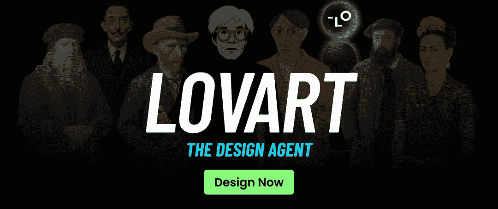

## 最累的，往往不是想点子

#####

> **尤其是在当前圣诞、跨年以及新年这样高度商业化、节奏又密集的节点里，品牌真正需要的，**从来不只是几张好看的图，而是一整套能快速落地、风格统一、还能反复调整的视觉方案。

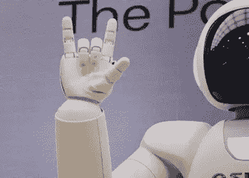

这类项目中设计师真正被消耗的，往往不是创**意阶段，而是创意之后的那一长串执行工作。一套设计从来不只是一张主**视觉，还要不断被延展成海报、社媒图、不同尺寸的物料。哪怕方向已经确定，后面依然会被复制、裁切、重排这些细碎动作拖慢节奏。

即使 AI 已经参与进来，这种状态也并没有发生根本变化。生成变快了，但生成之后的事情依旧被拆散：适配在这里，修改在那边，文件在不同工具之间来回流转。节日节点一密集，这种被拆开的工作方式就会被放大，时间和注意力被消耗在反复对齐上。

##### **一套设计从来不只是一张主视觉，还要不断被延展成海报、社媒图、不同**尺寸的物料。哪怕方向已经确定，后面依然会被复制、裁切、重排这些细碎动作拖慢节奏。

> 把同样的需求交给 Lovart 时，设计推进的方式开始不一样了。输入的不再**是“先做一张看看”，而是一个完整的节日设计目**标，生成的也不再是零散的几张图，而是一整套已经按照使用场景组织好的结果。主视觉、海报、多尺寸社媒图在同一个画布里同时出现，结构关系一开始就被理顺。

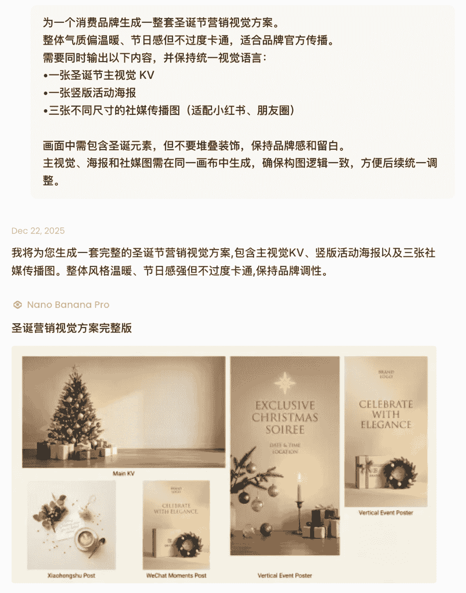

**从画**面本身来看，这套方案并没有靠堆叠元素制造节日感，而是通过统一的视觉语言完成整体表达。温暖而克制的氛围、金色与暖红为主的配色、大量留白保留品牌调性，每一张图都明显属于同一个体系。

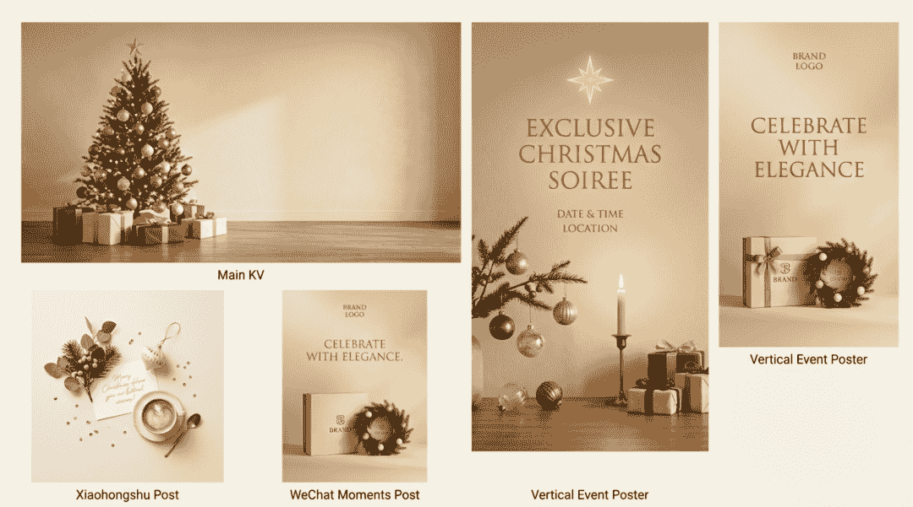

**更重**要的是，这种“成套生成”让使用方式变得清晰。哪一张是主视觉，哪一张用于竖版传播，哪一张适合社交平台，不需要再事后补想象。修改、微调和延展，都发生在同一套结果之上，而不是反复从头开始。

这种成套输出带来的变化，在实际项目里非常直观。每一张图该怎么用、会出现在哪里，不需要再事后补想象。不管是圣诞、跨年还是新年，不同主题下沿用的是同一套设计骨架，修改和调整都发生在同一个结果之上。

当节日从圣诞过渡到跨年或新年，设**计真正面临的挑战，并不是重新想主题，而是在不打断原有结**构的前提下完成切换。视觉需要变化，但使用场景、传播节奏和物料结构，最好保持稳定。

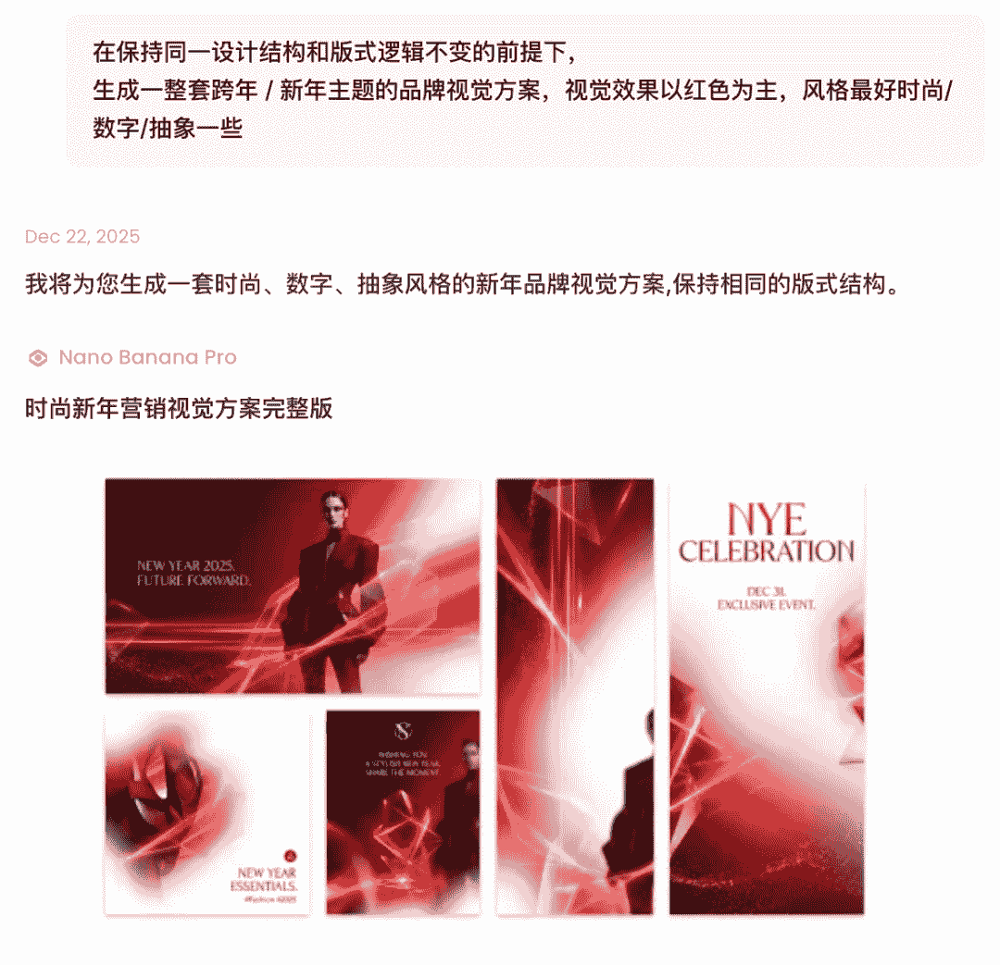

在这组跨年 / 新年方案中，Lovart 延续了圣诞项目中已经建立好的设计框架，只对主题元素和氛围进行调整。结构没有被推翻，主视觉、海报和多尺寸社媒图依然在同一逻辑下展开，设计从一个节日自然走向下一个，而不是反复回到起点。

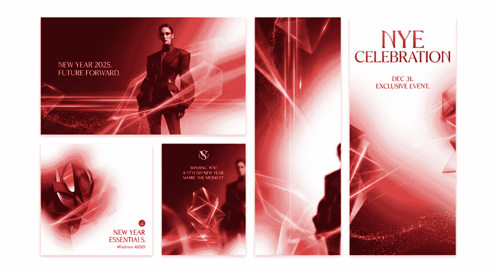

也正是在这种连续的推进中，设计的角色发生了变化。生成不再是必须立刻定型的终点，而是一个可以继续往前走的起点。设计从一开始就以“整套结果”为目标，也为后面的调整、细化和延展提供了更多空间。

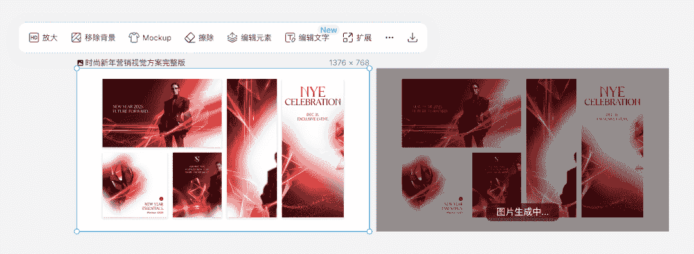

生成完成后，整套设计会保留在同一个画布中，直接就能继续操作。放大、移除背景、Mockup、编辑元素或文字，都在上方工具栏里随手完成，修改发生在原结果之上，不需要重新开始。

## 返工不再是设计流程的一部分

项目被真正推进起来后，很多变化其实发生得很安静。不是效率突然暴涨，也不是某个功能让人惊呼，而是一些原本会下意识回避的修改，开始变得没那么犹豫了。文案要不要先定、细节要不要留到最后，这些过去需要反复权衡的决定，慢慢不再成为负担。

在 Lovart 里，修改更像是设计过程中的自然一环。生成之后，画面不会被锁**死**，而是始终保持在一个可继续调整的状态里。无论是替换节日文案、调整时间信息，还是在不同语言版本之间切换，变化都直接落在现有设计上，版式和结构不会被打乱。修改不再意味着重新开始，而是顺着同一个结果往前走。

例如，上述新年设计方案 Lovart 一开始给的非常“国际范儿”，但其实作为设计师，更希望一套符合国人语境的方案，以往可能设计师要对整套设计方案的不同材料一一编辑，而现在只需要通过 Text Edit 编辑一句话全部搞定：

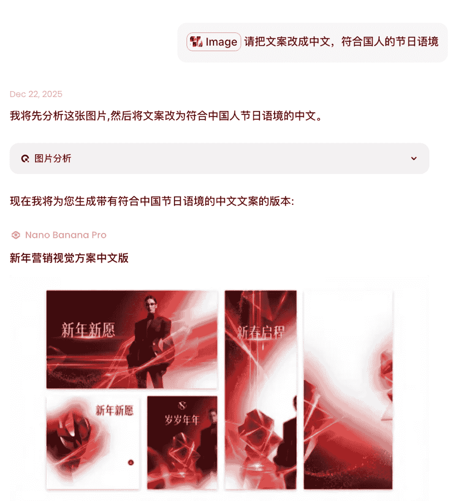

> 这种体验在年底节点里尤为明显。圣诞、跨年、新年往往伴随着频繁的信息变动，过去需要反复导出、找字体、重新对齐的步骤，现在只是在画布上顺手完成。设计不会因为一次改字被迫停下来，整体节奏始终保持连续。

**上一套节日方案在结构和气质上已经很完整，但在真实项目里，往往还需要再往前一步。比如年底给万象城做一**整套招商或传播方案时，视觉不只是“好看”，而是要更有意境、更有文化指向，字体本身就要承担情绪和态度，而不是简单的信息承载

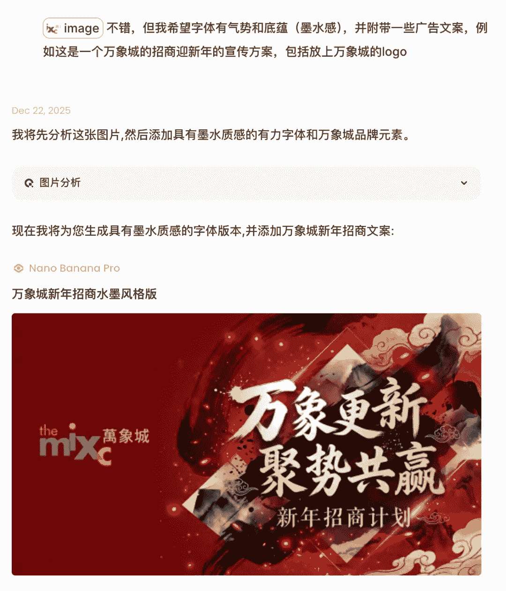

**在** Lovart 里，只需要明确提出这样的场景需求——指定品牌对象、调整为更具水墨感和力量感的字体风格，并加入招商语境的文案，系统就会在原有结构上完成整体升级。

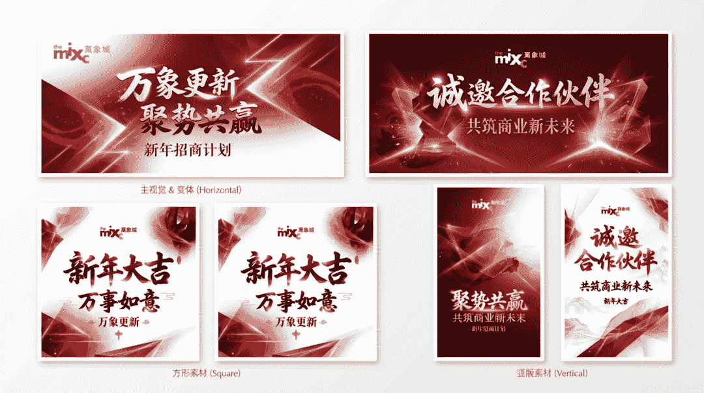

最终出来的是一整套已经适配商业场景的成品视觉，风格统一、气质明确，几乎可以直接拿去用，而不是停留在“概念图”阶段。

随着修改不再被视为风险，很多原本会被拖到最后统一处理的细节，现在可以在过程中自然完成。设计师不再需要反复判断“现在改会不会白忙一场”，而是可以在同一套结果上持续收敛，而这种确定感，往往比单纯的速度提升更重要。

## 设计可以直接投入使用

**随着设计方案敲定，接下来就需要考虑用在哪里？线上传播、电**商页面、线下物料、不同尺寸的展示位，这些并不是新的创作需求，而是对同一套设计的延展。过去，这一步往往意味着重新适配、重新制作，把已经完成的设计再拆开一遍。

> 在 Lovart 里，这种延展并没有被拆成新的流程。已经生成并调整好的设计，可以直接被放进不同的使用环境中，画面会自然贴合到载体本身的角度、材质和光影条件里。

> 设计师不需要再改画面，而是开始思考它会被放在哪里、以什么方式被看到。机场、商场、走廊、候机区，不同位置对同一张视觉的要求并不相同，但本质上仍然是对同一套设计的延展，而不是新的创作任务。

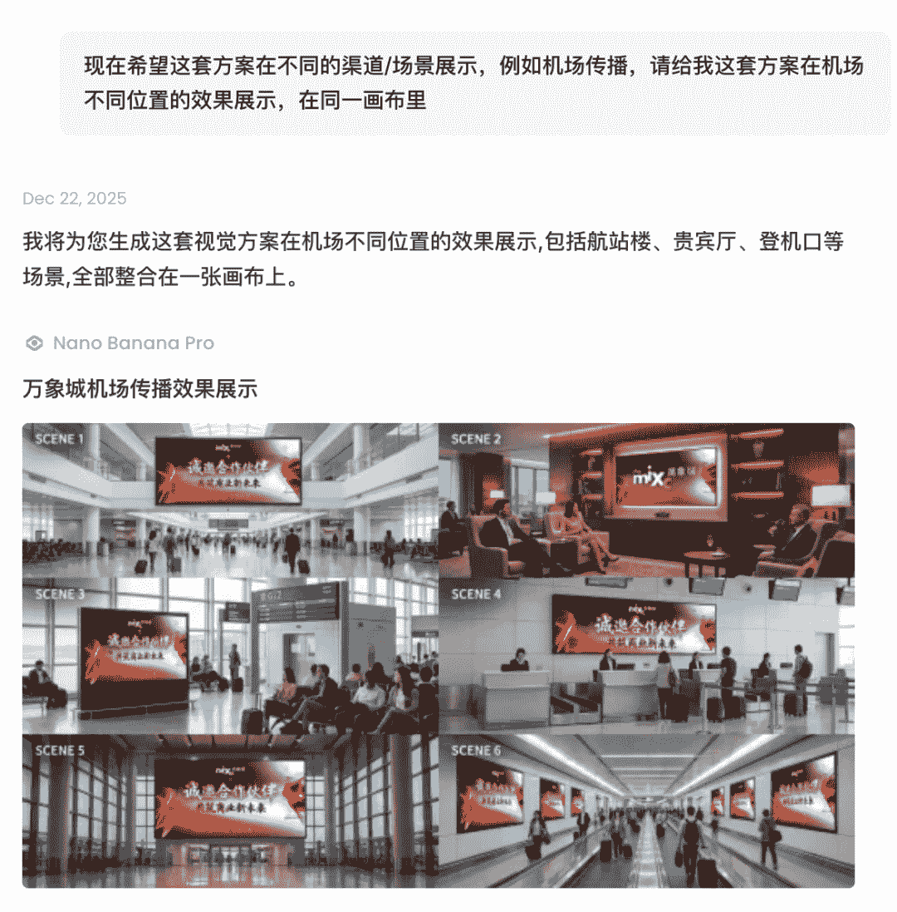

在 Lovart 里，已经生成并调整好的主视觉，可以直接被放进不同场景中做 Mockup 展示，系统会自动处理比例、透视和环境关系，同一套画面在多个载体里保持一致。设计不再为了“展示效果”额外再做一轮，而是顺着原有结果，自然走到真实使用场景里。

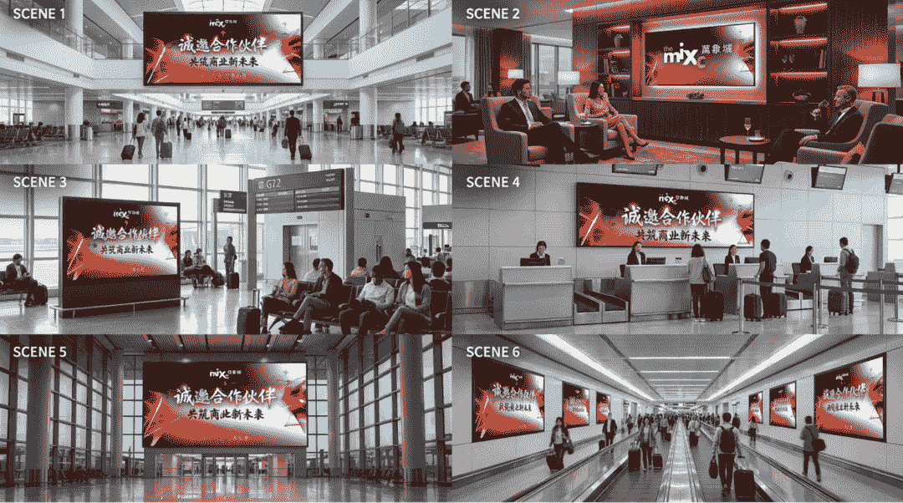

**这**种连续性，也体现在需要对外呈现设计成果的时候。节日方案、活动说明、营销汇报，往往需要整理成完整的 PPT。以往这一步常常要重新搭结构、再做视觉，而现在，设计本身就可以直接进入整理和表达阶段，页面结构、视觉风格和内容调整都发生在同一个环境里。

接下来往往还要面对一个很现实的问题：怎么把方案讲清楚、讲完整地交付给客户。原本以为这一步还是要回到熟悉的 PPT 工具里重新整理结构、再配一轮视觉，没想到在 Lovart 里，这件事可以直接接着往下做。

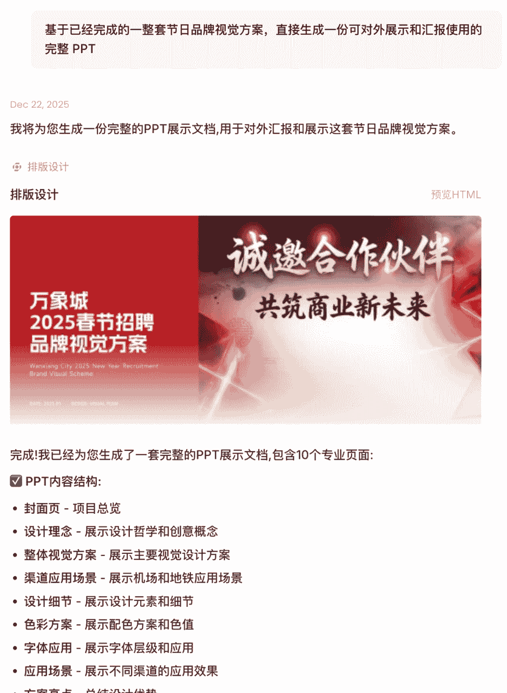

**把已经完成的设计方案交给 Lovart，**它不仅补齐了汇报所需要的结构，还把设计理念、应用场景和规范拆解成一页页清晰的页面。最终出来的效果，不只是“能用”，而是一份完整的专业提案，只要小幅修整，就可以直接拿去对外汇报，而不是大工序的二次加工。

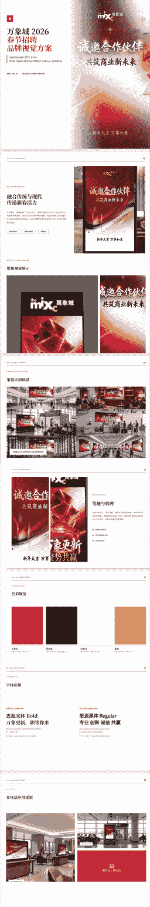

**生成**、修改和使用被放在同一条工作线上，很多原本需要额外沟通、反复确认的步骤，会在过程中被自然消化掉。设计师关注的重点，不再是“接下来该怎么交接”，而是“这套设计是否已经可以被直接拿去用”。

久而久之，工具在项目里的位置也变得清晰起来。它不再只是某一个环节的辅助，而是贯穿整个设计过程的一部分。一套设计可以被一次性完成、持续调整，并自然进入实际使用阶段，这种工作方式也就具备了被反复复制到下一个节日、下一个项目中的可能。