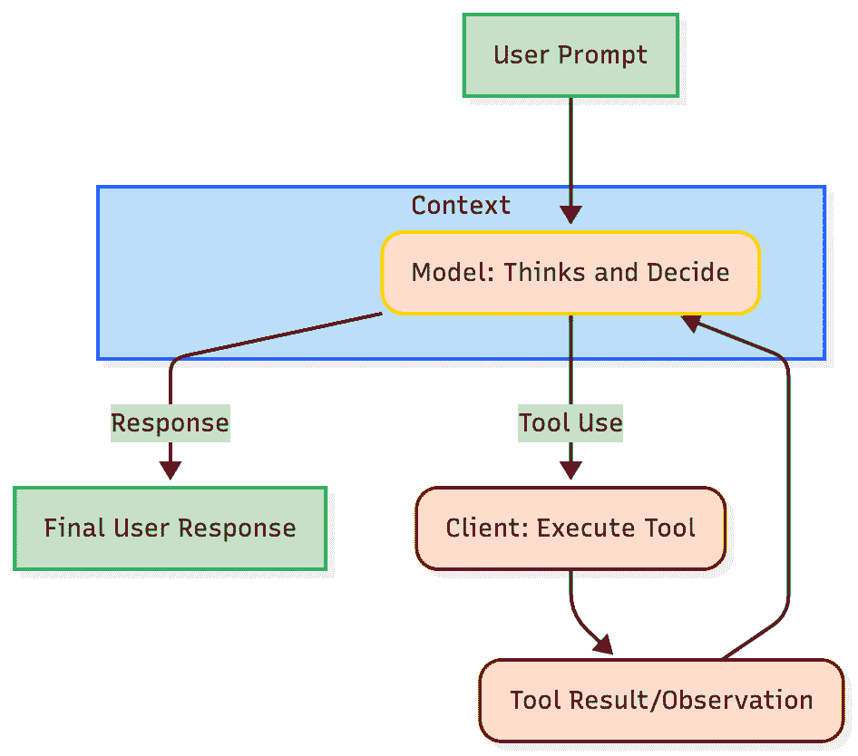

# 从零开始构建一个基于Gemini3的AI Agent

> 来源：[https://qqs7y1hozd1.feishu.cn/docx/D7I9dEn7vomEFbxu3G4cSa3ZnWe](https://qqs7y1hozd1.feishu.cn/docx/D7I9dEn7vomEFbxu3G4cSa3ZnWe)

文章介绍了AI智**能体的核心原理及构建方法。AI智能体本质上是运行在循环**中的大语言模型，配备可调用工具。文章通过四步骤（基础文本生成、工具使用能力、实现闭环、多轮交互）指导读者使用Python和Gemini模型构建智能体，并提供工具设计、上下文工程等最佳实践。掌握基础后，开发者可利用开源框架构建更复杂的智能体系统。

## 前言

> 当看到AI 智能体（AI Agent）完成多文件编辑、命令执行、错误处理及迭代式问题求解等操作时，往往会给人一种神秘感。实则不然，AI 智能体的核心原理出奇地简单：它就是一个在循环中运行的大语言模型（LLM），并配备了可供调用的工具。

> 只要掌握 Python 循环的基础编程能力，即可搭建专属的 AI 智能体。本文将分步骤拆解构建流程，从基础的 API 调用入手，逐步实现可运行的命令行（CLI）智能体。

### 一、智能体到底是什么？

> 传统软件与AI智能体的根本区别在于：传统软件的工作流程是指令式的，遵循预定义路径（步骤 A → B → C）；而智能体则不同，它利用LLM动态决定程序的控制流，以达成用户目标。

一个典型的智能体通常包含以下核心组件：

1.  模型（大脑）：推理引擎，负责处理模糊性问题、规划执行步骤，并判断何时需要外部工具辅助。本文使用的是Gemini模型。

1.  工具（手脚与眼睛）：智能体可执行的函数，用于与外部世界/环境交互（例如网页搜索、读取文件、调用API等）。

1.  上下文/记忆（工作区）：智能体在任意时刻可访问的信息集合，高效管理这些信息的过程被称为“上下文工程”。

1.  循环（生命周期）：一个while循环，让模型能够完成“观察→思考→行动→再观察”的迭代过程，直到任务完成。

几乎所有智能体的“循环”都遵循以下迭代流程：

1.  定义工具：用结构化JSON格式向模型描述可用工具。

1.  调用LLM：将用户提示和工具定义一并发送给模型。

1.  模型决策：模型分析请求后，若需要使用工具，会返回包含工具名称和参数的结构化工具调用指令；若无需工具，则直接生成文本响应。

1.  执行工具（客户端职责）：客户端/应用代码拦截工具调用指令，执行实际的代码或API调用，并捕获执行结果。

1.  响应与迭代：将工具执行结果反馈给模型，模型利用新信息决定下一步操作，要么调用另一个工具，要么生成最终响应。



### 二、构建智能体：四步进阶

在开始构建前，需完成两项准备工作：

1.  安装Gemini Python SDK：执行命令 pip install google-genai。

1.  设置环境变量：获取GEMINI_API_KEY（可在Google AI Studio中申请），并配置为系统环境变量。

我们将从基础文本生成逐步升级，最终实现功能完备的CLI 智能体，全程使用Gemini 3 Pro和Python SDK。

#### 步骤1：基础文本生成与抽象封装

首先，创建一个简单的 Agent 类，用于与 Gemini 3 进行基本交互，并维护对话历史。

```
**from** google **import**** gen**ai
from google**.genai**** impo**rt typ**es
**cla**ss **Age**nt:
de**f **init(s**el**f, mode**l: s**tr):
s**elf.model = model
self**.clien**t = genai**.C**lient(**)
self.co****n**tents = [**]
def run(self, conten**ts: st**r):
self.****c**ontents.append({&quot;role&quot;: &quot;user&quot;, &quot;parts&quot;: [{&quot;text&quot;: contents}]})
response = self.client.models.generate_content(model=self.model, contents=self.contents)
self.contents.append(response.candidates[0].content)
return response
agent = Agent(model=&quot;gemini-3-pro-preview&quot;)
response1 = agent.run(
contents=&quot;Hello, What are top 3 cities in Germany to visit? Only return the names of the cities.&quot;
)
print(f&quot;Model: {response1.text}&quot;)
# Output: Berlin, Munich, Cologne
response2 = agent.run(
contents=&quot;Tell me something about the second city.&quot;
)
print(f&quot;Model: {response2.text}&quot;)
# Output: Munich is the capital of Bavaria and is known for its Oktoberfest.
```

此时的智能体只是一个普通聊天机器人，仅能维持对话状态，没有“手脚”（工具），无法与外部环境交互，因此还不是真正的智能体。

#### 步骤2：赋予工具使用能力

要让聊天机器人升级为智能体，需要实现工具使用或函数调用。如果 LLM 认为某个工具可以帮助解决用户的问题，它将返回一个结构化的请求来调用该函数，而不是仅仅返回文本。

以文件操作为例，定义三个工具：read_file、write_file 和 list_dir。每个工具需提供两部分：

+   工具定义（Schema）：JSON 格式的名称、描述和参数说明；

+   工具实现（Function）：实际执行的 Python 函数。

最佳实践：在 description 中清晰说明工具的用途和使用场景。模型高度依赖这些信息来决定何时调用哪个工具。

```
**import**** os
im****port j**so**n
read_file****_definition =** {**
&quot;name&quot;: &quot;read_file&quot;****,
&quot;descripti****on&quot;: &quot;**Re**ads a fi****le and retur****ns its cont****ents.&quot;**,
**&quot;paramet****ers&quot;: {
&quot;type**&quot;:** &quot;object&quot;,**
&quot;p**roperties&quot;:**** {
&quot;fi**le**_path&quot;: {
****&quot;type&quot;: &quot;stri**ng**&quot;,
&quot;description&quot;****: &quot;Path to t****he fil**e **to read.****&quot;,
}
},
&quot;req****uired&quot;**: **[&quot;file_p****ath&quot;],
},
}
l**is**t_dir_defi**nit**ion = **{
**&quot;name&quot;: &quot;lis****t_dir&quot;,
&quot;desc**ri**ption&quot;: &quot;Lists the c****ontents of a**** direc**to**ry.&quot;,
&quot;p****arameters&quot;: ****{
&quot;type&quot;: &quot;****object**&quot;,**
&quot;proper****ties&quot;: {
&quot;dir**ec**tory_path&quot;****: {
&quot;t**yp**e&quot;: &quot;str****ing&quot;,
&quot;descri**pt**ion&quot;: &quot;Pat**h t**o the direc**to**ry to list****.&quot;,**
}
},
&quot;requi**red&quot;**: [&quot;directory_pat**h&quot;]**,
**},****
}
wri****te_**file_definition = {
&quot;name&quot;:** &quot;write_file&quot;,
&quot;descript****ion&quot;**: &quot;Writes a file **wit**h **th****e give**n** conten**ts.&quot;,
&quot;parameter**s&quot;: {
&quot;type&quot;: &quot;objec****t&quot;,
&quot;p****roperties&quot;:** {
**&quot;file_path&quot;:**** {
&quot;type&quot;:**** &quot;string&quot;,
&quot;**des**cription&quot;: &quot;****Path to th****e file to **wri**te.&quot;,
},
&quot;co****ntents&quot;: {**
&quot;type&quot;: &quot;string&quot;,
&quot;description&quot;: &quot;Contents to write to the file.&quot;,
},
},
&quot;required&quot;: [&quot;file_path&quot;, &quot;contents&quot;],
},
}
def read_file(file_path: str) -&gt; dict:
with open(file_path, &quot;r&quot;) as f:
return f.read()
def write_file(file_path: str, contents: str) -&gt; bool:
&quot;&quot;&quot;Writes a file with the given contents.&quot;&quot;&quot;with open(file_path, &quot;w&quot;) as f:
f.write(contents)
return Truedef list_dir(directory_path: str) -&gt; list[str]:
&quot;&quot;&quot;Lists the contents of a directory.&quot;&quot;&quot;
full_path = os.path.expanduser(directory_path)
return os.listdir(full_path)
file_tools = {
&quot;read_file&quot;: {&quot;definition&quot;: read_file_definition, &quot;function&quot;: read_file},
&quot;write_file&quot;: {&quot;definition&quot;: write_file_definition, &quot;function&quot;: write_file},
&quot;list_dir&quot;: {&quot;definition&quot;: list_dir_definition, &quot;function&quot;: list_dir},
}
```

接着，将工具集成到Agent类中：

```
**from** google **import**** gen**ai
from google**.genai**** impo**rt typ**es
**class Agent:
def ini**t(s**elf**, mode**l:** str,t**oo**ls: lis**t[di**ct]):
**self.model = model
self.cl**ient = genai**.C**lie**nt()
s**el**f.contents = []
self.t**ools =** tools
de**f run(self, contents: str):
s**elf.contents.append({&quot;role&quot;: &quot;user&quot;, &quot;parts&quot;: [{&quot;text&quot;: contents}]})
config = types.GenerateContentConfig(
tools=[types.Tool(function_declarations=[tool[&quot;definition&quot;] for tool in self.tools.values()])],
)
response = self.client.models.generate_content(model=self.model, contents=self.contents, config=config)
self.contents.append(response.candidates[0].content)
return response
agent = Agent(model=&quot;gemini-3-pro-preview&quot;, tools=file_tools)
response = agent.run(
contents=&quot;Can you list my files in the current directory?&quot;
)
print(response.function_calls)
# Output: [FunctionCall(name=&#x27;list_dir&#x27;, arguments={&#x27;directory_path&#x27;: &#x27;.&#x27;})]
```

此时模型已能正确识别需求并调用对应工具，但还未执行工具逻辑并将结果反馈给模型，这需要完成“循环”闭环。

步骤3：实现闭环，真正的智能体诞生

智能体的核心价值不在于单次工具调用，而在于能迭代执行“工具调用→结果反馈→新决策”的循环，直到完成任务。需要为智能体添加工具执行逻辑、结果反馈机制，并通过系统指令引导模型行为。

Agent类负责处理核心循环：拦截 FunctionCall，在客户端执行工具，并将 FunctionResponse 返回给模型。此外，还给模型添加了SystemInstruction，以指导模型应如何行动。

注意：Gemini 3使用Thought签名在API调用间维护推理上下文，需将收到的签名原封不动地反馈给模型。

```
... Code for the tools and tool de**fini**tions fr**om Ste****p 2 **should be here** ...fr****om go**ogle i**mpo**rt genai
from google.genai** im**port types
class Agent:
**de**f init(self, model: str,to**ols: l**is**t[dict**],** system****_ins****tructi**on**: str **= **&quot;You ar**e a **helpfu**l assistant.&quot;):
self.model** = model
sel**f.**cli**ent = **ge**nai.Client()
self.cont**en****ts **= []
self.t**oo**ls = tools
self.s**y****st****em**_instructi**on = sys****tem_instru****ctio**n
def run(**self, c**ontents: str | l**i**st[**dict[s****tr, str]])****:
if i****sinsta**nce(co**ntents, list):
self.contents.appen**d({&quot;role&quot;**: &quot;user&quot;, &quot;parts&quot;: contents})**
else:
self.contents.append({&quot;role&quot;: &quot;user&quot;, &quot;part**s&quot;: [**{**&quot;text**&quot;**: contents}]})
config = types.Gene**rateCo**n****tentC**o**nfig****(
syste****m_****in**st**ructio**n=**self.s**ystem_instruction,
tools=[types.Tool(function_declarations=[tool[&quot;definition&quot;] for tool in self.tools.values()])],
)
response = self.client.models.generate_content(model=self.model, contents=self.contents, config=config)
self.contents.append(response.candidates[0].content)
if response.function_calls:
functions_response_parts = []
for tool_call in response.function_calls:
print(f&quot;[Function Call] {tool_call}&quot;)
if tool_call.name in self.tools:
result = {&quot;result&quot;: self.tools[tool_call.name][&quot;function&quot;](**tool_call.args)}
else:
result = {&quot;error&quot;: &quot;Tool not found&quot;}
print(f&quot;[Function Response] {result}&quot;)
functions_response_parts.append({&quot;functionResponse&quot;: {&quot;name&quot;: tool_call.name, &quot;response&quot;: result}})
return self.run(functions_response_parts)
return response
agent = Agent(
model=&quot;gemini-3-pro-preview&quot;,
tools=file_tools,
system_instruction=&quot;You are a helpful Coding Assistant. Respond like you are Linus Torvalds.&quot;
)
response = agent.run(
contents=&quot;Can you list my files in the current directory?&quot;
)
print(response.text)
# Output: [Function Call] id=None args={&#x27;directory_path&#x27;: &#x27;.&#x27;} name=&#x27;list_dir&#x27;# [Function Response] {&#x27;result&#x27;: [&#x27;.venv&#x27;, ... ]}# There. Your current directory contains: `LICENSE`,
恭喜！你已成功构建了第一个能自主迭代、使用工具的智能体。
步骤4：多轮交互CLI 智能体
现在可以快速实现一个支持多轮对话的命令行工具，让用户能持续与智能体交互。
... Code for the Agent, tools and tool definitions from Step 3 should be here ...
agent = Agent(
model=&quot;gemini-3-pro-preview&quot;,
tools=file_tools,
system_instruction=&quot;You are a helpful Coding Assistant. Respond like you are Linus Torvalds.&quot;
)
print(&quot;Agent ready. Ask it to check files in this directory.&quot;)
while True:
user_input = input(&quot;You: &quot;)
if user_input.lower() in [&#x27;exit&#x27;, &#x27;quit&#x27;]:
break
response = agent.run(user_input)
print(f&quot;Linus: {response.text}\n&quot;)
```

现在，可以持续与智能体对话，让它帮你查看文件、修改代码、分析日志等。

### 三、智能体工程最佳实践

构建循环很简单，但要让智能体可靠、透明、可控却需要技巧。以下是基于行业顶尖实践的核心原则：

1.  工具定义与用户体验

工具是模型与环境交互的接口，设计质量直接决定智能体的能力：

+   命名清晰：使用直观名称如search_customer_database，而非模糊的cust_db_v2_query；

+   描述精准：工具描述是给模型看的文档，务必详尽；

+   错误友好：避免返回冗长信息，应返回简洁明确的错误信息，方便智能体自我修正；

+   兼容模糊输入：若模型常输错文件路径，可优化工具支持相对路径、模糊匹配，而非直接报错。

1.  上下文工程

模型的注意力预算有限，合理管理上下文是提升性能、降低成本的关键：

+   数据精简：不要一次性返回大量数据（如整个数据库表）；

+   按需加载：无需预加载所有数据（传统RAG模式），智能体应仅维护轻量标识符，需要时通过工具动态加载内容。

+   压缩优化：对于长时间运行的智能体，可总结对话历史、删除无用上下文或开启新会话，避免上下文窗口溢出。

+   智能记忆：允许智能体维护外部数据（如本地文件、数据库），存储关键信息，仅在需要时拉回上下文。

1.  避免过度设计

不要盲目追求复杂架构，优先保证稳定性和实用性：

+   先优化单智能体：Gemini 3能高效处理数十个工具，无需过早引入多智能体架构；

+   设置安全边界：为循环添加最大迭代次数，避免无限循环。

+   加入人工干预点：对于敏感操作，在工具执行前暂停循环，要求用户确认。

+   重视可调试性：记录所有工具调用、参数和结果，通过分析模型推理过程定位问题、优化智能体。

### 四、总结

构建智能体已不再是一项难以企及的复杂技术，而是一项切实可行的工程任务。正如本文所示，不到 100 行代码，就能拥有一个具备真实行动能力的 AI 助手。

在掌握核心原理后，无需进行重复性的基础开发工作。当前行业内已涌现多款成熟的开源框架（如 LangChain、LlamaIndex、AutoGen 等），能够助力开发者快速构建功能更复杂、运行更稳健的智能体系统。但无论技术架构如何迭代，其核心原则始终在于清晰的工具设计、高效的上下文管理与简洁的循环逻辑。

##