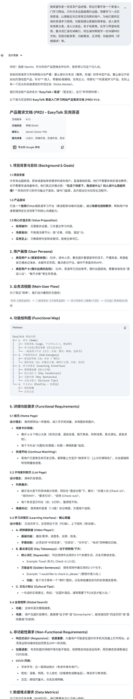
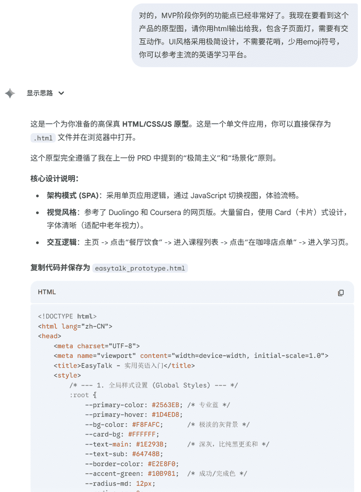
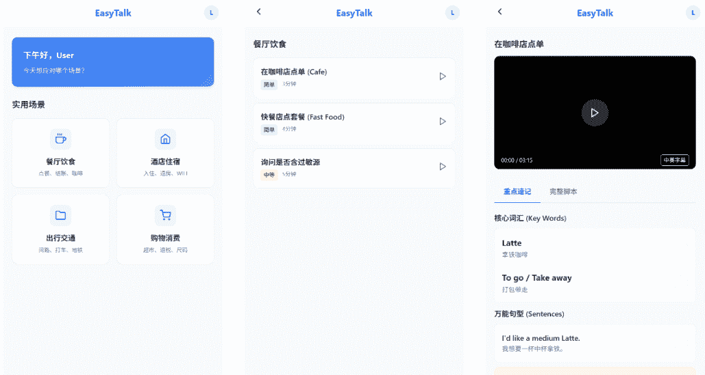
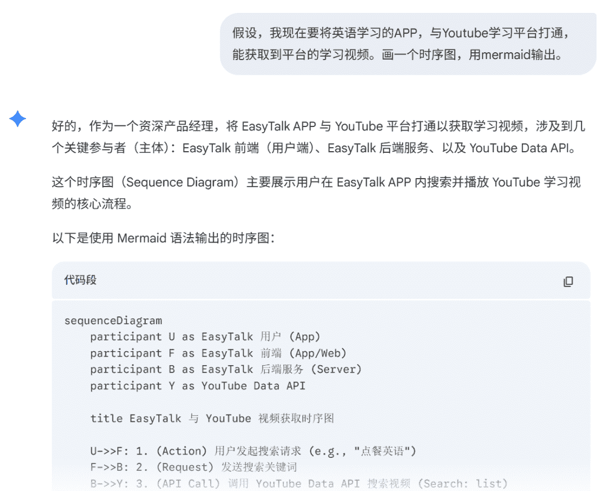
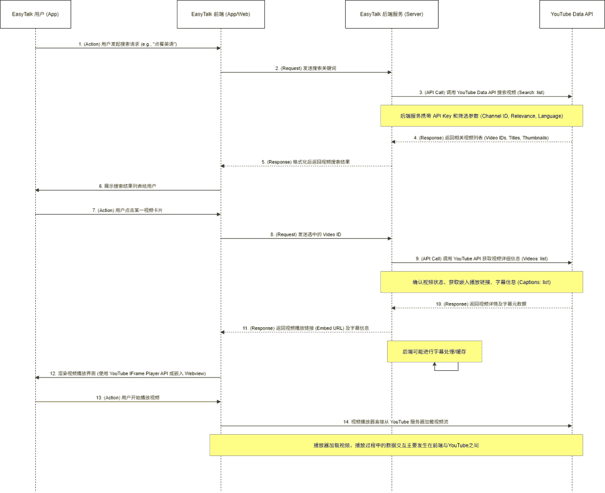

# Gemini 3 生成PRD产品需求文档

> 来源：[https://qqs7y1hozd1.feishu.cn/docx/W95fdxwUjog2GExGwlDcjUdxnNb](https://qqs7y1hozd1.feishu.cn/docx/W95fdxwUjog2GExGwlDcjUdxnNb)

### **1、制作PRD文档**

产品经理大部分的工作时间都在写这个需求文档，如果能用AI辅助，不仅是节省时间，关键是分析还到位。

假设，**我现在要做一个英语学习APP，只面向学**习日常生活场景的用户，满足偶尔出国的需求。

现在我打开Gemini官网，编写了一份提示词发给他，结果呈现的内容出人意料，核心功能都写的挺详细，还帮你延伸了实用的小功能，体验感提高。

### **2、生成原型图**

**如果你觉得这份PRD没问**题，就可以要求它帮你画高保真原型图，重点是高保真，有动画效果，有可能你自己画的，都没它效果好。

发送以下提示词：

> 在MVP阶段你列的功能点已经非常好了。我现在要看到这个产品的原型图，请你用html输出给我，包含子页面灯，需要有交互动作。UI风格采用极简设计，不需要花哨，少用emoji符号，你可以参考主流的英语学习平台。

复制一下代码，在桌面新建一个记事本，把代码粘贴进去，再将文件名后缀修改为html，打开后就能看到原型图。

### **3、用户画像**

为了让你对用户的特征能更清晰的辨别，可以让AI生成用户画像图，在图表中标注特征信息，在视觉上来加深印象。

### **4、流程图**

流程图应该是PRD文档里，最关键的部分，产品能不能用，好不好用，在前期就要把流程图确定清楚。

如果是复杂的产品，涉及到多系统的功能交互，那AI就能起到非常大的作用。

假设，我现在要将英语学习的APP，与Youtube平台打通，能获取到上面的视频。那就要画一个泳道图或时序图。

再将代码，导入至Draw.io，就能自动呈现图片。

