# Nano Banana Pro 提示词策略

> 来源：[https://qqs7y1hozd1.feishu.cn/docx/BYtLdJkL5otThgxfbO1ctZasnWb](https://qqs7y1hozd1.feishu.cn/docx/BYtLdJkL5otThgxfbO1ctZasnWb)

#### 🛑 章节 1：文本渲染、信息图与视觉合成

Nano-Banana Pro 拥有最先进（SOTA）的能力，可渲染清晰易读、风格化的文本，并将复杂信息合成为视觉格式。

##### 最佳实践：

+   压缩 (Compression)： 要求模型将密集文本或 PDF “压缩”成视觉辅助工具。

+   风格 (Style)： 明确指定你想要的风格，如“精致的编辑风”、“技术图表”或“手绘白板”效果。

+   引文 (Quotes)： 明确指定你想要的文本，并用引号括起来。

##### 示例提示词：

```
白板总结（教育类）：
“将‘Transformer 神经网络架构’的概念总结为一张手绘白板图，适用于大学讲座。使用不同颜色的记号笔区分编码器（Encoder）和解码器（Decoder）模块，并为‘自注意力（Self-Attention）’和‘前馈网络（Feed Forward）’添加清晰标签。”
```

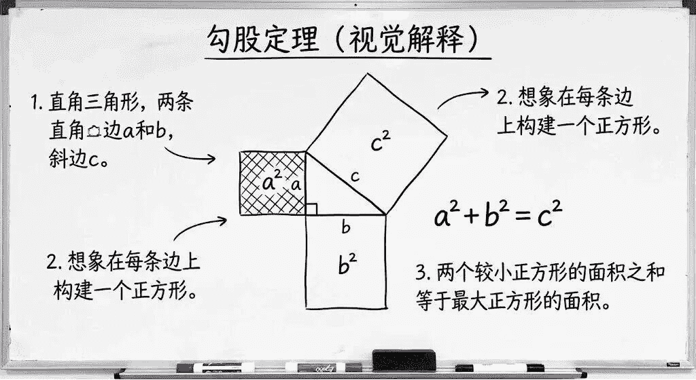

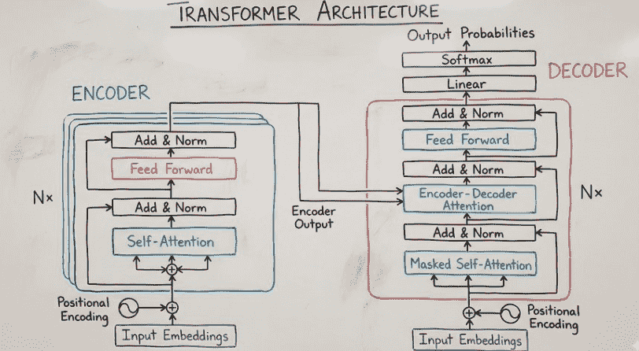

```
一款**移动旅行规划应用**需要三个主要设计元素，包括主页仪表板、行程屏幕及预订屏幕。主页仪表板应显示即将到来的旅行，提供常用功能的快速入口，并显示简单的地图预览。行程屏幕应显示每日安排，包含图标、备注及供用户查看的时间轴。预订屏幕应通过过滤器展示航班和酒店选择，显示价格比较卡片，直到用户找到首选选项并点击立即预订按钮。
```


```
复古信息图 ：
“制作一张关于美国小餐馆历史的复古 1950 年代风格信息图。包含‘食物’、‘点唱机’和‘装饰’等独立版块。确保所有文本清晰易读，并采用符合该时期的风格化设计。”
```


```
技术图表：
“创建一张正交蓝图，从平面图、立面图和剖面图描述这座建筑。用技术性建筑字体清晰标注‘北立面’和‘主入口’。格式为 16:9。”
```


#### 🛑 章节2：角色一致性与病毒式缩略图

Nano-Banana Pro 最多支持 14 张参考图像（其中 6 张具有高保真度）。这允许进行“身份锁定 (Identity Locking)”——将特定人物或角色放入新场景中而不会出现面部扭曲。

##### 最佳实践：

+   身份锁定： 明确说明：“保持人物的面部特征与图像 1 完全一致。”

+   表情/动作： 描述情绪或姿势的变化，同时保持身份不变。

+   病毒式构图 ： 一次性将主体与醒目的图形和文本结合起来。

##### 示例提示词：

```
“病毒式缩略图”（身份 + 文本 + 图形）(The &quot;Viral Thumbnail&quot; (Identity + Text + Graphics))：
“使用图像 1 中的人物设计一个病毒式视频缩略图。
面部一致性：保持人物的面部特征与图像 1 完全一致，但将其表情改为兴奋和惊讶。
动作：将人物摆放在画面左侧，手指指向画面右侧。
主体：在右侧放置一张高质量的牛油果吐司美食图片。
图形：添加一个醒目的黄色箭头，连接人物的手指和吐司。
文本：在中间叠加巨大的流行风格文字：‘3分钟搞定！’。使用粗体白色描边和投影效果。
背景：模糊、明亮的厨房背景。高饱和度和对比度。”
```

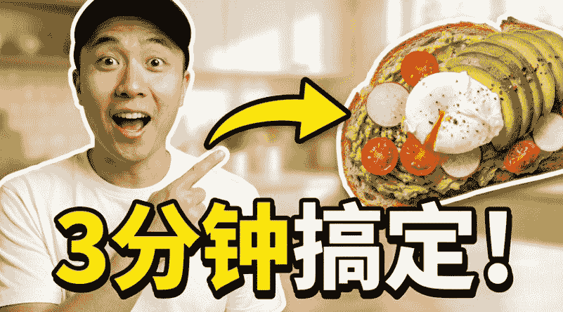

```
“毛绒伙伴”场景（群体一致性）
[输入 3 张不同毛绒玩偶的图像]
“创作一个由 10 个部分组成的搞笑故事，讲述这 3 个毛绒朋友去热带度假的经历。故事全程充满刺激，有情感起伏，并以一个幸福的时刻结束。确保所有 3 个角色的服装和身份保持一致，但他们的表情和角度应在所有 10 张图像中有所变化。确保每张图像中每个角色只出现一次。”
```

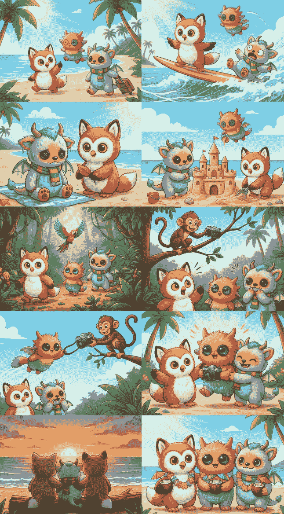

```
**绿色排毒冰沙分解图**：任务要求我创建一个信息图，通过原料、营养价值及混合顺序来演示制作绿色排毒冰沙的过程。
```

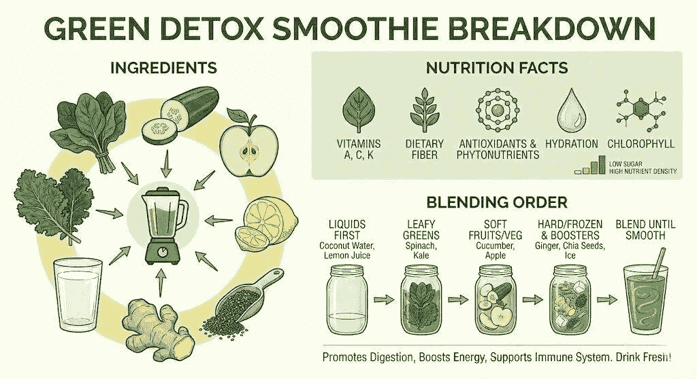

#### 🛑 章节3：基于 Google 搜索的信息锚定

Nano-Banana Pro 利用 Google 搜索，基于实时数据、时事或事实核查生成图像，减少在时效性话题上的幻觉（hallucinations）。

##### 最佳实践：

+   要求可视化动态数据（天气、股票、新闻）。

+   模型在生成图像前会“思考”（推理）搜索结果。

##### 示例提示词：

```
事件可视化 (Event Visualization)：
“根据当前的旅行趋势，生成一张关于 2025 年美国国家公园最佳游览时间的信息图。”
```

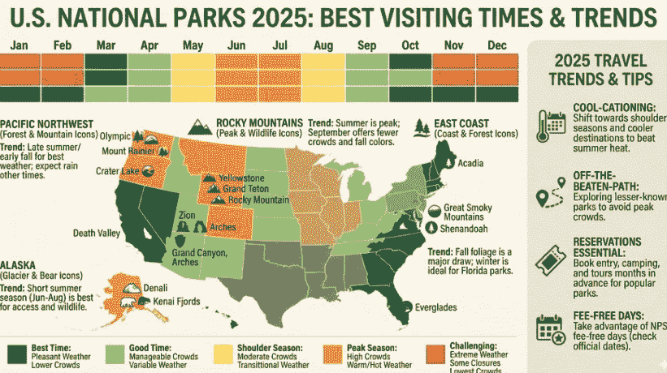

```
复古信息图 ：
“制作一张关于美国小餐馆历史的复古 1950 年代风格信息图。包含‘食物’、‘点唱机’和‘装饰’等独立版块。确保所有文本清晰易读，并采用符合该时期的风格化设计。”
```

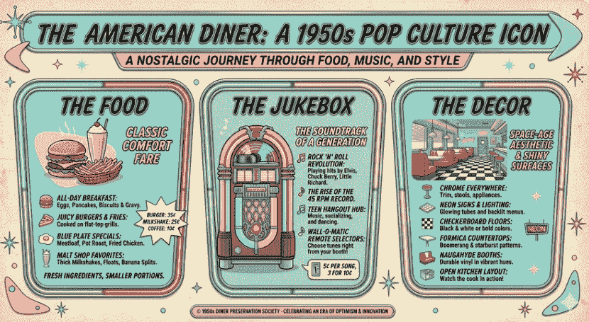

```
技术图表：
“创建一张正交蓝图，从平面图、立面图和剖面图描述这座建筑。用技术性建筑字体清晰标注‘北立面’和‘主入口’。格式为 16:9。”
```

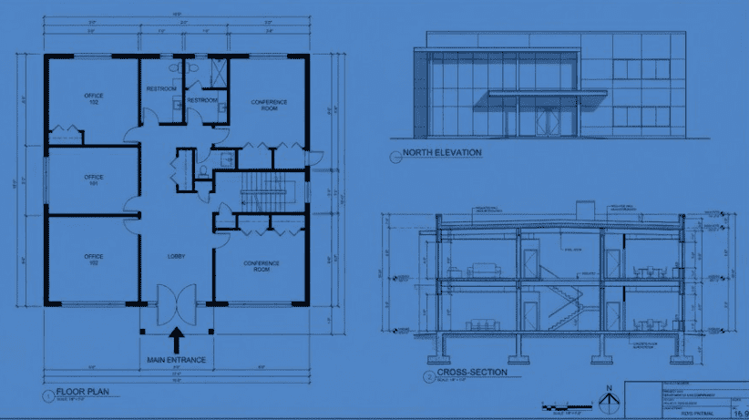

#### 🛑 章节4：高级编辑、修复与着色

该模型擅长通过对话式提示进行复杂编辑。这包括“图像修补 (In-painting)”（移除/添加对象）、“修复 (Restoration)”（修复老照片）、“着色 (Colorization)”（漫画/黑白照片）和“风格转换 (Style Swapping)”。

##### 最佳实践：

+   语义指令 ： 你不需要手动绘制遮罩；只需自然地告诉模型要更改什么。

+   物理理解： 你可以要求进行复杂更改，例如“给这个杯子装满液体”来测试物理生成能力。

##### 示例提示词：

```
对象移除与图像修补 (Object Removal &amp; In-painting)：
“移除这张照片背景中的游客，并用符合周围环境的合理纹理（鹅卵石和店面）填充该空间。”
```

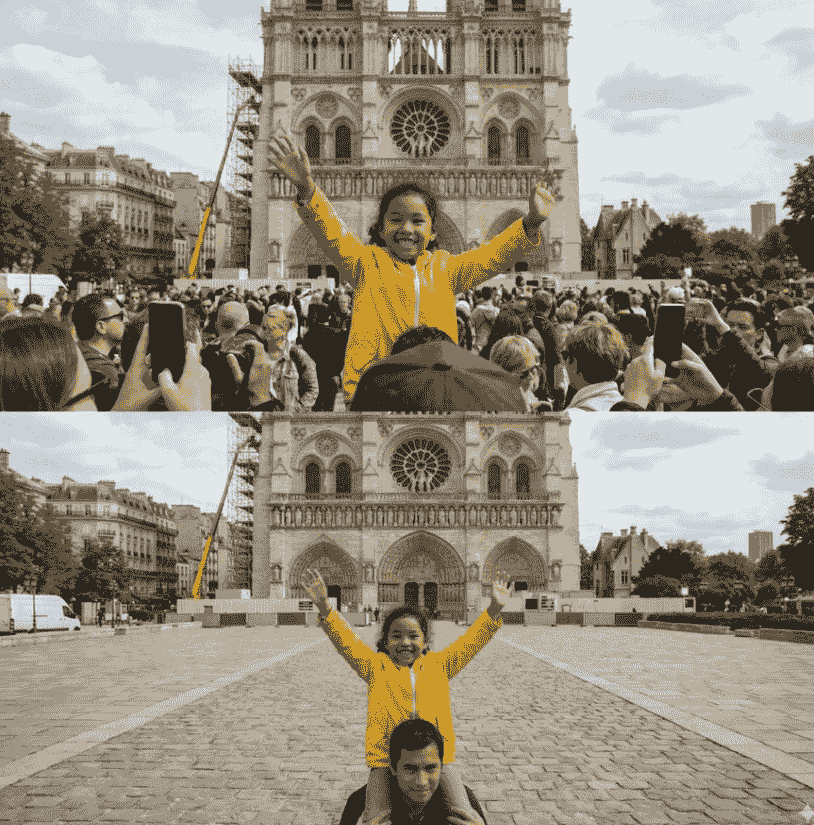

```
漫画/连环画着色 (Manga/Comic Colorization)：
[输入黑白漫画分镜]
“为这张漫画分镜上色。使用充满活力的动漫风格调色板。确保能量光束上的光照效果呈现发光的霓虹蓝色，角色的服装与其官方配色保持一致。”
```

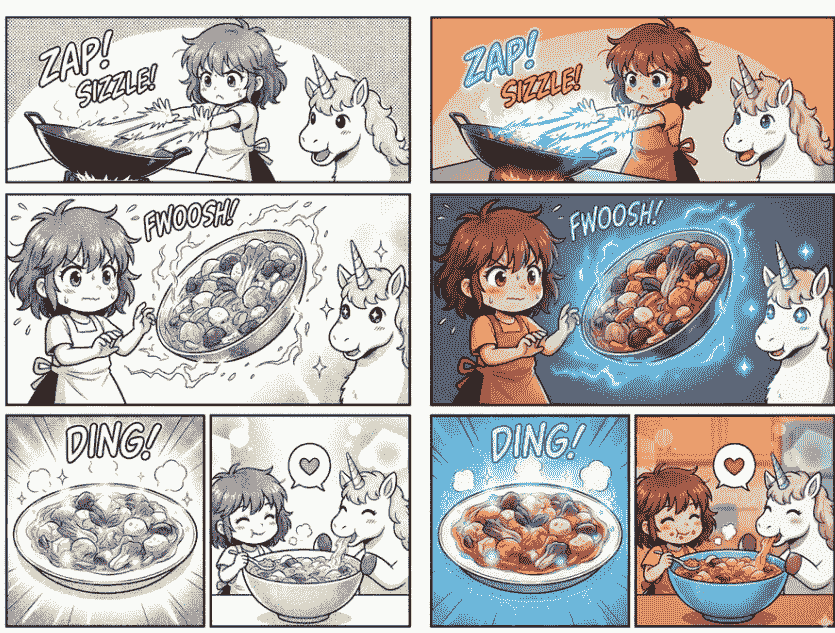

```
本地化（文本翻译 + 文化适配）
[输入伦敦公交车站广告图像]
“采用这个概念并将其本地化到东京场景，包括将标语翻译成日语。将背景改为夜晚繁忙的涩谷街道。”
```

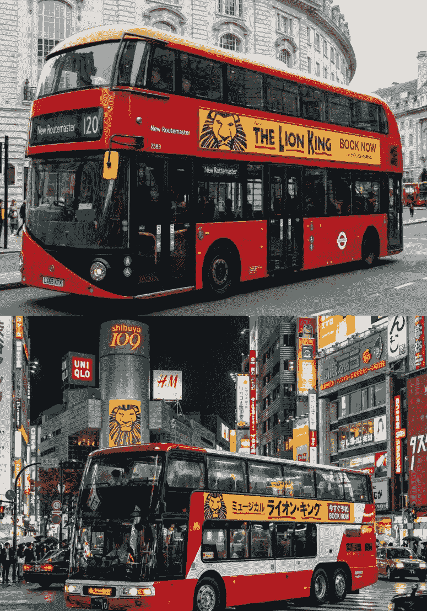

```
光线/季节控制 (Lighting/Seasonal Control)：
[输入夏季房屋图像]
“将此场景转换为冬季。保持房屋结构完全相同，但在屋顶和院子里添加积雪，并将光线改为寒冷、阴沉的下午光线。”
```

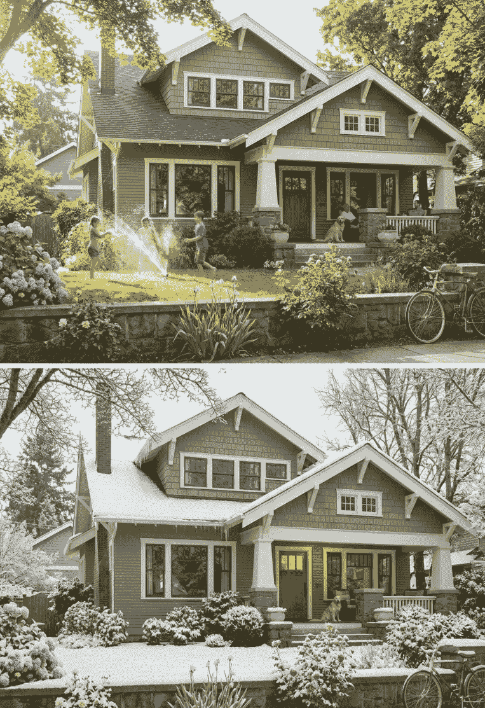

#### 🛑 章节5：维度转换 (2D ↔ 3D:

一项强大的新功能是将 2D 示意图转换为 3D 可视化效果，反之亦然。这非常适合室内设计师、建筑师和表情包创作者。

##### 示例提示词：

```
2D 平面图转 3D 室内设计板 (2D Floor Plan to 3D Interior Design Board)：
“基于上传的 2D 平面图，在一张图像中生成专业的室内设计演示板。
布局：拼贴形式，顶部一张大型主图（客厅区域的广角透视图），下方三张小图（主卧室、家庭办公室和一个 3D 俯视平面图）。
风格：应用现代极简主义风格，所有图像均采用温暖的橡木地板和灰白色墙壁。
质量：照片级真实感渲染，柔和的自然光线。”
```

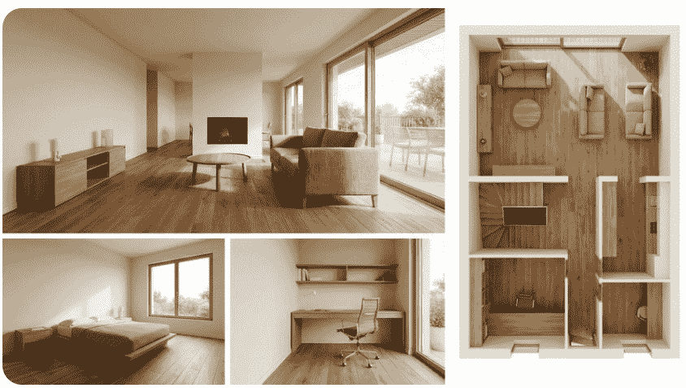

```
2D 转 3D 表情包转换：
“将‘This is Fine’狗表情包转换为照片级真实感的 3D 渲染。保持构图完全相同，但让狗看起来像一个毛绒玩具，让火看起来像真实的火焰。”
```


```
光线/季节控制 (Lighting/Seasonal Control)：
[输入夏季房屋图像]
“将此场景转换为冬季。保持房屋结构完全相同，但在屋顶和院子里添加积雪，并将光线改为寒冷、阴沉的下午光线。”
```


#### **🛑 章节6：高分辨率与纹理**

Nano-Banana Pro 支持原生 1K 至 4K 图像生成。这对于细节纹理或大幅面打印特别有用。

##### 最佳实践：

+   如果你的 API/界面允许，请明确要求高分辨率（2K 或 4K）。

+   描述高保真细节（瑕疵、表面纹理）。

##### 示例提示词：

```
4K 纹理生成：
“利用原生高保真输出，打造一个令人惊叹的青苔森林地面的氛围环境。掌控复杂的光照效果和细腻的纹理，确保每一缕苔藓和每一束光线都以适合 4K 壁纸的像素级完美分辨率呈现。”
```


```
复杂逻辑（思考模式）：
“创建一张超写实的信息图，展示一个解构的精致芝士汉堡，展示烤布里欧面包的纹理、肉饼的焦化外壳以及芝士闪亮的融化状态。为每一层标注其风味特征。”
```

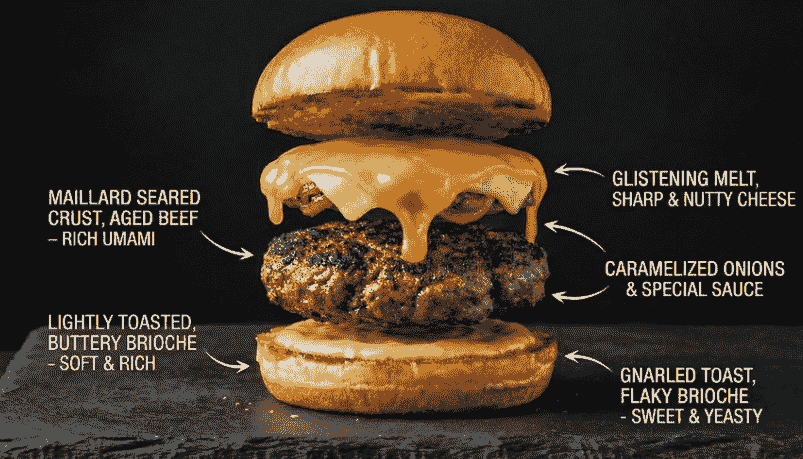

#### **🛑 章节7：思考与推理 **

Nano-Banana Pro 默认采用“思考”过程，在渲染最终输出前会生成临时的思考图像（不收费），以优化构图。这允许进行数据分析和解决视觉问题。

##### 示例提示词：

```
解方程 (Solve Equations)：
“在白板上解方程 log_{x^2+1}(x^4-1)=2 in C。清晰地展示步骤。”
```

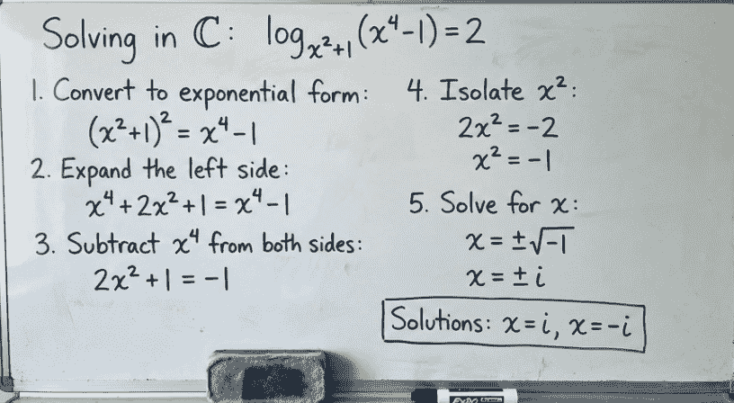

```
视觉推理：
“分析这张房间的图像，并生成一张‘之前’的图像，展示该房间在施工期间可能的样子，显示框架和未完成的石膏板。”
```

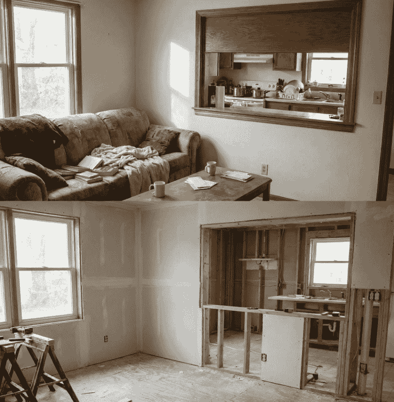

#### 🛑 章节8：一次性故事板与概念艺术:

你可以无需网格即可生成连续艺术或故事板，确保在单次会话中获得连贯的叙事流。这也常用于“电影概念艺术”（例如，即将上映电影的虚假泄露图）。

##### 示例提示词：

```
“创作一个引人入胜的 9 部分故事，包含 9 张图像，讲述一个获奖奢华行李箱广告中的一男一女。故事应有情感起伏，以一个展示女性和品牌标志的优雅镜头结束。女性和男性的身份及其着装必须贯穿始终保持一致，但可以且应该从不同的角度和距离展现他们。请一次生成一张图像。确保每张图像均为 16:9 的横向格式。”
```


```
精灵图 (Sprites)：
“精灵图：一个女人在无人机上做后空翻，3x3 网格，序列，逐帧动画，正方形宽高比。严格按照所附参考图像的结构。”
```


> (提示：可以提取每个单元格并制作 GIF 动画)

#### 🛑 章节9：结构控制与布局引导

输入图像不仅限于角色参考或待编辑的主体。你可以使用它们来严格控制最终输出的构图和布局。这对于需要将草图、线框图或特定网格布局转化为精美资产的设计师来说是革命性的。

##### 最佳实践：

+   草稿与草图： 上传手绘草图以精确定义文本和对象的位置。

+   线框图： 使用现有布局或线框图的截图来生成高保真 UI 模型。

+   网格： 使用网格图像强制模型为基于图块的游戏或 LED 显示屏生成资产。

##### 示例提示词：

```
草图转最终广告 (Sketch to Final Ad)：
“根据这张草图，为 [产品] 创建一个广告。”
```

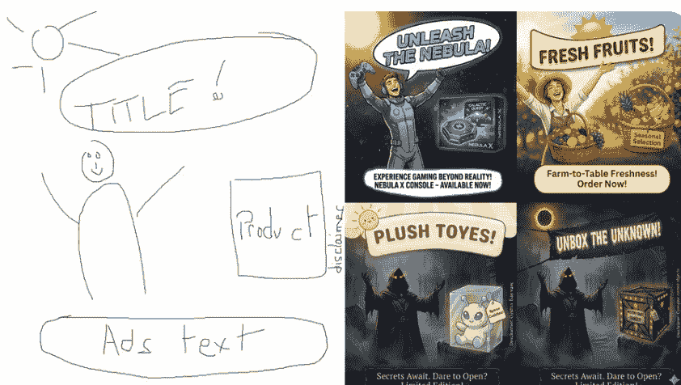

```
线框图转 UI 模型 (UI Mockup from Wireframe)：
“根据这些指南，为 [产品] 创建一个模型。”
```

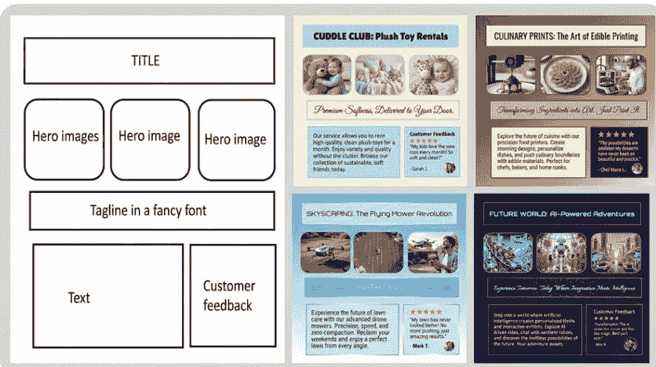

```
像素艺术与 LED 显示屏 (Pixel Art &amp; LED Displays)：
“生成一个独角兽的像素艺术精灵，完美适配这张 64x64 网格图像。使用高对比度颜色。”
(提示：开发人员随后可以编程提取每个单元格的中心颜色，以驱动连接的 64x64 LED 矩阵显示屏)。
```

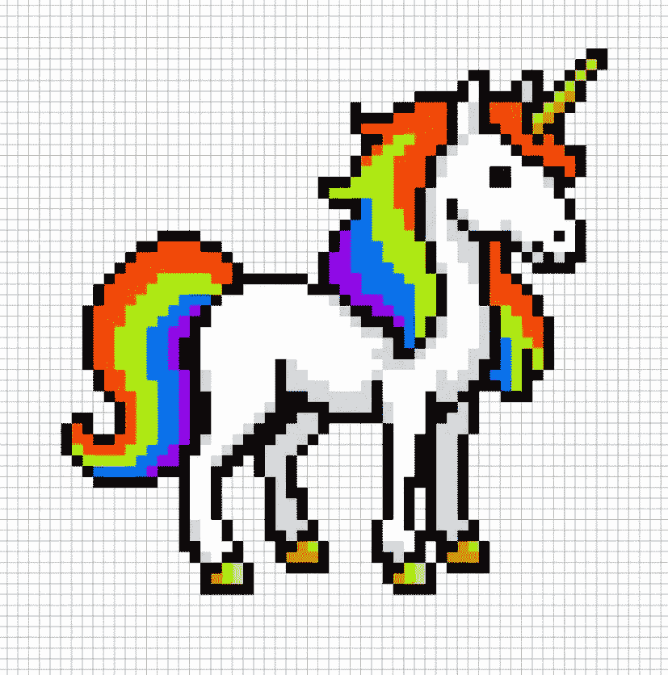

```
精灵图 (Sprites)：
“精灵图：一个女人在无人机上做后空翻，3x3 网格，序列，逐帧动画，正方形宽高比。严格按照所附参考图像的结构。”
```

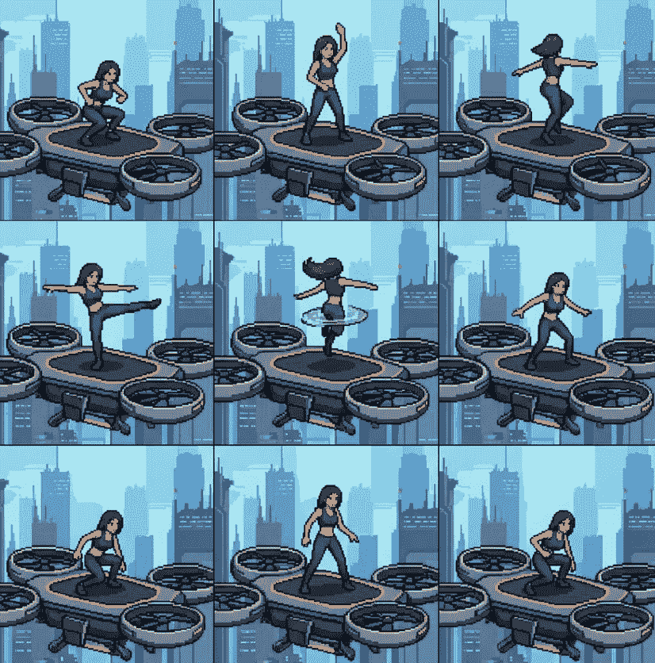

> (提示：可以提取每个单元格并制作 GIF 动画)

#### 🛑 章节10：科普插画/原型图/「一图读懂xxx」

```
提示词：用一个科普插画解释为什么原神改变了中国国产游戏生态，文字用中文
```

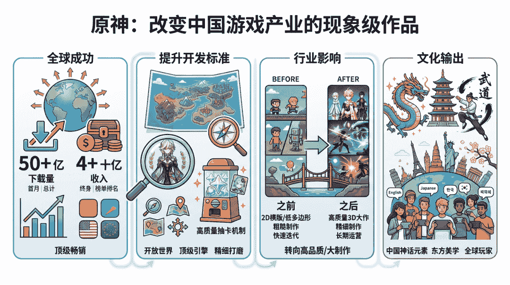

```
提示词：我想开发一款类似于“小宇宙”的APP，请你帮我画个原型图，所有要求均符合APP原型图标准。
```


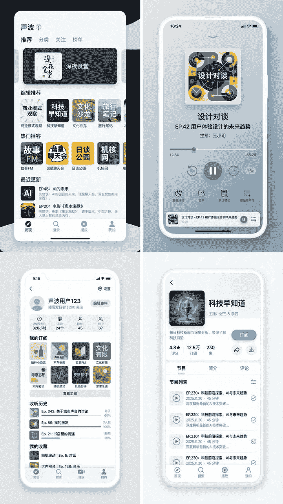

```
你需要生成一个长笔记，给中国的学生解释清楚一件事情：
{主题}

这个长笔记的背景风格为笔记本/手帐，适合手机阅读
笔记中的文字，都是中文
笔记主体文字为 36px，图片宽度为 1080px，清晰易读
你还会用 nano-banana 画一些图片，放在笔记中，便于读者更好的理解内容，风格统一
你的图片为手绘风格插图，彩色粗铅笔，信息量丰富，图中文字均为英文，纯色背景
你需要生成这个笔记，来解释后面的内容；对于重点内容要加粗；你的配色非常合理且好看

以下为你要生成的内容
{
内容和图片描述
}

请生成这个笔记，并在最后给出信息“这篇文章，完全由 lovart &amp; nano-banana 生成，带来直观的信息表达”
```

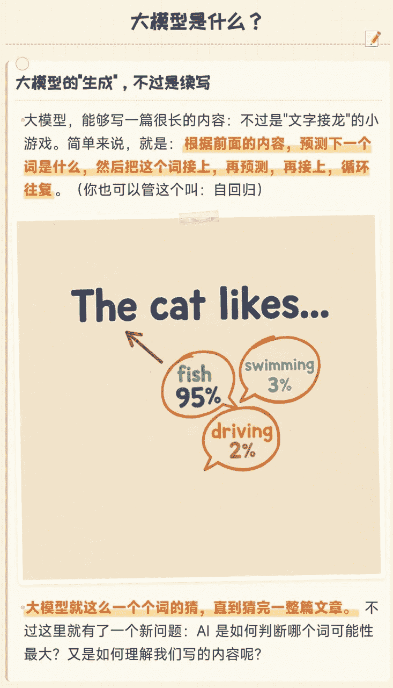

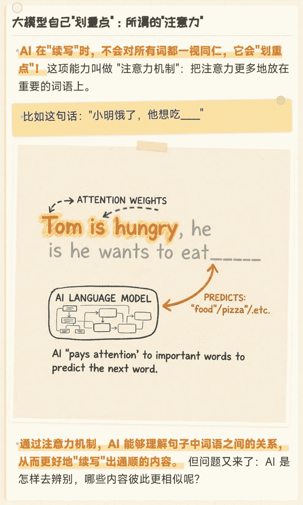

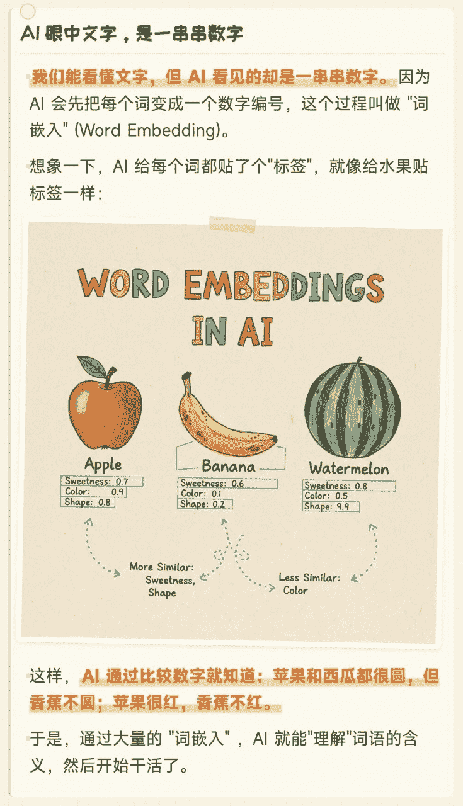

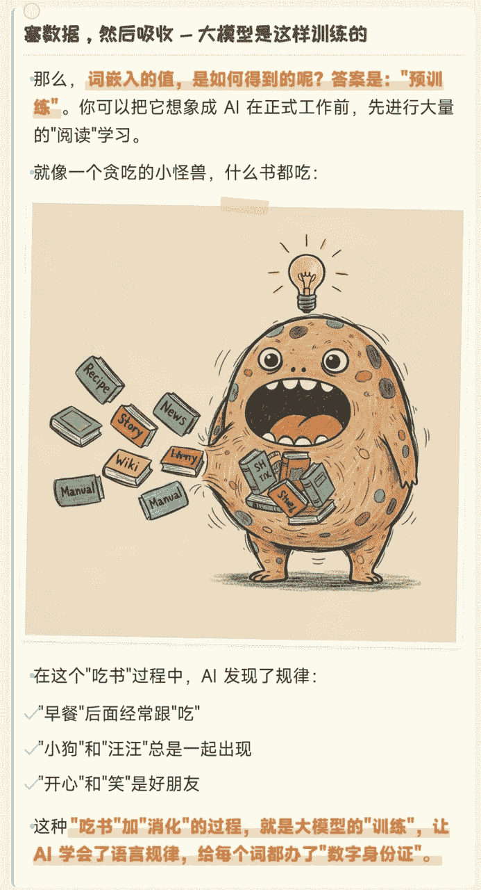