# Notebook LM+Gemini，速通任何领域

> 来源：[https://qqs7y1hozd1.feishu.cn/docx/MvdjdkRL4o4rNJxPrtHc0JuDnmg](https://qqs7y1hozd1.feishu.cn/docx/MvdjdkRL4o4rNJxPrtHc0JuDnmg)

# 第一步：让Gemini当星探，只看最好的

YouTube上内容虽然很好，但太多了，比如我要研究“一人公司”这个话题，我就要找含金量最高的那个视频，其他的视频我一秒都不想浪费。

因为Gemini和youtube都是谷歌旗下的平台，Gemini能够直接打通YouTube上的内容。

那我就直接进入Gemini的官网：gemini.google.com

直接给Gemini发送下面这个提示词：

> Gemini，我想用你更好的帮我吸收youtube上面的视频，因为我要在上面学习，里面有一些博主讲的内容我很喜欢，但是我英语不好，我也听不懂。我一直在研究一人公司，然后youtube上面有一个博主叫dankoe，在我们国内很有名，我想去研究一下他关于一人公司这个话题下一些观点。你帮我把dankoe在youtube上面发过的所有关于一人公司的视频链接都发给我

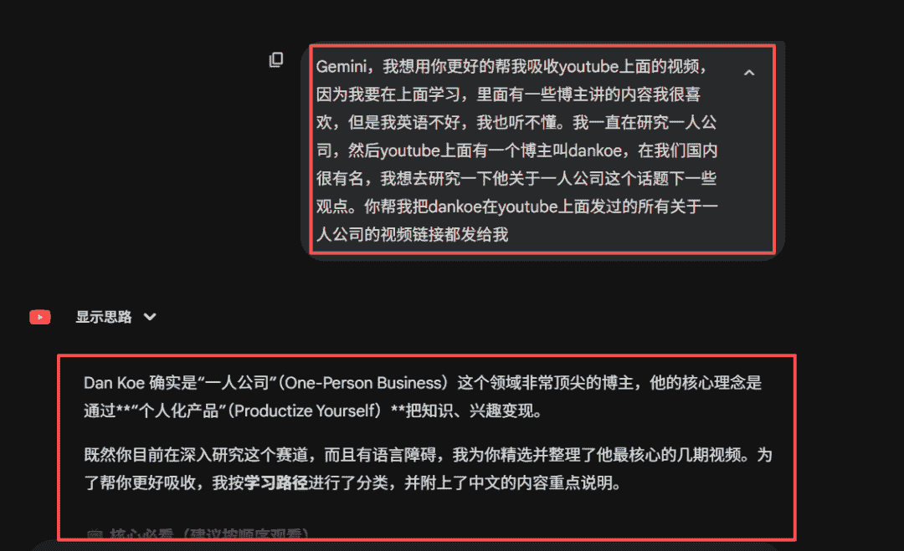

Gemini 会瞬间帮我过滤掉那些无关的视频，甩给我几条核心内容，并附带了YouTube上对应的视频链接，以及推荐理由，真的很省时间。

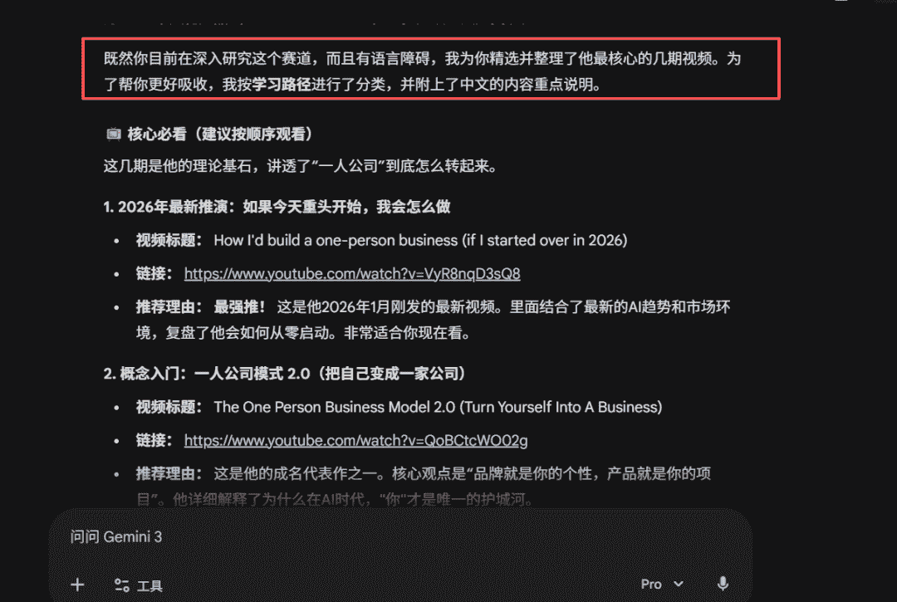

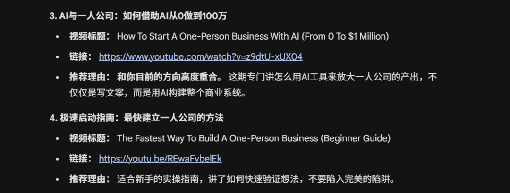

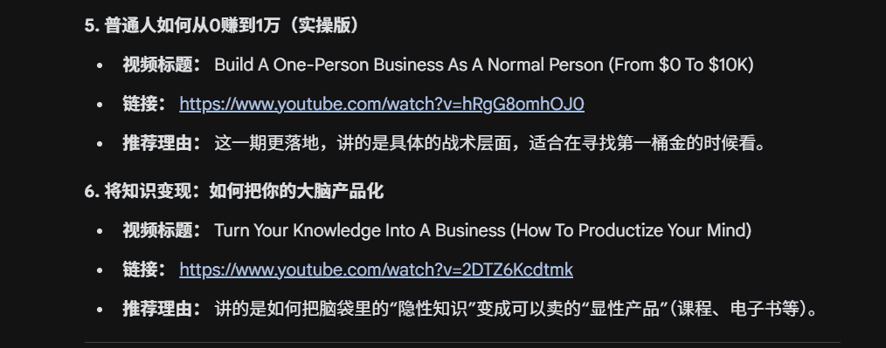

# 第二步：不用去看视频，用NotebookLM直接扒出逐字稿

拿到视频链接，不用去下载字幕，时间不够的话，也不用费大量时间去硬听原视频，毕竟太吃力了。

我们需要的是视频里的原汁原味的信息。

NotebookLM是谷歌旗下的一款神级笔记工具。

**进入NotebookLM官网**：

https://notebooklm.google.com/

进去后新建一个笔记本。

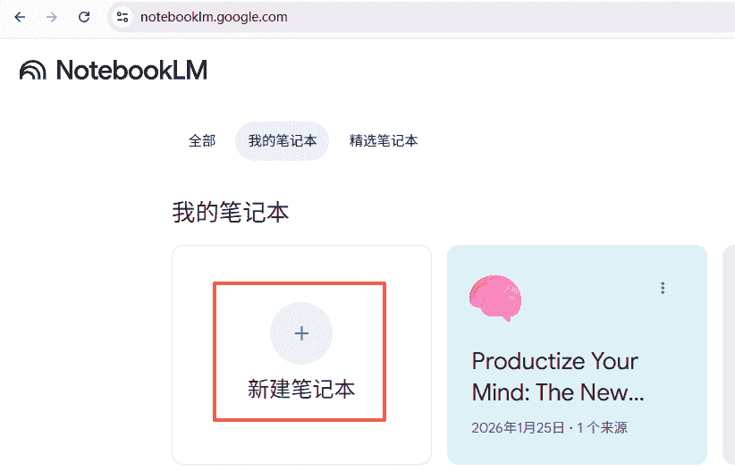

**骚操作来了，**你不需要下载视频，直接点击**“添加来源”**，选择“YouTube网站”，把Gemini给到我们的链接粘贴进去。

比如我就选择dankoe《将知识变现：如何把你的大脑产品化》这一期视频的链接，点击插入。

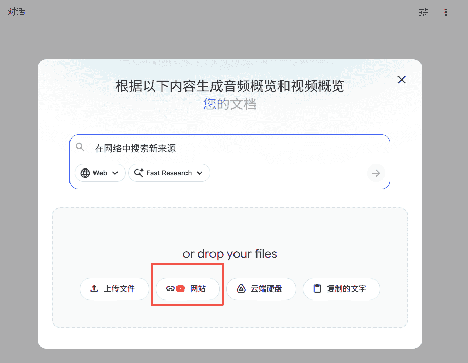

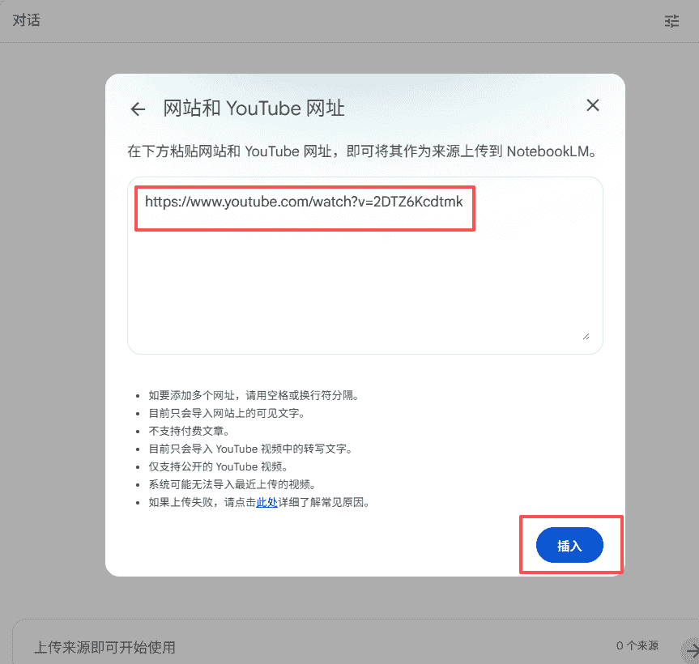

点插入之后，他会自动的帮你先针对这个视频做一个总结

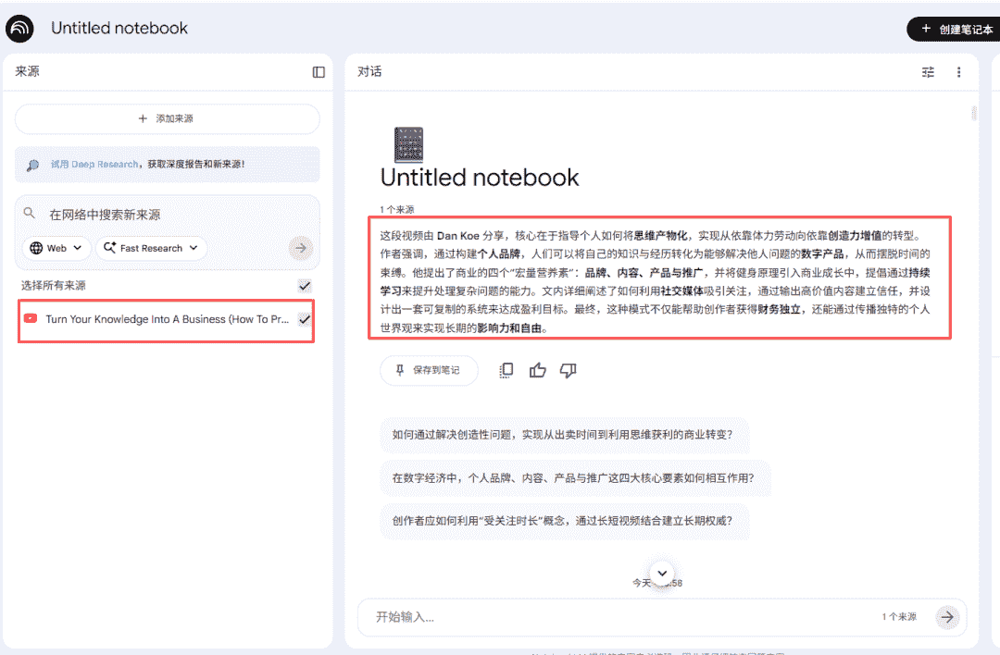

接着，可以在文本框，发送这段提示词：

> 把全视频的逐字稿翻译成中文，按时间戳分段显示

瞬间，NotebookLM 就把整个视频的逐字稿“扒”下来了。

不管这视频是一个小时还是两个小时，不管语**速多快，**它现在已经是一份你可以随意调用的中文文档了。

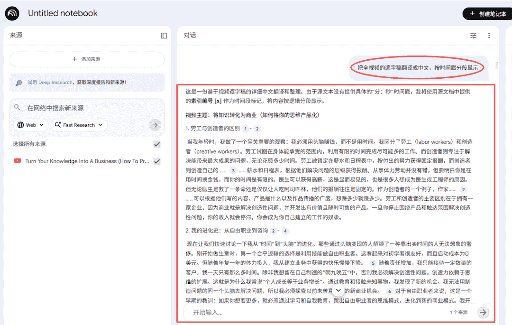

**这一步能让你快速学习到原汁原味的原文，但读起来还**是太枯燥，且太费时间了，所以进行第三步。

# 第三步：让AI深度分析视频逐字稿，学习精华

这一步是核心。普通的AI总结只会告诉你视频讲了什么，给你总结一下，那太浅了。

我们要像拆解精密仪器一样，把博主的思维逻辑拆出来。

我给 NotebookLM 发送了这组指令：

> 你是商业拆解专家，精通“一人公司”模式。基于你刚刚提取并翻译好的中文逐字稿，帮我进行深度拆解，输出中文：

> 核心论点： 用一句话总结这个视频在讲什么核心认知差？

> 逻辑框架： 他是用什么样的逻辑推导出来的？（请用 1. 2. 3. 的步骤形式呈现他的思维链条）。

> 金句与时间戳： 提取文中引发共鸣的5-10个金句（中英对照），并附上大概的时间位置，方便我回看视频听语气。

> 概念词典： Dan Koe喜欢发明新词，请把这些词提取出来，并用大白话解释它的真实含义。

这个指令结构你也可以参考，结果非常震撼，它总结得非常好。

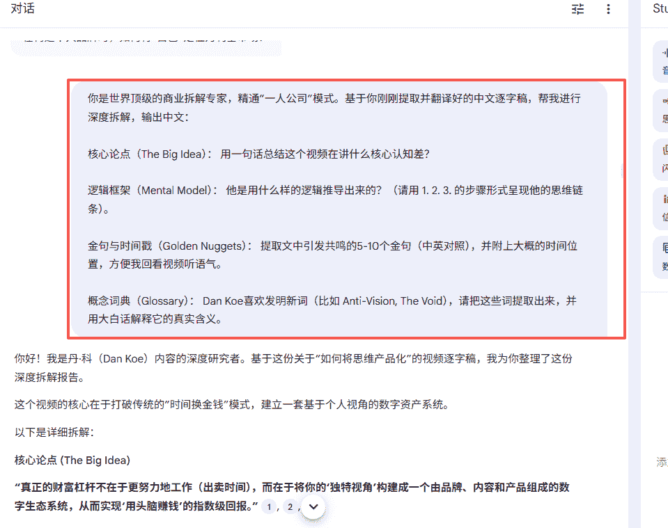

我帖一部分notebooklm总结的内容的截图，大家可以稍微看下。

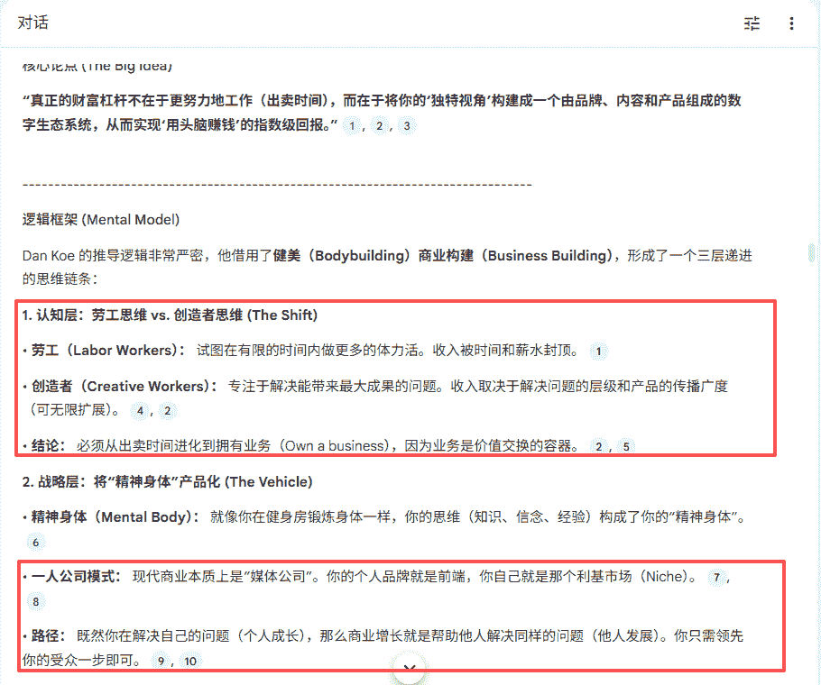

**还给出很多很好的金句，真的非常棒，这些金句都是原汁原**味的，如果要你自己手动总结，估计得累死。

比如我就很喜欢里面讲到的这些金句：

> “劳工被锁定在薪水和日程表中，而创造者则创造自己的薪水和日程表。“

> “如果我能获得一个读者，我就能获得一百万个。”

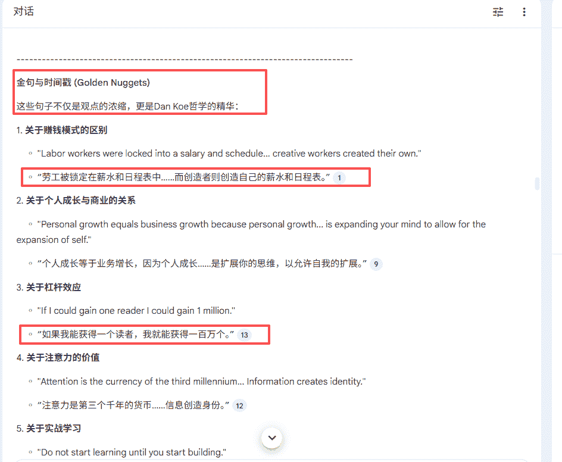

如果不通过这种深度拆解，光看视频，大概率就听个热闹，很难第一遍就抓住这个核心骨架。

# **第四步、让AI把内容进行本土化**

学习的终点不仅仅是知道了，更得要能用了，因为dankoe是做的海外自媒体，它不一定完全和我们国内的一样，但底层逻辑是一样的。

于是，我为了更好地去理解如何具体去应用他的方法，我让AI做最后一步本土化。

我接着在NoteBookLM的对话框输入这个提示词：

> 结合Dan Koe的上述观点，请帮我进行“中国本土化”的迁移：

> 比如场景置换，比如当他提到Newsletter时，对应国内是公众号，请把他的这套打法，通过中国国内一人公司的视角重新演绎一遍。

> 以及给出落地行动清单，如果我要教我的学员执行这套理论，请列出他们明天就能做的具体动作（SOP）。

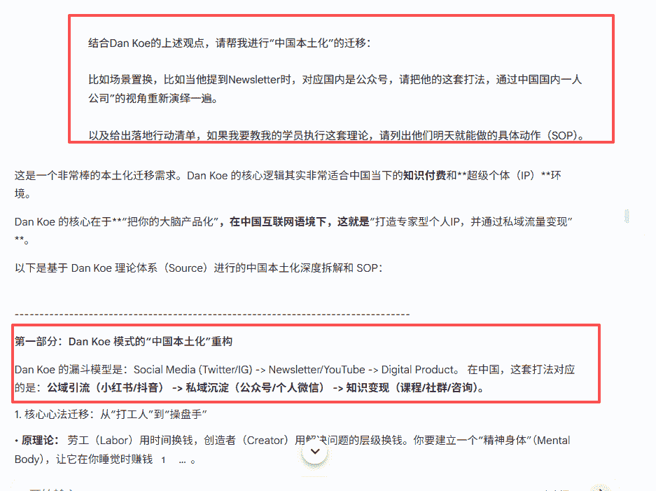

瞬间，就会发现他帮我们总结的内容就非常接地气了。比如他总结到：

> **拒绝内卷****和35岁危机的唯一解**法，是建立个人资产。在中国，这不只是做自媒体，而是把你的认知、经验、踩过的坑打包成一个不需要你实时在场的“产品”。你不是在找一份工作，你是在经营一家以你名字命名的“一人无限责任公司。

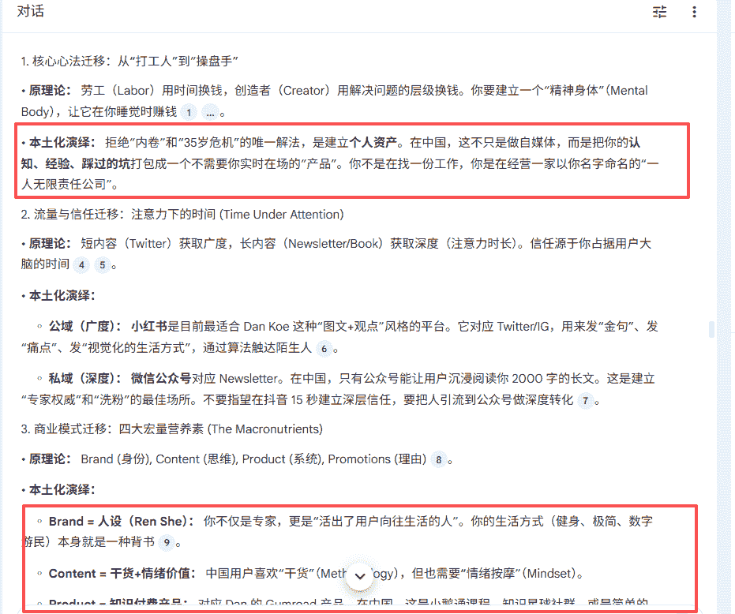

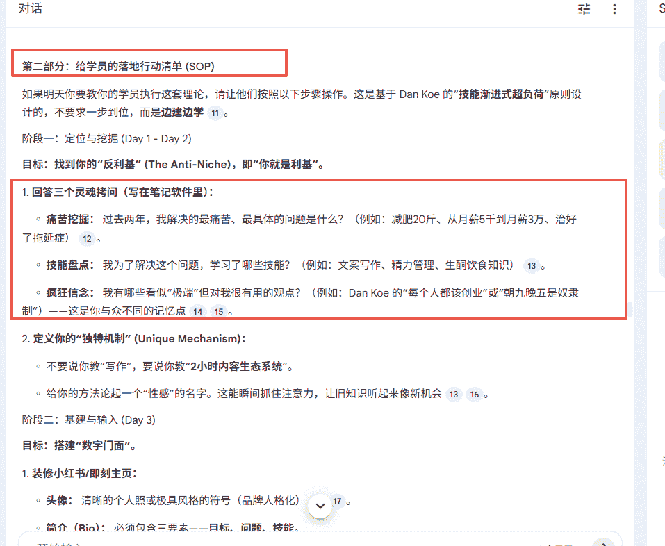

这样你就能够学到原汁原味且真正有价值的内容了。

通过这个案例，我想表达的是，AI的确方便了我们的学习生活中的方方面面。

**以**前，你也许多花3小时，只能模模糊糊听懂大概，现在，你花10分钟，就能把顶级高手的思维模型拆解得一清二楚，并且直接落地成你的SOP。

**之所以用Notebook LM，是因为很**适合用来学习，它非常忠实于原文，不会乱发散，不会乱编，你给它什么视频，它就只回答视频里的内容。

非常适合整理资料、提取字幕、做摘要、做研究，

还可以把这些分析拆解出来的文本，保存到笔记。点击保存到笔记

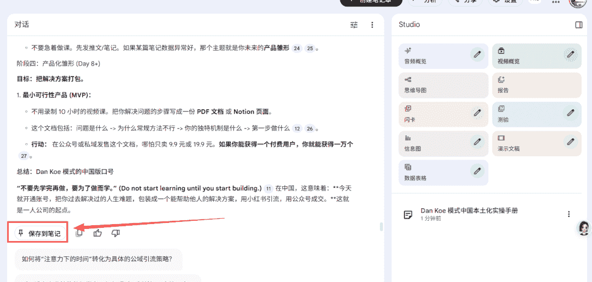

然后再把保存好的笔记**转换为来源。**

最终可以把它做成播客、思维导图、ppt等，方便复习。

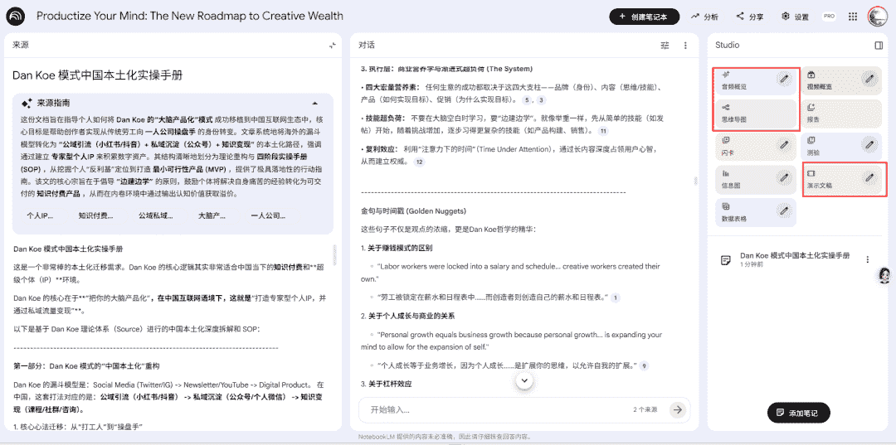

比如我把它做成一个ppt，如下：

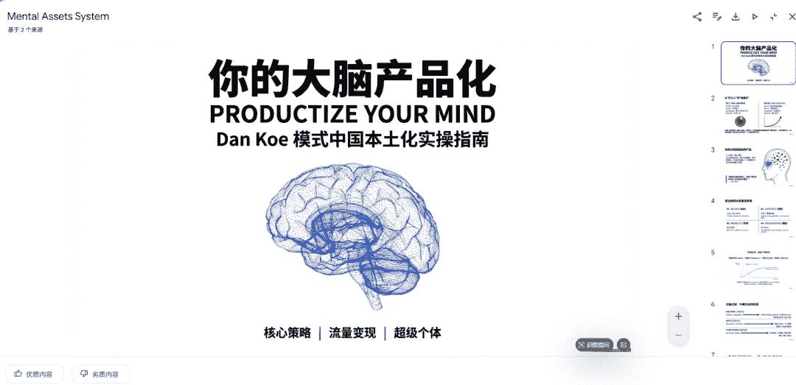

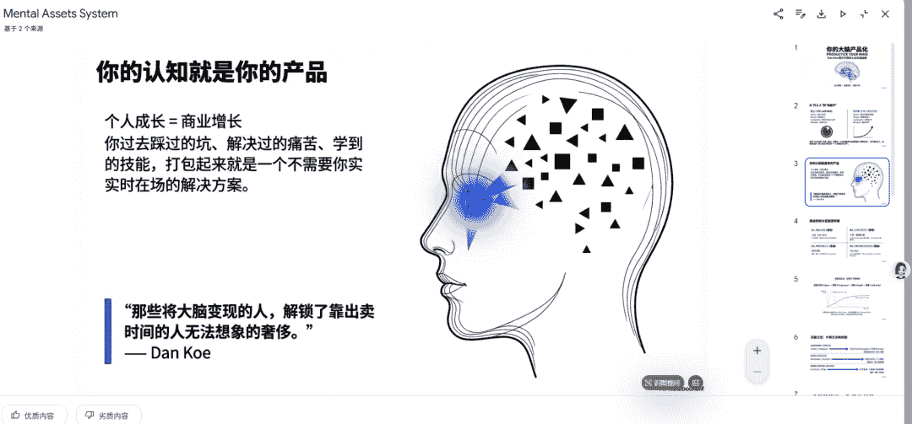

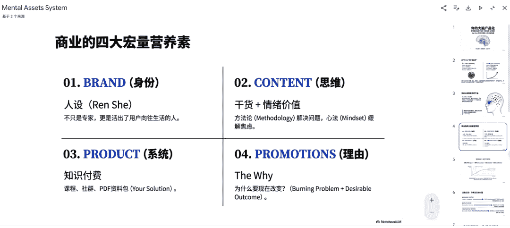