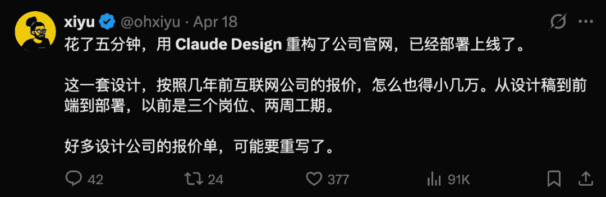
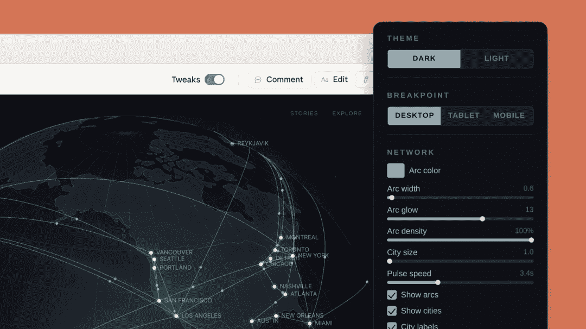
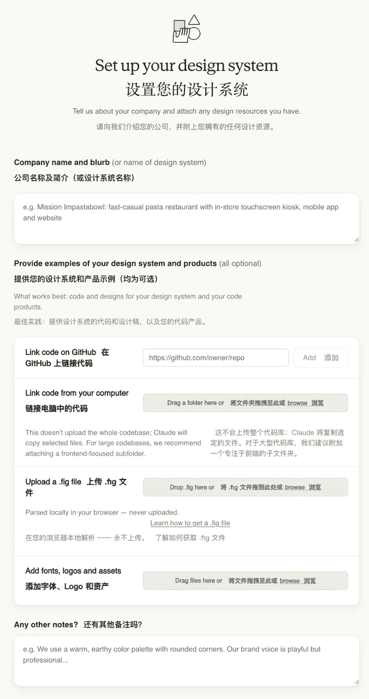
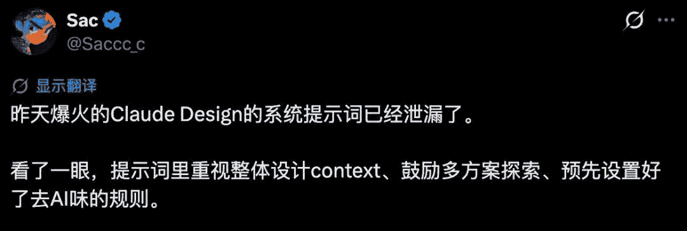

# Claude Design 提示词，拿走即用

> 来源：[https://qqs7y1hozd1.feishu.cn/docx/FyDPdD9daorkgCxUfx0c1jJCnKg](https://qqs7y1hozd1.feishu.cn/docx/FyDPdD9daorkgCxUfx0c1jJCnKg)

### **对话就能出设计稿 **

以前做设计，你得先学 Figma 或者 Photoshop，学会了才能把脑子里的想法变成图。

现在你直接说：“帮我做一个深色主题的交互式地图，城市之间用发光的弧线连接。”

几秒钟，就出来了。

### **它会给你做工具 **

Claude Design 里有个功能叫 Knobs（旋钮）。

你可以让它给你生成自定义滑块。想调弧线的发光强度？它给你加一个 0-100 的滑块。想改字号？再加一个。

你拖动滑块，设计实时跟着变。

这不只是“AI 帮你画图”，而是“AI 给你做了个专属工具”。

### **自动套用你的品牌规范 **

Claude Design 在你开始用之前，会读你的代码库和设计文件，自动提取颜色、字体、组件规范，给你搭一套 design system。

### 直接交给 Claude Code 去实现

设计完了，你可以导出成 PDF、PPTX、HTML，或者发到 Canva 继续编辑。

但最厉害的是它和 Claude Code 的配合。

设计做好了，点一下 handoff，所有资产自动打包成一个“交接包”，Claude Code 拿到就能直接开始写代码。

从设计到代码，中间少了一层人工翻译。

### 这次，Claude Design提示词也泄露了

说完了牛的地方，现在说点实际的。

Claude Design 现在对 Claude Pro、Max、Team、Enterprise 用户开放，入口是 claude.ai/design。但问题是，Claude 在国内一直不太好用，很容易封号，支付也不方便。

这次，Claude Design 的系统提示词传出泄露了。

整个提示词里重视整体设计context、鼓励多方案探索、预先设置好了去AI味的规则。

把这些提示词拿去，就可以配合国内的 AI 工具去使用。