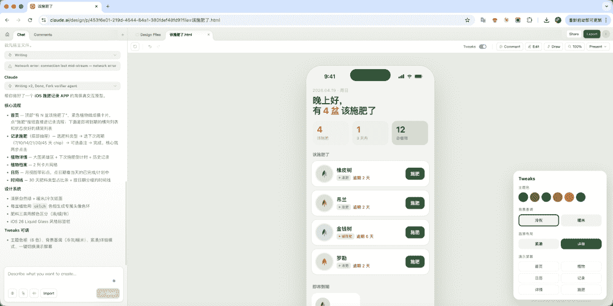
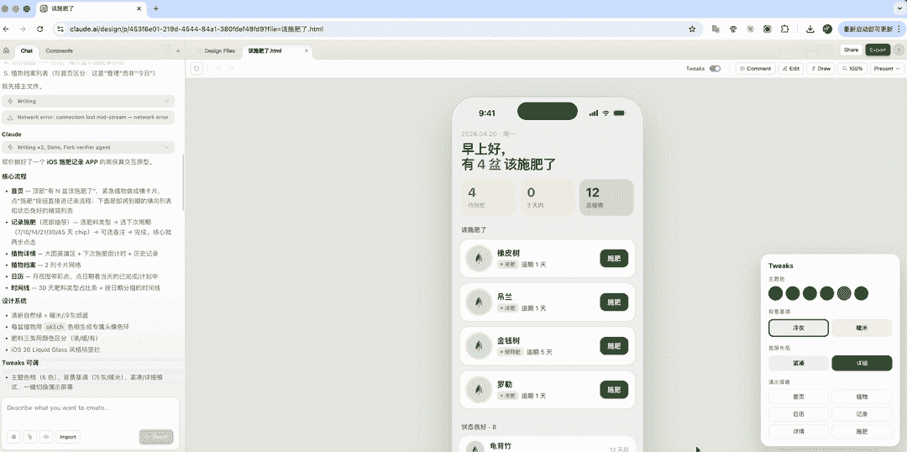
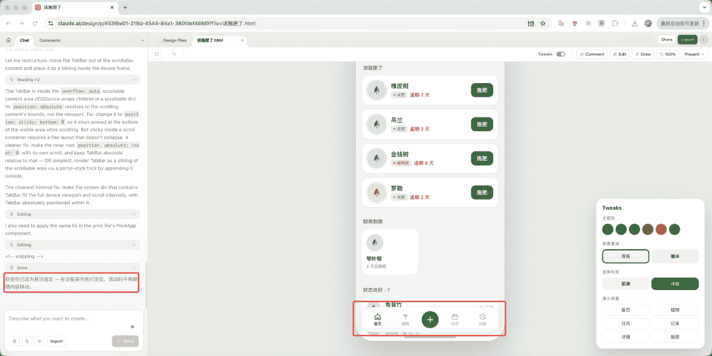
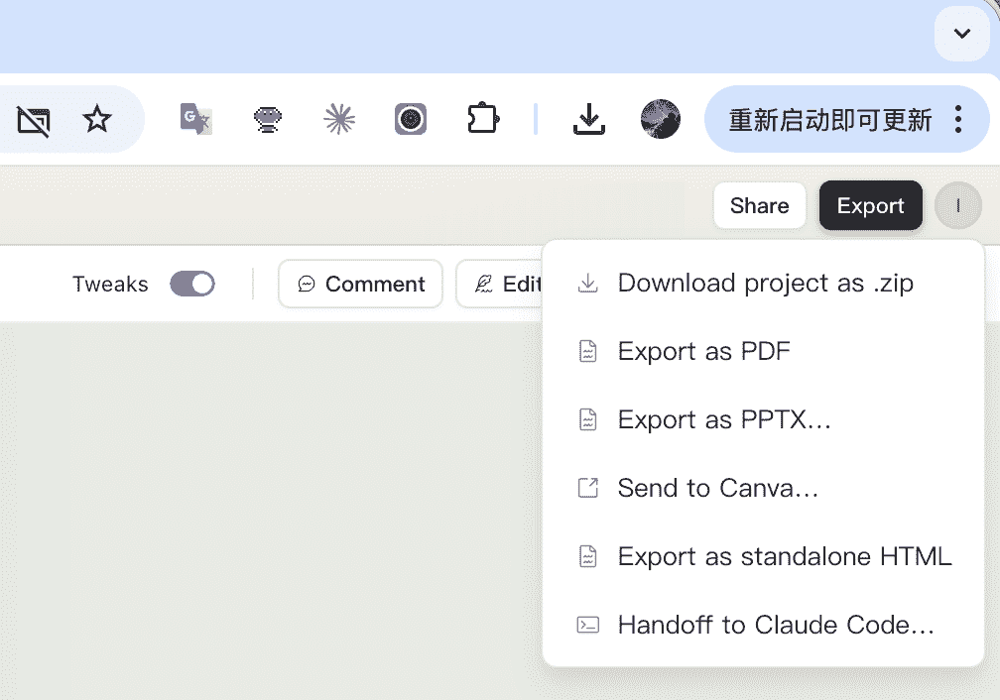
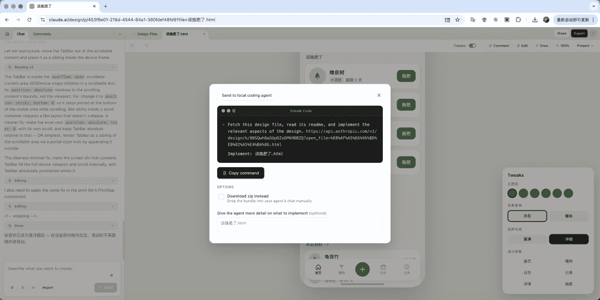
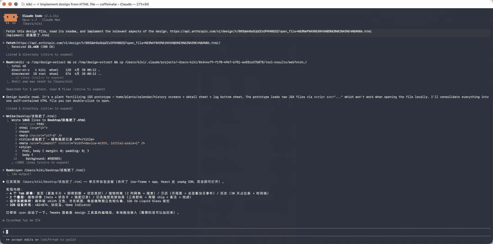

# Claude Design：5分钟画完一个 APP

> 来源：[https://qqs7y1hozd1.feishu.cn/docx/KG0KdpElfoBV6ixmLuwcAWmbnMe](https://qqs7y1hozd1.feishu.cn/docx/KG0KdpElfoBV6ixmLuwcAWmbnMe)

试着做一个APP吧！

**家里养了十几盆，大**大小小各种类型都有，浇水很简单，见干见湿就行了，但施肥时间是真记不住——

周期长，两周到一个月不等，没有像土壤干湿那样可以直接感知的外部信号，忘了当下看不出问题，养着养着就发现——长得很慢、叶子没那么绿了、该开花的不开

所以，直接写给**Claude Design：**

> 我养了十几盆植物，总是是记不住上次什么时候施肥。想做一个 APP，核心功能只有一个：记录施肥 + 提醒下次施肥时间。

发送~ 等

Claude Design马上给我发来一些问题要我确认

我认真选好、填好，点继续（在“需要哪些功能”那里，我额外加了一条：每次施肥后，选一下下次施肥的时间就行）

Claude Design开始干活...

**5分钟后**，设计图做好了

右侧可以选择其他的主题色、背景基调、首屏布局、切换其他页面（↓↓↓这里是一个动图奥~）

我额外提到的“下次施肥时间”，它也做了专门设计

预览发现，底部的导航图标随页面滚动，马上把修改意见发给Claude Design，很快就修改好了

右上角支持多种格式导出，我一个个试了下

+   **ZIP：****打开**是 HTML 文件，可以预览 ✅

+   **PDF：**不太行，页面不能滑动** ❌**

+   **PPTX：**不太行，部分格式会错乱 ❌

+   导出给 Claude Co**de**：直接 copy 一段提示词 ✅

我把那段提示词发给 Claude Code，等几分钟

**代码全写出来了！**

