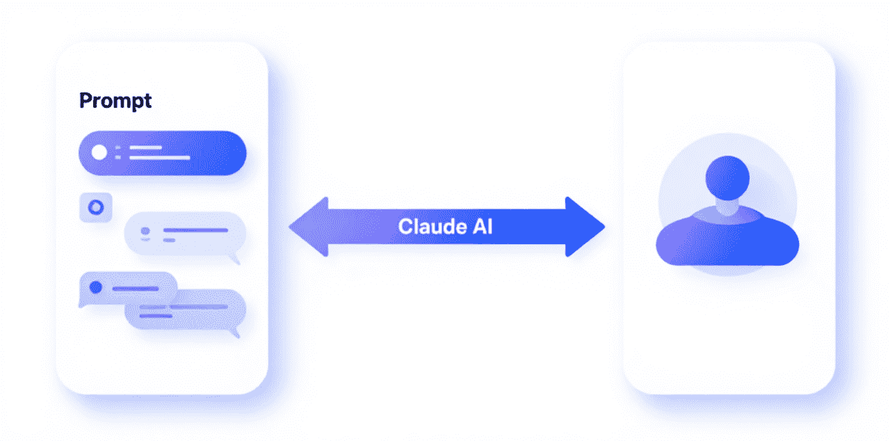

# Claude Design：对话即设计

> 来源：[https://qqs7y1hozd1.feishu.cn/docx/OJl5dz6kMoCQEfxWN6CcYZxhnJu](https://qqs7y1hozd1.feishu.cn/docx/OJl5dz6kMoCQEfxWN6CcYZxhnJu)

Anthropic 不只是做大模型了。Claude Design 是他们第一个向设计工具市场正面出击的产品——直接挑战 Figma 的核心阵地。

## 什么是 Claude Design？

Claude Design 是 Anthropic **Labs 旗下的全新产品，基于****旗舰模型 C**laude Opus 4.7（同日发布的最强视觉推理模型）驱动。它让你通过自然语言对话，直接生成：

✦     交互式原型（点击可跳转、动效可演示）

✦     产品线框图与功能流程图

✦     Pitch Deck / 演示幻灯片（可导出 PPTX）

✦     落地页 / 营销素材（可导出 HTML、发到 Canva）

✦     含 3D / 着色器 / 语音视频的前沿创意原型

目前以 Research Preview 形式向所有 Claude Pro、Max、Team、Enterprise 付费用户开放，访问地址：claude.ai/design。

▲ Prompt → Claude Design → 原型 / 代码的完整创作链路

## 五大核心能力拆解

> 🎨品**牌设计系统自动植入 **

> Claude 在 onboarding 阶段读取你的代码库和设计文件，自动提取颜色、字体、组件风格，构建专属设计系统。之后每个项目都自动遵循你的品牌规范，无需每次手动套用。

> 📥多**源导入，从任何起点开始 **

> 支持文字 Prompt / 图片 / DOCX / PPTX / XLSX / 代码库导入，还可以用 Web Capture 工具直接抓取现有网站元素，让原型看起来就像真实产品。

> 🎛️精细调节：对话 + 内联注释 + 滑块

> 三种精细控制方式并存：在对话框里说"把间距加大 20%"，在元素上直接写内联注释，或使用 Claude 自动生成的调节滑块实时调整颜色、排版、间距——然后一键应用到全局。

> 👥团**队协作 + 权限分级 **

> 设计稿可设为私有、组织内可查看链接、或授权多人编辑。团队成员能在同一个设计里和 Claude 展开群体对话，实时共同修改。

> 🔗一键 Handoff 到 Claude Code

> 设计完成后，Claude 自动打包成"Handoff Bundle"，一条指令传给 Claude Code 即可进入开发阶段。Anthropic 生态内的"探索 → 原型 → 生产代码"全链路闭环正式打通。

## 这件事为什么比看上去更重要？

发布前一天，Anthropic 首席产品官 Mike Krieger 主动辞去了 Figma 的董事会席位。Figma 现在估值约100亿美元，占据 UI/UX 设计工具市场 80-90% 的份额。这个辞职动作几乎是公开宣战。

但 Claude Design 的真正威胁不在于抢走专业设计师——而在于把"使用设计工具"这件事的门槛降到零。Figma 和 Adobe 的假设是"有一个训练有素的设计师在回路里"，而 Claude Design 不需要。创始人、产品经理、市场人员，从来没打开过 Figma 的人，现在也能直接出可用原型。

📊 真实用户数据：效率提升有多明显？

▶     **Brilliant**（互动教育平台）：最复杂页面在其他工具需要 20+ 轮 Prompt，Claude Design 只需 2 轮

▶     **Datadog**（云监控平台）：设计流程从过去一周的 Brief → 草稿 → 审查循环，压缩到一次对话完成

## Anthropic ：从模型公司到全栈产品公司

C**laude **Design 的背景是 Anthropic 整体战**略的转变。从年初到现在，**公司年化营收已从90亿美元飙升至 300亿美元。VentureBeat 披露，Anthropic 正与高盛、摩根大通等谈判，最早可能在 2026年10月 IPO。

不只**是** Claude Design——同日发布的 Claude Opus 4.7、持续升级的 Claude Code、以及逐渐完善的 Anthropic Labs 产品矩阵，都在说明同一件事：Anthropic 不再满足于做其他产品的底层 API，它要从 Prompt 到交付物，自己拥有整条链路。

## 三类人，三种用法

> **🚀 创业者 / 产品经理**

> 用文字描述功能需求，5分钟拿到可点击的交互原型，当天开始用户测试，不等设计师排期。

> **🎨 设计师**

> 快速生成 10 个方向的探索草稿，而不是只有时间做 2 个。把 Figma 留给精细打磨，用 Claude Design 扩大早期探索空间。

> **📢 市场 / 运营人员**

> 从粗糙 outline 到完整 on-brand Pitch Deck 只需一次对话，直接导出 PPTX 或发到 Canva 精修，无需反复拉设计师改稿。

## 现在如何试用？

**1**     确认你有 Claude Pro / Max / Team / Enterprise 付费订阅

**2**     访问 claude.ai/design（Anthropic 正在逐步向用户开放）

**3**     Enterprise 用户默认关闭，管理员需在 Organization Settings 手动开启

**4**     用量计入订阅限额，可单独开通 Extra Usage 突破限制