# 一句话搞定整套UI和PPT，不会设计也能Claude Design出高端设计稿

> 来源：[https://qqs7y1hozd1.feishu.cn/docx/DJZ0dLVvbozy0cxNfwWckRyMnzH](https://qqs7y1hozd1.feishu.cn/docx/DJZ0dLVvbozy0cxNfwWckRyMnzH)

4月17号凌晨，Anthropic发布了一个叫Claude Design的新产品。

跟Claude Design聊聊天，它就能给你整出：

动态社交页面：

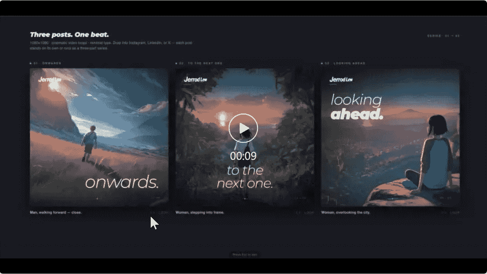

完整的可交互网页：

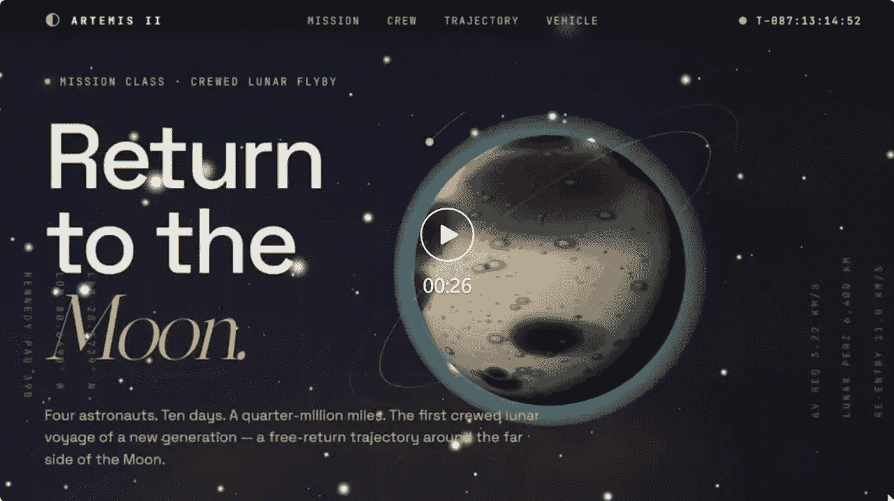

一整个产品宣发视频：

简单说，你用大白话告诉Claude Design你想要一个什么样的设计，比如App原型、PPT、营销落地页、产品线框图，它直接给你生成一个可交互的设计稿。

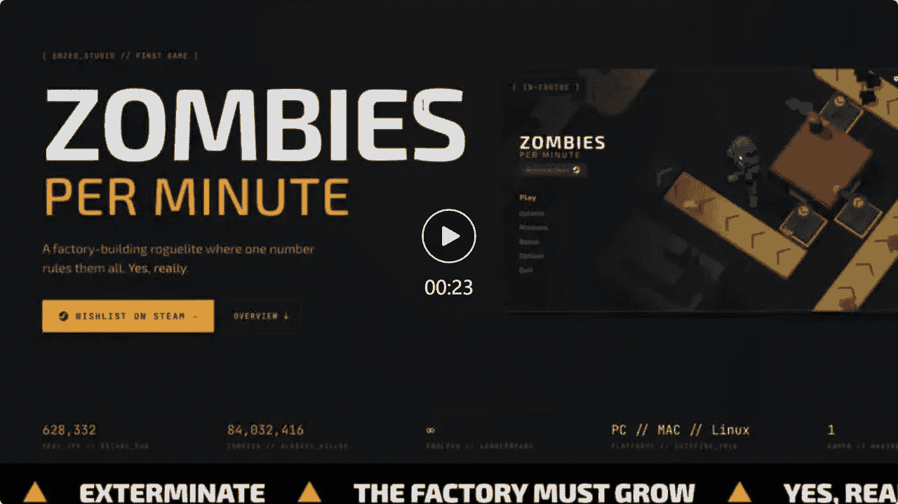

能点，能滑，能操作，不是静态截图，并且审美高得可怕...

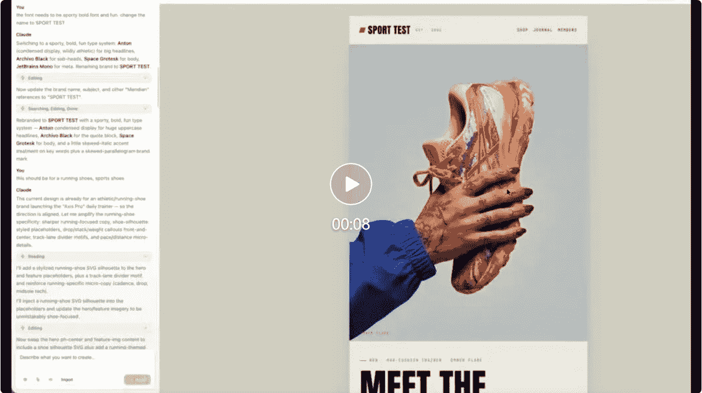

**Claude De**sign直接给了四种可控的修改方法，每一种都切中了不同场景的痛点。

你可以直接对话让它改，这是最基础的。

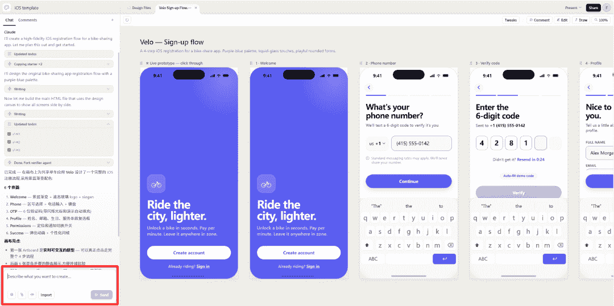

也可以在设计稿上框选某个元素，像在Figma里给设计师留评论一样写批注。

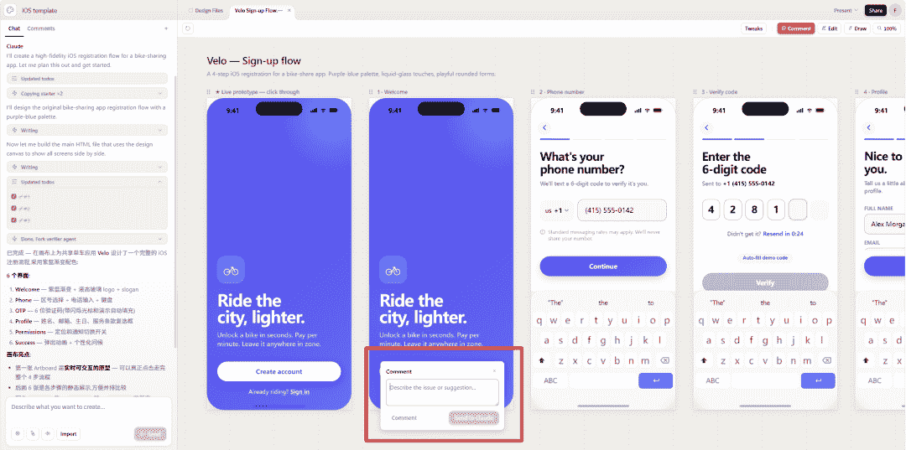

还可以进编辑模式，右边弹出属性面板，字体、字号、颜色、间距，直接手动调。

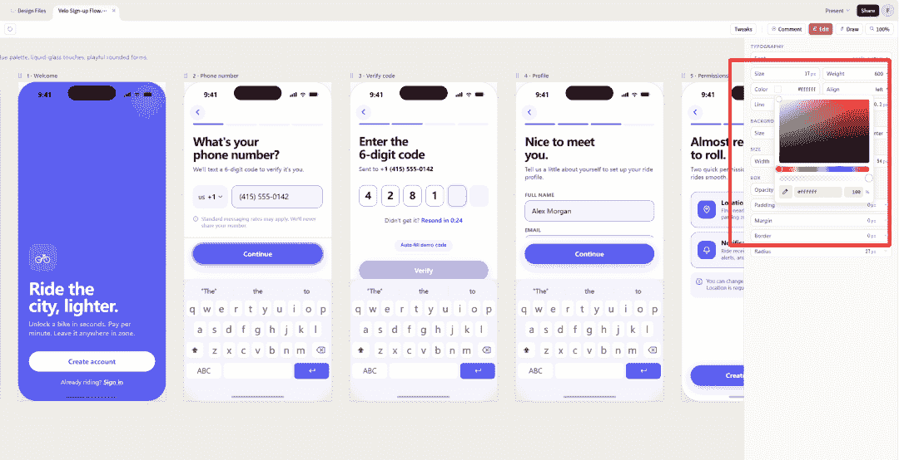

最骚的是第四种：Claude会根据你的设计内容，自动生成一组调节滑块，主题色深浅、间距大小、动画速度你拖着玩就行，拖到满意为止。

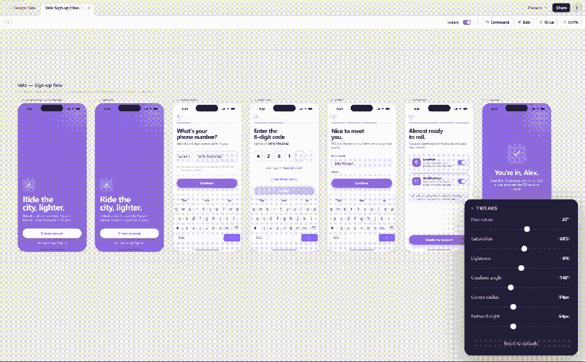

而且设计完的东西，你可以导出PDF、PPTX，可以一键发到Canva里继续精修。

Canva的CEO在发布当天就公开站台，两家是正式的合作关系。

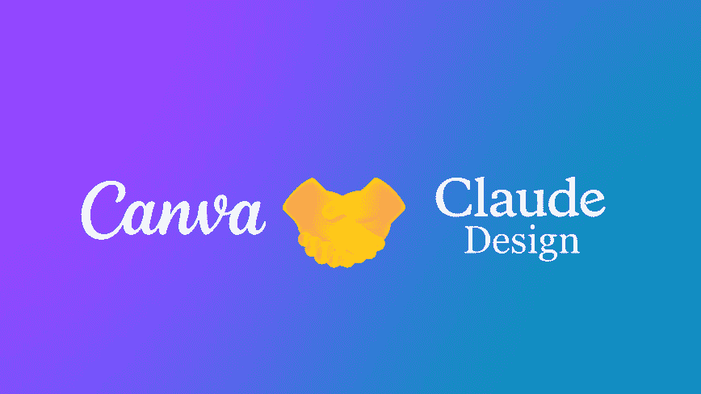

更狠是设计稿可以直接打包，一个指令交给C**laude C**ode，AI帮你把设计变成可以跑的代码。

**从脑子里的想法，**到可交互的原型，到能上线的产品，全链路打通了。

一个人就能干完以前三个人的活。

你不需要会Figma，不需要会写代码，只需要知道自己想要什么，剩下的事Claude全都帮你搞定。

我们拿到的已经是迭代过的、可以直接用的组件代码，不用再回头重建mockup了。

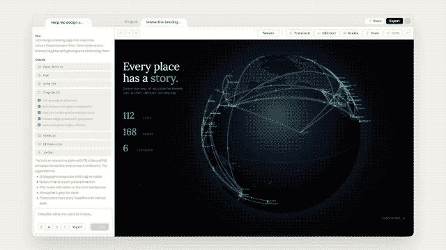

如果要用到实际工作中，建议大家第一件事就是把自己的品牌色、字体、组件风格喂进去，让它先学会你的视觉语言。

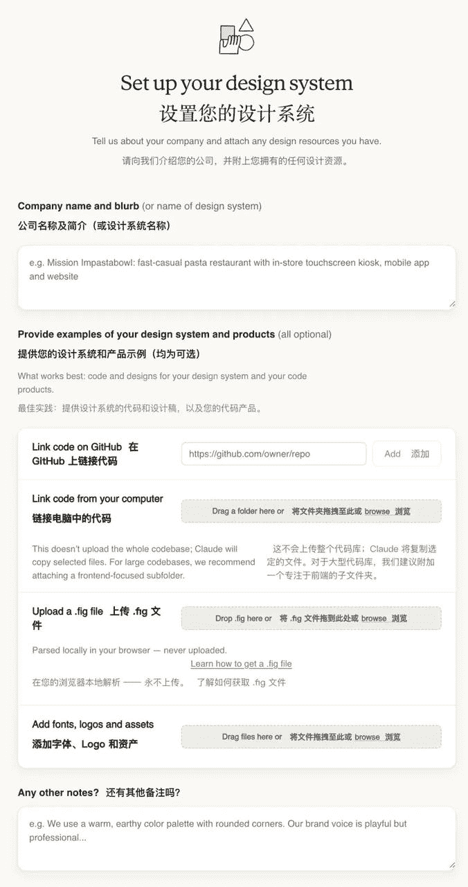