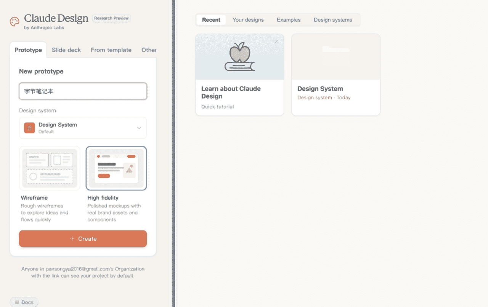
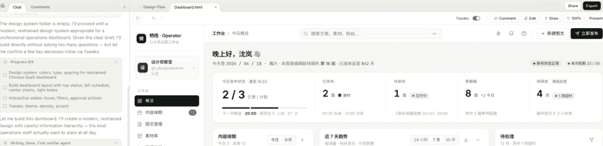
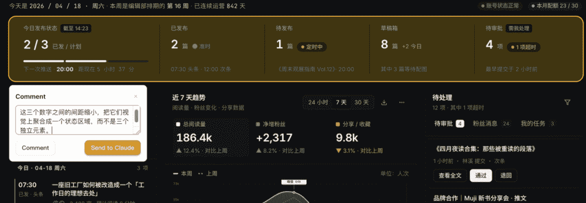
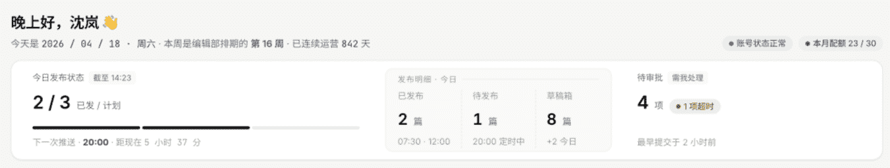
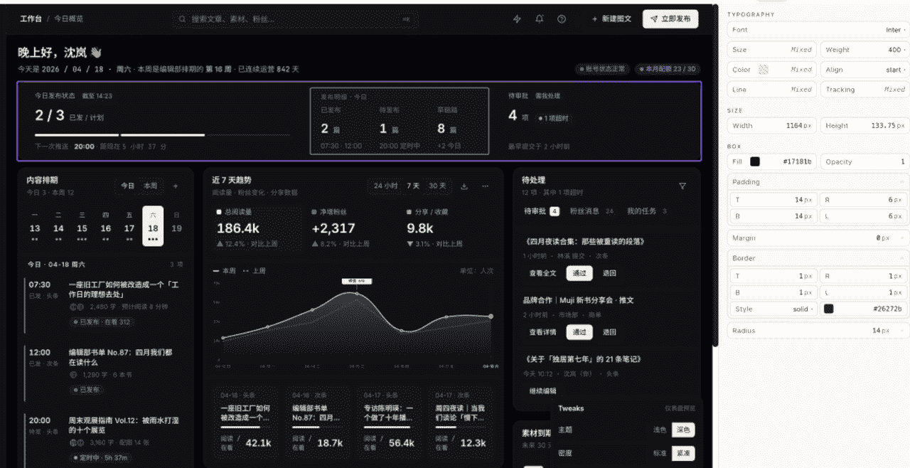
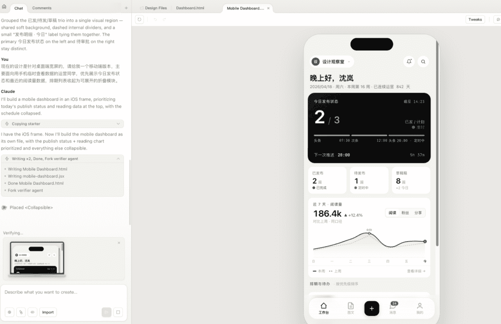
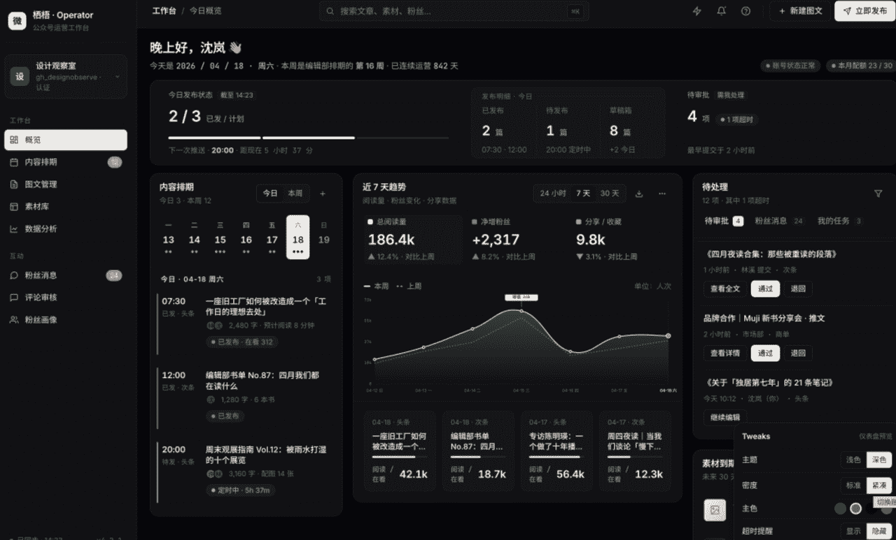
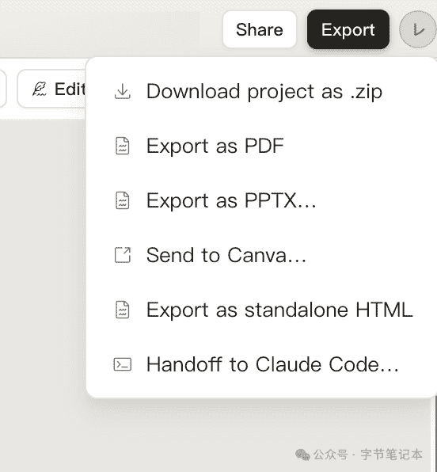

# 通过对话直接完成界面设计，claude design生成原型

> 来源：[https://qqs7y1hozd1.feishu.cn/docx/SHUTd1LGhoPTuUxMVPYcMNN0nmQ](https://qqs7y1hozd1.feishu.cn/docx/SHUTd1LGhoPTuUxMVPYcMNN0nmQ)

先说清楚 Claude Design 的定位。

它不是 AI 修图工具，不是Figma的竞品，也不是帮你生成好看封面图的东西。

它做的是界面设计，具体来说是你描述需求，它在右侧画布上生成可用的 UI 设计稿，然后你通过对话或者直接点击画布元素来迭代修改，最后导出原型或者直接交给开发。

左边对话，右边画布。

Claude Design 基于组织设计系统。

如果你的团队已经把品牌色、字体、组件规范配置进去了，你每次生成的设计都会自动遵循这套规范。

不需要每次告诉它用我们公司的蓝色，它默认就知道。

### **实际操作全记录**

**第一步：给足上下文**

Claude Design 允许你在项目开始时上传截图、竞品参考或者代码库。

做了两件事：

> 一是上传了现有后台的截图，告诉它"这是现状，风格已经过时，保留信息密度但提升视觉层次"。

> 二是粘贴了一段产品说明，描述了核心用户是日更型👸号运营，每天登录 2-3 次，主要操作是查看昨日数据、确认今日排期、处理待审批内容。

这个上下文输入花了大概五分钟，但对后续生成质量影响很大。

**第二步：第一次生成**

提示词是这样写的：

"设计一个运营 SAAS 平台的主仪表盘。顶部显示今日发布状态（已发/待发/草稿数量），左侧为今日和本周排期列表，中间为最近 7 天的阅读量和粉丝变化折线图，右侧为待处理事项（待审批文章、素材到期提醒）。用户是每日操作的运营人员，需要一眼看到最关键的状态信息。风格现代、克制，信息层次清晰。"

生成结果出来用了大概 15 秒。

第一稿的整体结构基本对，顶部状态栏、左侧排期、中间图表、右侧代办，布局逻辑清晰。

但有两个问题，顶部状态栏的三个数字（已发/待发/草稿）间距太松，信息密度偏低，右侧待处理事项用了卡片叠加样式，视觉上显得很重，和左侧的列表风格不统一。

**第三步：用内联评论做精细修改**

Claude Design 的内联评论功能是这次体验里最实用的部分之一。

我直接点击画布上那个间距过松的顶部状态栏，输入："这三个数字之间的间距缩小，把它们视觉上聚合成一个状态区域，而不是三个独立元素。"

修改应用了，顶部区域变紧凑了。

然后点击右侧卡片区域，输入："右侧待处理事项改成紧凑列表样式，和左侧排期保持视觉一致，用左侧红点/橙点标注优先级。"

两次定向修改，加起来不到三分钟。

如果是传统流程，这两个改动要写进需求文档、发给设计师、等待响应、确认效果，最快也要半天。

**第四步：通过对话做结构性调整**

精细改动用内联评论，结构性调整用对话，这是 Claude Design 建议的使用策略，实际用下来确实合理。

在对话框输入："现在的设计是针对桌面端宽屏的，请给我一个移动端版本，主要面向用手机临时查看数据的运营同学，优先展示今日发布状态和最近的阅读量数据，排期列表收起为可展开的折叠模块。"

它没有在原稿上修改，而是生成了一个新的移动端布局方案，同时保留桌面版。这就涉及到版本管理的问题。

**第五步：保存版本，探索备选方案**

我告诉它："把桌面端版本先保存，我想看一个完全不同的整体风格方向，深色主题，数据看板感更强，参考 Linear 或者 Vercel 的后台风格。"

它保存了当前版本，然后生成了一个深色系方案。两版风格差异明显，一个适合日常运营的轻量感，一个适合数据分析场景的专注感。

实际产品决策时，这两版可以直接发给用户做偏好测试，而不是靠拍脑袋。

第六步：让 Claude Design 审查可用性

这个功能很多人可能忽略。

我问它："从运营同学每日高频使用的角度，审查这个设计有哪些可用性问题？"

> **它给出了三条具体反馈：**

> 1，排期列表里的"今日待发"和"明日待发"视觉权重相同，但对用户而言今日的紧迫性更高，建议用颜色或字重区分。

> 2，折线图的时间轴默认显示 7 天，但运营同学通常更关心昨日数据，建议默认高亮昨日数据点。

> 3，右侧待处理事项没有"全部已处理"的快捷操作，批量操作入口缺失。

三条都是真实的可用性问题，不是泛泛而谈。

把这几条反馈直接复制进需求文档，就是有效的设计改进记录。

**第七步：导出**

最终版本选择了"Handoff to Claude Code"。这个选项会把设计稿的结构信息整理成对开发更友好的格式，理论上可以直接交给工程师或者继续用 Claude Code 生成前端代码。

如果是要给甲方或者团队做汇报，导出 PDF 或者 PPTX 更合适。

### 几个感受

它改变的不是设计本身，是需求到原型的响应速度。

以前这条链路是：**产品写需求 → 设计出原型 → 评审修改 → 再出稿，快则三天，慢则一周。现在**这条链路变成：产品开对话框 → 描述需求 → 迭代修改，一个下午可以过完两个方向。

把需求变成可以讨论的原型这件事，从专业门槛彻底降维到变成了对话门槛。

**上下文质量决定输出质量。**

我试过用一句话提示词生成，结果是很泛的通用 UI，没有什么针对性。