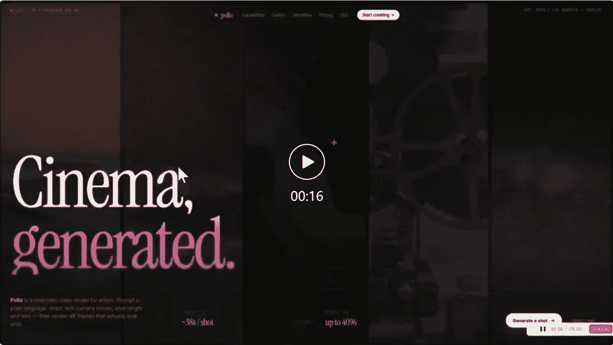
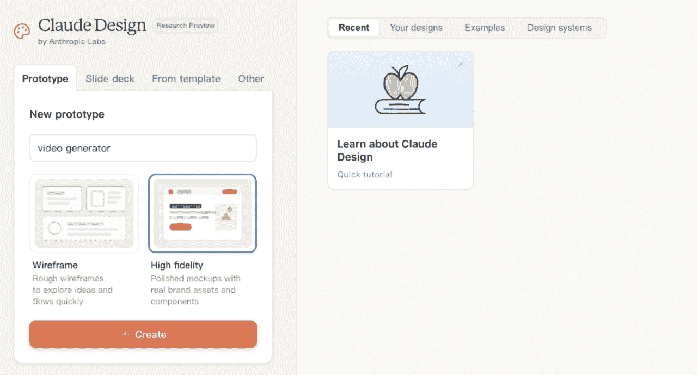
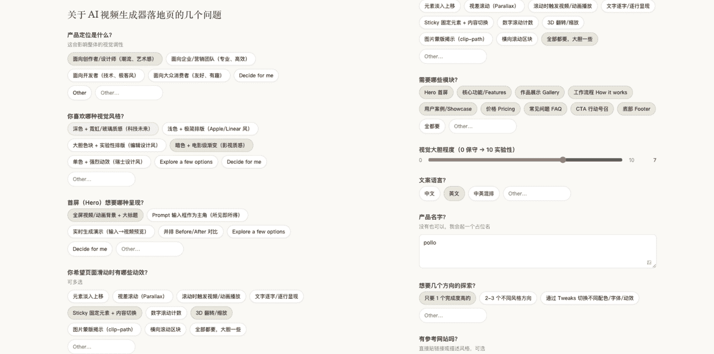
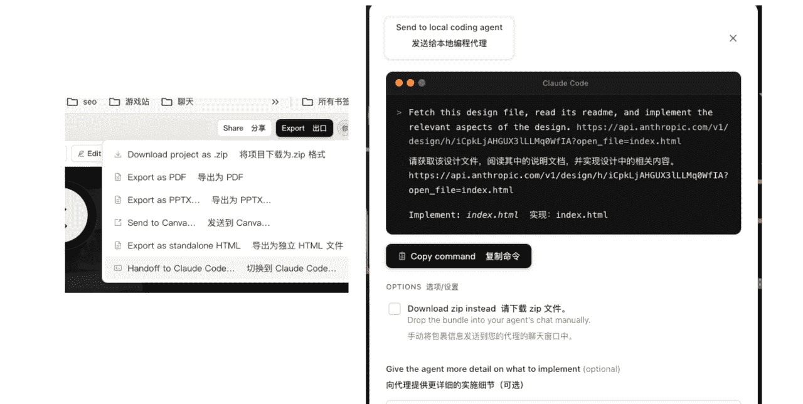

# 使用claude design 设计你的网站

> 来源：[https://qqs7y1hozd1.feishu.cn/docx/WlRsdcyW2ojiEKxKryJcosiHnZf](https://qqs7y1hozd1.feishu.cn/docx/WlRsdcyW2ojiEKxKryJcosiHnZf)

首先是打开claude.ai/design , 起一个项目名字，就可以开始设计了。

然后就说常规的对话，提出你的需求，我提的需求是 “帮我生成一个AI视频生成器的落地页，页面滑动有动效”，然后比较好的地方是，他会让你自己去选择你想要的效果，因为作为一个设计小白，我压根不知道要怎么描述，但是提供给了我选项，我就知道怎么去选择了。甚至还可以输入你的参考网站。

最后生成的效果就是上面的视频，也可以对话编辑，和选择元素进行编辑。个人感觉已经设计的很好了，就没有编辑。然后直接导出，可以选择是直接用复制命令到claude code，这个也是非常方便的。

