# 不会设计也能做出产品原型，claude Design实战

> 来源：[https://qqs7y1hozd1.feishu.cn/docx/QNy6ddervosi7qxZnooc53KYnqg](https://qqs7y1hozd1.feishu.cn/docx/QNy6ddervosi7qxZnooc53KYnqg)

在**这之前，用了多款「AI 生成设**计」类的工具，但出来的效果总是差点意思。试了Claude Design，只能说：Amazing！你有想法，它能慢慢帮你长出来。

#### 01**先给大家看看测试例子**

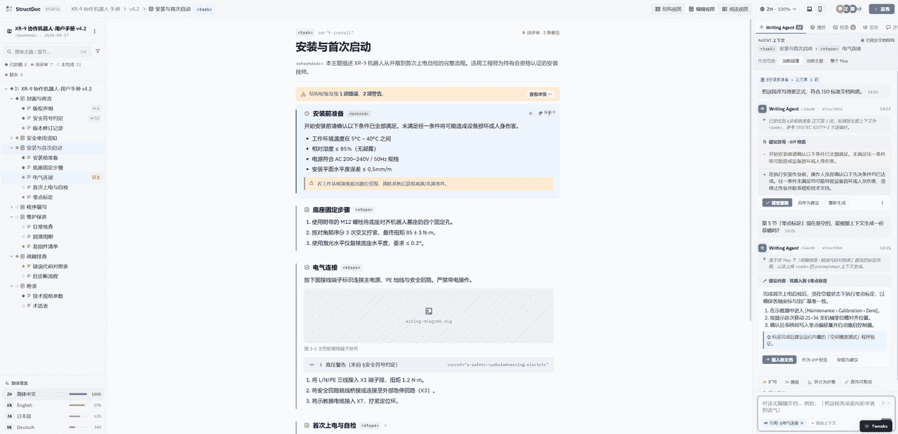

做一个基于 DITA 的结构化文档编辑系统的产品原型：

+   writing agent

+   多栏工作台（中间编辑区 + 左侧目录 + 右侧功能区）

+   支持手机端的适配

+   属性、检查、版本等模块

然后将自己的初步想法给到GPT（当然做这一步是为了节约token，没办法，它的token消耗速度太快了），然后GPT会帮我设计一个比较专业的提示词。

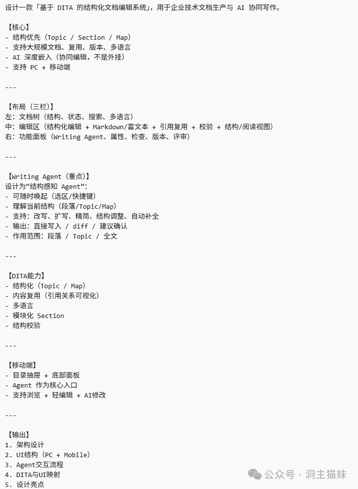

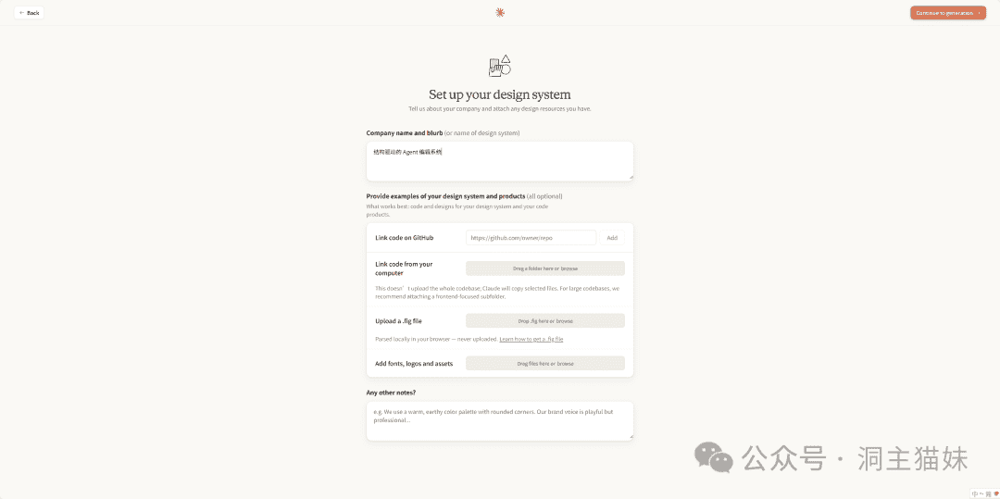

先创建一个项目。你也可以上传品牌资产：Logo、字体文件、色板让它学习视觉语言，甚至可以将GitHub上的代码链接粘给它。

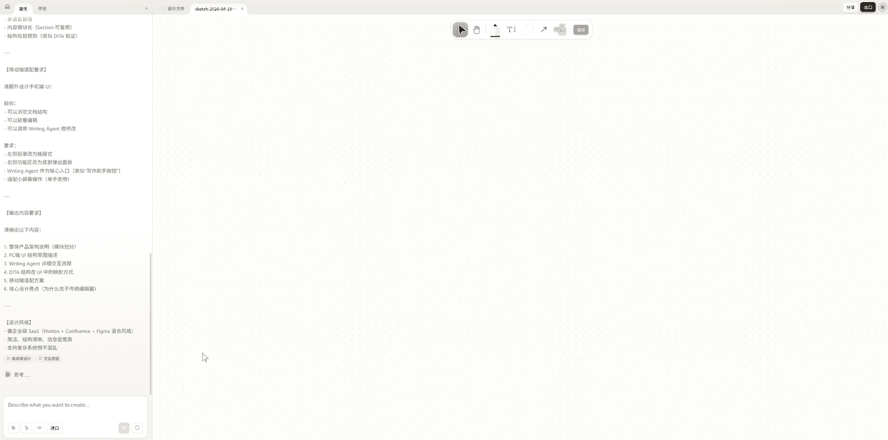

然后我们将提示词直接喂给Claude Design。也可以直接简单的描述你需要什么，它会制作第一个版本。

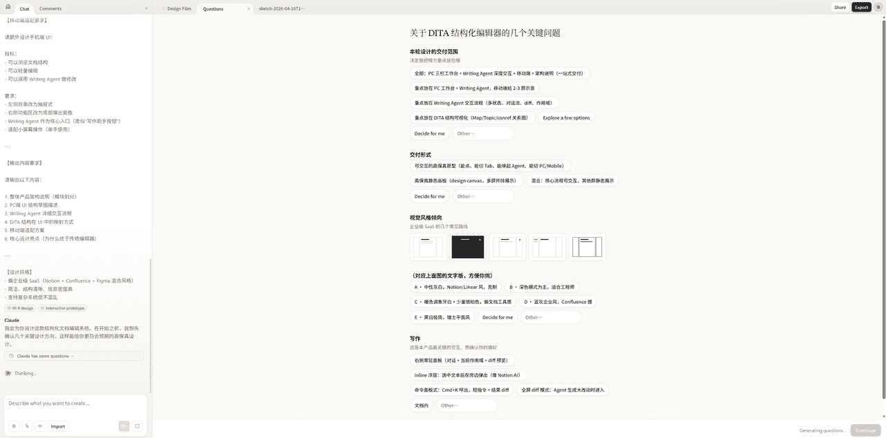

然后它做了一件蛮有意思的事情，它先问了我几个问题：

+   本轮设计的交付范围（PC为主，适配移动端）

+   交付形式（演示稿还是可交付的高保真原型）

+   视觉风格偏好（提供了几个SaaS常见风格）

+   面向投资人看的 Demo 还是开发交付？

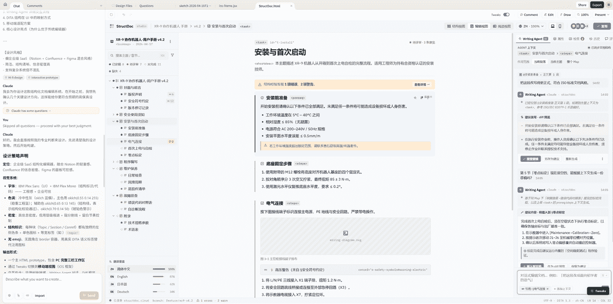

对于初版来说，整体考虑的已经很不错了，比如对于一款编辑器，几个关键功能点：

+   多视图模式（结构/编辑/阅读）

+   文档状态可视化（已定稿/待评审/未完成/缺失）

+   多语言状态可视化

+   协同编辑逻辑

+   diff 比对预览

+   ......

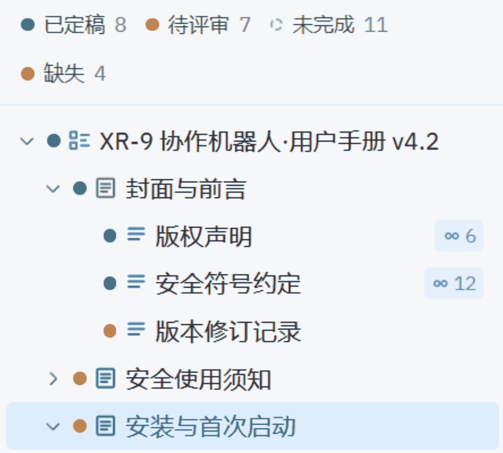

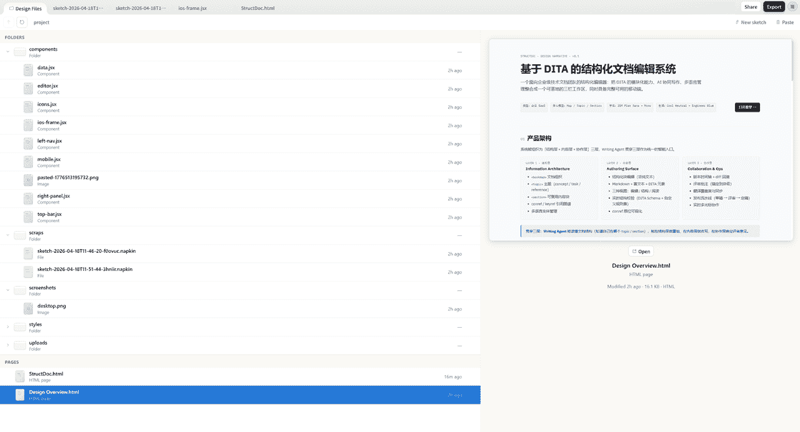

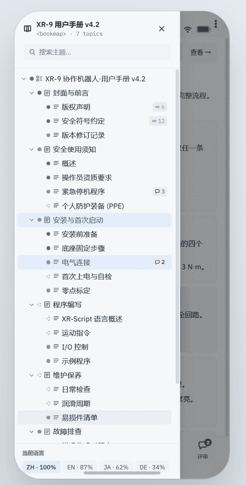

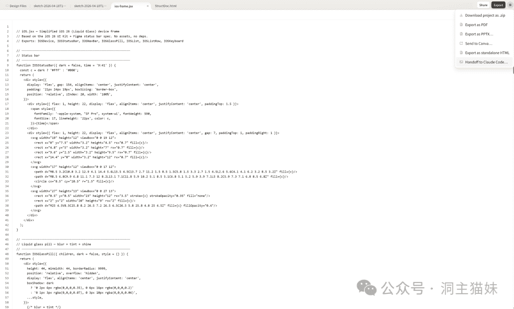

做完之后，还**可以导出ZIP、PDF、P**PTX和HTML，甚至可以直接交给Claude Code 接入开发流程。这两年AI应用的落地，很多工作方式，正在被重新改写。之前用AI做图，你要学prompt，要试关键词，出来的结果就跟抽奖一样。然后你用着用着就会各种喷。现在不一样了，有时候你甚至给它表达一个模糊的感觉，出来的效果依然很惊艳。第一次觉得，设计这件事，是可以被“说出来”的。这就很微妙了！02再回过头看看它到底是什么？

Claude Design 不是一个画布工具，它更像 Claude Code。

传统的 AI 设计工具，逻辑是「你来画，AI 帮你快一点」；Claude Design 的逻辑反过来了，AI 是主要的生成者，你是过程的审阅者。

就像Ryan Mather在推文里提到：不要试图以使用基于画布工具的方式来使用Claude Design。

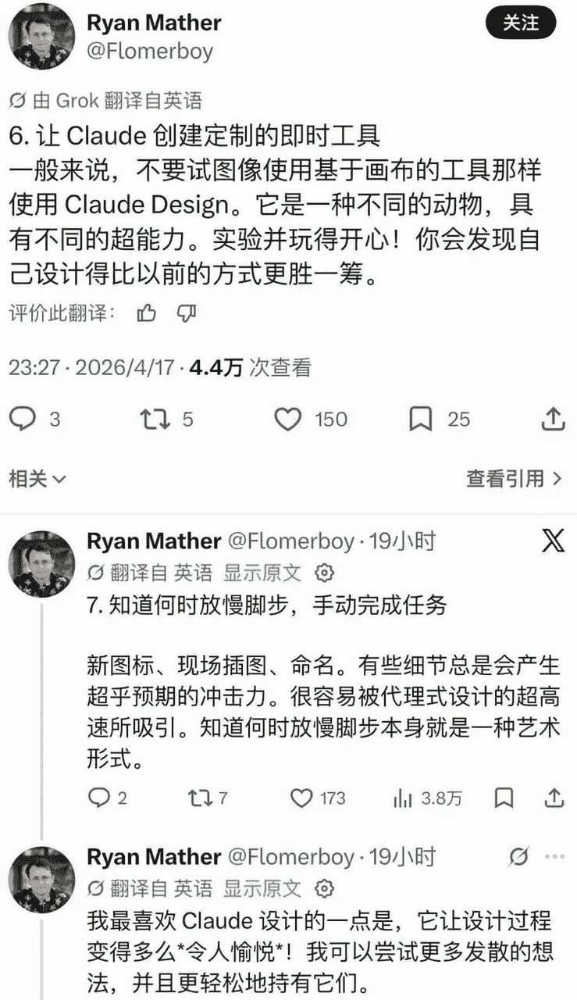

官方的说法是：基于新发布的型号Opus4.7，面向Pro、Max、Team和Enterprise订阅用户访问，我现在是Pro版本，使用额度多了一个Claude Design的额度开放。就是每次发Prompt前都是开两个窗口，一个用来使用，一个观察额度情况，生怕一个提问过去直接干歇火了。（不知道你们是不是也是这样用的）

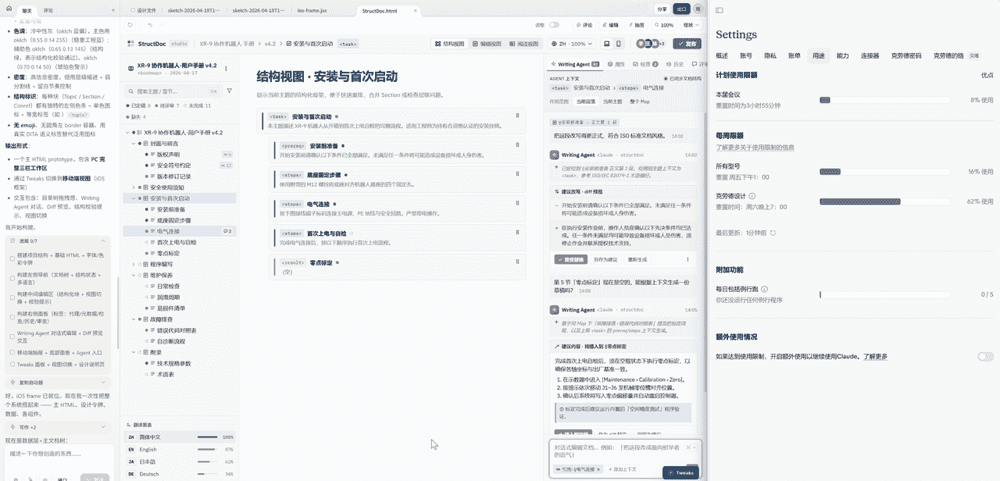

以前，一款产品的上线需要搭配产品经理+UI+开发+测试，缺少某个角色，于是很多事情就无法更好地推进了。一些有想法的人想做又不会或者缺少资源，慢慢好的想法最后也放弃了。现在，好像出现了一种新的可能。一个人也能推进完整产品雏形，你只需要告诉它，你想要一个什么样的东西，这些生成的“中间过程”直接得到结果了。以前需要一周的事情，现在开会的时候就能一边聊需求一边做出原型了，开发工程师们也能直接参与设计对话。有了这些“好搭子们”，越来越多的人，可以一个人做很多的事。不会设计的人也能变成产品，变成设计师。还是那句话，我们正在走向：“anything is code”的趋势！

# 03除了上面的界面产出，它还能干哪些活呢？

从官方上给出的使用场景来看，Claude Design不仅为设计师提供了广泛探索的空间，也让其他人能够创作视觉作品。所以至少可以覆盖以下这些场景：

它最大的价值是，让有想法但不会设计的人，也能做出一个像样的东西。

# 04虽然它很好用，但是token是个大问题

它的使用量是单独计算的，有自己的每周限额，和普通的Claude对话的额度是并行的，所以在每周的重置计划内规划好用在哪里。

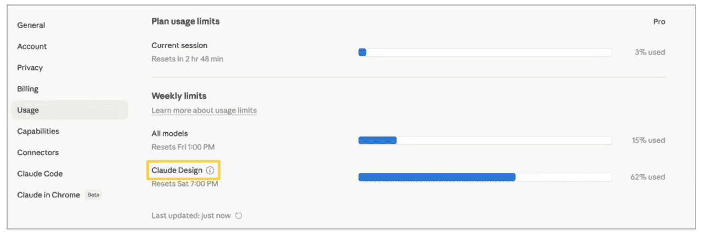

基本做完一个测试，半个小时就能把一周的额度用完**。所以在**第一个prompt里尽可能的把需求说清楚，前期多花点时间，后面能节约多次无效迭代。

说在最后当然我们的设计师们也不要太焦虑，就像有着25年经验的平面设计师在接受采访时曾表示：“她其实并没有真正使用过人工智能工具。”

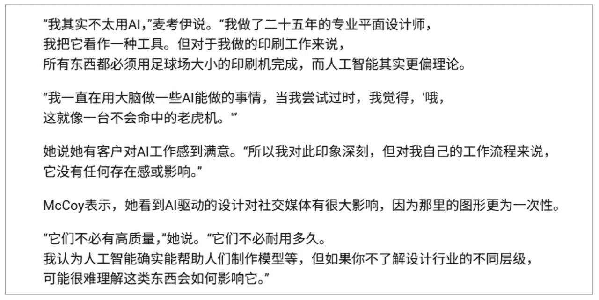

Claude Design 的舒适区是快速产出，对于高精度的品牌视觉、需要印刷的物料、高度定制的创意设计，还是得设计师来。

用设计圈朋友跟我说的话：它大概会减少部分模板化工作的需求，但做真正有创意的设计，还需要一段路。