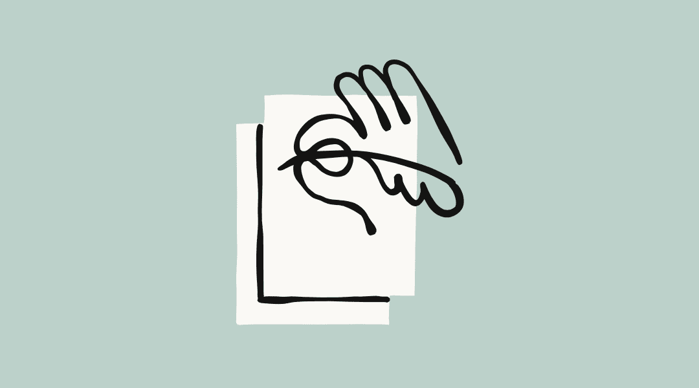

# Claude Design是什么？Anthropic最新AI设计工具完整介绍

> 来源：[https://qqs7y1hozd1.feishu.cn/docx/Lw7YdCD4YoR4rcxmisAcrxu3nmf](https://qqs7y1hozd1.feishu.cn/docx/Lw7YdCD4YoR4rcxmisAcrxu3nmf)

# **第一章  ·  开场**

## Figma董事会少了一人，AI设计工具的牌桌上多了一家

Claude Design是Anthropic首次正面推出的设计产品

**2026年4月17日，An**thropic推出Claude Design——由Claude Opus 4.7视觉模型驱动的AI设计工具，通过对话就能制作原型、简报、着陆页，还能导出PPTX、PDF、Canva，或者直接打包交给Claude Code变成上线产品。

同一周，Anthropic的首席产品官（CPO）迈克·克里格（Mike Krieger）——Instagram联合创始人——悄悄退出了Figma董事会。彭博社披露Opus 4.7和Claude Design即将上市时，Adobe、Figma、Wix三家公司股价同日下跌超过2%。

把这几件事凑在一起你会发现，这不是又一个「AI帮你做简报」的小玩意。这是Anthropic对整个设计工具市场的第一次正面出击。

这篇文章会拆解：**C**laude Design究竟是什么、它如何运作、六个核心功能怎么使用、与Figma和Canva的差别在哪里、设计师和非设计师各自该如何看待它，以及为什么这次的发布时机“一点都不巧合”。

[▶ 介绍Anthropic Lab](https://youtu.be/t_LBECI🐧qs)s的Claude Design观看  →

Anthropic官方发布影片，点图跳转到YouTube观看。| @claude YouTube

# **第二章  ·  它是什么**

## Claude Design是什么

一句话：一个让你用对话完成「设计流程最上游那一段」的工具。

你打一段话描述你想要的东西 —— 「帮我做一个冥想应用的原型，简洁排版、自然配色」—— Claude 直接生成一个可操作的初版。然后你通过对话、内联注释、直接改字，或 Claude 自动生成的滑块（就像 Adobe 最近推出的那种自定义滑块）来调整暗黑模式、间距、字号、色票。

与你认知中的 Canva 或 Midjourney** 不同的是，**C**laude De**sign 不是生成图像。Anthropic 的原话很刻意：「Opus 4.7 是我们最强的视觉模型」——他们连「图像生成器」这个词都不用。它生成的是功能性的设计对象：可交互的原型、可编辑的演示文稿、可导出为网页的着陆页。

Claude Design的精修界面：Tweaks条、内联注释、直接编辑，加上右侧THEME / BREAKPOINT的定制滑块。| 图：Anthropic

Anthropic将其定位为「Anthropic Labs」旗下产品——与Claude Code、MCP、Cowork、Skills同属一条产品线。Labs的逻辑是「拿一个很强的能力，包装成可供人使用的界面」。这批产品在过去两年让Anthropic从一家API公司转变为应用公司，Claude Code上线六个月就实现了十亿美元营收，是这个Labs方法论最成功的案例。

Claude Design是接棒的下一个。

## “设计师被迫分配给自己探索的时间——没空做十个方向的原型，所以只做两三个。Claude Design 就是要把探索成本降到最低。”

—ANTHROPIC官方

# **第三章  ·  工作原理**

## 它如何运作

Claude Design的流程遵循的是「自然创作节奏」 —— Anthropic官方原话。我将其拆分为五个阶段，在任何一个阶段你都可以停下来与Claude对话调整。

### 01 **Onboarding 建品牌**

Claude读取你的代码库和设计文件，自动构建出你品牌的设计系统 —— 色票、字体、组件。之后每个项目都自动套用，保持品牌一致性。团队可以同时维护多套设计系统。

### 02 **Import 取素材**

起点可以是一段文本提示、上传DOCX/PPTX/XLSX文件、指向一个代码库，或使用网页捕获工具直接从网站抓取元素进来 —— 制作出的原型会和真实产品长得一样。

### 03 **Refine 微调**

在元素上进行内联留言、直接编辑文字，或使用Claude自动生成的调节旋钮微调间距、颜色、版型。调整完成后，可以让Claude将此改动应用到整个设计中。

### 04 **Collaborate 协作**

组织内权限控制：私人、整个组织可见，或开放编辑权限给同事一起与Claude对话并修改设计。就像Figma那样多人协作，不同之处在于Claude也在群聊中。

### 05 Export & Handoff 交棒

导出为组织内 URL、文件夹、Canva、PDF、PPTX 或独立 HTML。设计定稿后可以打包成交接包，一句话交给 Claude Code 就能将其变成真正的产品。

# **第四章  ·  核心功能**

## 六个核心功能

官方列出六种客户实际正在使用的场景，每一种对应一个典型的设计工作流痛点：

### **功能01  **可交互的真实原型

设计师常见的痛点：静态 mockup 无法进行用户测试，但要实现动态效果则需要编写代码。Claude Design 让你可以将静态 mockup 直接转换为可点击、可输入、带有状态切换的原型，无需 PR、无需代码审查即可发送出去收集反馈。Brilliant官方表示，他们最复杂的页面过去需要编写20多个提示才能重现，现在两个提示就足够了。

### **功能02  **从线框到开发的交接

产品经理（PM）可以直接绘制功能流程，然后将设计交给Claude Code去实现；或者交给设计师继续细化。过去的流程是Figma → Zeplin → Jira → 工程，Claude Design想把它压缩成“一次对话，一次交接”。

#### **功能03  **设计探索(Design Exploration)

原本要花一天画三版概念图，现在可以开启五十个方向。对资深设计师来说，这是最有感触的升级——不是帮你做设计，而是帮你把「想法→可视化」这段时间压缩到趋近于零。

### **功能04  演示文稿**

从大纲到完整的品牌化演示文稿，导出 PPTX 或丢到 Canva。这一块正面挑战 Gamma、Tome，也侧面挑战 Canva 的 AI 演示文稿。区别在于：Claude Design 生成的演示文稿可以直接交给 Claude Code 变成网站，这条流程是其他家没有的。

### **功能05  **营销素材(Marketing Collateral)

着陆页、社群素材、活动视觉。营销团队先用Claude Design做出初版，设计师再进行精修。这种“非设计师先产出、设计师后精修”的分工，正是Anthropic一直强调的“互补，而非替代”。

### **功能06  **Frontier Design(前沿设计)

这一项最有趣——code-powered prototype，可以搭载语音、视频、着色器、3D、内置AI。这不是Figma能做到的，也不是Canva能做到的，比较接近framer.com + p5.js + Three.js的混合。对于会编程的设计师来说，这是探索“AI时代界面长什么样”的沙盒。

Claude Design实际产出的设计界面，已经达到了生产级别的完成度。| 图:Anthropic

# **第五章  ·  时机**

## 为什么现在出？三件事拼出完整脉络

Claude Design的发布时间点绝非偶然。看这三件事凑在一起：

第一，Mike Krieger退出Figma董事会。 Krieger是Instagram联合创始人、Anthropic现任首席产品官（CPO），过去两年同时担任Figma董事。本周TechCrunch报道，他在Claude Design发布前几天辞去了Figma董事职务——因为他知道接下来他要做的产品与Figma存在直接利益冲突。

第二，Adobe、Figma、Wix股价同日下跌超过2%。彭博社4月14日披露Opus 4.7与Claude Design即将上市后，市场给出的即时反应。这三家是设计工具、UI工具、网页构建器三个领域的代表。

第**三，Anthropic与Canva的官方合**作。Canva首席执行官Melanie Perkins亲自为Claude Design背书，官方说法是“互补不替代”。这句话翻译过来就是：Claude Design做的是Canva的上游，即“把想法变成可编辑素材”这部分；Canva接手做“让多人协作精修这个素材”。两家并不冲突。

**把**这三件事叠加起来，Anthropic的策略轮廓很清晰：用Claude Design吃掉Figma和Adobe最上游的“概念发想→视觉初版”那一段市场，下游的精修和协作留给Canva。这是切了一块过去只有Figma会做的蛋糕，然后把Canva拉进同一个阵营。

## “我们最复杂的页面，过去需要编写20多个提示才能重现，在Claude Design中只需要2个提示。从原型到生产的跨越首次变得无缝。”

—  OLIVIA XU，高级产品设计师