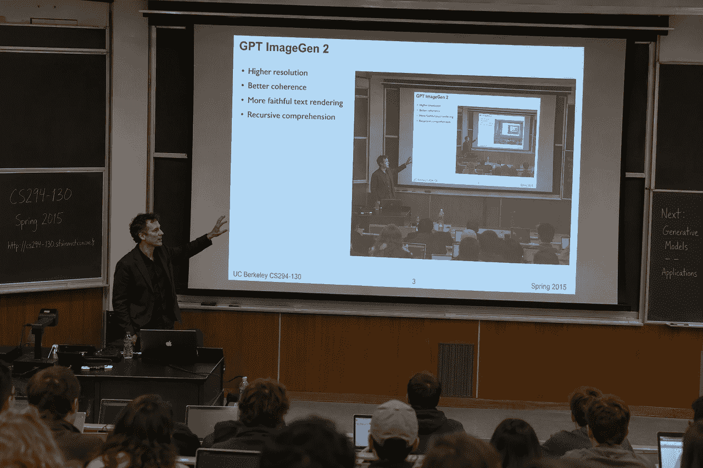

# GPT-image-2 – OpenAI推出的下一代原生图像生成模型

> 来源：[https://qqs7y1hozd1.feishu.cn/docx/AKexdJNrHo2YQhxv0MTcMwZCnGe](https://qqs7y1hozd1.feishu.cn/docx/AKexdJNrHo2YQhxv0MTcMwZCnGe)

## GPT-image-2是什么

GPT-image-2 （ChatGPT Images[ 2.0](https://ai-bot.cn/best-ai-painting-tools/)）是OpenAI推出的下一代原生图像生成模型，是其首个具备”思考”能力的图像模型。模型于2026年4月初以”maskingtape-alpha”等代号短暂现身Chatbot Arena后引发热议。模型支持 2K 分辨率与多画幅输出，在复杂指令遵循、物体空间关系、密集文本渲染和多语言准确性上实现突破，可联网获取实时信息并自我校验。现已集成至 ChatGPT、Codex 及 API，适用于 UI 设计、营销物料、学术海报等专业创作场景。

## GPT-image-2的主要功能

+   **复杂指令精确遵循**：模型能理解并执行包含多对象、精细布局和风格约束的复杂提示词。

+   **高密度文本渲染**：模型能准确生成小字号文字、图标、UI 元素及密集排版内容。

+   **多画幅与 2K 输出**：支持多种宽高比，最高可输出 2K 分辨率图像。

+   **联网实时信息获取**：模型在思考模式下可搜索网络获取最新信息并融入图像创作。

+   **多图像一致性生成**：支持基于单一提示词生成多张风格统一但内容不同的关联图像。

+   **自我输出校验**：模型能复查并修正自身生成结果中的错误或不一致之处。

## GPT-image-2的技术原理

+   **推理能力嵌入**：将 OpenAI 推理模型的”思考”机制引入图像生成流程，使模型在出图前进行任务规划、信息检索和逻辑验证。

+   **增强型指令遵循架构**：通过改进的注意力机制和对齐技术，显著提升对复杂空间关系、物体位置和精细细节的控制精度，解决传统模型”大致像但不对”的问题。

+   **多语言文本渲染引擎**：针对非拉丁语系（尤其是中文、日文）优化字形编码和渲染路径，从根本上解决 AI 生图常见的文字乱码、错字或语义不通问题。

+   **世界知识融合**：用扩展的视觉知识和世界知识库，自动补全提示词中未明确描述的合理细节，使用户无需撰写冗长提示即可获得完整画面。

+   **多模态协同生成**：与 ChatGPT 的对话能力深度耦合，支持基于上传文档（如论文、产品说明）自动理解内容并生成对应视觉物料，实现从文本分析到视觉输出的闭环。

## 如何使用GPT-image-2

+   **访问入口**：访问[ChatGPT](https://ai-bot.cn/sites/30.html)官网，登录OpenAI账号。确保已订阅相应套餐或获得使用权限。

+   **调用图像生成**：在对话框输入任意图像生成指令，系统会自动调用GPT-image-2。

+   **迭代优化**：点击已生成图片进入编辑模式，用自然语言指令进行局部修改，模型支持多轮对话式精修。

+   **导出与应用**：确认满意后点击下载按钮获取PNG/JPG格式文件（最高4K分辨率）。企业用户可通过即将开放的API接口批量调用，生成的图像可直接用于商业用途（需遵守OpenAI内容政策）。

## GPT-image-2的关键信息和使用要求

+   **命名**：产品官方名称为 ChatGPT Images 2.0，内部代号及媒体称为 GPT-Image-2。

+   **账号要求**：必须用已验证的手机号注册，企业版需通过Sales申请批量访问权限。

+   **内容合规**：禁止生成虚假政治人物照片、非自愿性亲密影像、特定个人可识别的私人信息图像，OpenAI内置多级安全过滤器。

+   **商用授权**：通过ChatGPT界面生成的图像版权归用户所有，可商用；API调用需遵守OpenAI服务条款，预计按生成张数或token计费。

+   **语言支持**：原生支持中文提示词与图像内文字生成，无需翻译为英文。

## GPT-image-2的核心优势

+   **文字渲染革命**：业界首个能稳定生成复杂中文书法、UI标签、长句排版的图像模型，字符准确率较DALL-E 3提升数十倍。

+   **像素级可控**：通过对话实现手术刀式局部编辑，可精确调整指定区域而不破坏整体光照、透视与阴影一致性。

+   **知识驱动真实**：内置世界知识库，确保历史建筑、科学图表、品牌标识等内容的物理准确性与文化合规性。

+   **生产级输出**：原生4K分辨率与可印刷设计文件直出能力，弥合AI生成与专业设计交付之间的最后一道鸿沟。

+   **零延迟推理**：优化后的自回归架构将生成速度压缩至3秒内，支持实时交互式图像创作流程。

## GPT-image-2的项目地址

+   **项目官网**：https://openai.com/index/introducing-chatgpt-images-2-0/

## GPT-image-2的同类竞品对比

## GPT-image-2的应用场景

+   **电商视觉设计**：生成带多语言产品标签、条形码、包装信息图的商品主图与详情页，直接投入淘宝、亚马逊等平台使用。

+   **游戏资产预研**：快速产出概念原画、角色设定图、UI界面原型，支持即时修改风格与元素，加速前期迭代。

+   **出版与印刷**：创作杂志封面、书籍插图、海报物料，原生4K分辨率满足CMYK印刷标准，无需后期放大处理。

+   **教育与学术**：生成精准的解剖图、历史场景还原图、分子结构示意图，文字标注清晰可读，适合教材与论文插图。

+   **品牌营销**：制作带品牌Logo、Slogan的社交媒体素材与户外广告，确保字体合规、色彩准确且视觉风格统一。