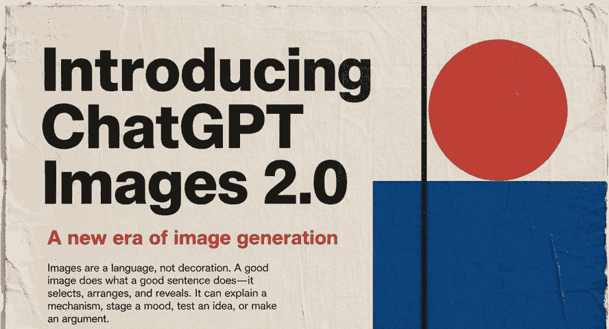
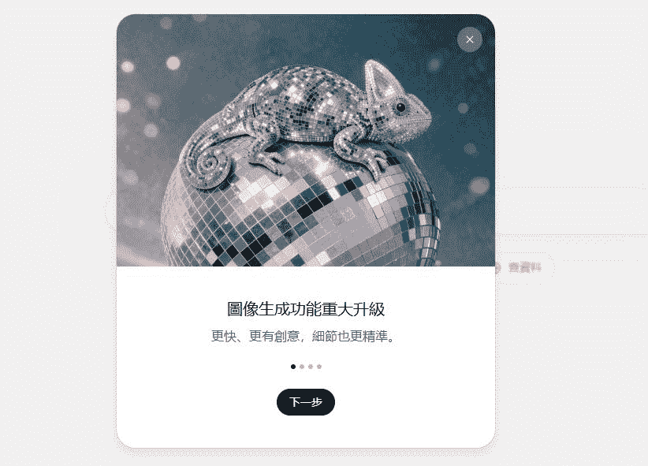
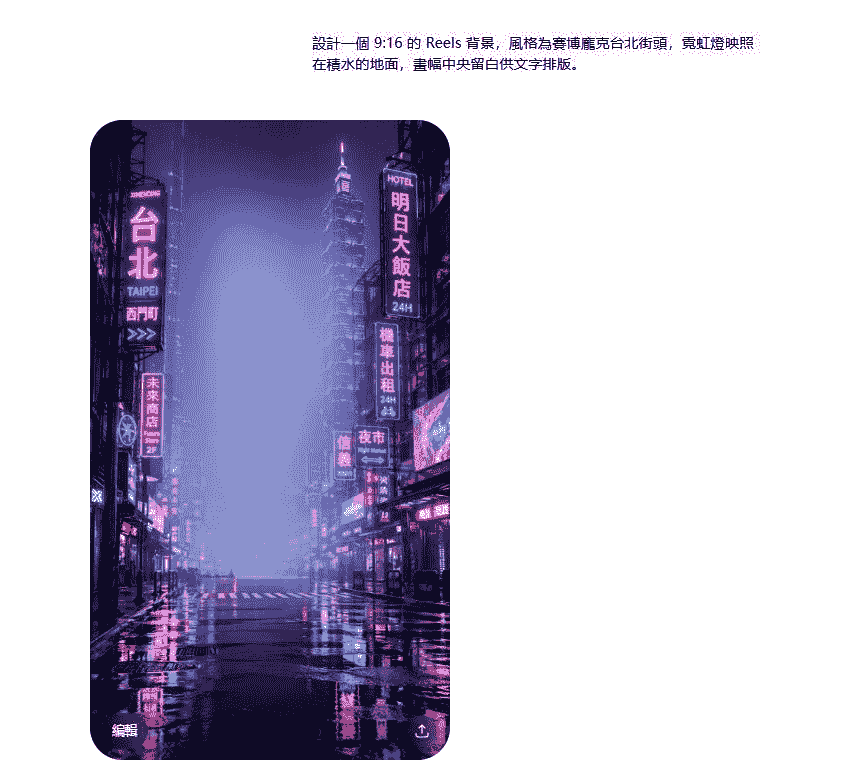
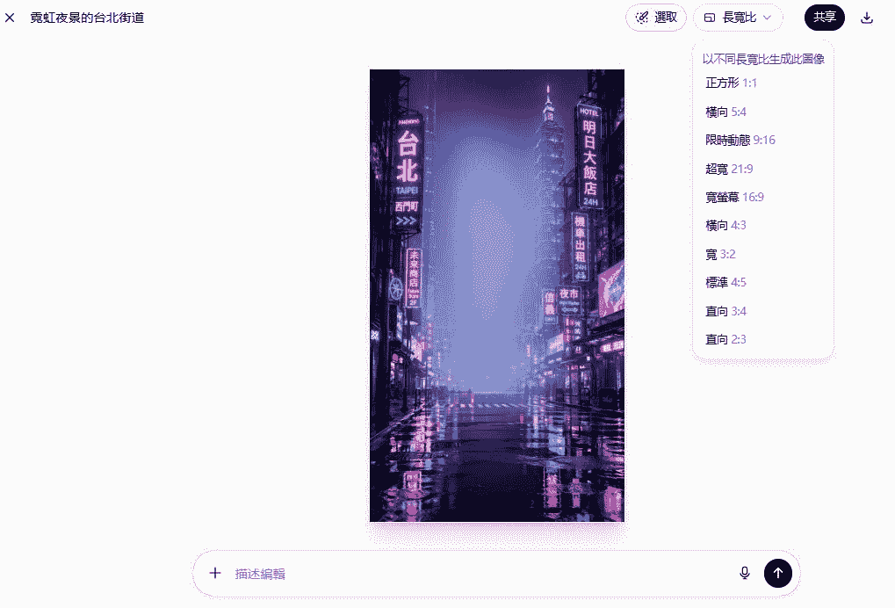
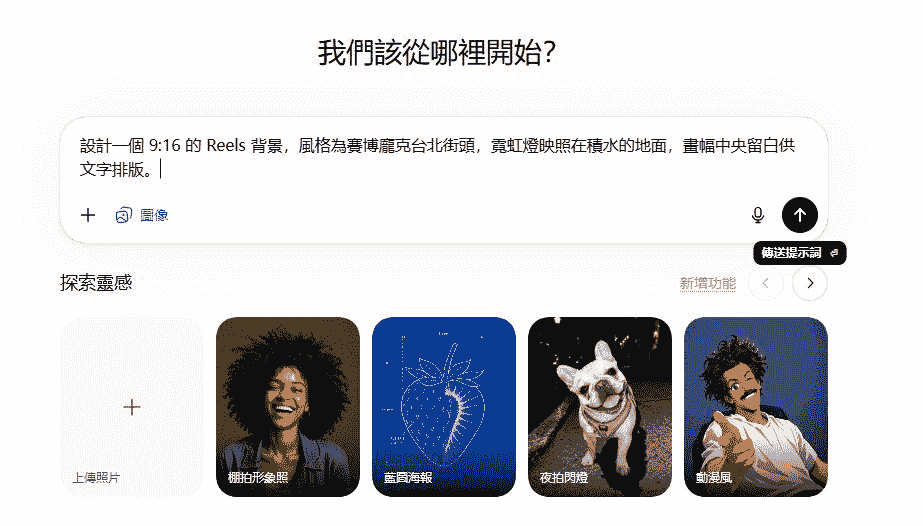

# ChatGPT Image 2 最新教程（附指令大全）！

> 来源：[https://qqs7y1hozd1.feishu.cn/docx/Ep0odRvXAo1cOLxUss1cHrE8nDb](https://qqs7y1hozd1.feishu.cn/docx/Ep0odRvXAo1cOLxUss1cHrE8nDb)

AI 影像生成领域又迎来了历史性的更新。 OpenAI 已正式开放了ChatGPT Image 2（亦被称为ChatGPT Image 2.0），这款模型不仅是技术的迭代，更是首个导入逻辑思考能力的影像模型。对于设计师与内容创作者来说，这意味着我们终于可以摆脱AI 乱画文字或物理逻辑错误的噩梦。本文详解ChatGPT Image 2 功能、免费使用方法与实用的指令范例等技巧！

## 一、ChatGPT Image 2 是什么？ ChatGPT Image 2.0 最新功能解析

ChatGPT Image 2 是OpenAI 最新推出的AI 图像生成模型，相比旧版GPT Image 1.5，已经进化为「具备推理能力的AI 设计工具」。根据OpenAI API 文件：GPT Image 2 是「目前最先进（state-of-the-art）的图像生成模型」，它不只是生成，而是完整图像处理能力（生成+ 编辑）。 GPT Image 2.0 最新核心升级：

1.  **思考模式（Thinking）：** ChatGPT Image 2 AI 在生成图片前会先理解与推理需求，进行逻辑拆解，确保图像中的重力、光影以及人物肢体比例符合现实逻辑，甚至可连网查资料再生成图片，意味着：GPT Image 图片更符合逻辑、更适合商业用途（如广告、简报）。

1.  **多图生成（一次最多8 张）：**一个Prompt 可生成一系列图片，并且：人物、风格、物件可保持一致。适合：社群素材、漫画、品牌视觉。

1.  **文字渲染大幅提升：** ChatGPT Image 2可生成完整文字排版，支援多语（含中文），可做海报、简报、UI设计，这是商业用途的关键突破。

1.  图像品质全面升级（2K + 高拟真）： ChatGPT Image 2.0 在画质上也有明显进化：支援最高约2K 解析度、支援多比例：3:1（横幅）、1:3（直式）。同时：写实能力大幅提升，可生成：假截图、杂志图片、广告素材甚至「真假难辨」。

1.  **多语言生成能力（全球化）：**除了英文，还支援：中文、日文、韩文、印度语等，并能生成：多语海报等在地化素材。

## 二、如何使用GPT Image 2免费版？

ChatGPT 直接使用（最简单）这是目前最多人使用的方式，也是体验ChatGPT Image 2 免费功能的最佳入口。

**开启ChatGPT：**选择图像生成模型（GPT Image 2）或者弹出升级框连续直接点击“下一步”→“开始制作”

**输入提示词(Prompt)：**在对话框直接输入描述。

+   例如：设计一个9:16 的Reels 背景，风格为赛博庞克台北街头，霓虹灯映照在积水的地面，画幅中央留白供文字排版。

**编辑图片：** ChatGPT Image 2生成图片后，点击图片的左下角编辑，可以进一步对图片做编辑修改，改尺寸、选取照片某一部分或输入提示词进一步要求修改，如输入「把文字字体变大、尺寸换成1:1等」。

如果你希望把ChatGPT Image 2 从「手动工具」升级为「自动化生产系统」，那可以使用GPT Image 2 API。 API 串接：对于开发者，GPT Image 2 API 已经开放，支援WebSocket 连接，生图速度提升了40%。

## 三、ChatGPT Image 2 指令（Prompt）范例大全与技巧

> 在使用ChatGPT Image 2（GPT Image 2） 时，真正决定图片品质的关键不是工具本身，而是Prompt（指令写得好不好），根据2026 年最新AI 图像生成实测与Prompt 工程研究显示，越清晰、越结构化的指令，生成效果越稳定、越接近商业级设计需求。

>

### ChatGPT Image 2 指令技巧

Prompt 黄金公式：场景（Scene） + 主体（Subject） + 细节（Details） + 风格（Style） + 限制（Constraints）例如：

+   场景：咖啡厅/ 城市/ 室内

+   主体：人物/ 商品/ UI

+   细节：光线/ 材质/ 色调

+   风格：写实/ 日系/ 电影感

+   限制：比例/ 用途/ 清晰度

+   这种结构能显著提升GPT Image 2 的稳定性与一致性

ChatGPT Image 2 指令其它技巧

+   加入「镜头语言」，例如：50mm 镜头（标准人像感）、广角镜头、浅景深。效果：背景更自然模糊、主体更突出。

+   加入「用途描述」，例如：用于广告、用于Instagram 贴文、用于电商产品图。 AI 会自动调整构图比例、主体位置、留白空间、视觉焦点。

+   加入「光线描述」，如：黄金时刻、柔和棚拍光、电影感光影。提升画面立体感，增加氛围感。

+   避免使用「模糊描述词」如：美丽的图片、好看的设计，AI 无法理解「美」的标准。

### ChatGPT Image 2 指令范例大全（直接可用）