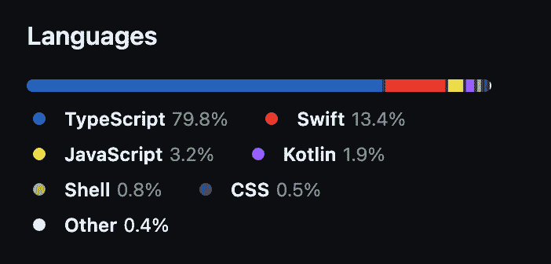
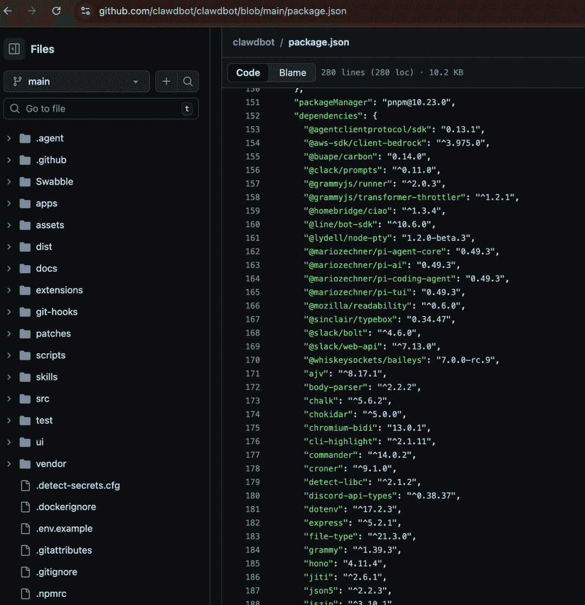
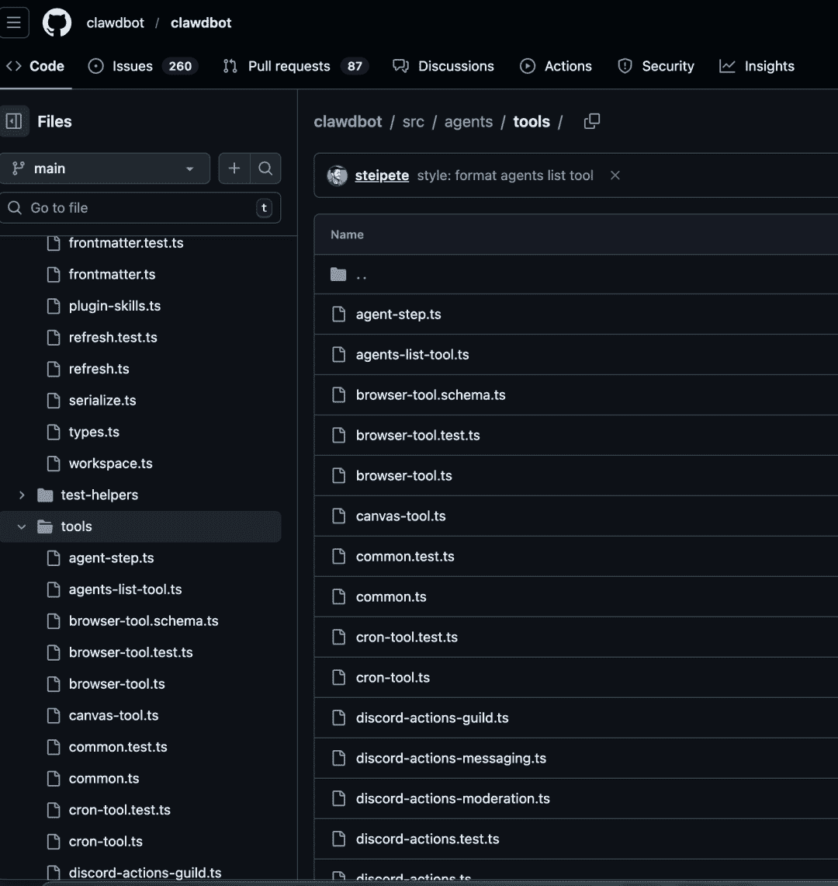
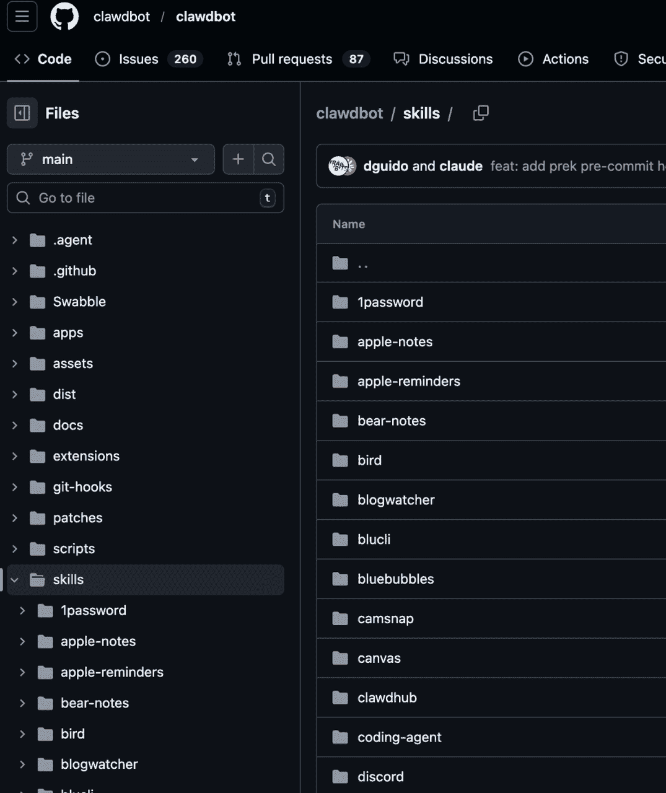

# Clawdbot 的技术实现

> 来源：[https://qqs7y1hozd1.feishu.cn/docx/EOopd2gLqoKIsSxZyahcMeCdnuf](https://qqs7y1hozd1.feishu.cn/docx/EOopd2gLqoKIsSxZyahcMeCdnuf)

Clawdbot 是一个开源的个人 AI 助手项目，它的设计目标是让用户能够在自己的设备上运行一个完全可控的智能助手。这个项目在 GitHub 上获得了 15.4k 星标和 1.9k 分支，采用 MIT 开源协议。

项目的核心理念是"本地优先"（Local-first），所有的控制逻辑和数据都运行在用户自己的设备上，而不是依赖云端服务。它支持连接多个消息平台（WhatsApp、Telegram、Slack、Discord、Google Chat、Signal、iMessage、Microsoft Teams 等），通过统一的控制平面进行管理。

本文将从代码层面深入分析 Clawdbot 的技术实现原理，重点关注其架构设计和核心模块的实现细节。

## 整体架构

Clawdbot 的代码库位于

`https://github.com/clawdbot/clawdbot`

主要使用 TypeScript 编写，运行时要求 Node.js 版本 ≥22。项目采用 `pnpm` 作为包管理器，整个代码库的结构清晰，模块化程度高。



从 `src/` 目录的组织结构来看，系统由以下核心模块组成：

这些模块通过 `Gateway()` 这个中心枢纽进行协调。所有的客户端（CLI、macOS 应用、移动应用）都通过 `WebSocket` 连接到 `Gateway`，`Gateway` 负责将请求路由到相应的处理模块。



## Gateway 控制平面实现

### 启动机制

`Gateway` 的启动逻辑在 `src/gateway/boot.ts` 文件中实现。这个文件定义了一个特殊的启动机制：系统会在启动时检查工作目录下是否存在 `BOOT.md` 文件，如果存在且内容不为空，会将其内容作为指令交给 `Agent` 执行。

`src/gateway/boot.ts` 中的核心函数 `runBootOnce` 实现如下逻辑：

```
export async function runBootOnce(params: {
  cfg: ClawdbotConfig;
  deps: CliDeps;
  workspaceDir: string;
}): Promise<BootRunResult>;
```

该函数首先调用 `loadBootFile` 函数读取 `BOOT.md` 文件：

```
async function loadBootFile(
  workspaceDir: string,
): Promise<{ content?: string; status: "ok" | "missing" | "empty" }>
```

如果文件存在且非空，函数会调用 `buildBootPrompt` 构建一个特殊的提示词，然后通过 `agentCommand` 函数（位于 `src/commands/agent.js`）将任务提交给 `Agent` 执行。这个设计允许用户通过编辑 Markdown 文件来定义启动时的自动化任务。

返回值类型定义为：

```
export type BootRunResult =
  | { status: "skipped"; reason: "missing" | "empty" }
  | { status: "ran" }
  | { status: "failed"; reason: string };
```

### WebSocket 服务

`Gateway` 的 `WebSocket` 服务器实现位于 `src/gateway/server/` 目录。从目录结构可以看到包含以下关键文件：

+ `src/gateway/server-methods/` - 定义了各种 RPC 方法的处理逻辑
+ `src/gateway/protocol/` - 定义了通信协议的数据结构
+ `src/gateway/auth.ts` - 实现了连接认证逻辑

`Gateway` 通过 `WebSocket` 提供实时双向通信能力。客户端连接后，可以发送不同类型的消息（如 `agent:run`、`config:get`、`session:send` 等），`Gateway` 根据消息类型将请求分发到对应的处理函数。

### 认证与安全

`src/gateway/auth.ts` 文件实现了连接认证机制。当客户端尝试建立 `WebSocket` 连接时，必须提供有效的认证凭证。`Gateway` 会验证这些凭证，只有通过验证的连接才会被接受并保持活跃状态。

此外，`src/gateway/device-auth.ts` 文件处理设备级别的认证，确保只有授权的设备可以连接到 `Gateway`。

## Agent 运行时实现

### Pi Agent 架构

`Agent` 的核心实现位于 `src/agents/` 目录。这个目录包含了完整的 AI 代理运行时，称为 `Pi Agent`。

关键子目录包括：

+ `src/agents/pi-embedded-runner/` - `Pi Agent` 的嵌入式运行器
+ `src/agents/pi-embedded-helpers/` - 运行时辅助函数
+ `src/agents/pi-extensions/` - `Agent` 扩展机制
+ `src/agents/tools/` - 工具集合
+ `src/agents/skills/` - 技能系统
+ `src/agents/sandbox/` - 沙箱隔离环境

`Agent` 的工作流程是：接收用户消息 → 构建包含工具列表的提示词 → 调用 LLM → 解析 LLM 响应 → 执行工具调用 → 将结果反馈给 LLM → 循环直到任务完成。

### 认证配置管理

`src/agents/auth-profiles/` 目录实现了多认证配置管理。`Clawdbot` 支持同时配置多个 LLM 提供商（Anthropic、OpenAI 等）的认证信息，并在运行时根据配置选择使用哪个提供商。

相关文件包括：

+ `src/agents/auth-health.ts` - 检查认证配置的健康状态
+ `src/agents/auth-profiles.*.test.ts` - 认证配置的测试用例

### 沙箱机制

`src/agents/sandbox/` 目录实现了代码执行的沙箱隔离。当 `Agent` 需要执行可能存在风险的操作时，这些操作会在隔离的 Docker 容器中执行。

项目根目录下的 `Dockerfile.sandbox` 和 `Dockerfile.sandbox-browser` 定义了两种沙箱容器：

+ `Dockerfile.sandbox` - 通用的代码执行沙箱
+ `Dockerfile.sandbox-browser` - 带有浏览器的沙箱，用于需要浏览器环境的任务

## 多渠道通信系统

### 插件化架构

`Clawdbot` 的多渠道支持通过插件化架构实现，核心代码位于 `src/channels/plugins/` 目录。每个消息平台都有对应的插件实现。

插件目录结构：

+ `src/channels/plugins/actions/` - 渠道操作定义
+ `src/channels/plugins/agent-tools/` - 渠道相关的 `Agent` 工具
+ `src/channels/plugins/normalize/` - 消息标准化处理
+ `src/channels/plugins/onboarding/` - 渠道引导流程
+ `src/channels/plugins/outbound/` - 出站消息处理
+ `src/channels/plugins/status-issues/` - 状态问题处理

关键文件：

+ `src/channels/plugins/catalog.ts` - 插件注册表
+ `src/channels/plugins/config-schema.ts` - 插件配置模式定义
+ `src/channels/plugins/channel-config.ts` - 渠道配置管理

### 消息标准化

`src/channels/plugins/normalize/` 目录负责将不同平台的消息格式转换为统一的内部表示。这样 `Agent` 和 `Gateway` 只需要处理标准化的消息对象，而不需要关心消息来自哪个平台。

### 安全控制

`src/channels/allowlists/` 目录实现了白名单机制。相关文件包括：

+ `src/channels/allowlist-match.ts` - 白名单匹配逻辑
+ `src/channels/mention-gating.ts` - 提及门控（群组中需要 `@` 才响应）
+ `src/channels/command-gating.ts` - 命令门控

`src/pairing/` 目录实现了私信配对机制。当陌生用户首次发送私信时，系统会生成一个配对码，只有管理员批准后该用户才能正常使用机器人。

## 浏览器控制实现

### CDP 协议封装

浏览器控制功能位于 `src/browser/` 目录。核心实现基于 Chrome DevTools Protocol (CDP)。

关键文件：

+ `src/browser/cdp.ts` - CDP 协议的核心封装
+ `src/browser/cdp.helpers.ts` - CDP 辅助函数
+ `src/browser/chrome.ts` - Chrome 浏览器启动和管理
+ `src/browser/chrome.executables.ts` - Chrome 可执行文件路径查找

`src/browser/cdp.ts` 实现了与 Chrome 浏览器的通信，通过 `WebSocket` 连接到浏览器的调试端口，发送 CDP 命令来控制浏览器行为。

### 浏览器操作

`src/browser/client-actions.ts` 及相关文件定义了浏览器的各种操作：

+ `src/browser/client-actions-core.ts` - 核心操作（导航、点击、输入等）
+ `src/browser/client-actions-observe.ts` - 页面观察和数据提取
+ `src/browser/client-actions-state.ts` - 浏览器状态管理
+ `src/browser/client-actions-types.ts` - 操作类型定义

### 配置文件管理

`src/browser/profiles.ts` 和 `src/browser/profiles-service.ts` 实现了浏览器配置文件的管理。每个会话可以使用独立的浏览器配置文件，保持 Cookie 和登录状态的隔离。

## Canvas 可视化系统

`Canvas` 功能位于 `src/canvas-host/` 目录。这个模块实现了 `A2UI` 协议的渲染服务。

`A2UI`（Agent-to-UI）是一个将 `Agent` 的内部状态和工作流程可视化的协议。`Agent` 可以通过发送 `A2UI` 指令来更新 `Canvas` 上的内容，实现实时的可视化交互。

项目还在 `vendor/a2ui/` 目录下包含了 `A2UI` 渲染器的供应商代码，用于在客户端（如 macOS 应用、iOS 应用）中渲染 `Canvas` 内容。

## 节点系统实现

### 节点管理

`src/nodes/` 目录实现了设备节点的管理。节点是指运行在 macOS、iOS、Android 上的伴侣应用，它们通过 `WebSocket` 连接到 `Gateway`，提供设备原生能力。

`src/node-host/` 目录包含了节点主机服务，负责管理与各个节点的连接和通信。

### 跨平台应用

项目包含以下平台的应用实现：

+ `apps/` 目录 - 包含各平台应用的项目文件
+ `Swabble/` 目录 - 移动应用的核心代码（Swift 实现）

从 `.swiftformat` 和 `.swiftlint.yml` 配置文件可以确认，移动应用使用 Swift 语言开发。

## 工具系统实现

### 工具目录结构

`src/agents/tools/` 目录包含了 `Agent` 可用的所有工具实现。这个目录有超过 50 个文件，涵盖了从底层浏览器控制到高层业务操作的完整工具链。

`https://github.com/clawdbot/clawdbot/tree/main/src/agents/tools`



工具按功能分为以下几类：

浏览器控制工具：`browser-tool.ts` 是浏览器控制的核心实现，配合 `browser-tool.schema.ts` 定义了工具的输入输出规范。这个工具封装了 `src/browser/` 目录下的 `CDP` 协议实现，为 `Agent` 提供了页面导航、元素操作、截图等能力。

可视化工具：`canvas-tool.ts` 实现了 `A2UI` 协议的 `Canvas` 操作接口，`Agent` 可以通过这个工具向用户界面推送实时的可视化内容。

定时任务工具：`cron-tool.ts` 提供了定时任务的创建和管理能力，`Agent` 可以设置定期执行的任务。

会话管理工具：包含 `sessions-list-tool.ts`（列出会话）、`sessions-send-tool.ts`（发送消息到会话）、`sessions-history-tool.ts`（查询会话历史）、`sessions-spawn-tool.ts`（创建新会话）、`session-status-tool.ts`（查询会话状态）等一系列文件，提供了完整的会话操作能力。

网络工具：`web-fetch.ts` 实现了网页内容抓取，`web-search.ts` 提供了网页搜索能力。这些工具在 `web-fetch.ssrf.test.ts` 中有针对 SSRF 攻击的安全测试，在 `web-tools.readability.test.ts` 中测试了可读性提取功能。

节点控制工具：`nodes-tool.ts` 是与设备节点通信的接口，通过它 `Agent` 可以调用运行在 iOS/Android/macOS 上的原生功能。

平台特定操作：针对不同消息平台，有专门的操作工具。例如 `discord-actions.ts` 及其子模块（`discord-actions-guild.ts`、`discord-actions-messaging.ts`、`discord-actions-moderation.ts`）提供了 Discord 平台的服务器管理、消息操作和审核功能。类似的还有 `slack-actions.ts`、`telegram-actions.ts`、`whatsapp-actions.ts`。

多媒体工具：`image-tool.ts` 提供图像生成和处理能力，`tts-tool.ts` 实现了文本转语音功能。

系统工具：`gateway-tool.ts` 允许 `Agent` 查询和修改 `Gateway` 配置，`memory-tool.ts` 提供了会话记忆功能，`agents-list-tool.ts` 可以列出所有可用的 `Agent`。

### 浏览器工具深入分析

`src/agents/tools/browser-tool.ts` 的实现展示了工具系统的设计模式。该文件定义了关键类型：

```
type BrowserProxyFile = {
  path: string;
  base64: string;
  mimeType?: string;
};

type BrowserNodeTarget = {
  nodeId: string;
  label?: string;
};
```

核心函数 `resolveBrowserNodeTarget` 实现了浏览器目标解析逻辑。它支持多种目标类型：

+ `sandbox`：在沙箱容器中的浏览器
+ `host`：在主机上运行的浏览器
+ `custom`：自定义浏览器实例
+ `node`：在远程设备节点上的浏览器

当 `Agent` 调用浏览器工具时，系统会根据配置和节点状态决定使用哪个浏览器实例。如果指定了 `requestedNode` 参数，工具会检查该节点是否连接（`node.connected && isBrowserNode(node)`），然后将浏览器操作代理到该节点执行。这意味着 `Agent` 可以控制运行在用户手机上的浏览器，实现真正的跨设备操作。

## 技能系统实现

### 技能系统架构

`src/agents/skills/` 目录实现了一个完整的技能管理系统。技能是对基础工具的高级封装，将多个工具调用和特定的提示词组合成面向任务的能力单元。



核心文件包括：

配置和类型定义：`config.ts` 管理技能的配置，`types.ts` 定义了技能系统的类型结构，`frontmatter.ts` 负责解析技能文件中的 Markdown frontmatter 元数据。

技能加载机制：`bundled-dir.ts` 管理内置技能目录，`plugin-skills.ts` 处理插件技能的加载，`workspace.ts` 管理用户工作空间中的自定义技能。

动态刷新：`refresh.ts` 实现了技能的动态刷新机制，允许在运行时重新加载技能而无需重启系统。

序列化：`serialize.ts` 负责将技能定义序列化为 `Agent` 可以理解的格式。

环境配置：`env-overrides.ts` 允许技能通过环境变量覆盖默认配置。

### 三层技能体系

从测试文件的命名可以看出，`Clawdbot` 实现了三层技能体系：


## 技能系统

Bundled Skills（内置技能）：这些技能随项目一起发布，存储在特定的内置目录中。测试文件 `skills.build-workspace-skills-prompt.applies-bundled-allowlist-without-affecting-workspace-skills.test.ts` 验证了内置技能的白名单机制不会影响工作空间技能。

Plugin Skills（插件技能）：通过 `plugin-skills.ts` 加载的外部技能包。这些技能可以通过包管理器安装，扩展系统的能力。

Workspace Skills（工作空间技能）：用户在自己的工作空间中创建的自定义技能。测试文件 `skills.build-workspace-skills-prompt.prefers-workspace-skills-managed-skills.test.ts` 表明工作空间技能具有最高优先级，会覆盖同名的插件技能和内置技能。

### 技能的构建和执行

测试文件揭示了技能系统的工作流程：

`skills.buildworkspaceskillcommands.test.ts` 测试了技能命令的构建过程。每个技能会被转换为 `Agent` 可以调用的命令。

`skills.buildworkspaceskillsnapshot.test.ts` 测试了技能快照功能，这允许系统保存和恢复技能的状态。

`skills.resolveskillspromptforrun.test.ts` 测试了技能提示词的解析。当 `Agent` 需要执行一个技能时，系统会根据技能定义和当前上下文，构建一个包含指令和可用工具列表的完整提示词。

`skills.build-workspace-skills-prompt.syncs-merged-skills-into-target-workspace.test.ts` 显示系统支持技能同步，可以将多个来源的技能合并到目标工作空间。

## 沙箱系统实现

### 沙箱架构

`src/agents/sandbox/` 目录实现了基于 Docker 的沙箱隔离系统。这个系统确保 `Agent` 执行的代码和工具调用不会对主机系统造成安全威胁。

核心文件分为几个层次：

Docker 集成层：`docker.ts` 封装了 Docker API 的调用，`types.docker.ts` 定义了 Docker 相关的类型。这一层负责容器的创建、启动、停止和删除。

配置管理层：`config.ts` 定义了沙箱的配置选项，`config-hash.ts` 通过计算配置的哈希值()来确保沙箱环境的一致性。当配置改变时，系统会创建新的沙箱容器。

运行时管理层：`manage.ts` 实现了沙箱的生命周期管理，`runtime-status.ts` 提供运行时状态查询，`context.ts` 维护沙箱的执行上下文，`registry.ts` 管理沙箱实例的注册表。

浏览器支持层：`browser.ts` 实现了沙箱内浏览器的集成，`browser-bridges.ts` 提供了沙箱浏览器与外部系统的桥接机制。这使得 `Agent` 可以在隔离环境中安全地进行网页操作。

工作空间管理：`workspace.ts` 管理沙箱的工作空间，包括文件的挂载和权限控制。

安全策略：`tool-policy.ts` 定义了工具使用策略，规定了哪些工具可以在沙箱内执行，哪些必须在主机上执行。`tool-policy.test.ts` 包含了策略的测试用例。

维护功能：`prune.ts` 实现了沙箱的清理功能，定期删除不再使用的容器和镜像，防止磁盘空间耗尽。

### 沙箱工作流程

当 `Agent` 需要执行一个需要隔离的操作时（例如运行用户提供的代码），系统会：

1. 通过 `config-hash.ts` 计算当前配置的哈希值
1. 在 `registry.ts` 中查找是否已有匹配的沙箱实例
1. 如果不存在，通过 `docker.ts` 创建新的容器
1. 通过 `workspace.ts` 挂载必要的文件和目录
1. 在容器内执行操作
1. 通过 `runtime-status.ts` 监控执行状态
1. 操作完成后，根据策略决定是保持容器运行还是销毁

项目根目录的 `Dockerfile.sandbox` 和 `Dockerfile.sandbox-browser` 定义了两种沙箱镜像。前者是通用的代码执行环境，后者额外包含了 Chrome 浏览器，用于需要浏览器的任务。

### 安全机制

沙箱系统的安全性体现在多个方面：

进程隔离：通过 Docker 容器实现完全的进程隔离，沙箱内的代码无法直接访问主机资源。

网络隔离：可以配置容器的网络策略，限制沙箱的网络访问。

文件系统隔离：沙箱有独立的文件系统，只能访问明确挂载的目录。

资源限制：可以限制容器的 CPU、内存等资源使用，防止资源耗尽攻击。

工具策略：通过 `tool-policy.ts` 定义的策略，某些敏感工具（如系统配置修改）被禁止在沙箱内执行。

## 开发工具链

### 包管理

项目使用 `pnpm` 作为包管理器。`pnpm-workspace.yaml` 文件定义了工作空间配置，支持 Monorepo 结构。

`package.json` 中定义了完整的构建和开发脚本：

```
{
  "scripts": {
    "dev": "node scripts/run-node.mjs",
    "build": "tsc -p tsconfig.json && ...",
    "ui:build": "node scripts/ui.js build",
    "gateway:watch": "tsx watch src/cli/entry.ts gateway",
    "test": "vitest"
  }
}
```

### 代码质量工具

项目使用以下工具保证代码质量：

+   `Oxlint` (`.oxlintrc.json`) - 基于 Rust 的高性能代码检查工具

+   `Oxfmt` (`.oxfmtrc.jsonc`) - 代码格式化工具

+   `detect-secrets` (`.detect-secrets.cfg`) - 密钥泄露检测

+   `shellcheck` (`.shellcheckrc`) - Shell 脚本检查

+   `swiftlint` (`.swiftlint.yml`) - Swift 代码检查

### 测试体系

项目建立了完善的测试体系，包含多个测试配置文件：

+   `vitest.unit.config.ts` - 单元测试配置

+   `vitest.e2e.config.ts` - 端到端测试配置

+   `vitest.gateway.config.ts` - Gateway 专项测试配置

+   `vitest.extensions.config.ts` - 扩展功能测试配置

+   `vitest.live.config.ts` - 实时环境测试配置

从 `src/` 目录下大量的 `.test.ts` 文件可以看出，项目的测试覆盖率很高，几乎每个核心模块都有对应的测试用例。

### 持续集成

`.github/` 目录包含了 GitHub Actions 的工作流配置，实现了自动化的构建、测试和发布流程。

## 部署方案

### Docker 部署

项目提供了完整的 Docker 部署方案：

+   `Dockerfile` - 主应用的 Docker 镜像

+   `docker-compose.yml` - Docker Compose 配置

+   `docker-setup.sh` - Docker 环境设置脚本

### 云平台部署

`fly.toml` 文件提供了 Fly.io 平台的部署配置，用户可以将 `Gateway` 部署到云端，实现远程访问。

## 总结

Clawdbot 是一个架构清晰、模块化程度高的个人 AI 助手项目。通过分析其代码实现，可以总结出以下技术特点：

架构设计：采用中心化的 `Gateway` 控制平面，所有模块通过 WebSocket 与 `Gateway` 通信，实现了松耦合的架构。

插件化：渠道、工具、技能都采用插件化设计，具有很强的可扩展性。

安全机制：通过沙箱隔离、白名单控制、配对机制等多层安全措施，保障系统安全。

跨平台能力：通过节点系统和原生应用，实现了跨 macOS、iOS、Android 的设备控制能力。

工程实践：使用现代化的开发工具链（`pnpm`、`Oxlint`、`vitest`），建立了完善的测试体系和自动化流程。

从代码实现来看，Clawdbot 是一个工程质量很高的开源项目，其设计思路和实现方式值得学习和借鉴。

最后我们再整理下 `package.json` 中所有依赖的介绍：

## 生产依赖 (dependencies)

## 可选依赖 (optionalDependencies)

## 开发依赖 (devDependencies)
