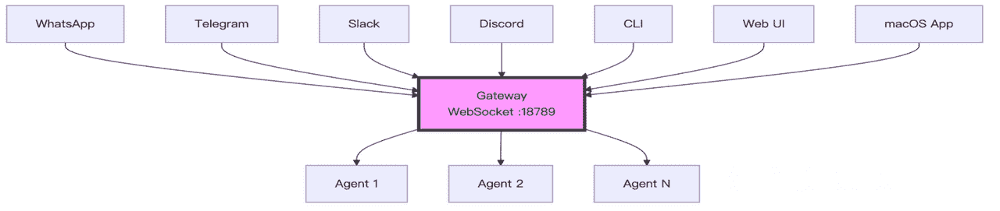
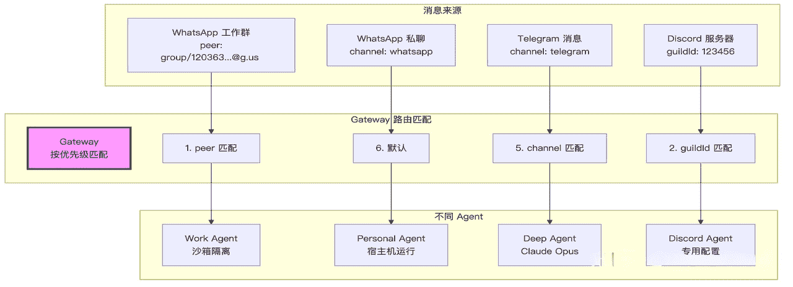
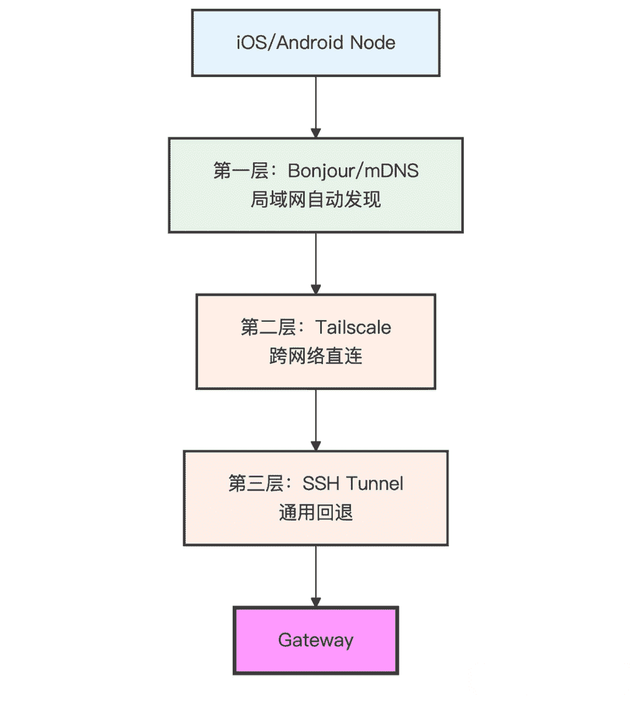
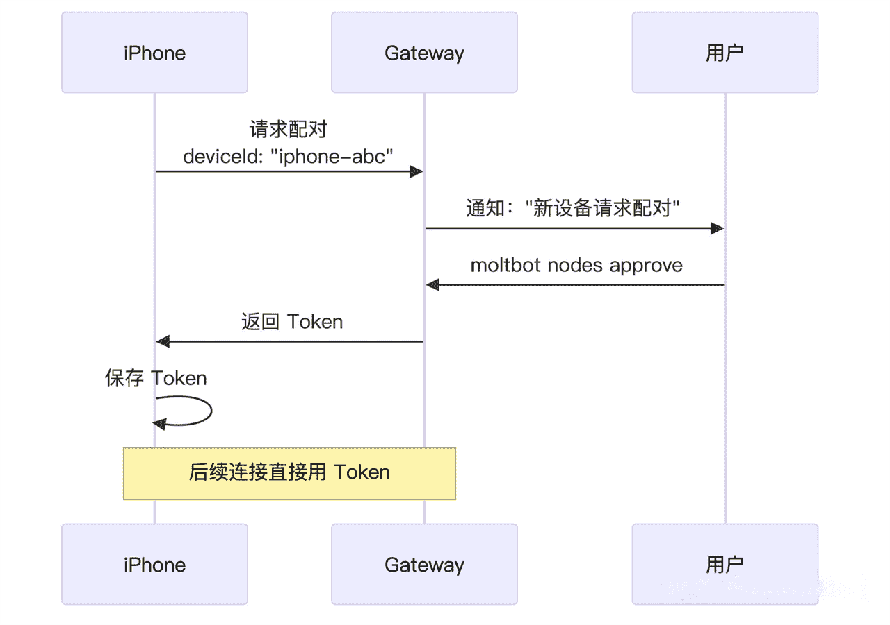
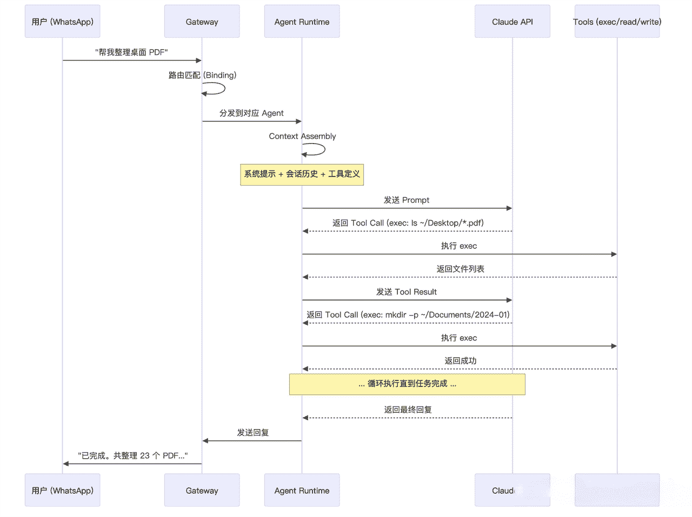
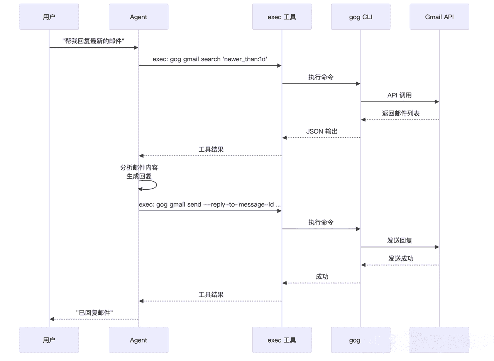
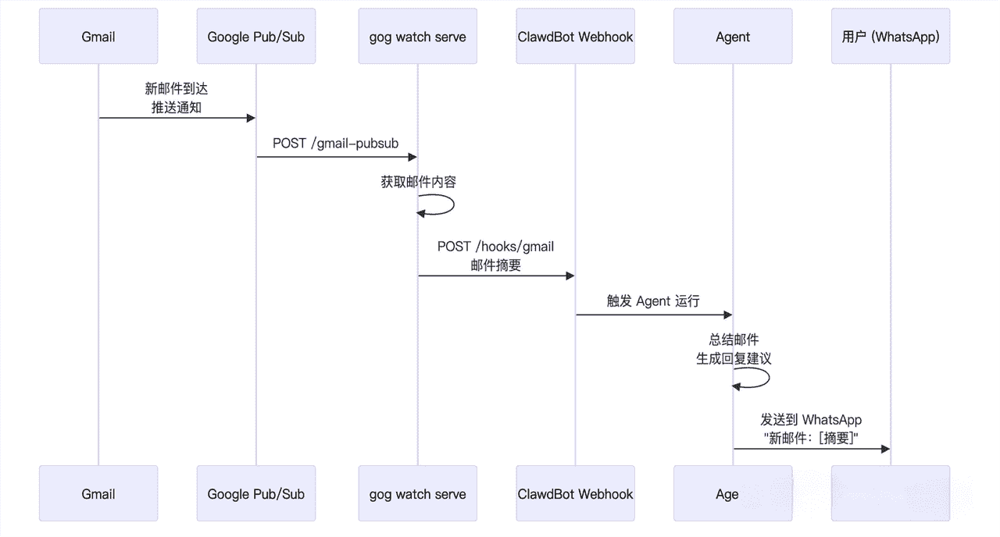
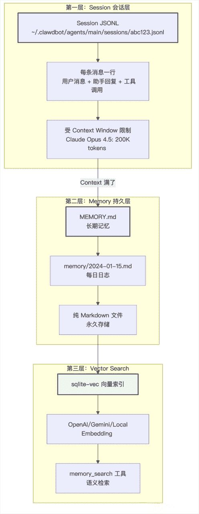
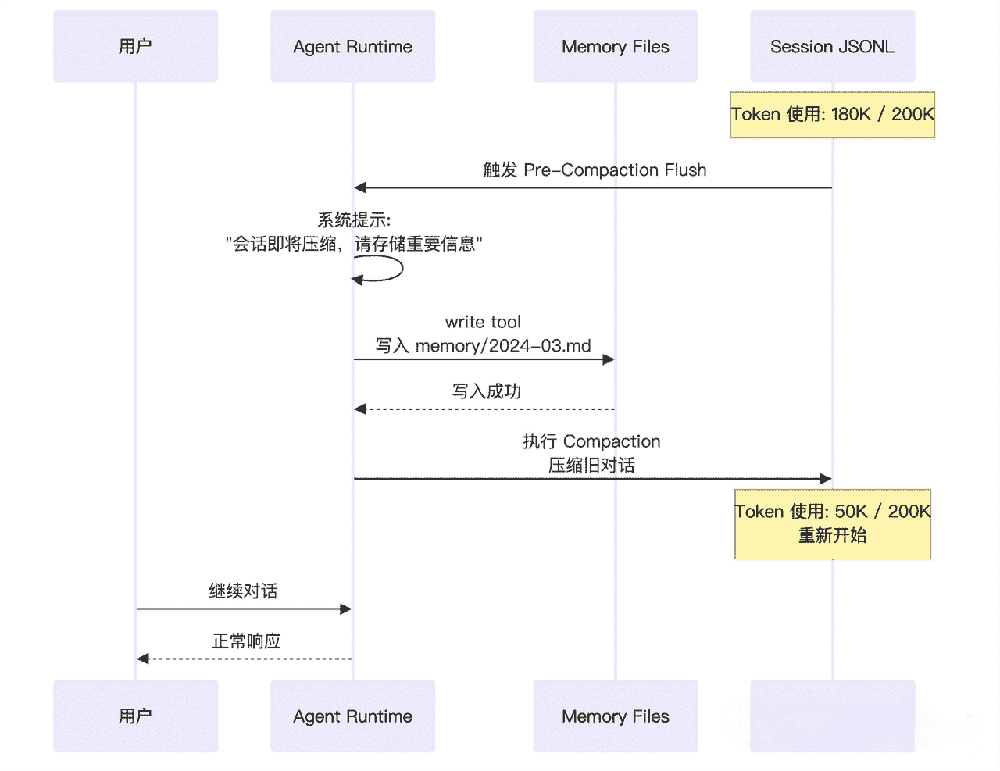
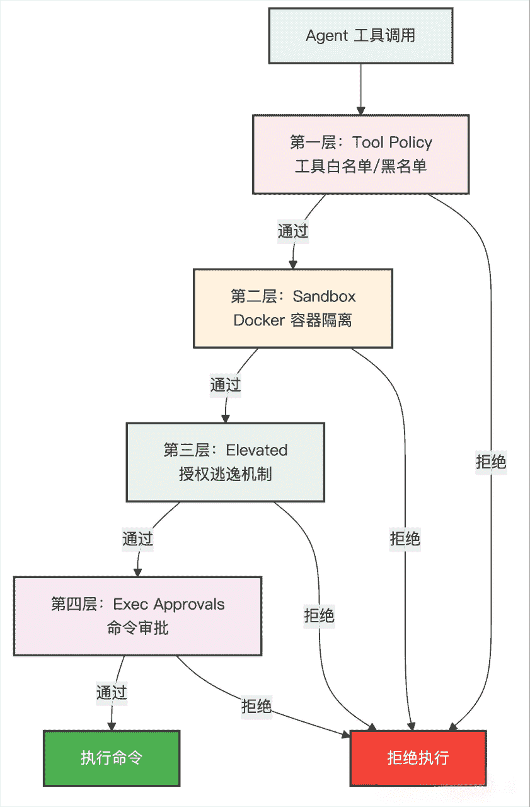

# 一文看懂 OpenClaw：7×24 小时 AI 助手的架构设计

> 来源：[https://qqs7y1hozd1.feishu.cn/docx/NZ5ed14HooXxlgxT3UScEH7Ynnd](https://qqs7y1hozd1.feishu.cn/docx/NZ5ed14HooXxlgxT3UScEH7Ynnd)

ClawdBot 爆火的背后，不只是”长了手的 Claude”，而是一套完整的 `Agent` 架构设计。

> [本文从一条 WhatsApp 消息出发](https://zhida.zhihu.com/search?content_id=269700961&content_type=Article&match_order=1&q=Gateway&zhida_source=entity)[，带你看懂](https://zhida.zhihu.com/search?content_id=269700961&content_type=Article&match_order=1&q=Tools&zhida_source=entity) [Gateway](https://zhida.zhihu.com/search?content_id=269700961&content_type=Article&match_order=1&q=Memory&zhida_source=entity)、`Agent Loop`、`Tools`、`Memory` 四大核心模块。

---

## 开篇 — 从一条消息说起

凌晨 2 点，你躺在床上刷手机，突然想起明天要用的 PDF 还没整理。

> 打开 WhatsApp，发了一条消息：
>
> “帮我把桌面上的 PDF 按日期分类到 `Documents` 文件夹”
>
> 10 秒后，手机震动，回复来了：
>
> “已完成。共整理 23 个 PDF 文件，按 2024-01、2024-02、2024-03 三个子文件夹分类。”

你没有打开电脑，没有登录任何网页，甚至没有下床。

这就是 ClawdBot。

> 它不是一个聊天机器人，而是一个 7×24 小时待命的 AI 员工。它能操控你的电脑、记住你的偏好、通过任何 IM 软件接收指令。

**但问题来了：它是怎么做到的？**

## Gateway 中枢 — 为什么需要一个”网关”？

### 问题：10+ 个平台，如何统一？

ClawdBot 支持的消息渠道多到离谱：

+ WhatsApp、Telegram、Signal、iMessage
+ Slack、Discord、Microsoft Teams
+ Google Chat、Matrix、WebChat
+ 甚至还有 Zalo（越南版🛰️）

每个平台都有自己的 API、认证方式、消息格式。如果为每个平台单独写一套 `Agent` 逻辑，代码会变成一团乱麻。

ClawdBot 的解法：`Gateway`（网关）。

### 设计：单一 `WebSocket` 控制平面

`Gateway` 是整个系统的 中央控制器。所有消息渠道都连接到它，所有客户端（CLI、Web UI、手机 App）也连接到它。



> `Gateway` 做三件事：

1. 接收消息：从各个渠道收集用户指令
1. 路由分发：决定这条消息应该交给哪个 `Agent` 处理
1. 回复投递：把 `Agent` 的回复发送回对应的渠道

`Gateway` 是”翻译官”，它把 10+ 种消息格式统一成一种内部协议，让 `Agent` 只需要关心”做什么”，而不用关心”消息从哪来”。

### 创新：`Binding` 路由机制

ClawdBot 支持 多 `Agent` 架构。一个 `Gateway` 可以托管多个独立的 `Agent`。

核心理解：每一个消息来源，绑定一个特定的 `Agent`。

**消息来源 = `channel`（渠道）+ `accountId`（账号）+ `peer`（对话方）**



> **路由规则按优先级匹配：**

1. `peer` 匹配（最高）：精确匹配对话方 ID
1. `guildId` 匹配：Discord 服务器
1. `teamId` 匹配：Slack 工作区
1. `accountId` 匹配：账号
1. `channel` 匹配：渠道
1. 默认 `Agent`（最低）

确定性、零延迟、无 AI 开销。

配置示例：

```
{
  "bindings": [
    // 优先级最高：特定群组
    { "agentId": "work", "match": { "channel": "whatsapp", "peer": { "kind": "group", "id": "120363...@g.us" } } },
    // 优先级中等：特定渠道
    { "agentId": "deep", "match": { "channel": "telegram" } },
    // 优先级最低：默认
    { "agentId": "personal", "match": { "channel": "whatsapp" } }
  ]
}
```

`Binding` 是确定性的一对一映射，不是 AI 分类。每个消息来源只绑定一个 `Agent`，路由规则清晰可控。

这就是 ClawdBot 的第一个架构创新：通过 `Gateway` + `Binding`，实现了”一个入口，多个大脑”。

### Gateway 的第三个能力：`Node` 发现

`Gateway` 不只管理消息渠道，还负责 发现和管理远程设备（`Node`）。

问题：你的 iPhone 和运行 `Gateway` 的 Mac 不在同一台机器上，它们怎么找到彼此？

**三层发现机制：**



[`Bonjour`](https://zhida.zhihu.com/search?content_id=269700961&content_type=Article&match_order=1&q=Bonjour&zhida_source=entity)：局域网广播

> `Gateway` 通过 `mDNS` 广播自己（`_moltbot-gw._tcp`），iPhone 扫描局域网，发现 `Gateway`，一键连接。

[`Tailscale`](https://zhida.zhihu.com/search?content_id=269700961&content_type=Article&match_order=1&q=Tailscale&zhida_source=entity)：跨网络直连

> 不在同一局域网？通过 `Tailscale` 虚拟组网，iPhone 通过 `MagicDNS` 解析 `Gateway` 地址，直连。

`SSH`：通用回退

> 前两种都不行？`SSH` 端口转发：`ssh -N -L 18789:127.0.0.1:18789 user@gateway-host`

配对流程：



配对信息存在 `~/.clawdbot/nodes/paired.json`。

`Gateway` 不只是消息路由器，还是设备管理中心。通过 `Bonjour`/`Tailscale`/`SSH` 三层发现机制，实现了从局域网到跨网络的无缝连接。

## Agent Loop — 思考与行动的循环

消息到达 `Gateway` 后，下一步是什么？

答案是 `Agent Loop`——ClawdBot 的核心运行时。

### 一条消息的完整旅程

让我们追踪那条”整理 PDF”的消息：



### 四个核心阶段

阶段 1：`Context Assembly`（上下文组装）

`Agent` 需要告诉 LLM “你是谁、你能做什么、用户说了什么”。这包括：

+ 系统提示：`Agent` 的身份、规则、工具列表
+ 会话历史：之前的对话记录
+ Bootstrap 文件：`AGENTS.md`、`SOUL.md`、`TOOLS.md` 等工作区文件

`ClawdBot` 会把这些内容拼接成一个完整的 Prompt，发送给 LLM。

阶段 2：`Model Inference`（模型推理）

LLM 收到 Prompt 后，决定下一步行动。它可能：

+ 直接回复用户
+ 调用一个工具（`Tool Call`）
+ 请求更多信息

阶段 3：`Tool Execution`（工具执行）

如果 LLM 决定调用工具，`Agent` 会：

1. 解析 `Tool Call` 参数
1. 执行对应的工具（`exec`、`read`、`write`、`browser`…）
1. 把执行结果返回给 LLM

阶段 4：`Reply Dispatch`（回复分发）

当 LLM 生成最终回复后，`Agent` 会：

1. 格式化回复内容
1. 通过 `Gateway` 发送回对应的消息渠道
1. 支持流式输出（边生成边发送）

### 循环的本质

`Agent Loop` 的核心是一个 “思考-行动”循环：

```
思考 → 行动 → 观察 → 思考 → 行动 → 观察 → ... → 完成
```

LLM 负责”思考”（决定做什么），Tools 负责”行动”（执行操作），执行结果作为”观察”反馈给 LLM，然后继续下一轮循环。

这就是 `Agent` 和 `Chatbot` 的本质区别：`Chatbot` 只会说，`Agent` 会做。

## 操控电脑 — `Tools` 系统设计

`Agent` 的能力边界，取决于它能调用什么工具。

ClawdBot 的 `Tools` 系统是它最强大的部分。让我们看看它是如何”操控电脑”的。

### 3.1 `exec` / `process`：命令执行

`exec` 是最基础也最强大的工具。它可以执行任何 shell 命令：

```
{ "tool": "exec", "command": "ls -la ~/Desktop" }
```

但 ClawdBot 的 `exec` 远不止于此：

前台 vs 后台执行

```
// 前台执行（等待完成）
{ "tool": "exec", "command": "ls -la" }

// 后台执行（立即返回，稍后轮询）
{ "tool": "exec", "command": "npm run build", "background": true }
```

`PTY` 模式（真正的终端）

有些命令需要交互式终端（比如 `vim`、`htop`）。ClawdBot 支持 `PTY` 模式：

```
{ "tool": "exec", "command": "htop", "pty": true }
```

`process` 工具管理后台任务

```
// 查看后台任务
{ "tool": "process", "action": "list" }

// 获取输出
{ "tool": "process", "action": "poll", "sessionId": "abc123" }

// 发送按键（比如 Ctrl+C）
{ "tool": "process", "action": "send-keys", "sessionId": "abc123", "keys": ["C-c"] }
```

### 3.2 `browser`：浏览器自动化

ClawdBot 可以控制一个专用的 Chrome 浏览器：

```
// 打开网页
{ "tool": "browser", "action": "open", "targetUrl": "https://example.com" }

// 获取页面快照（AI 可读的结构化数据）
{ "tool": "browser", "action": "snapshot", "snapshotFormat": "ai" }

// 执行操作（点击、输入、拖拽）
{ "tool": "browser", "action": "act", "request": { "kind": "click", "ref": "e12" } }

// 截图
{ "tool": "browser", "action": "screenshot" }
```

底层基于 [`Playwright`](https://zhida.zhihu.com/search?content_id=269700961&content_type=Article&match_order=1&q=Playwright&zhida_source=entity) + `CDP` 协议，可以：

+ 获取页面的 `Accessibility Tree`（无障碍树）
+ 通过 `ref` 引用精确定位元素
+ 处理文件上传、对话框、PDF 导出

### 3.3 文件系统工具

```
// 读取文件
{ "tool": "read", "path": "~/Documents/report.md" }

// 写入文件
{ "tool": "write", "path": "~/output.txt", "content": "Hello World" }

// 编辑文件（精确替换）
{ "tool": "edit", "path": "~/code.py", "old": "def foo():", "new": "def bar():" }

// 批量补丁（多文件编辑）
{ "tool": "apply_patch", "patches": [...] }
```

### 3.4 [`Sandbox` 沙箱](https://zhida.zhihu.com/search?content_id=269700961&content_type=Article&match_order=1&q=Sandbox+%E6%B2%99%E7%AE%B1&zhida_source=entity)：安全边界

这是 ClawdBot 最重要的安全机制。

问题：如果 AI 执行了 `rm -rf /`，你的电脑就完了。

解法：把工具执行放进 `Docker` 容器。

```
{
  "agents": {
    "defaults": {
      "sandbox": {
        "mode": "non-main",  // 非主会话启用沙箱
        "scope": "session",   // 每个会话一个容器
        "workspaceAccess": "none"  // 容器看不到真实工作区
      }
    }
  }
}
```

**三种模式：**

+ `off`：直接在宿主机执行（危险但高效）
+ `non-main`：只有主会话在宿主机，群聊/其他渠道在沙箱
+ `all`：所有会话都在沙箱

`Elevated` 逃逸：授权用户可以通过 `/elevated on` 临时突破沙箱，在宿主机执行命令。

### 3.5 `Node` 节点：远程设备控制

ClawdBot 不只能控制本地电脑，还能控制远程设备。

场景：`Gateway` 跑在 Linux 服务器上，但你想用 Mac 的摄像头拍照。


```json
// 列出已连接的节点
{ "tool": "nodes", "action": "status" }

// 在 Mac 节点上执行命令
{ "tool": "nodes", "action": "run", "node": "office-mac", "command": ["echo", "Hello"] }

// 拍照
{ "tool": "nodes", "action": "camera_snap", "node": "iphone-1" }

// 屏幕录制
{ "tool": "nodes", "action": "screen_record", "node": "office-mac", "duration": "10s" }

// 获取位置
{ "tool": "nodes", "action": "location_get", "node": "iphone-1" }
```

### Node 可以是：

+ macOS 菜单栏 App

+ iOS/Android App

+ 无头节点（`moltbot node run`）

### 3.6 Skills：如何操作邮箱等软件？

这是很多人好奇的问题：ClawdBot 怎么操作 Gmail、Calendar、Slack 这些软件？

答案是 [Skills 系统](https://zhida.zhihu.com/search?content_id=269700961&content_type=Article&match_order=1&q=Skills+%E7%B3%BB%E7%BB%9F&zhida_source=entity)。

`Skills` 是 ClawdBot 的”能力扩展包”，每个 Skill 本质上是：

1. 一个 CLI 工具（比如 `gog`、`himalaya`）

1. 一份使用说明（`SKILL.md`）

以 Gmail 为例：`gog` Skill

ClawdBot 通过 `gog`（Google Workspace CLI）操作 Gmail：

```
# 搜索邮件
gog gmail search 'newer_than:7d' --max 10

# 发送邮件
gog gmail send --to user@example.com --subject "Hi" --body "Hello"

# 创建草稿
gog gmail drafts create --to user@example.com --subject "Hi" --body-file ./message.txt

# 回复邮件
gog gmail send --to user@example.com --subject "Re: Hi" --body "Reply" --reply-to-message-id <msgId>
```

当你对 ClawdBot 说”帮我回复最新的邮件”，它会：



Gmail Pub/Sub：实时邮件通知

ClawdBot 还支持 Gmail Push 通知：



配置后，新邮件到达时 ClawdBot 会自动：

+ 总结邮件内容

+ 发送到你的 WhatsApp/Telegram

+ 可选：自动回复/归档

其他 Skills 示例

+ `himalaya`：通用 IMAP/SMTP 邮件客户端

+ `bird`：Twitter/X CLI（发推、回复、搜索）

+ `wacli`：WhatsApp CLI（同步、搜索、发送）

+ `discord`：Discord 操作（表情、投票、贴纸）

+ `spotify-player`：Spotify 控制（搜索、播放、队列）

### Skills 的加载机制

Skills 有三个来源：

1. Bundled Skills：随 ClawdBot 安装自带

1. Managed Skills：`~/.clawdbot/skills`（全局共享）

1. Workspace Skills：`<workspace>/skills`（当前 Agent 专属）

当 Agent 启动时，ClawdBot 会：

1. 扫描所有 Skills 目录

1. 检查依赖（二进制文件、环境变量）

1. 把符合条件的 Skills 注入到系统提示中

1. Agent 可以通过 `read` 工具读取 `SKILL.md` 学习如何使用

Agent 的能力边界 = `Tools` 的能力边界。

ClawdBot 通过 `Tools` + `Skills` 双层架构，既能直接操控系统（`Tools`），又能调用各种专业工具（`Skills`）。

## 永不遗忘 — Memory 架构

ClawdBot 最让人惊艳的特性之一，是它的 7×24 小时记忆。

但这里有个关键问题：记忆 ≠ 上下文。

### 4.1 三层记忆架构



#### 第一层：Session 会话层

每个会话有独立的 JSONL 历史文件：

```
~/.clawdbot/agents/<agentId>/sessions/<SessionId>.jsonl
```

每一行是一条消息（用户消息、助手回复、工具调用、工具结果）：

```
{"role":"user","content":[{"type":"text","text":"帮我整理桌面"}]}
{"role":"assistant","content":[{"type":"tool_use","id":"call_1","name":"exec","input":{"command":"ls ~/Desktop"}}]}
{"role":"user","content":[{"type":"tool_result","tool_use_id":"call_1","content":"file1.pdf\nfile2.pdf"}]}
{"role":"assistant","content":[{"type":"text","text":"已完成整理"}]}
```

这些历史会在 context window 内保持，但有两个限制：

1. Token 上限：Claude Opus 4.5 是 200K tokens，超过就需要压缩

1. 会话重置：默认每天凌晨 4 点重置（可配置）

#### 第二层：Memory 持久层

ClawdBot 的记忆是 纯 Markdown 文件：

```
~/clawd/
├── MEMORY.md              # 长期记忆（手动维护）
└── memory/
    ├── 2024-01-15.md      # 每日日志
    ├── 2024-01-16.md
    └── 2024-01-17.md
```

`MEMORY.md` 示例：

```
# 长期记忆

## 用户偏好
- 喜欢简洁的代码风格
- 工作时间：9:00-18:00
- 不喜欢被打断

## 重要决策
- 2024-01-15：决定用 TypeScript 重构项目
- 2024-02-20：切换到 Claude Opus 4.5

## 常用命令
- 部署：`npm run deploy`
- 测试：`npm test`
```

`memory/2024-01-15.md` 示例：

```
# 2024-01-15

- 完成了 PDF 整理功能
- 用户反馈很满意
- 修复了邮件发送的 bug
```

#### 第三层：Vector Search 语义检索

ClawdBot 会对 Memory 文件建立向量索引（`sqlite-vec`）：

```
{
  "memorySearch": {
    "provider": "openai",  // 或 gemini、local
    "model": "text-embedding-3-small",
    "query": {
      "hybrid": {
        "enabled": true,
        "vectorWeight": 0.7,  // 语义相似度
        "textWeight": 0.3     // 关键词匹配
      }
    }
  }
}
```

Agent 可以通过 `memory_search` 工具搜索记忆：

```
{ "tool": "memory_search", "query": "上次部署用的什么命令？" }
```

返回：

```
{
  "results": [
    {
      "file": "MEMORY.md",
      "lines": "42-44",
      "snippet": "## 常用命令\n- 部署：`npm run deploy`",
      "score": 0.89
    }
  ]
}
```

### 4.2 Pre-Compaction Memory Flush：最精髓的设计

这是 ClawdBot 实现 7×24 小时的核心机制。

#### 问题：

当会话接近 context window 上限时，ClawdBot 会执行 compaction（压缩），把旧的对话总结成一段文字。但这个过程会丢失细节。

#### 解法：

在压缩之前，触发一个 `silent turn`（静默回合），提醒 Agent 把重要信息写入磁盘。



配置：

```
{
  "compaction": {
    "memoryFlush": {
      "enabled": true,
      "softThresholdTokens": 4000,
      "systemPrompt": "会话即将压缩，请存储持久记忆",
      "prompt": "把重要信息写入 memory/YYYY-MM-DD.md；如无需存储回复 NO_REPLY"
    }
  }
}
```

记忆 ≠ 上下文。上下文是临时的（受 Token 限制），记忆是永久的（存在磁盘上）。ClawdBot 通过 Memory Flush 机制，在压缩前抢救重要信息。

### 4.3 Queue 机制：处理并发消息

当多条消息同时到达，ClawdBot 如何保证不混乱？

#### Queue 机制：

+ 串行执行：每个 session 同时只有一个 Agent 运行（避免冲突）

+ 三种模式：

> `steer`：注入当前运行（取消后续工具调用）

> `collect`：合并成一个后续回合（默认）

> `followup`：排队等待

+ 防止风暴：`debounce`（防抖）+ `cap`（上限）

配置：

```
{
  "messages": {
    "queue": {
      "mode": "collect",
      "debounceMs": 1000,
      "cap": 20
    }
  }
}
```

这保证了即使消息密集到达，Agent 也能有序处理，不会因为并发导致会话状态混乱。

## 安全边界 — 如何防止 AI 删库跑路？

ClawdBot 的权限很高，理论上可以执行 `rm -rf /`。

如何保证安全？

### 5.1 Tool Policy：白名单机制

最简单的方法：不给它危险工具。

```
{
  "tools": {
    "deny": ["exec", "write", "edit", "apply_patch"]
  }
}
```

或者只允许特定工具：

```
{
  "tools": {
    "allow": ["read", "browser", "message"]
  }
}
```

支持工具组：

```
{
  "tools": {
    "allow": ["group:fs", "group:sessions"],  // 文件系统 + 会话工具
    "deny": ["group:runtime"]                  // 禁止命令执行
  }
}
```

### 5.2 Sandbox Mode：容器隔离

更安全的方法：把工具执行放进 Docker 容器。

```
{
  "sandbox": {
    "mode": "non-main",      // 非主会话启用沙箱
    "scope": "session",       // 每个会话一个容器
    "workspaceAccess": "none" // 容器看不到真实工作区
  }
}
```

三种模式：

+ `off`：直接在宿主机执行（危险但高效）

+ `non-main`：主会话（你的私人对话）在宿主机，群聊/其他渠道在沙箱

+ `all`：所有会话都在沙箱

工作区访问控制：

+ `none`：容器有独立的工作区（`~/.clawdbot/sandboxes/<sessionId>`）

+ `ro`：只读挂载真实工作区（可以读文件，不能改）

+ `rw`：读写挂载（危险，慎用）

### 5.3 Elevated Mode：授权逃逸

有时你确实需要在宿主机执行命令（比如重启服务）。

ClawdBot 提供 Elevated Mode：

```
/elevated on
```

然后 Agent 可以通过 `elevated: true` 参数突破沙箱：

```
{ "tool": "exec", "command": "sudo systemctl restart nginx", "elevated": true }
```

授权机制：

1. 只有 `tools.elevated.enabled` 启用才可用

1. 需要在 `tools.elevated.allowFrom` 中配置允许的发送者

1. 每个会话独立控制（不会影响其他会话）

### 5.4 Exec Approvals：命令审批

最严格的方法：每个命令都需要人工批准。

```
{
  "tools": {
    "exec": {
      "host": "gateway",      // 在宿主机执行
      "security": "allowlist", // 白名单模式
      "ask": "on-miss"        // 不在白名单的命令需要批准
    }
  }
}
```

工作流程：

```
Agent 调用 exec
    ↓
命令不在白名单
    ↓
返回 status: "approval-pending"
    ↓
macOS App 弹出审批窗口
    ↓
用户点击 Approve/Deny
    ↓
命令执行/拒绝
```

白名单管理：


# 5.5 多层防护总结

## 添加到白名单

```bash
moltbot approvals allowlist add "/usr/bin/git"
```

## 查看白名单

```bash
moltbot approvals allowlist list
```

## 移除

```bash
moltbot approvals allowlist remove "/usr/bin/git"
```

`ClawdBot` 的安全是 多层防护：



推荐配置：

```json
{
  "sandbox": {
    "mode": "non-main",           // 群聊在沙箱
    "workspaceAccess": "ro"       // 只读工作区
  },
  "tools": {
    "deny": ["gateway", "cron"],  // 禁止修改系统配置
    "exec": {
      "security": "allowlist",    // 白名单模式
      "ask": "on-miss"            // 不在白名单的命令需要批准
    }
  }
}
```

安全不是“禁止所有”，而是“分层授权”。主会话（私人对话）可以高权限，群聊/公开渠道必须严格隔离。

# 小结 — 给 Agent 一台专属电脑

`ClawdBot` 的爆火，不是因为它“更聪明”，而是因为它 真的能做事。

2025 是 `Agent` 年，2026 是“给 Agent 一台电脑”年。

几乎所有人都在用电脑工作：读文档、写代码、发邮件、做 PPT。这些任务的共同点：都可以转化为“操作电脑”。

给 `Agent` 一台电脑，它就能做任何人用电脑做的事。

为什么是“专属”电脑？

+   隔离：你不会让 `Agent` 在主力机上随便执行命令

+   持续运行：7×24 小时待命需要永不关机的设备

+   本地控制：你的数据在本地，`Agent` 也应该在本地

这就是为什么 Mac Mini 被抢购一空——它是最便宜的“Agent 专属电脑”。

`ClawdBot` 用一套完整的架构设计，证明了这条路是可行的：

+   `Gateway` 统一多渠道接入

+   `Tools` + `Skills` 定义能力边界

+   `Memory` 实现持久化记忆

+   多层防护保证安全

从 `Chatbot` 到 `Agent` 的范式转移已经开始了。
