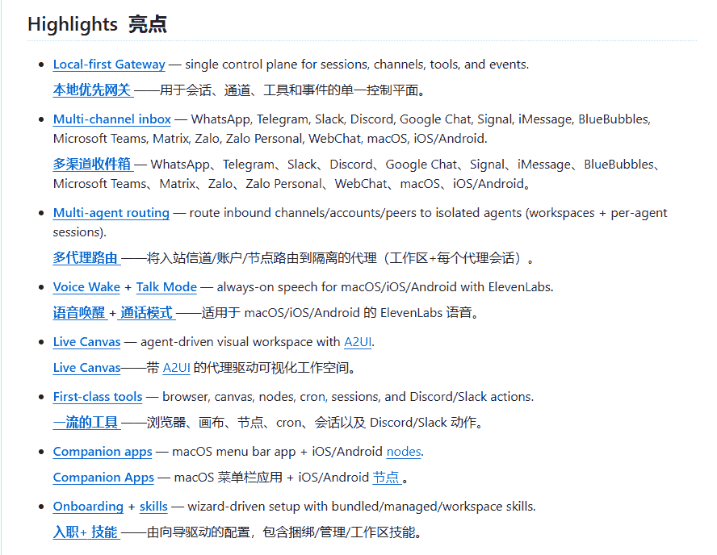
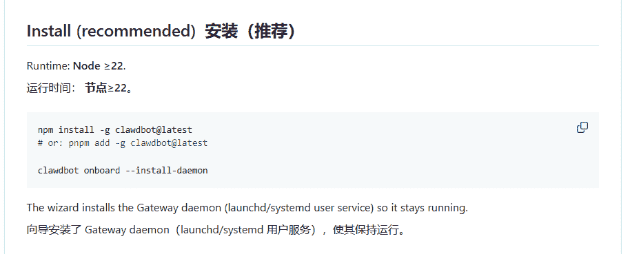
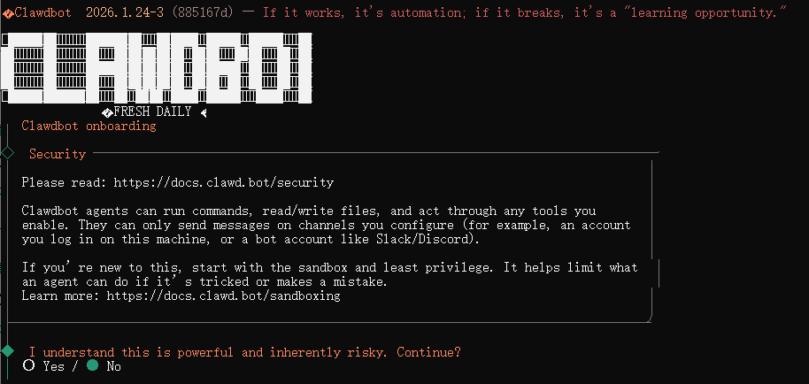
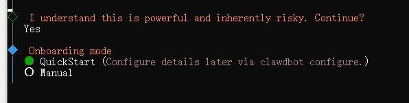
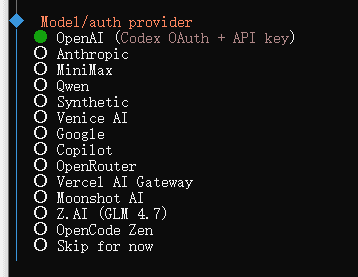
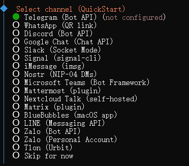
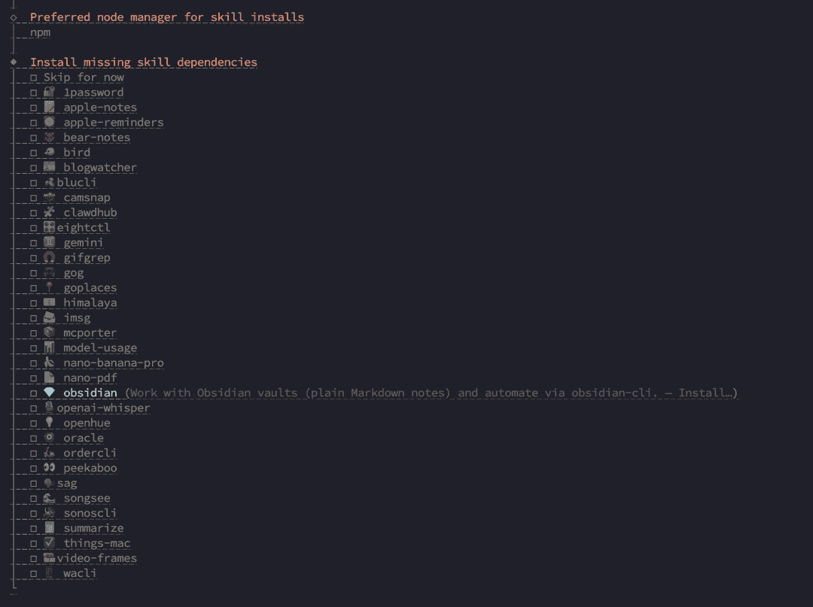
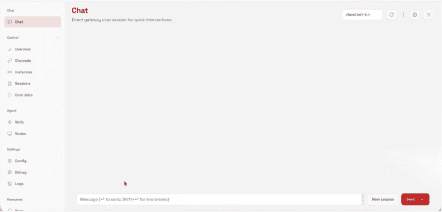

# 那个外网爆火的Clawdbot，我写了个小白也会跑的教程！

> 来源：[https://qqs7y1hozd1.feishu.cn/docx/YDoCdGBoXoJJQdxeyYVc3YNln5g](https://qqs7y1hozd1.feishu.cn/docx/YDoCdGBoXoJJQdxeyYVc3YNln5g)

过去的 AI，本质上都被关在应用层里。不管模型再聪明，能活动的范围也只是在网页、API 或某个沙盒环境中打转。你得给接口、给权限、给格式，AI 才能一步步往前挪。

clawdbot 选择了另一条路。

它不再和应用谈合作，而是直接刺破了应用层。只要是人类能通过鼠标和键盘完成的操作，它都能完成。从 Excel 里提数、生成图表，到在 PPT 里排版，再到把结果丢进 Slack 或邮件，全流程不需要人为介入。

这一步的真正含义在于：

软件第一次不再是人去学怎么用，而是AI 学会怎么替你用。

它也因此不太像一个工具，更像是一个拥有数字躯体的虚拟员工。

但如果只有执行力，这还不足以让它爆火。

真正戳中所有开发者神经的，是它对遗忘这个问题的处理。

所有用过大模型的人都知道那种痛苦：任务一拉长，Token 一满，AI 就开始断片。你明明花了半小时铺垫背景，它却像什么都没发生过。clawdbot 给 AI 接上了一个外挂式的向量数据库，相当于为它建立了一个几乎无限容量的第二大脑。它可以像人类翻档案一样，精准回溯几天前、甚至几个月前的对话细节。

这件事带来的变化非常直接：AI 第一次在复杂、长期工程里，保持了逻辑一致性。不管任务周期拉得多长，它都记得你最初的意图。

到这里，其实已经很危险了。

因为当一个系统既能操作你的电脑，又不会忘事，它就已经越过了工具的边界。

更夸张的是它的交互方式。语音唤醒、持续对话，在 macOS、iOS、Android 之间无缝切换。你不再需要琢磨 Prompt 该怎么写，只需要像和同事沟通一样，把模糊的想法说出来。

这种体验上的变化，意味着 AI 正在从被指挥的工具，转向可以共事的对象。

也正是在真实使用中，clawdbot 的价值开始变得异常清晰。

你只需要把一个网页链接丢给它，系统就会自动解析内容，绕开广告和噪音，提取核心信息，并通过大模型完成理解、压缩和清洗，最后直接存入本地或云端数据库。从链接到结构化知识，全程不需要复制、粘贴或重新排版。

你随手记录的碎片化想法，也不会再丢失。不完整的思路会被自动分类、补全，并和已有内容建立关联，同步进 memo 或知识库，随时可检索、可复用。

任务管理同样发生了变化。你不需要再设置复杂的闹钟或日历规则，只要用自然语言告诉它什么时候做什么，它就会准时提醒，甚至直接执行后续动作。

在没有明确指令的时候，它也依然在线。凭借长期上下文和你的历史偏好，它给出的反馈不再是通用答案，而是明显贴合你个人逻辑的判断建议。

大多数时候，它是安静的。但你需要的时候，它随时能接手。

如果你也想第一时间感受这种击穿天花板的效率，现在就可以动手安装。

需要注意的是，由于该项目拥有极高的系统权限，建议不要在主力办公电脑上直接运行。推荐使用闲置设备、虚拟机或云服务器进行测试。

在开始之前，请确保你的本地环境满足以下条件：

Node.js 版本：高于22 （这是硬性门槛，版本过低会导致安装失败）。

若未安装，请前往 Node.js 官网 下载最新 LTS 版本。

如果是windows用户必须使用WSL2()

官方已经将流程简化到了极致，你只需要打开终端，执行这一条命令：

npm install -g clawdbot@latest

安装确认：安装终端提示点击确认。

模式选择： 出现 QuickStart（快速开始）和 Manual（手动配置）选项，建议新手直接选择 QuickStart。

模型供应商： 支持目前主流的所有大模型。根据自己手头的 API Key() 进行选择。

驱动通道： 选择我们希望通过哪种途径（如 Web、终端或特定客户端）来驱动项目执行任务。

技能配置（Skills）： 选择偏好的 Node 管理器，并安装必要的技能包依赖。可以根据实际需求进行勾选。

完成所有依赖安装后，会看到一个简洁的聊天交互接口。

现在，你可以试着对它下达指令了，比如：“帮我监控网页上的数据变化，并自动整理成表格发给我。”

当一个 AI 拿到了操作系统的 Root 权限，并拥有了不可磨灭的长效记忆，所谓的软件边界就已经消失了。

Clawdbot 的爆火，其实是在告诉我们：AI 的未来不在对话框里，而在你的系统底层。 我们正在亲历一个时代的落幕——那个需要人类去学习软件操作的时代。以后，你只需要下达意图，剩下的交给那个住在你 Mac mini 里的幽灵。

在这个指数级进化的时代，保持好奇心是唯一的解药。