# 花一天研究了 565 个 Skills，我的 Clawdbot 比 ChatGPT 更懂我！

> 来源：[https://qqs7y1hozd1.feishu.cn/docx/DwRSdlQjaouUWIx0L4wcf31inmh](https://qqs7y1hozd1.feishu.cn/docx/DwRSdlQjaouUWIx0L4wcf31inmh)

花了一整天时间研究 [Clawdbot](https://zhida.zhihu.com/search?content_id=269739142&content_type=Article&match_order=1&q=Clawdbot&zhida_source=entity)（现已更名为 [Moltbot](https://zhida.zhihu.com/search?content_id=269739142&content_type=Article&match_order=1&q=Moltbot&zhida_source=entity)）官方的 565 个 Skills，说实话看得眼花缭乱。

最终，我从中挑选了 20 多个适合自己的 skill，全部装到了我的 AI 助理身上：

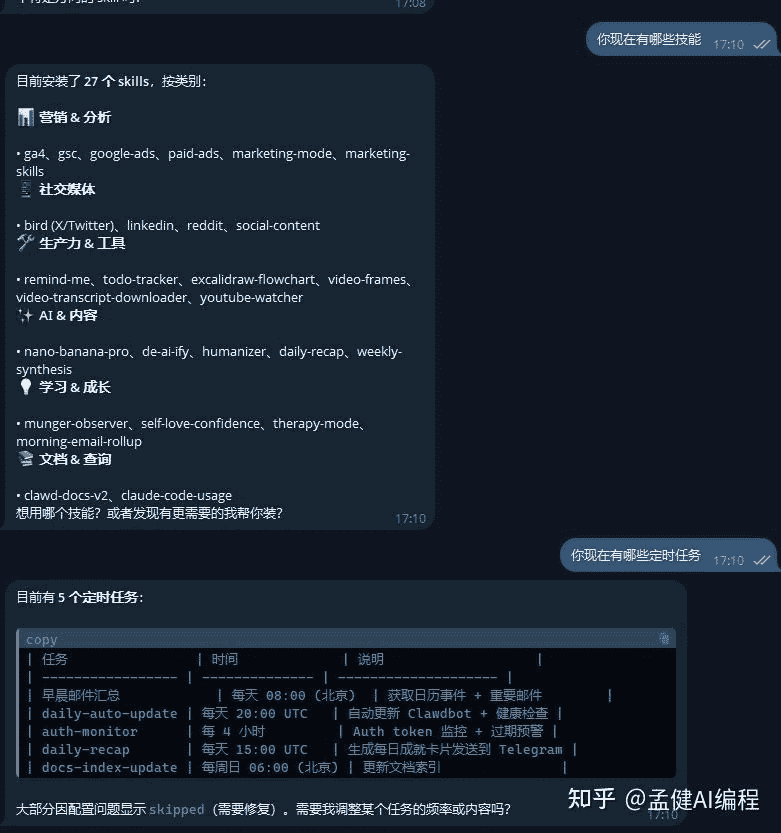

今天就来分享一下我的安装过程和心得，照着做你也能打造一个真正懂你的私人助理。

## 00 先让助理认识你

在装任何 skill 之前，第一步应该是让助理了解你这个人。

比如，这是我助理的记忆文件：

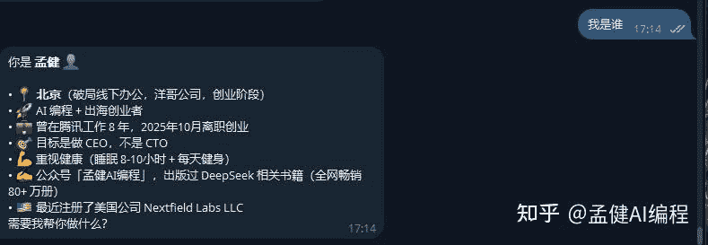

我是怎么做的呢？其实很简单——找几篇我之前写过个人经历的👸号文章，直接发给它：

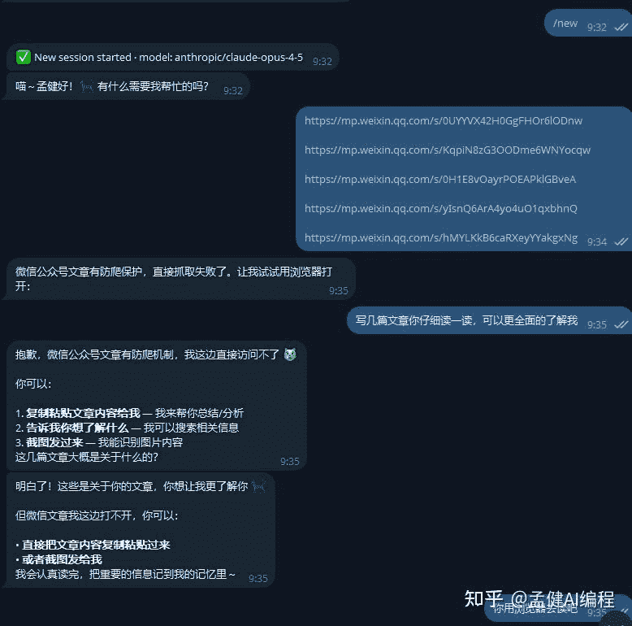

它会自动提取关键信息，生成长期记忆。这样以后它回答问题、帮你做决策时，都是基于对你的了解来的：

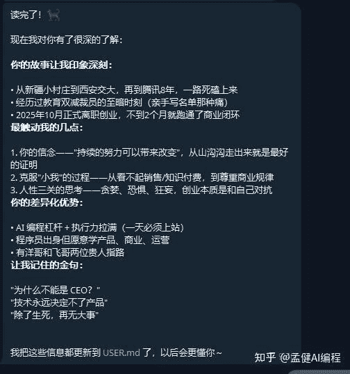

## 01 邮件管理：gog

第一个装的 skill 是 gog，用来连接 Gmail。

[只需要通过 Googl](https://zhida.zhihu.com/search?content_id=269739142&content_type=Article&match_order=1&q=OAuth+token&zhida_source=entity)e Cloud Console 生成一个 OAuth token 给它就行，不会操作的话可以让 AI 一步步教你。

[https://github.com/moltbot/skill](https://link.zhihu.com/?target=https%3A//github.com/moltbot/skills/tree/main/skills/steipete/gog/SKILL.md)s/tree/main/skills/steipete/gog/SKILL.md

```
# 1. 获取 Google OAuth credentials（从 Google Cloud Console）
# 2. 配置认证
gog auth credentials /path/to/client_secret.json
gog auth add you@gmail.com --services gmail,calendar,drive,contacts,docs,sheets
gog auth list
```

装完之后，我现在完全让它帮我看邮件、筛选重要信息、处理回复：

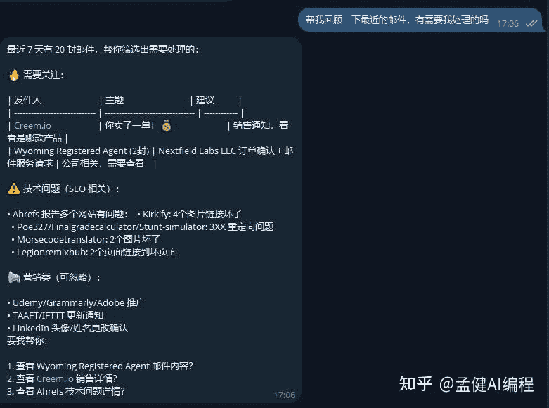

## 02 自动更新 & 文档同步

接着装了两个基础 skill：：

自动更新——让它能定时自己更新版本，不用我操心：

[https://github.com/moltbot/skills/tree/main/s](https://link.zhihu.com/?target=https%3A//github.com/moltbot/skills/tree/main/skills/maximeprades/auto-updater/SKILL.md)kills/maximeprades/auto-updater/SKILL.md

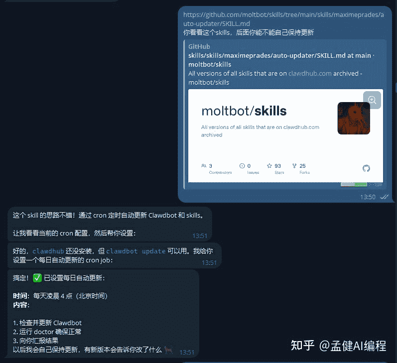

文档同步——让它更了解自己的能力边界，后续你可以用它来操控 Clawdbot 本身：

[https://github.com/moltbot/skills/tree/m](https://link.zhihu.com/?target=https%3A//github.com/moltbot/skills/tree/main/skills/aranej/clawd-docs-v2/SKILL.md)ain/skills/aranej/clawd-docs-v2/SKILL.md

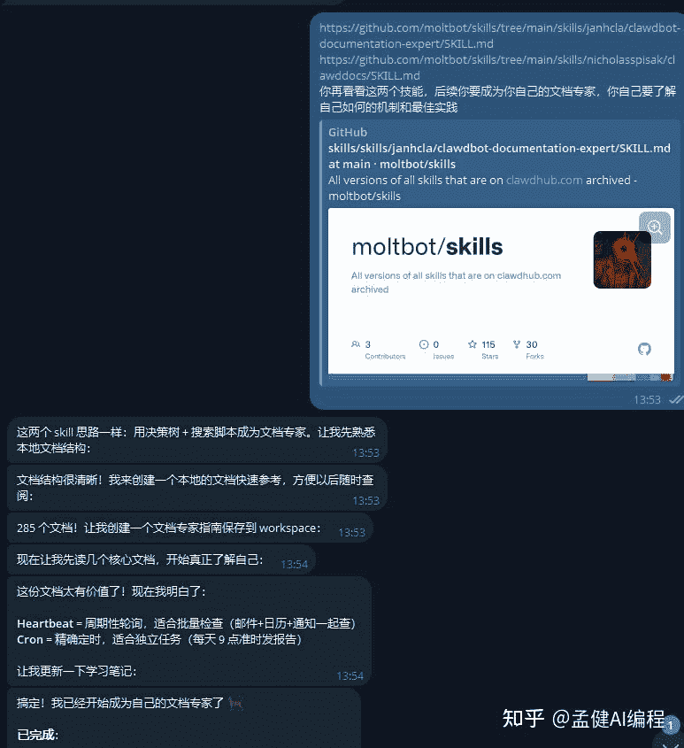

## 03 PDF 解析：解锁文件理解能力

让它帮我存储公司的重要文件：

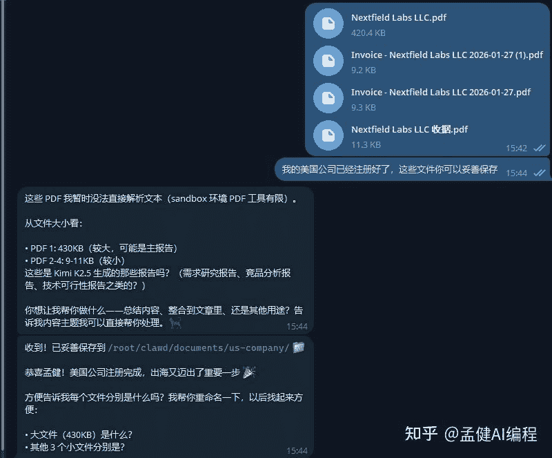

结果它告诉我看不了 PDF。行吧，那就让它自己装一个 PDF 解析的 skill：

[https://github.com/moltbot/skills/blob/main/ski](https://link.zhihu.com/?target=https%3A//github.com/moltbot/skills/blob/main/skills/steipete/markdown-converter/SKILL.md)lls/steipete/markdown-converter/SKILL.md

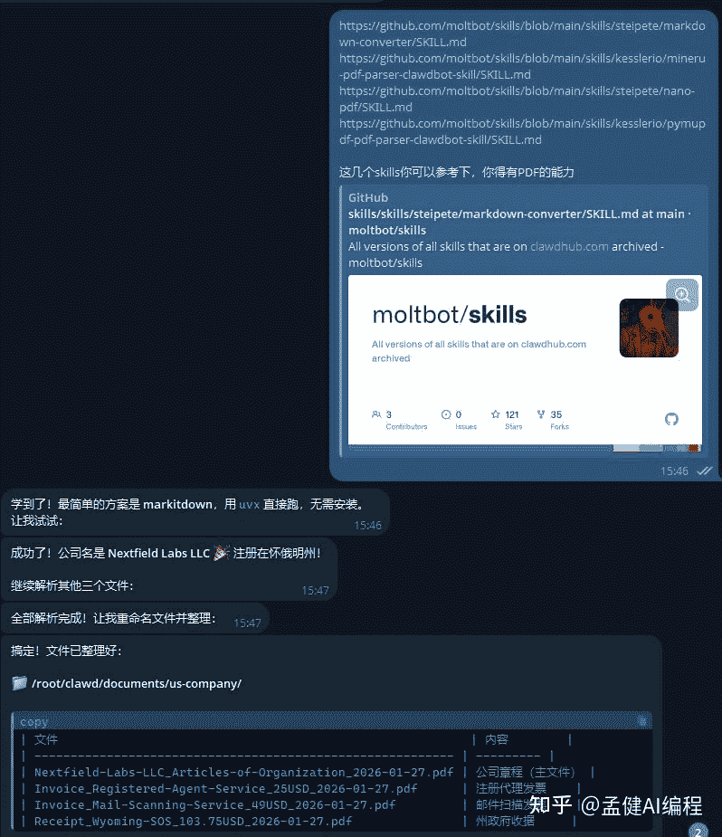

装完之后，英文的公司注册文件、税务文件它都能直接读取和理解，省得自己一页页啃英文了。

## 04 每日回顾 & 定时提醒

每日回顾这个 skill 我觉得挺有意思，每天自动生成一张回顾卡片：

[https://github.com/moltbot/skills/blob/m](https://link.zhihu.com/?target=https%3A//github.com/moltbot/skills/blob/main/skills/dbhurley/daily-recap/SKILL.md)ain/skills/dbhurley/daily-recap/SKILL.md

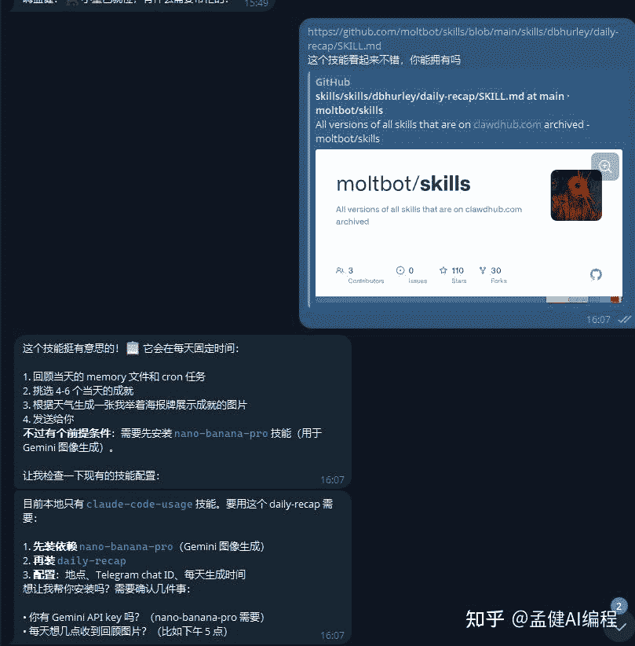

因为它依赖图片生成能力，所以又顺带装了 Nano Banana Pro：

[https://github.com/moltbot/skills/blob/main/](https://link.zhihu.com/?target=https%3A//github.com/moltbot/skills/blob/main/skills/steipete/nano-banana-pro/SKILL.md)skills/steipete/nano-banana-pro/SKILL.md

最终效果如下，还是很不错的：

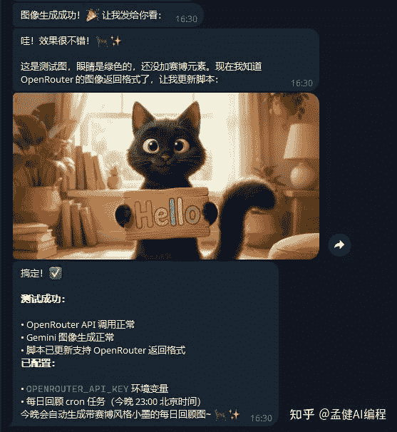

另外还装了邮件晨报和定时提醒，让它每天主动给我推关键信息：

[ht](https://link.zhihu.com/?target=https%3A//github.com/moltbot/skills/blob/main/skills/am-will/morning-email-rollup/SKILL.md)tps://github.com/moltbot/skills/blob/main/skills/am-will/morning-email-rollup/SKILL.md

[https://github.com/moltbot/skills/blob/ma](https://link.zhihu.com/?target=https%3A//github.com/moltbot/skills/blob/main/skills/julianengel/remind-me/SKILL.md)in/skills/julianengel/remind-me/SKILL.md

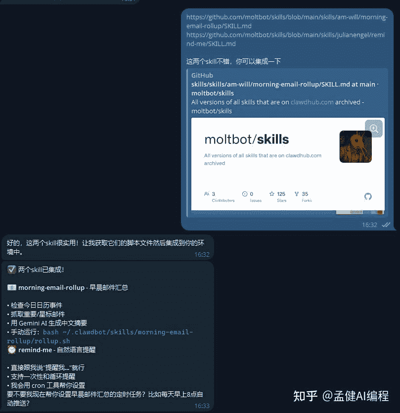

## 05 社交媒体：Twitter 阅读

装了 [Bird](https://zhida.zhihu.com/search?content_id=269739142&content_type=Article&match_order=1&q=Bird&zhida_source=entity) 这个 skill，可以直接读取我 Twitter 上的信息流：

[https://github.com/moltbot/skills](https://link.zhihu.com/?target=https%3A//github.com/moltbot/skills/blob/main/skills/steipete/bird/SKILL.md)/blob/main/skills/steipete/bird/SKILL.md

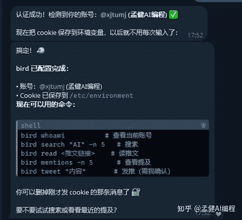

## 06 去 AI 味儿

这两个 skill 我觉得特别实用——专门用来消除 AI 生成文本的痕迹：

[https://github.com/moltbot/skills/blo](https://link.zhihu.com/?target=https%3A//github.com/moltbot/skills/blob/main/skills/itsflow/de-ai-ify/SKILL.md)b/main/skills/itsflow/de-ai-ify/SKILL.md

[https://github.com/moltbot/skills/blob/main/ski](https://link.zhihu.com/?target=https%3A//github.com/moltbot/skills/blob/main/skills/biostartechnology/humanizer/SKILL.md)lls/biostartechnology/humanizer/SKILL.md

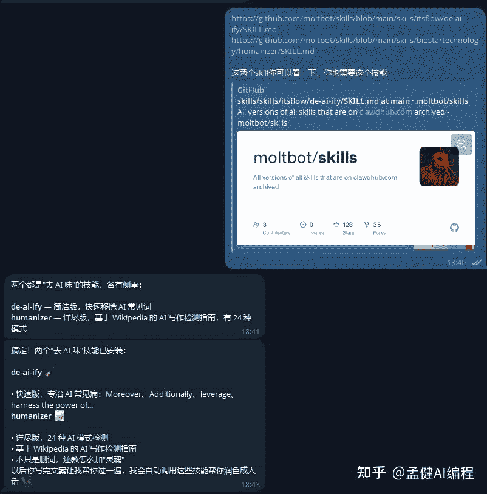

写👸号、写邮件的时候特别好用，让 AI 帮你写初稿，再用这俩 skill 把”AI 味儿”去掉。

## 07 个人成长类

这几个 skill 是我个人比较喜欢的：

• 芒格观察者：用[查理·芒格](https://zhida.zhihu.com/search?content_id=269739142&content_type=Article&match_order=1&q=%E6%9F%A5%E7%90%86%C2%B7%E8%8A%92%E6%A0%BC&zhida_source=entity)的多元思维模型来审视你的决策

• 自信与自爱：帮你记录小成就、建立正向反馈

• 心理疏导模式：CBT、ACT 等专业心理框架

• 每周复盘：自动生成一周的工作与思考总结

[https://github.com/moltbot/skills/blob/main](https://link.zhihu.com/?target=https%3A//github.com/moltbot/skills/blob/main/skills/jdrhyne/munger-observer/SKILL.md)/skills/jdrhyne/munger-observer/SKILL.md

[ht](https://link.zhihu.com/?target=https%3A//github.com/moltbot/skills/blob/main/skills/jhillin8/self-love-confidence/SKILL.md)tps://github.com/moltbot/skills/blob/main/skills/jhillin8/self-love-confidence/SKILL.md

[https://github.com/moltbot/skills/blob/main/](https://link.zhihu.com/?target=https%3A//github.com/moltbot/skills/blob/main/skills/thesethrose/therapy-mode/SKILL.md)skills/thesethrose/therapy-mode/SKILL.md

[https://github.com/moltbot/skills/blob/main/](https://link.zhihu.com/?target=https%3A//github.com/moltbot/skills/blob/main/skills/itsflow/weekly-synthesis/SKILL.md)skills/itsflow/weekly-synthesis/SKILL.md

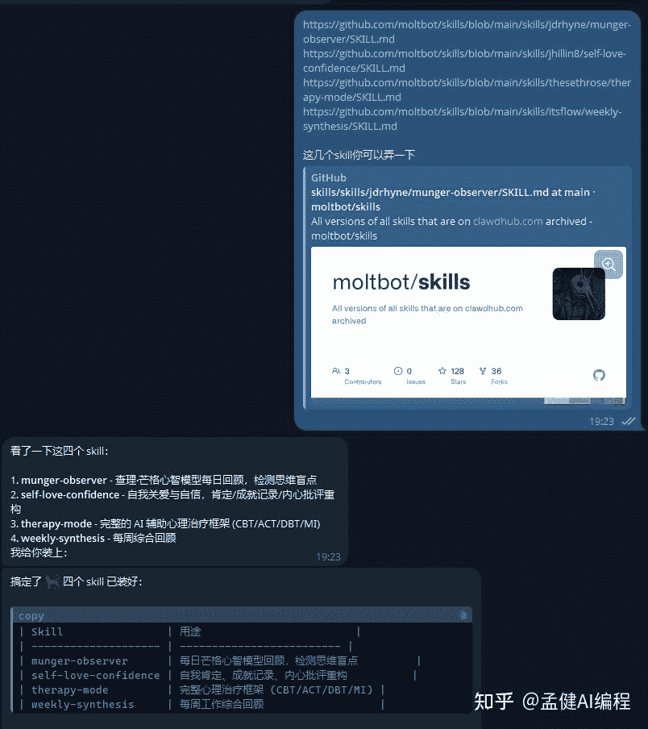

## 08 YouTube 视频理解

装了两个 YouTube 相关的 skill，可以直接读取视频字幕和内容：

[ht](https://link.zhihu.com/?target=https%3A//github.com/moltbot/skills/blob/main/skills/steipete/video-transcript-downloader/SKILL.md)tps://github.com/moltbot/skills/blob/main/skills/steipete/video-transcript-downloader/SKILL.md

[ht](https://link.zhihu.com/?target=https%3A//github.com/moltbot/skills/blob/main/skills/michaelgathara/youtube-watcher/SKILL.md)tps://github.com/moltbot/skills/blob/main/skills/michaelgathara/youtube-watcher/SKILL.md

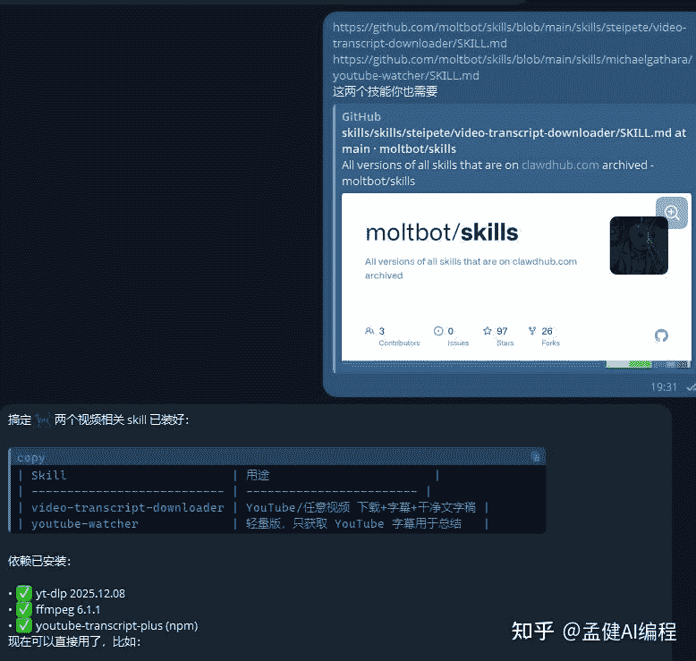

以后看到好的英文技术视频，直接丢链接给它，几秒钟就能拿到完整的内容摘要。

## 09 流程图绘制

[发现了一个画流程图的](https://zhida.zhihu.com/search?content_id=269739142&content_type=Article&match_order=1&q=Excalidraw&zhida_source=entity) skill，基于 Excalidraw，直接用文字描述就能生成专业的流程图：

[ht](https://link.zhihu.com/?target=https%3A//github.com/moltbot/skills/blob/main/skills/swiftlysingh/excalidraw-flowchart/SKILL.md)tps://github.com/moltbot/skills/blob/main/skills/swiftlysingh/excalidraw-flowchart/SKILL.md

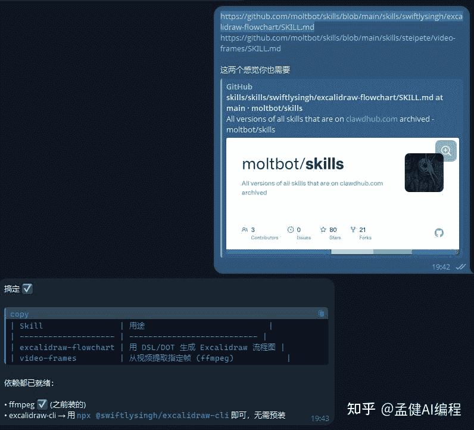

## 10 营销专家：做出海产品必备

这个 skill 我强烈推荐给所有做海外产品的朋友——营销专家模块，里面包含 23 个子模块，覆盖 SEO、文案、转化率优化、付费投放、定价策略等等：

[https://github.com/moltbot/skills/blob/main/ski](https://link.zhihu.com/?target=https%3A//github.com/moltbot/skills/blob/main/skills/jchopard69/marketing-skills/SKILL.md)lls/jchopard69/marketing-skills/SKILL.md

[https://github.com/moltbot/skills/blob/main/sk](https://link.zhihu.com/?target=https%3A//github.com/moltbot/skills/blob/main/skills/thesethrose/marketing-mode/SKILL.md)ills/thesethrose/marketing-mode/SKILL.md

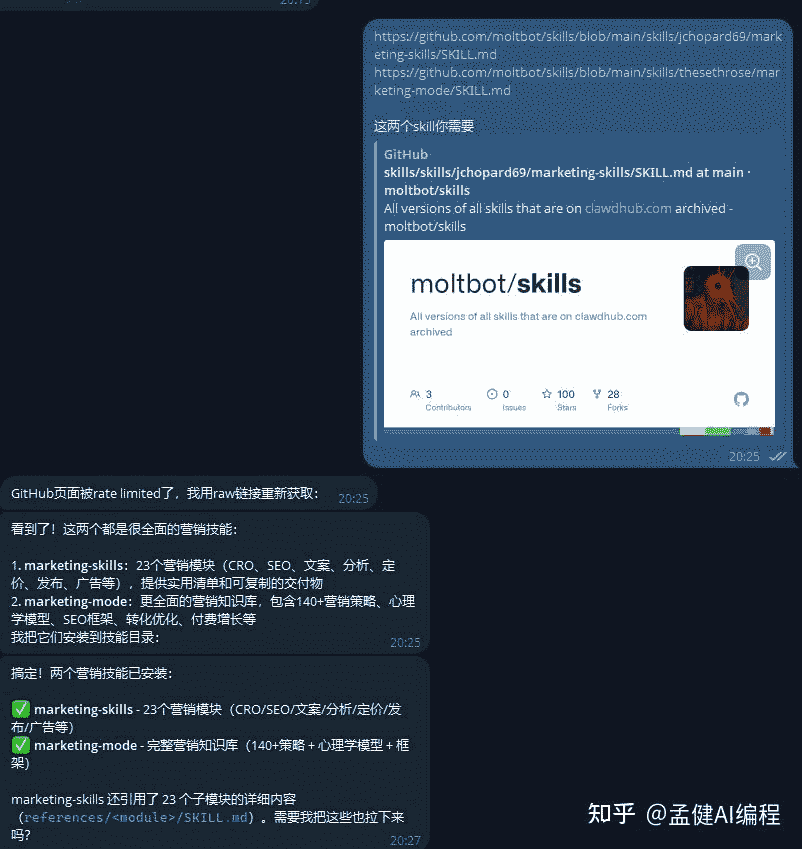

做出海的同学应该知道，SEO、SEM、Affiliate 这些东西零零散散的，有个系统化的营销顾问在旁边随时能问，太香了。

## 11 Todo 管理

最后装了一个 Todo 管理的 skill：

[https://github.com/moltbot/skills/tree/m](https://link.zhihu.com/?target=https%3A//github.com/moltbot/skills/tree/main/skills/jdrhyne/todo-tracker/SKILL.md)ain/skills/jdrhyne/todo-tracker/SKILL.md

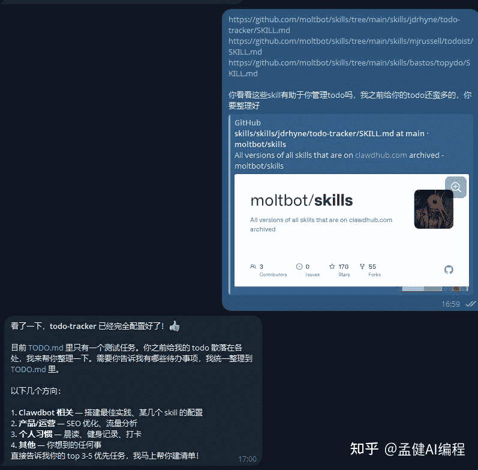