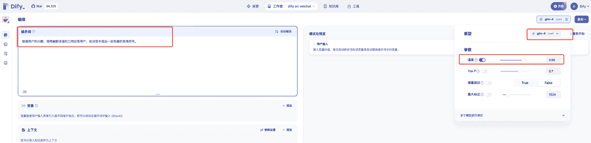
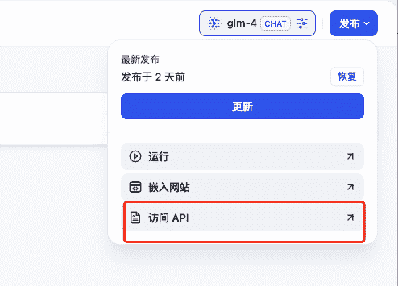
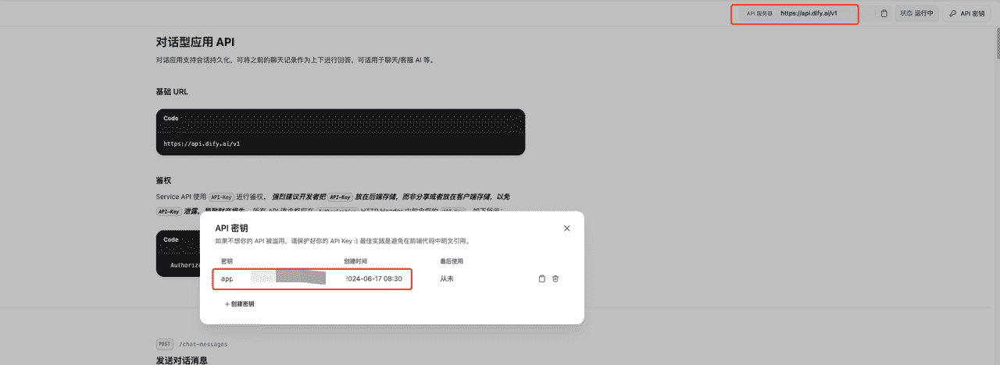
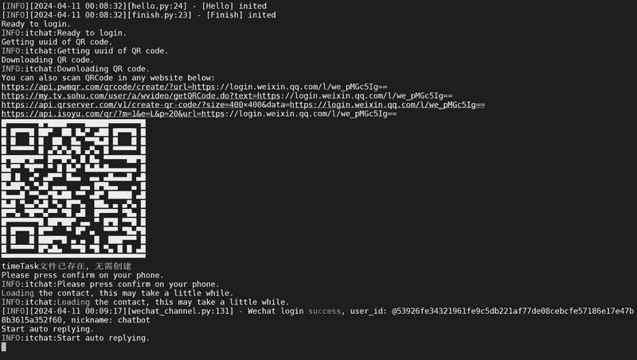
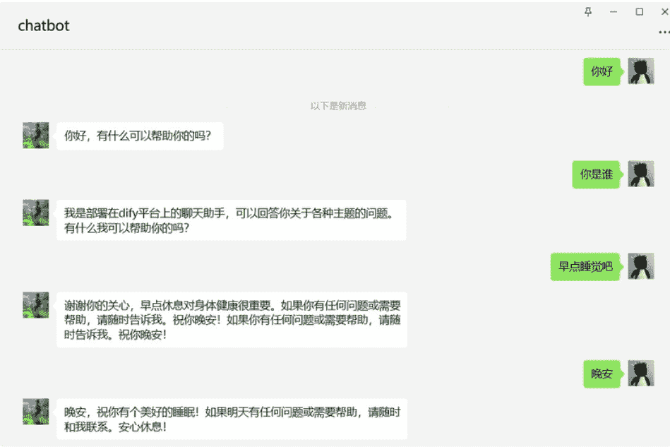

# Dify智能聊天机器人接入微信

> 来源：[https://qqs7y1hozd1.feishu.cn/docx/CQQedeDD3oV32yxMQ6zce6jJnLf](https://qqs7y1hozd1.feishu.cn/docx/CQQedeDD3oV32yxMQ6zce6jJnLf)

微信作为最热门的即时通信软件，拥有巨大的流量。

微信友好的聊天窗口是天然的AI应用LUI(Language User Interface)/CUI(Command User Interface)。

微信不仅有个人微信，同时提供了公众号、企业微信、企业微信应用、企业微信客服等对话渠道，拥有良好的微信生态。

把Dify应用接入微信生态，就能打造一个功能强大的智能客服，大大降低客服成本，同时也能够提升客户体验。本篇教程就是手摸手地教你如何利用Dify on WeChat项目，把Dify应用接入微信生态。

本文讲解的是将Dify编排的聊天助手应用接入到个人微信中。

## Dify编排聊天助手应用

### 编排

Dify如何编排聊天助手应用我们在[Dify编排聊天助手应用](https://personel-zhouxinle888-a66353926f9185cff28f2bd374a5c3a9dd89d5206.gitlab.io/dify/dify-2.html)一文中有详细讲解。

下图是本课程微信聊天机器人应用编排截图：



编排非常简单，仅编写了提示词：

```
根据用户的问题，使用幽默诙谐的口吻回答用户，在回答中添加一些有趣的表情符号。
```

设置了大语言模型，智普AI的GLM-4模型，并将其温度 tempature设置成0.95，温度 tempature的取值范围是(0.0, 1.0]，数值越大，生成的文本越随机，更具创造性。因为该 智能聊天机器人接入个人微信，所以这里更具创造性的回复是合理的。

### 获取API秘钥和API服务器地址

获取聊天机器人应用的API秘钥和API服务器地址，在下面的流程中需要使用。

在编排页面右上角点击发布-访问API：



如下图所示，获取API秘钥和API服务器地址：



## 部署Dify on WeChat项目

Dify on WeChat是 ChatGPT on WeChat的下游分支，额外实现了对接Dify API，支持Dify聊天助手、支持Agent调用工具和知识库，支持Dify[工作流，详情请查看GitHu](https://github.com/hanfangyuan4396/dify-on-wechat)b仓库Dify on WeChat。 部署了Dify on WeChat项目，就可以将上面我们编排的智能聊天助手应用接入到个人微信中。

### 下载Dify on WeChat

```
git clone https://github.com/hanfangyuan4396/dify-on-wechat
```

### 安装Python

我是在Mac电脑上部署的，安装Anaconda桌面客户端便就成功安装了Python，我使用的Python版本是3.11.7。

### 安装核心依赖（必选）

```
//进入dify-on-wechat根目录cd dify-on-wechat/pip3 install -r requirements.txt  # 国内可以在该命令末尾添加 &quot;-i https://mirrors.aliyun.com/pypi/simple&quot; 参数，使用阿里云镜像源安装依赖
```

### 拓展依赖 （可选，建议安装）

```
pip3 install -r requirements-optional.txt # 国内可以在该命令末尾添加 &quot;-i https://mirrors.aliyun.com/pypi/simple&quot; 参数，使用阿里云镜像源安装依赖
```

### 填写配置文件

我们在项目根目录创建名为config.json的文件，文件内容如下，我们在上文中获取Api秘钥和Api服务器地址保存了API密钥与API服务器地址，请把dify_api_base配置为API服务器地址；dify_api_key配置为API密钥其他配置保持不变。

```
{ 
  &quot;dify_api_base&quot;: &quot;https://api.dify.ai/v1&quot;,
  &quot;dify_api_key&quot;: &quot;app-xxx&quot;,
  &quot;dify_app_type&quot;: &quot;chatbot&quot;,
  &quot;channel_type&quot;: &quot;wx&quot;,
  &quot;model&quot;: &quot;dify&quot;,
  &quot;single_chat_prefix&quot;: [&quot;&quot;],
  &quot;single_chat_reply_prefix&quot;: &quot;&quot;,
  &quot;group_chat_prefix&quot;: [&quot;@bot&quot;],
  &quot;group_name_white_list&quot;: [&quot;ALL_GROUP&quot;]
}
```

### 启动Dify-on-wechat

```
cd dify-on-wechat
nohup python3 app.py &amp; tail -f nohup.out   # 在后台运行程序并通过日志输出二维码
```

注意这里使用nohup命令将程序运行在后台，通过tail -f nohup.out命令查看日志输出二维码，如果不使用nohup命令，程序将不会在后台运行，终端窗口关闭后程序也会停止运行。

### 扫码登录

Dify-on-wechat启动成功后，在终端中会输出二维码，使用微信扫码登录。



登录后当看到"itchat:Start auto replying."字符，表示登录成功，我们可以进行测试。

注意！

> 本项目使用itchat实现个人微信登录，有封号风险，建议使用实名认证过的微信小号进行测试。

### 对话测试



我们看到，微信机器人的回复与在Dify测试页面上的回复一致。至此，恭喜你成功把Dify接入了个人微信🎉🎉🎉