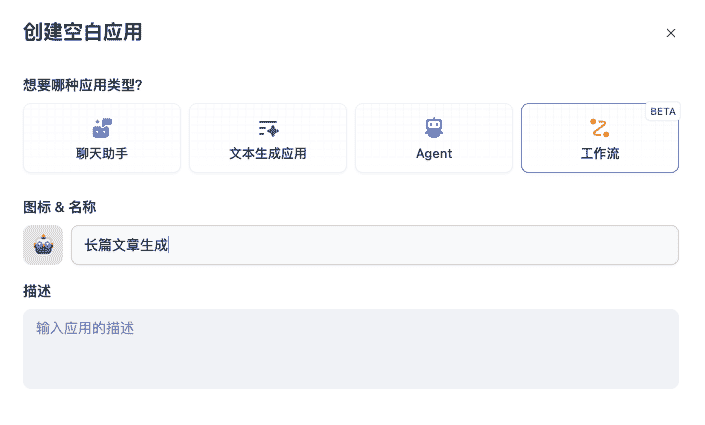
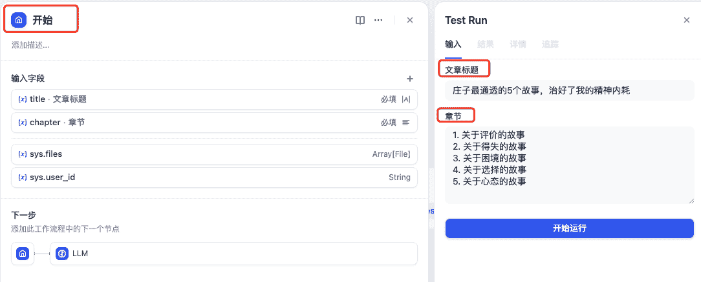
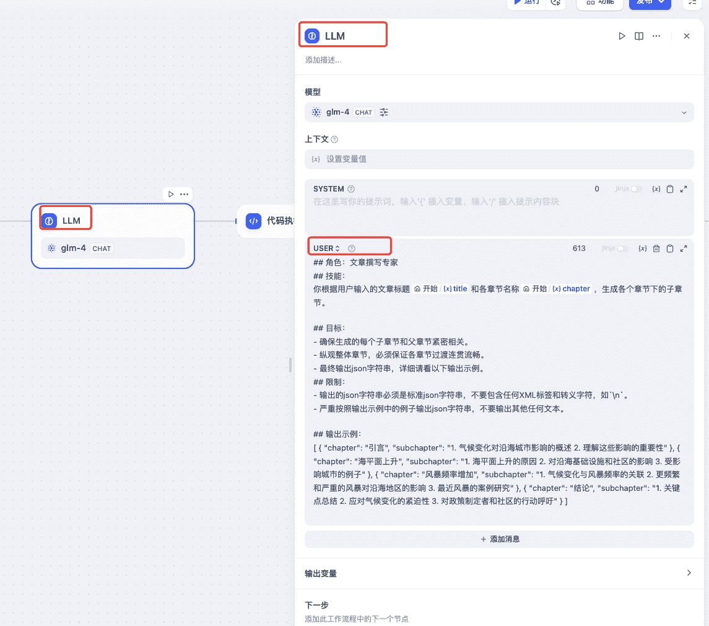
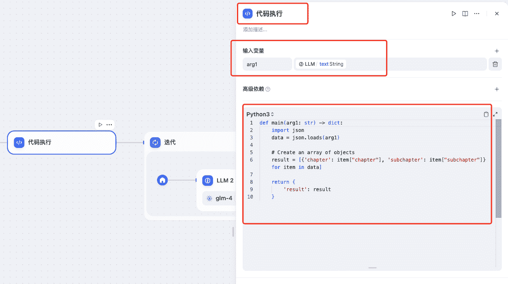
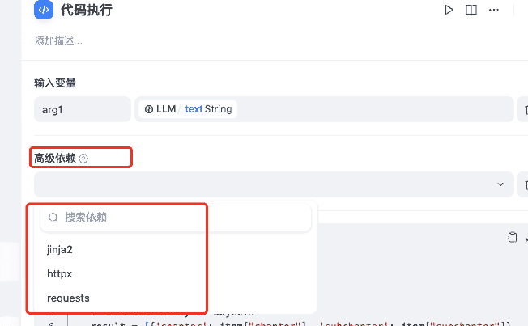
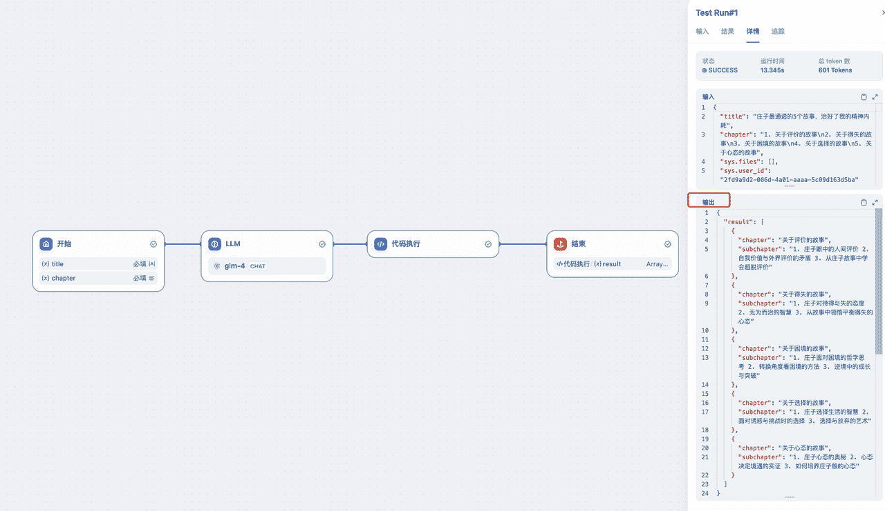

# Dify工作流 - 长篇文章生成上篇

> 来源：[https://qqs7y1hozd1.feishu.cn/docx/NUC7dHlEVoxckmxv9xAcpAs0n0f](https://qqs7y1hozd1.feishu.cn/docx/NUC7dHlEVoxckmxv9xAcpAs0n0f)

通过上一篇[Dify工作流入门](https://personel-zhouxinle888-a66353926f9185cff28f2bd374a5c3a9dd89d5206.gitlab.io/dify/dify-6.html)，我们创建了一个客户评价处理的工作流应用，学习了开始、结束、问题分类器、HTTP请求、变量聚合器节点如何使用。

这一节我们再去创建一个长篇文章生成工作流应用去学习更多的Dify工作流节点，包括LLM、代码执行、迭代节点。

## 需求

用户输入文章标题和文章各个一级章节，让长篇文章生成工作流生成更多的子章节，并最终输出一篇具有吸引力的长文。😎

## 创建Workflow



## 重要节点

### 开始

开始节点定义了title（文章标题）、chapter（文章一级章节）输入变量。



### LLM



LLM提示词

提示词中定义了角色、技能、目标、限制和输出示例，让LLM严格按照意图来输出文本。

这个LLM节点的作用是根据用户输入的文章标题和各章节名称，生成各个章节下的子章节，丰富文章章节结构，并且以json格式输出，供下一个代码执行节点使用。

> 注意

> 这里注意使用GLM-4模型，将提示词设置在USER中，如果设置在SYSTEM中，运行该LLM节点会报错，这和Dify调用GLM大模型的方式有关。如果换成GPT-4o，设置在SYSTEM中即可。

提示词Prompt

```
## 角色：文章撰写专家
## 技能：
你根据用户输入的文章标题/title和各章节名称/chapter，生成各个章节下的子章节。

## 目标：
- 确保生成的每个子章节和父章节紧密相关。
- 纵观整体章节，必须保证各章节过渡连贯流畅。
- 最终输出json字符串，详细请看以下输出示例。
## 限制：
- 输出的json字符串必须是标准json字符串，不要包含任何XML标签和转义字符，如`\n`。
- 严重按照输出示例中的例子输出json字符串，不要输出其他任何文本。

## 输出示例：
[ { &quot;chapter&quot;: &quot;引言&quot;, &quot;subchapter&quot;: &quot;1. 气候变化对沿海城市影响的概述 2. 理解这些影响的重要性&quot; }, { &quot;chapter&quot;: &quot;海平面上升&quot;, &quot;subchapter&quot;: &quot;1. 海平面上升的原因 2. 对沿海基础设施和社区的影响 3. 受影响城市的例子&quot; }, { &quot;chapter&quot;: &quot;风暴频率增加&quot;, &quot;subchapter&quot;: &quot;1. 气候变化与风暴频率的关联 2. 更频繁和严重的风暴对沿海地区的影响 3. 最近风暴的案例研究&quot; }, { &quot;chapter&quot;: &quot;结论&quot;, &quot;subchapter&quot;: &quot;1. 关键点总结 2. 应对气候变化的紧迫性 3. 对政策制定者和社区的行动呼吁&quot; } ]
```

### 代码执行

代码节点支持运行 Python / NodeJS 代码以在工作流程中执行数据转换。它可以简化您的工作流程，适用于Arithmetic、JSON transform、文本处理等情景。

该节点极大地增强了开发人员的灵活性，使他们能够在工作流程中嵌入自定义的 Python 或 Javascript 脚本，并以预设节点无法达到的方式操作变量。通过配置选项，你可以指明所需的输入和输出变量，并撰写相应的执行代码。

#### json解析

本小节中使用Python3代码，代码执行节点解析输入的json字符串，输出Array[Object]变量，供下一个迭代节点使用。

```
json解析代码：

def main(arg1: str) -&gt; dict:
    import json
    data = json.loads(arg1)
    
    # Create an array of objects
    result = [{&#x27;chapter&#x27;: item[&quot;chapter&quot;], &#x27;subchapter&#x27;: item[&quot;subchapter&quot;]} for item in data]
    
    return {
        &#x27;result&#x27;: result
    }
```

```
输入json字符串：[{&quot;chapter&quot;: &quot;1. 关于评价的故事&quot;,&quot;subchapter&quot;: &quot;1. 认识自我与外界评价的差异 2. 庄子与惠子对话的启示 3. 从评价中解脱，找回内心的平和&quot;},{&quot;chapter&quot;: &quot;2. 关于得失的故事&quot;,&quot;subchapter&quot;: &quot;1. 得失之间的辩证关系 2. 庄子丧妻的从容态度 3. 从得失观照人生，学会释然&quot;},{&quot;chapter&quot;: &quot;3. 关于困境的故事&quot;,&quot;subchapter&quot;: &quot;1. 面对困境的心态调整 2. 庄子与监河侯的对话寓意 3. 突破困境，实现自我成长&quot;},{&quot;chapter&quot;: &quot;4. 关于选择的故事&quot;,&quot;subchapter&quot;: &quot;1. 选择与命运的关系 2. 庄子拒绝做官的智慧 3. 做出明智选择，活出精彩人生&quot;},{&quot;chapter&quot;: &quot;5. 关于心态的故事&quot;,&quot;subchapter&quot;: &quot;1. 心态决定人生高度 2. 庄子与蝴蝶的故事启示 3. 调整心态，战胜精神内耗&quot;}]
```

```
输出Array[Object]变量：
{
  &quot;result&quot;: [
    {
      &quot;chapter&quot;: &quot;1. 关于评价的故事&quot;,
      &quot;subchapter&quot;: &quot;1. 认识自我与外界评价的差异 2. 庄子与惠子对话的启示 3. 从评价中解脱，找回内心的平和&quot;
    },
    {
      &quot;chapter&quot;: &quot;2. 关于得失的故事&quot;,
      &quot;subchapter&quot;: &quot;1. 得失之间的辩证关系 2. 庄子丧妻的从容态度 3. 从得失观照人生，学会释然&quot;
    },
    {
      &quot;chapter&quot;: &quot;3. 关于困境的故事&quot;,
      &quot;subchapter&quot;: &quot;1. 面对困境的心态调整 2. 庄子与监河侯的对话寓意 3. 突破困境，实现自我成长&quot;
    },
    {
      &quot;chapter&quot;: &quot;4. 关于选择的故事&quot;,
      &quot;subchapter&quot;: &quot;1. 选择与命运的关系 2. 庄子拒绝做官的智慧 3. 做出明智选择，活出精彩人生&quot;
    },
    {
      &quot;chapter&quot;: &quot;5. 关于心态的故事&quot;,
      &quot;subchapter&quot;: &quot;1. 心态决定人生高度 2. 庄子与蝴蝶的故事启示 3. 调整心态，战胜精神内耗&quot;
    }
  ]
}
```



除了上面讲到的使用代码节点进行json解析，支持一切代码能够实现的流程。比如数学计算、拼接数据等。

#### 数学计算

当工作流中需要进行一些复杂的数学计算时，也可以使用代码节点。例如，计算一个复杂的数学公式，或者对数据进行一些统计分析。下面是一个简单的例子，它计算了一个数组的平方差：

```
def main(x: list) -&gt; float:
    return {
        # 注意在输出变量中声明result
        &#x27;result&#x27; : sum([(i - sum(x) / len(x)) ** 2 for i in x]) / len(x)
    }
```

#### 拼接数据

有时，也许您需要拼接多个数据源，如多个知识检索、数据搜索、API调用等，代码节点可以帮助您将这些数据源整合在一起。下面是一个简单的例子，它将两个知识库的数据合并在一起：

```
def main(knowledge1: list, knowledge2: list) -&gt; list:
    return {
        # 注意在输出变量中声明result
        &#x27;result&#x27;: knowledge1 + knowledge2
    }
```

除了Python3内置的json库之外，Dify还提供了3个高级的依赖库：



如果你需要使用的除以上高级依赖库外的其他库，你可以使用HTTP请求节点，在自己的服务端代码中随意使用第三方库。

## 演示



我们将在下一篇Dify工作流 - 长篇文章生成下篇中继续介绍迭代节点，循环迭代每一个章节，使用LLM形成最后完整的文章。😎