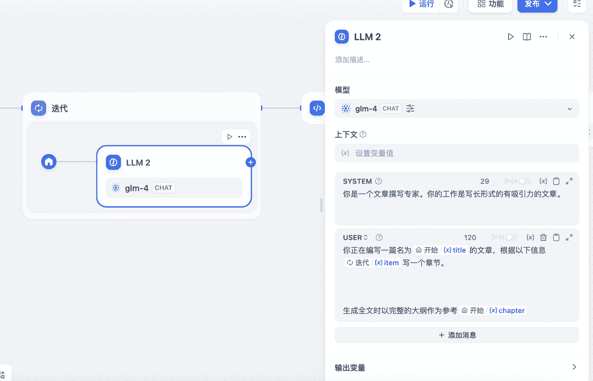
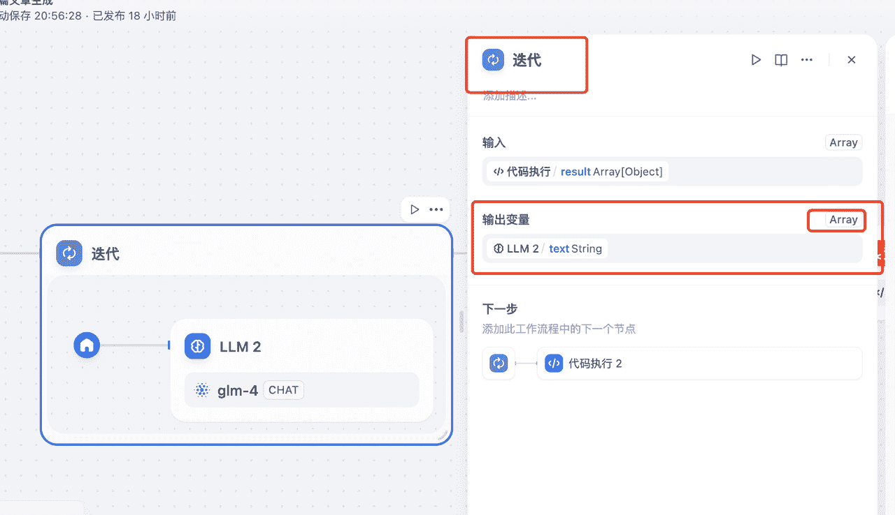
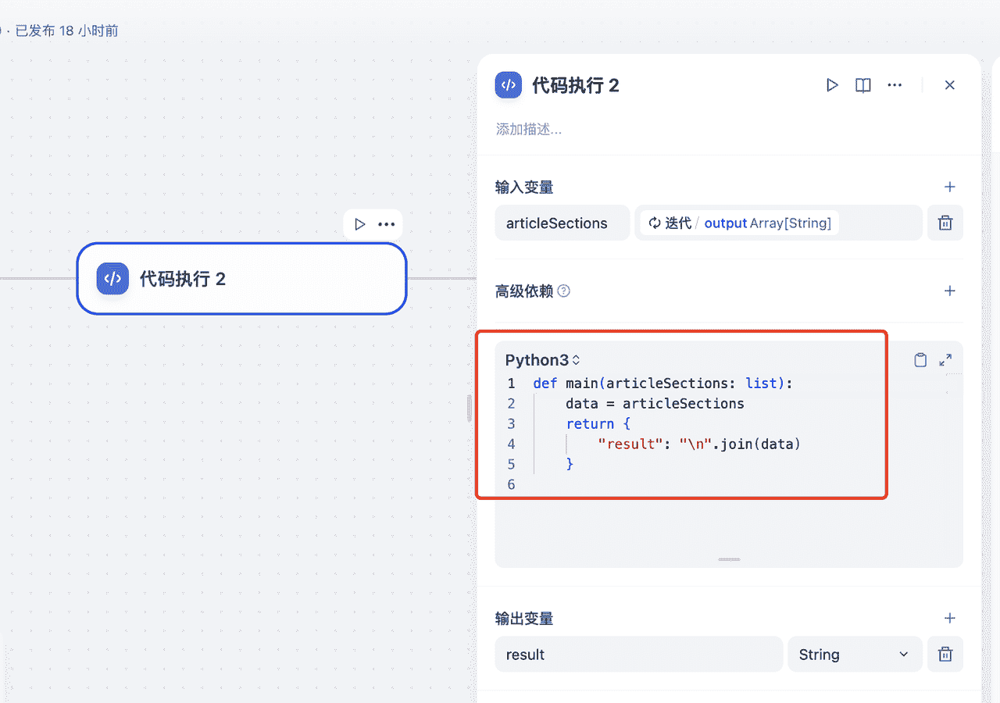

# Dify工作流 - 长篇文章生成下篇

> 来源：[https://qqs7y1hozd1.feishu.cn/docx/WgCzdROQBo2Pw2xrY0YcNF94nNd](https://qqs7y1hozd1.feishu.cn/docx/WgCzdROQBo2Pw2xrY0YcNF94nNd)

接上篇，长篇文章生成工作流本节中将介绍迭代，代码执行节点。

## 重要节点

### 迭代

上一篇中，代码执行节点输入`Array[Object]`变量。迭代节点循环`Array[Object]`，取出其中每一个`Object`，`Object`示例如下：

```
{
      &quot;chapter&quot;: &quot;1. 关于评价的故事&quot;,
      &quot;subchapter&quot;: &quot;1. 认识自我与外界评价的差异 2. 庄子与惠子对话的启示 3. 从评价中解脱，找回内心的平和&quot;
 }
```

一个`Object`代表了一个章节（包含父章节和各个子章节）。因为包含5个章节，所以迭代节点循环迭代5次，根据每一个`Object`生成章节的详细内容，如何生成？在迭代节点中嵌套LLM节点，使用LLM节点编写每一个章节的具体内容。

嵌套的LLM节点中，在`SYSTEM`和`USER`中都分别编写了提示词`Prompt`。



每一个LLM节点输出的都是`String`类型的Text文本。所以最终迭代节点输出的就是`Array[String]`数组，这是一个包含每个章节详细内容的数组。



迭代节点输出内容：

```
{
  &quot;output&quot;: [
    &quot;### 关于评价的故事\n\n在庄子的哲学中，评价与标签往往是我们加诸于外界的简化手段，它们往往限制了我们对事物真实面貌的理解。以下是两个关于评价的故事，它们不仅展示了大宗师的深邃见解，同时也对我们如何应对现代生活的“精神内耗”提供了独特的视角。\n\n#### 1. 大宗师的眼中无牛\n\n故事讲述了一个牧童与庄子的对话。牧童问庄子：“我能够熟练地驾驭牛，我知道何时它们需要休息，何时它们需要工作。但是，大宗师，您如何看待这些牛呢？”庄子回答：“在我眼中，并无牛的存在。我看到的是一种无需标签的自然存在，它超越了牛的概念。”\n\n这个故事告诉我们，当我们去除事物的标签和预设的评价时，我们可以更接近它们的真实本质，同时也能够减少因固定观念而产生的内心困扰。在现代社会中，我们常常因为对他人的成见和评价而感到焦虑和疲惫，但庄子的智慧启示我们，放下这些评价，就能够获得精神上的解脱。\n\n#### 2. 庄子与惠子论鱼之乐\n\n另一个著名的例子是庄子与惠子沿河而行，讨论鱼的快乐。惠子说：“鱼出游从容，是它们的快乐。”庄子反问：“你非鱼，安知鱼之乐？”惠子又问：“你非我，安知我不知鱼之乐？”庄子回答：“我非你，固不知你；你非鱼，无疑亦不知鱼之乐。我们各有所知，各有所不知，故不可凭主观臆断。”\n\n这个故事提醒我们，我们常常试图评价和代入他人的感受，却忘记了每个人的体验都是独一无二的。这种认识可以减少我们对他人的不必要揣测，从而减轻心理上的负担。\n\n这两个故事都是庄子思想中关于评价的深刻讨论。它们不仅揭示了评价的相对性和局限性，也为我们指出了一条减轻精神内耗的道路。通过学习庄子看待世界的方式，我们可以在纷繁复杂的现代社会中找到一颗平和的心，不被外界评价所左右，从而达到内心的宁静与自在。在接下来的章节中，我们将继续探讨庄子关于得失、困境、选择和心态的故事，它们同样能够为我们心灵的疗愈提供独到的见解。&quot;,
    &quot;### 关于得失的故事\n\n在庄子的哲学里，得失并非如常人所见那般绝对。他通过一个个精妙绝伦的故事，向我们展示了一个更加宽广的世界观，告诉我们如何在纷繁复杂的世事中保持一颗平和的心。\n\n#### 1. 螳臂当车的故事\n\n螳臂当车，是许多人耳熟能详的故事。在一个炎热的夏天，一只螳螂站在路中央，举起前臂试图阻挡一辆马车的行进。螳螂自以为强大，却不知自己的力量在巨大的车轮面前显得多么微不足道。最终，螳螂被车轮碾过。\n\n庄子通过这个故事告诉我们，有些时候，我们过于高估自己的能力，而忽视了客观事物的强大。在现实生活中，我们也常常像螳螂一样，为了微不足道的利益或面子，试图阻挡时代的巨轮，结果却只能是自取灭亡。学会认清形势，接受自己的局限，是减少内耗的第一步。\n\n#### 2. 庄子拒绝做官的背后\n\n庄子生活的时代，是一个诸侯割据、战火纷飞的年代。当时，楚威王听闻庄子才华横溢，便派使者邀请他担任楚国相国。然而，庄子却拒绝了这一许多人梦寐以求的职位。\n\n庄子对使者说：“我听说楚国有只神龟，已经死了三千年。楚王将它珍藏在庙里，用锦缎包裹，供人瞻仰。你认为这只龟是宁愿死去成为神龟，还是宁愿活着在烂泥里爬行？”使者回答：“当然宁愿活着在烂泥里爬行。”庄子接着说：“我将宁愿在烂泥里自由爬行，也不愿死去成为被人供奉的神龟。”\n\n这个故事向我们展示了庄子对权力和名利的淡泊态度。他深知一旦为官，虽然可以享受荣华富贵，但同时也会失去自由和真正的自我。庄子拒绝做官的背后，是他对待得失的超然态度，也是他对精神自由的执着追求。\n\n通过这两个故事，我们可以学到，面对得失，不必过于执着。有时候，失去并不意味着失败，而是为了获得更大的自由和幸福。当我们学会放下，不再为名利所困，我们的内心将变得更加宁静和强大。\n\n在接下来的章节中，我们将继续探讨庄子如何用智慧的故事治愈我们的精神内耗，引领我们走向更加通透的人生境界。&quot;,
    &quot;### 关于困境的故事\n\n#### 1. 井底之蛙的启示\n\n在庄子的哲学里，关于困境的故事往往富含深意，让人反思自我，理解世界的多元和个体认知的局限。\n\n故事发生在一片宁静的村庄，庄子与几位弟子途径一口井，见到井底有一只青蛙，它安逸地生活在自己的小世界里，对井口外的天地一无所知。庄子便对弟子们说：“你们看，这只青蛙以为它的井就是全世界，它不知道外面还有江河湖海，还有广袤的大地。”\n\n这个故事告诉我们，当人局限于自己的视角和认知时，就像井底之蛙，看不到更广阔的世界。我们每个人或许都曾在人生的井底中徘徊，但关键在于，我们要有跳出来，探索未知世界的勇气和行动。\n\n#### 2. 庄子论逍遥游\n\n庄子的《逍遥游》是道家思想中探讨自由与困境的哲学名篇。在这里，庄子提出了“逍遥游”的概念，主张人应顺应自然，超越世俗的束缚，达到心灵的自由与解放。\n\n他说：“逍遥游者，无为而治。”这句话意味着，真正的自由并非来自外界环境，而是内心的平和与超脱。当面对困境时，不困于形，不乱于心，才能游刃有余地应对生活中的种种挑战。\n\n庄子的这一观点，对于我们治好精神内耗有着极大的启示。在这个快节奏的社会，我们常常为了名利而劳碌奔波，忘记了内心的宁静与自由。而庄子的逍遥游，正是提醒我们放慢脚步，回归内心，找到真正属于自己的人生之道。\n\n总结来说，无论是井底之蛙的启示，还是庄子论逍遥游，都在教导我们如何面对人生的困境。当我们能跳出自己的井，拓宽视野，同时保持内心的平和与自由，精神内耗自然会得到治愈。这时，我们才能真正体会到生活的乐趣，把握住每一个简单而美好的瞬间。&quot;,
    &quot;### 关于选择的故事\n\n在选择的道路上，庄子用他的哲学之剑为我们挥洒出一片清新的天地。他让我们明白，选择并非一成不变，而是在不断变化中寻找内心的平衡。\n\n#### 1. 庄子与蝴蝶的梦\n\n庄子曾梦见自己变成了一只翩翩起舞的蝴蝶，那一刻，他忘却了自己的存在，完全沉浸在这只蝴蝶的快乐与自由之中。当梦醒来，庄子陷入了沉思：我是庄子，还是那只蝴蝶？这个故事告诉我们，人生如梦，我们在不同的角色中转换，每个选择都可能让我们成为不同的“自我”。学会在不同身份中找到平衡，顺应内心的选择，才能活出真正的自我。\n\n#### 2. 庄子论鱼的选择\n\n庄子曰：“鱼，我所欲也，熊掌，亦我所欲也，二者不可得兼，舍鱼而取熊掌者也。”这句话表达了庄子关于选择的智慧。人生中常常面临鱼与熊掌不可兼得的困境，如何做出明智的选择，成为许多人纠结的难题。庄子告诉我们，学会放弃，才能获得更好的东西。在得失之间，我们需要明智地抉择，不被眼前的小利所迷惑，而是要追求长远的大利。\n\n这两个故事治好了我们的精神内耗，让我们明白：选择并非生命的全部，而是在不断尝试与放弃中找到适合自己的道路。当我们学会在纷繁复杂的选择中保持清醒的头脑，顺应内心的声音，我们就能摆脱精神的枷锁，迈向更加美好的未来。\n\n接下来，我们还将探讨关于得失、困境和心态的故事，继续挖掘庄子的智慧，为我们的人生导航。&quot;,
    &quot;### 第五章：关于心态的故事\n\n在庄子的哲学中，心态的调整被视为一种艺术，甚至是一种到达宇宙奥秘的途径。他通过几个简短而富有深意的故事，向我们展示了如何以自然和宁静的心态面对生活的起起落落。\n\n#### 第一节：鼓盆而歌的庄子\n\n庄子在妻子去世时，没有像常人那样痛哭流涕，反而鼓盆而歌。这一行为让周围的人大为不解，甚至有人指责他冷血无情。然而，庄子解释道：生命本就是自然的一部分，生与死不过是形态的变化。他妻子虽死，但她的生命已经融入了天地之间，他为什么要悲伤呢？这个故事告诉我们，接受生命的自然规律，保持内心的平和，是对生命最深刻的尊重。\n\n庄子说：“夫大块载我以形，劳我以生，佚我以老，息我以死。”这句话启迪我们，应以一种更宏观的视角看待生命的各个阶段，保持内心的宁静，不为生死所累。\n\n#### 第二节：庄子论天地大美\n\n在另一个故事中，庄子与惠子游于濠梁之上。庄子感叹水中游鱼之乐，惠子却质疑庄子并非鱼，怎能知鱼之乐。庄子反问：“子非我，安知我不知鱼之乐？”这段对话揭示了庄子对于“大美”的理解。\n\n庄子认为，天地间的大美，并非在于具体的形态，而在于万物相融相通的和谐。我们应当放下狭隘的自我，去感受宇宙间流动的生机与美丽。这种心态上的开放和包容，使得庄子在面对天地万物时，总能保持一种由衷的赞叹和敬畏。\n\n通过这两个故事，庄子向我们展示了一种超越常人焦虑和内耗的心态——与自然和谐相处，接受生活的无常，拥抱每一个瞬间。当我们在忙碌和纷扰的生活中感到疲惫时，不妨效仿庄子的心态，寻找内心的宁静和力量。\n\n庄子告诉我们，当我们学会以更广阔的视角看待人生，许多看似重大的问题其实不过是过眼云烟。这种心态的转变，或许正是治疗我们精神内耗的良方。&quot;
  ]
}
```

根据迭代节点的输出结果，下一个代码节点，仅仅需要将`Array[String]`中每一个`String`取出并用`换行符\n`拼接就能形成最终的长篇文章`Text String`。

### 代码执行



## 演示

输出结果


# 关于评价的故事

在庄子的哲学中，评价是一种相对而主观的概念。他常常用生动的寓言故事来揭示人们对于事物评价的相对性和局限性。

## 1. 逍遥游中的鹏与蝉

在《逍遥游》中，庄子讲述了一个关于鹏和蝉的故事。鹏是一种巨大的鸟，其背可遮天蔽日，翅膀挥动时能激起三千里的浪涛。而蝉则是一种小昆虫，只能在树下短暂地鸣叫。庄子通过这个故事，向我们展示了大小之间的相对性。

故事中，鹏鸟嘲笑蝉的渺小，认为自己能翱翔于九天之上，而蝉只能在树下叫唤。然而，庄子却指出，鹏虽然飞得高远，但也有其束缚；蝉虽然微小，却能在适合自己的环境中自由歌唱。在这个故事中，庄子告诉我们：大小、高低、强弱，都只是相对的概念。我们在评价事物时，不应仅仅站在自己的角度，而要理解万物各有其时、各有其用。

## 2. 对大小的相对评价

庄子进一步阐述了对大小的相对评价。他说：“天地之大，秋毫之末不足以论；泰山之高，累丸之积不足以观。”这句话意味着天地之广博和泰山之雄伟，不是用微小的秋毫和累丸可以衡量的。庄子借此告诉我们，在宇宙的宏大面前，我们常常过于关注微小的差别，而忽略了事物本质的统一。

通过这些故事，我们可以在生活中找到启示。当我们在意他人的评价，或者与他人比较时，很容易陷入焦虑和内耗。但如果我们能理解庄子所说的相对评价，就能跳出这种困境，认识到每个人都有自己的价值和时区，不必过于在意他人的眼光。

庄子这些关于评价的故事，不仅治好了我们的精神内耗，还教会了我们如何以更宽容、更平和的心态看待世界。当我们学会从不同角度看待问题，评价事物时不再局限于单一标准，我们的内心也将获得真正的自由和宁静。

# 关于得失的故事

在庄子的哲学中，得与失并非是我们凡人眼中的对立面，而是一种更为辩证的存在。他通过一个个生动的故事，揭示了人们在追逐名利过程中的荒谬，以及如何以一种更为豁达的心态面对人生的得失。

## 1. 秋水的故事：鱼之乐

秋天，水位下降，河床上的鱼儿被困在浅滩上。庄子见此情景，却并未像常人那样表现出对鱼的同情。相反，他提出了一个问题：“你们知道鱼儿此刻是否快乐？”我们常常以人的视角去判断其他生命的感受，却忘了每个生命都有其独特的乐趣和价值。

庄子告诉我们，鱼儿在水中游弋，未必不快乐；在浅滩上跳跃，也未尝不快乐。得与失，对于鱼儿来说，不过是另一种形式的体验。如果我们能像庄子那样看待生活中的起起落落，或许就能减少许多不必要的焦虑和烦恼。

## 2. 得与失的辩证看法

在另一个故事中，庄子讲述了一个关于朋友间辩论的故事。两人争论谁更懂得失去。一人说：“我失去了财物，但我得到了教训。”另一人则反驳：“我失去了健康，但我得到了家人的关爱。”庄子听后笑着说：“你们都错了，真正的得失，是在你们辩论的过程中，失去了与朋友共度的美好时光。”

这个故事告诉我们，过于纠结于得与失，反而容易让我们忽视生活中的美好。在庄子的眼中，得与失并非绝对，而是随着时间和环境的变化而变化。我们应以一种更为宽容和开放的心态去接受生活的给予，无论是得是失，都是人生的一部分。

在接下来的章节中，我们将继续探讨庄子关于困境、选择和心态的故事，希望这些故事能像一股清泉，洗涤我们心灵的尘埃，治好我们的精神内耗。

# 关于困境的故事

在庄子的哲学里，困境不仅是一种挑战，更是一种成长的契机。他通过以下几个故事，向我们展示了面对困境的态度与解决方法。

## 1. 庖丁解牛的哲学

庖丁是一位技艺高超的屠夫，他的解牛之术令人叹为观止。每当庖丁动手解牛时，他总能在牛的骨骼和肌肉间游刃有余，整个过程仿佛在跳一支优美的舞蹈。

这个故事告诉我们，面对复杂和困难的情境，我们应该像庖丁解牛一样，深入了解问题的本质，顺应事物的自然规律，找到最适合的解决方法。当我们面对困境时，不必过于焦虑，而应冷静分析，顺应时势，以最恰当的方式解决问题。

## 2. 面对困境的态度与解决方法

庄子还讲过一个关于大树的故事。有一棵巨大的树，因为形状奇特，被认为无用，所以伐木人从未将它砍倒。而这棵树因此得以长寿，成为了人们赞叹的对象。

这个故事启示我们，在困境中，有时需要转换思维，看到问题的另一面。当我们被常规观念所束缚，可能会忽略那些看似无用，实则具有潜在价值的事物。面对困境，我们应该保持开放的心态，从不同的角度寻找解决之道。

在现实生活中，我们都会遇到各种困境，但关键在于我们如何去面对。庄子告诉我们，无论是庖丁解牛的顺应自然，还是那棵被认为无用的巨树所启示的转换思维，都是我们应对困境的有效方法。

当我们能够以这样的态度和方法去面对生活中的挑战时，那些所谓的精神内耗便会逐渐消解，我们会发现，困境其实是我们成长道路上不可或缺的伙伴。通过这些故事，我们学会了在困境中寻找机遇，以平和的心态迎接生活中的每一个挑战。

# 第四章：关于选择的故事

在庄子的哲学中，选择是一个充满智慧与哲学思考的话题。他通过一个个生动的故事，向我们展示了如何运用自由意志去做出选择，以及如何在选择中寻找真正的快乐。

## 1. 知鱼之乐的启示

庄子与惠子游于濠梁之上，庄子看着水中的鲦鱼，感叹道：“鲦鱼出游从容，是鱼之乐也。”惠子反问：“子非鱼，安知鱼之乐？”庄子回答：“子非我，安知我不知鱼之乐？”这段对话揭示了庄子的相对主义思想。他告诉我们，每个人都有自己的视角和感受，我们应当尊重他人的选择，不必过于主观地去评判。

这个故事启示我们，在面临选择时，要懂得换位思考，尊重他人的选择，同时也要相信自己的判断。知鱼之乐，便是懂得在不同角度看待问题，从而找到最适合自己的答案。

## 2. 选择与自由意志的探讨

庄子在《逍遥游》中讲述了这样一个故事：肩吾问于连叔：“吾闻言于接舆，大而不要，往而不反。吾服焉。”连叔曰：“其言谓何？”肩吾曰：“‘神人无功，圣人无名’。”连叔曰：“吾闻之，功盖天地，tranquility而游，名利不可求也。”

这个故事阐述了庄子对于选择与自由意志的看法。他认为真正的自由，不是追求功名利禄，而是遵循内心的声音，无功无名，逍遥自在。当我们面临选择时，要摒弃世俗的观念，听从内心的呼唤，勇敢地追求自己真正想要的生活。

在现实生活中，我们常常被外界的评价和期望所困扰，从而忽视了内心的真实需求。庄子的故事提醒我们，选择应当基于自由意志，而不是被外界因素所左右。只有这样，我们才能找到真正的快乐和满足。

总结来说，庄子的这两个故事告诉我们，在面对选择时，要懂得尊重他人，相信自己的判断，并勇敢追求内心的真实需求。只有这样，我们才能在纷繁复杂的世界中，找到属于自己的道路，治好精神内耗，过上充实而快乐的生活。

# 关于心态的故事

在庄子的哲学中，心态不仅仅是个人的心理状态，它几乎等同于一个人的世界观和生活方式。庄子的故事里，我们总能发现那些以独特视角看待世界，从而找到心灵自由的人。以下是两个关于心态的故事，它们或许能够启发我们，在现代社会的纷扰中找到一份宁静和自在。

## 1. 相忘于江湖的理念

“相忘于江湖”这一理念源自庄子《庄子·外物》中的一段话。在这个故事中，庄子讲述了两条鱼被困在一条干涸的小溪里，它们互相用口中的湿气来维持对方的生命。这种相互依赖的关系在它们看来是深厚的友情。然而，当潮水上涨，两条鱼回到了各自的江湖之中，它们便忘记了对方。

庄子用这个故事告诉我们，真正的自由和幸福不是依赖他人，而是在广阔的世界中找到自己的位置，实现自我。有时候，我们的精神内耗来自于对过去的执着，或是对人际关系的过分依赖。当我们学会像两条鱼那样“相忘于江湖”，我们便能在各自的世界中遨游，找到心灵的自在。

## 2. 心态决定生活的境界

庄子在《庄子·逍遥游》中提出了“心态决定生活的境界”的哲学观点。故事中，庄子描述了许由拒绝接受尧帝的帝位，选择继续做他的隐士。在世人眼中，帝位代表着至高无上的权力和荣耀，但许由却认为这些只是生活的累赘，他更重视心灵的自由与宁静。

这个故事告诉我们，一个人的心态决定了他的生活境界。在这个物质主义的社会，我们往往追求名利，却忽略了心灵的修养和自由。当我们能够像许由一样，看淡名利，重视内心的平和与满足，我们的精神内耗自然会得到治愈。

在这两个故事中，庄子向我们展示了一种超越常规价值观的心态，一种能够使我们在纷繁复杂的世界中保持清醒和自由的心态。通过学习庄子的智慧，我们可以在面对生活的压力和困境时，保持一颗平和的心，从而治疗我们的精神内耗。当我们能够做到这一点时，生活的境界也将得到质的提升。

# 导出DSL

长篇文章生成工作流应用可以导出为`DSL`，方便你在Dify[工作区中导入查看整个应用的](https://personel-zhouxinle888-a66353926f9185cff28f2bd374a5c3a9dd89d5206.gitlab.io/dify/%E9%95%BF%E7%AF%87%E6%96%87%E7%AB%A0%E7%94%9F%E6%88%90.yml)编排。点击 `长篇文章生成工作流.yml`下载。

创建应用时，选择导入`DSL`文件即可。
