# Dify——知识库优化及标注

> 来源：[https://qqs7y1hozd1.feishu.cn/docx/O4oMd1xkAolNdZx2nYycWaeBnBd](https://qqs7y1hozd1.feishu.cn/docx/O4oMd1xkAolNdZx2nYycWaeBnBd)

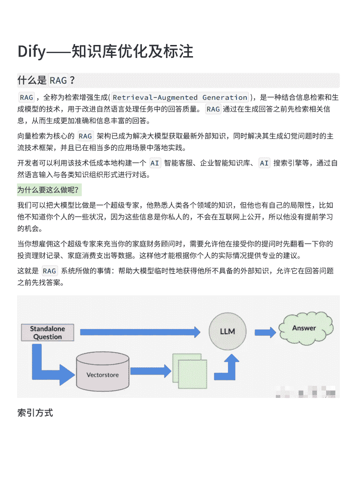

[Dify——知识库优化及标注.pdf](https://internal-api-drive-stream.feishu.cn/space/api/box/stream/download/all/SBWCbcnFwoGVu8x3MF5cL5xEnrg)

## 什么是RAG？

RAG，全称为检索增强生成(Retrieval-Augmented Generation)，是一种结合信息检索和生成模型的技术，用于改进自然语言处理任务中的回答质量。RAG通过在生成回答之前先检索相关信息，从而生成更加准确和信息丰富的回答。

向量检索为核心的 RAG 架构已成为解决大模型获取最新外部知识，同时解决其生成幻觉问题时的主流技术框架，并且已在相当多的应用场景中落地实践。

开发者可以利用该技术低成本地构建一个 AI 智能客服、企业智能知识库、AI 搜索引擎等，通过自然语言输入与各类知识组织形式进行对话。

为什么要这么做呢？

我们可以把大模型比做是一个超级专家，他熟悉人类各个领域的知识，但他也有自己的局限性，比如他不知道你个人的一些状况，因为这些信息是你私人的，不会在互联网上公开，所以他没有提前学习的机会。

当你想雇佣这个超级专家来充当你的家庭财务顾问时，需要允许他在接受你的提问时先翻看一下你的投资理财记录、家庭消费支出等数据。这样他才能根据你个人的实际情况提供专业的建议。

这就是 RAG 系统所做的事情：帮助大模型临时性地获得他所不具备的外部知识，允许它在回答问题之前先找答案。

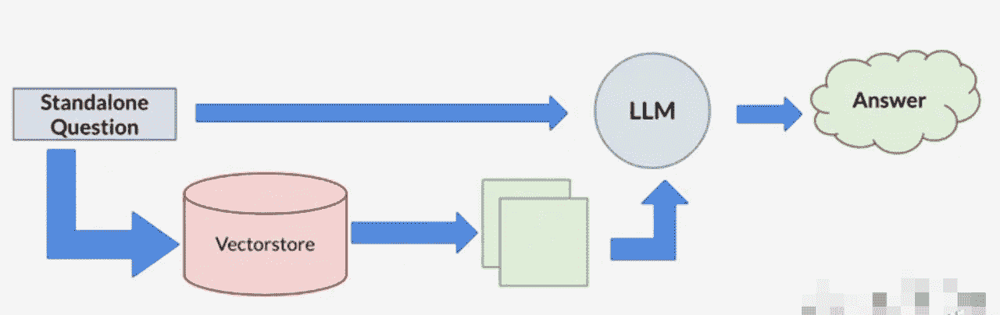

### 索引方式

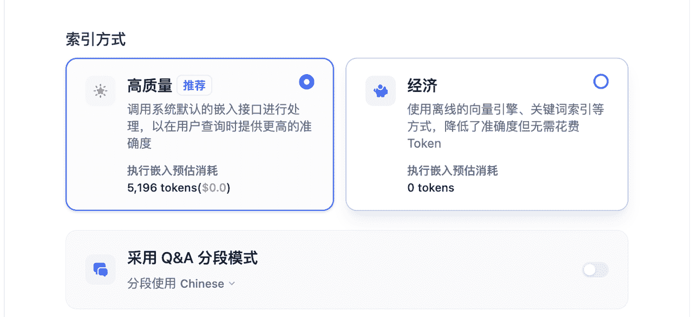

你需要选择文本的索引方式来指定数据的匹配方式，索引策略往往与检索方式相关，你需要根据场景需求来选择合适的索引方式。

+   高质量模式

+   将调用 OpenAI 的嵌入接口进行处理，以在用户查询时提供更高的准确度。

+   经济模式

+   会使用关键词索引方式，降低了准确度但无需花费 Token。

+   Q&A模式（仅社区版支持）

+   高质量索引模式下，提供Q&A 模式。 Q&A 分段模式功能，与上述普通的「Q to P」（问题匹配文本段落）匹配模式不同，它是采用「Q to Q」（问题匹配问题）匹配工作，在文档经过分段后，经过总结为每一个分段生成 Q&A 匹配对，当用户提问时，系统会找出与之最相似的问题，然后返回对应的分段作为答案。这种方式更加精确，因为它直接针对用户问题进行匹配，可以更准确地获取用户真正需要的信息。

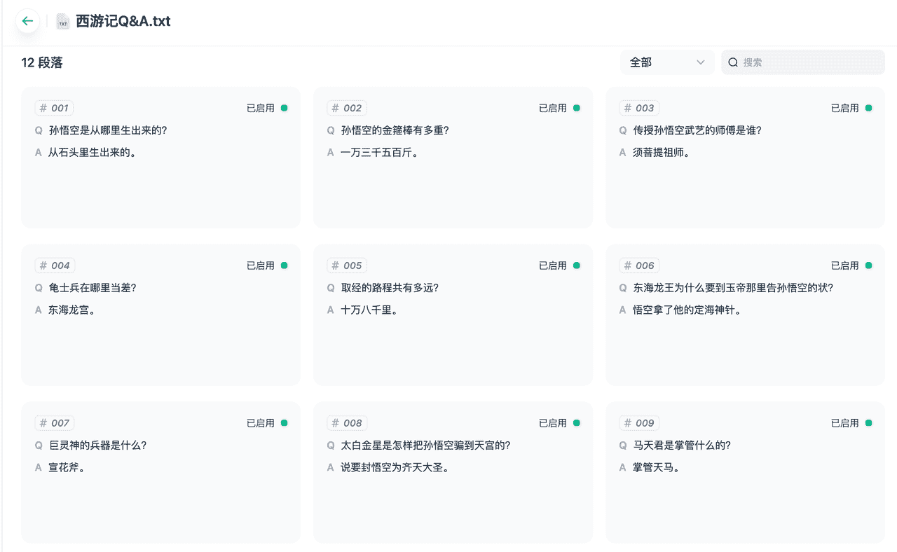

### 检索设置

索引策略往往与检索方式相关

在经济索引模式下，提供了倒排索引的方案。不推荐经济模式索引模式，实际效果一般。

在高质量索引模式下，Dify 提供了 3 种检索方案：

+   向量检索

通过生成查询嵌入并查询与其向量表示最相似的文本分段。

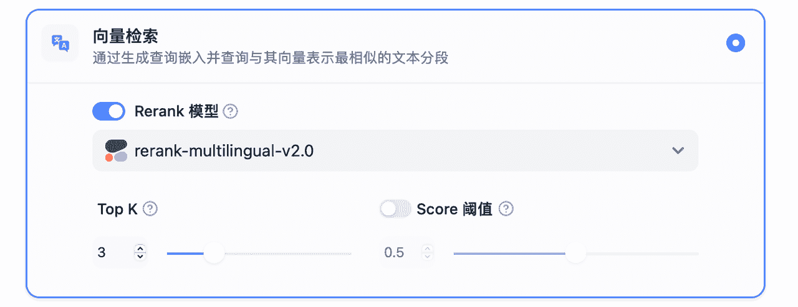

TopK：用于筛选与用户问题相似度最高的文本片段。系统同时会根据选用模型上下文窗口大小动态调整片段数量。系统默认值为 3 。

Score 阈值：用于设置文本片段筛选的相似度阈值，即：只召回超过设置分数的文本片段。系统默认关闭该设置，即不会对召回的文本片段相似值过滤。打开后默认值为 0.5 。

Rerank 模型：你可以在“模型供应商”页面配置 Rerank 模型的 API 秘钥之后，在检索设置中打开Rerank 模型，系统会在语义检索后对已召回的文档结果再一次进行语义重排序，优化排序结果。设置 Rerank 模型后，TopK 和 Score 阈值设置仅在 Rerank 步骤生效。

+   全文检索

索引文档中的所有词汇，从而允许用户查询任意词汇，并返回包含这些词汇的文本片段。

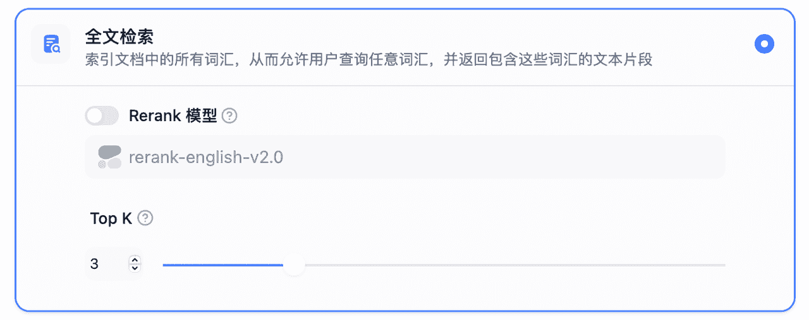

+   混合检索

同时执行全文检索和向量检索，并应用重排序步骤，从两类查询结果中选择匹配用户问题的最佳结果。

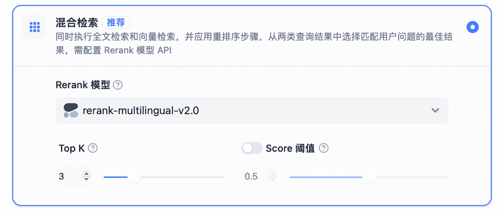

为什么需要混合检索

计算机能够发现用户问题与句子之间细微的语义相关性，比如 “猫追逐老鼠” 和 “小猫捕猎老鼠” 的语义相关度会高于 “猫追逐老鼠” 和 “我喜欢吃火腿” 之间的相关度。在将相关度最高的文本内容查找到后，RAG 系统会将其作为用户问题的上下文一起提供给大模型，帮助大模型回答问题。

除了能够实现复杂语义的文本查找，向量检索还有其他的优势：

+   相近语义理解（如老鼠/捕鼠器/奶酪，谷歌/必应/搜索引擎）

+   多语言理解（跨语言理解，如输入中文匹配英文）

+   多模态理解（支持文本、图像、音视频等的相似匹配）

+   容错性（处理拼写错误、模糊的描述）

虽然向量检索在以上情景中具有明显优势，但有某些情况效果不佳。比如：

+   搜索一个人或物体的名字（例如，伊隆·马斯克，iPhone 15）

+   搜索缩写词或短语（例如，RAG，RLHF）

+   搜索 ID（例如， gpt-3.5-turbo ， titan-xlarge-v1.01 ）

而上面这些的缺点恰恰都是传统关键词搜索的优势所在，传统关键词搜索擅长：

+   精确匹配（如产品名称、姓名、产品编号）

+   少量字符的匹配（通过少量字符进行向量检索时效果非常不好，但很多用户恰恰习惯只输入几个关键词）

+   倾向低频词汇的匹配（低频词汇往往承载了语言中的重要意义，比如“你想跟我去喝咖啡吗？”这句话中的分词，“喝”“咖啡”会比“你”“想”“吗”在句子中承载更重要的含义）。

在混合检索中，你需要在数据库中提前建立向量索引和关键词索引，在用户问题输入时，分别通过两种检索器在文档中检索出最相关的文本。

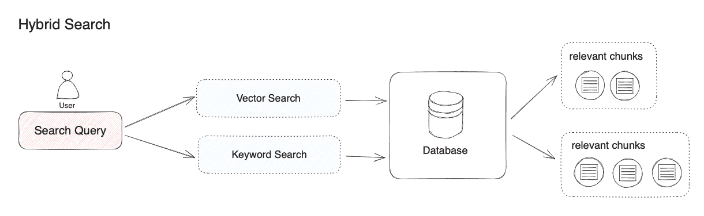

### 重排序

混合检索能够结合不同检索技术的优势获得更好的召回结果，但在不同检索模式下的查询结果需要进行合并和归一化（将数据转换为统一的标准范围或分布，以便更好地进行比较、分析和处理），然后再一起提供给大模型。这时候我们需要引入一个评分系统：重排序模型（Rerank Model）。

重排序模型会计算候选文档列表与用户问题的语义匹配度，根据语义匹配度重新进行排序，从而改进语义排序的结果。

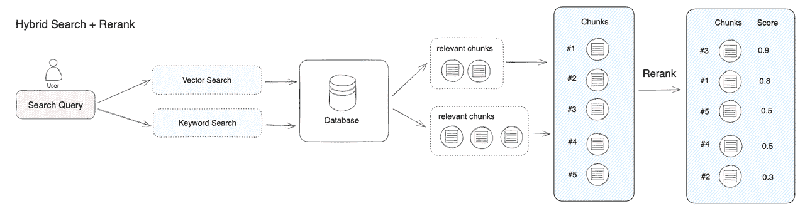

获取Cohere Rerank模型，[Cohere Rerank](https://cohere.com/rerank)。

### 召回模式

当用户构建知识库问答类的AI 应用时，如果在应用内关联了多个数据集，Dify 在检索时支持两种召回模式：N选1召回模式和多路召回模式。

+   N选1召回模式

适合数据集区分度大且数据集数量偏少的应用。

根据用户意图和数据集描述，由 Agent 自主判断选择最匹配的单个数据集来查询相关文本。

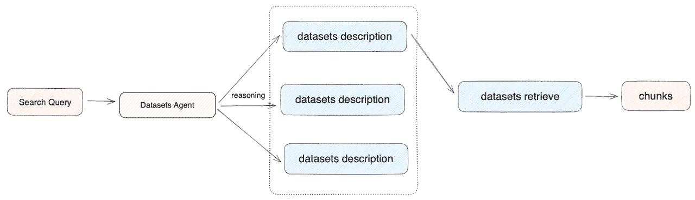

+   多路召回模式

当创建的知识库问答应用关联了多个数据集时，我们更推荐将召回模式配置为多路召回。

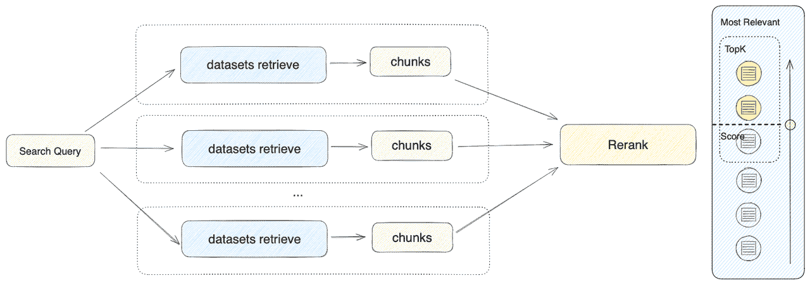

## 标注回复

标注回复功能通过人工编辑标注为应用提供了可定制的高质量问答回复能力。

适用情景：

+   特定领域的定制化回答： 在企业、政府等客服或知识库问答情景时，对于某些特定问题，服务提供方希望确保系统以明确的结果来回答问题，因此需要对在特定问题上定制化输出结果。比如定制某些问题的“标准答案”或某些问题“不可回答”。

+   POC 或 DEMO 产品快速调优： 在快速搭建原型产品，通过标注回复实现的定制化回答可以高效提升问答结果的生成预期，提升客户满意度。

标注回复功能相当于提供了另一套检索增强系统，可以跳过 LLM 的生成环节，规避 RAG 的生成幻觉问题。

### 使用流程

1.  在开启标注回复功能之后，你可以对 LLM 对话回复内容进行标注，你可以将 LLM 回复的高质量答案直接添加为一条标注，也可以根据自己的需求编辑一条高质量答案，这些编辑的标注内容会被持久化保存；

1.  当用户再次提问相似的问题时，会将问题向量化并查询中与之相似的标注问题；

1.  如果找到匹配项，则直接返回标注中与问题相对应的答案，不再传递至 LLM 或 RAG 过程进行回复；

1.  如果没有找到匹配项，则问题继续常规流程（传递至 LLM 或 RAG）；

1.  关闭标注回复功能后，系统将一直不再继续从标注内匹配回复。

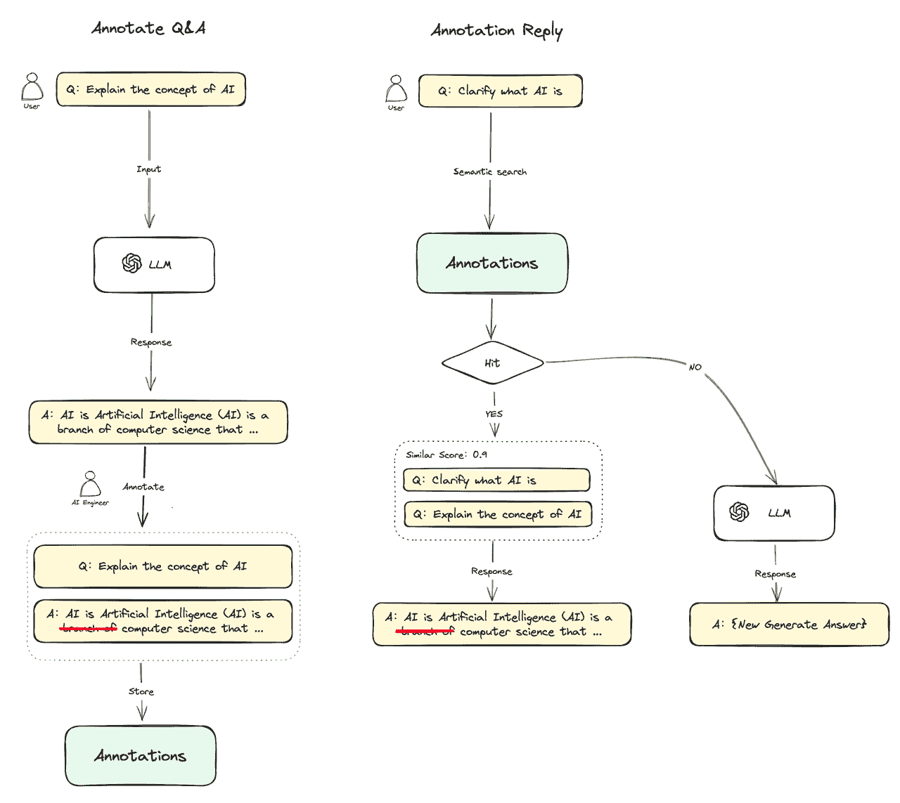

### 开启标注回复

1.  提示词编排中开启标注回复

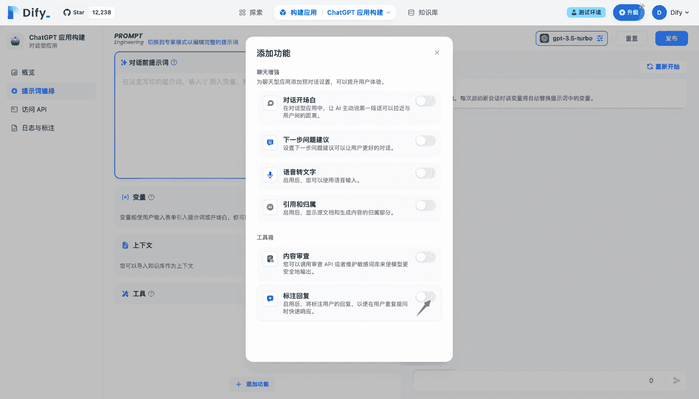

1.  日志与标注中开启标注回复

### 添加标注

1.  在会话调试页添加标注

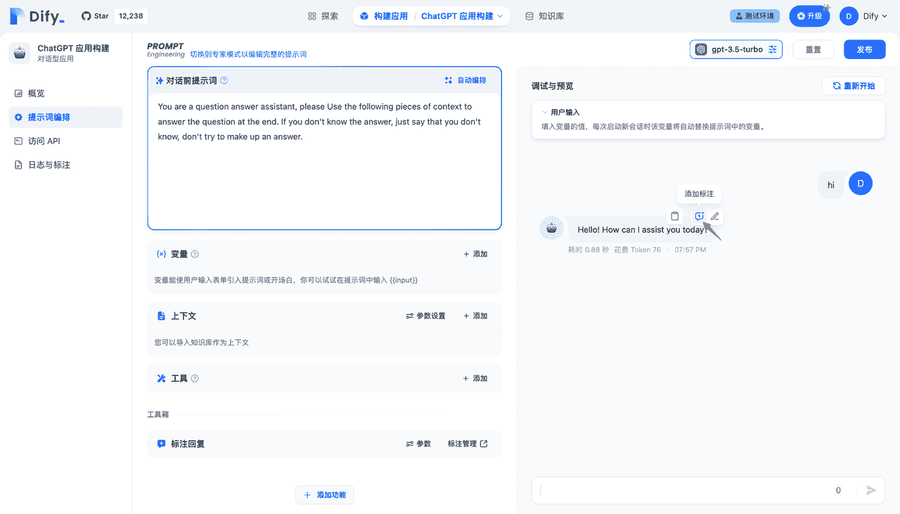

编辑成你需要的高质量回复并保存。

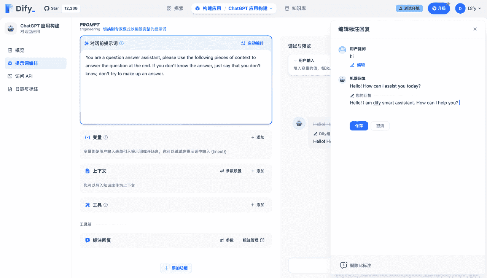

1.  批量导入标注问答对

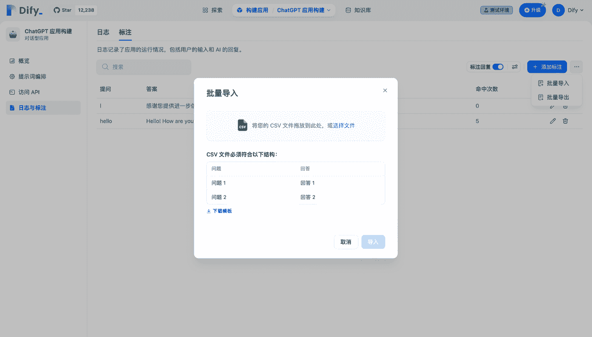

### 查看标注回复命中历史

在标注命中历史功能内，你可以查看所有命中该条标注的编辑历史、命中的用户问题、回复答案、命中来源、匹配相似分数、命中时间等信息，你可以根据这些系统信息持续改进你的标注内容。

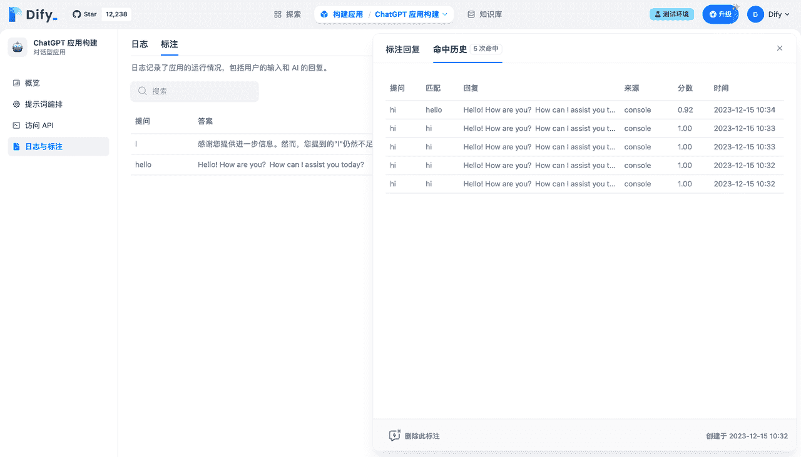