# 知识库引入及应用

> 来源：[https://qqs7y1hozd1.feishu.cn/docx/CAuJdd8l4o3w5mx8quTc8sYqnrc](https://qqs7y1hozd1.feishu.cn/docx/CAuJdd8l4o3w5mx8quTc8sYqnrc)

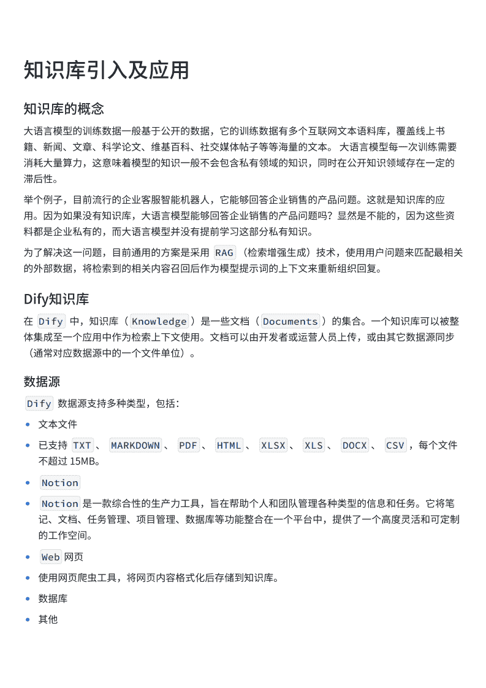

[知识库引入及应用.pdf](https://internal-api-drive-stream.feishu.cn/space/api/box/stream/download/all/XGZBbNZCrovUA7xZUD6cx4senvc)

## 知识库的概念

大语言模型的训练数据一般基于公开的数据，它的训练数据有多个互联网文本语料库，覆盖线上书籍、新闻、文章、科学论文、维基百科、社交媒体帖子等等海量的文本。 大语言模型每一次训练需要消耗大量算力，这意味着模型的知识一般不会包含私有领域的知识，同时在公开知识领域存在一定的滞后性。

举个例子，目前流行的企业客服智能机器人，它能够回答企业销售的产品问题。这就是知识库的应用。因为如果没有知识库，大语言模型能够回答企业销售的产品问题吗？显然是不能的，因为这些资料都是企业私有的，而大语言模型并没有提前学习这部分私有知识。

为了解决这一问题，目前通用的方案是采用 RAG（检索增强生成）技术，使用用户问题来匹配最相关的外部数据，将检索到的相关内容召回后作为模型提示词的上下文来重新组织回复。

## Dify知识库

在 Dify 中，知识库（Knowledge）是一些文档（Documents）的集合。一个知识库可以被整体集成至一个应用中作为检索上下文使用。文档可以由开发者或运营人员上传，或由其它数据源同步（通常对应数据源中的一个文件单位）。

### 数据源

Dify 数据源支持多种类型，包括：

+   文本文件

+   已支持 TXT、 MARKDOWN、 PDF、 HTML、 XLSX、 XLS、 DOCX、 CSV，每个文件不超过 15MB。

+   Notion

+   Notion是一款综合性的生产力工具，旨在帮助个人和团队管理各种类型的信息和任务。它将笔记、文档、任务管理、项目管理、数据库等功能整合在一个平台中，提供了一个高度灵活和可定制的工作空间。

+   Web网页

+   使用网页爬虫工具，将网页内容格式化后存储到知识库。

+   数据库

+   其他

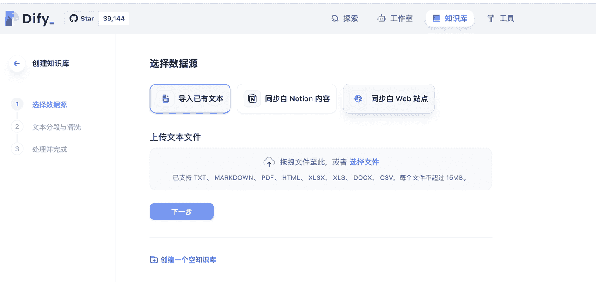

### 创建知识库

在 Dify 主导航栏中点击知识库，在该页面你可以看到已有的知识库。你可以点击 创建知识库 进入创建向导：

+   如果你已经准备好了文件，可以从上传文件开始。

+   如果你还没有准备好文档，可以先创建一个空数据集。

注意点： 这是为了防止单一知识库存在多数据源而造成的管理困难。如果你需要使用多个数据源，建议创建多个知识库。

### 上传文档

我使用ChatGPT-4 虚拟创建了火星牌扫地机器人的产品文档，点击 [火星牌扫地机器人.txt](https://personel-zhouxinle888-a66353926f9185cff28f2bd374a5c3a9dd89d5206.gitlab.io/dify/%E7%81%AB%E6%98%9F%E7%89%8C%E6%89%AB%E5%9C%B0%E6%9C%BA%E5%99%A8%E4%BA%BA.txt)下载。 这个文档是公开互联网上没有的资料，刚好可以作为我们的私有知识库。

### 分段和清洗

分段：大语言模型存在有限的上下文窗口，通常需要将整段文本进行分段处理后，将与用户问题关联度最高的几个段落召回，即分段 TopK 召回模式。此外，在用户问题与文本分段进行语义匹配时，合适的分段大小将有助于匹配关联性最高的文本内容，减少信息噪音。

清洗：为了保证文本召回的效果，通常需要在将数据传入模型之前对其进行清理。例如，如果输出中存在不需要的字符或者空行，可能会影响问题回复的质量。为了帮助用户解决这个问题， Dify 提供了多种清洗方法，可以帮助用户在将输出发送到下游应用程序之前对其进行清理。

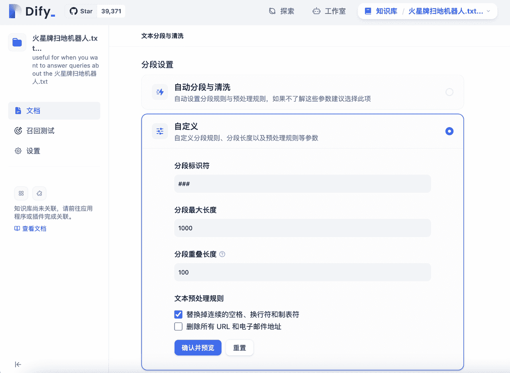

分段规则：

+   分段标识符，设置标识符如\n，系统将在文本中出现该标识符时分段；

+   分段最大长度，根据分段的文本字符数最大上限来进行分段，超出该长度时将强制分段；

+   分段重叠长度，设置分段间的重叠字符数，建议设置为分段长度的 10-25%，有助于保留分段之间的语义相关性，在多分段召回时提高召回效果。

预处理规则：

+   替换连续的空格、换行符和制表符；

+   删除所有 URL 和电子邮件地址；

理解分段重叠长度：

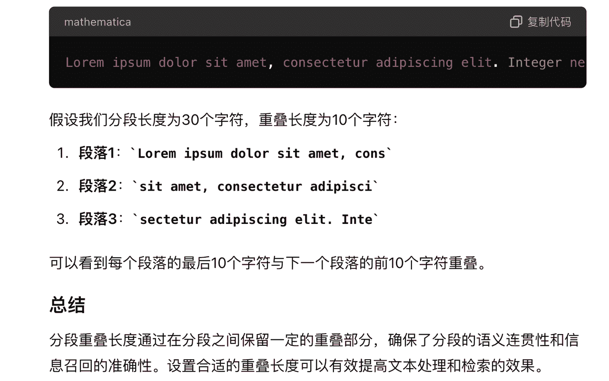

## 知识库及文档维护

### 查看文本分段

知识库内已上传的每个文档都会以文本分段（Chunks）的形式进行存储，你可以在分段列表内查看每一个分段的具体文本内容。

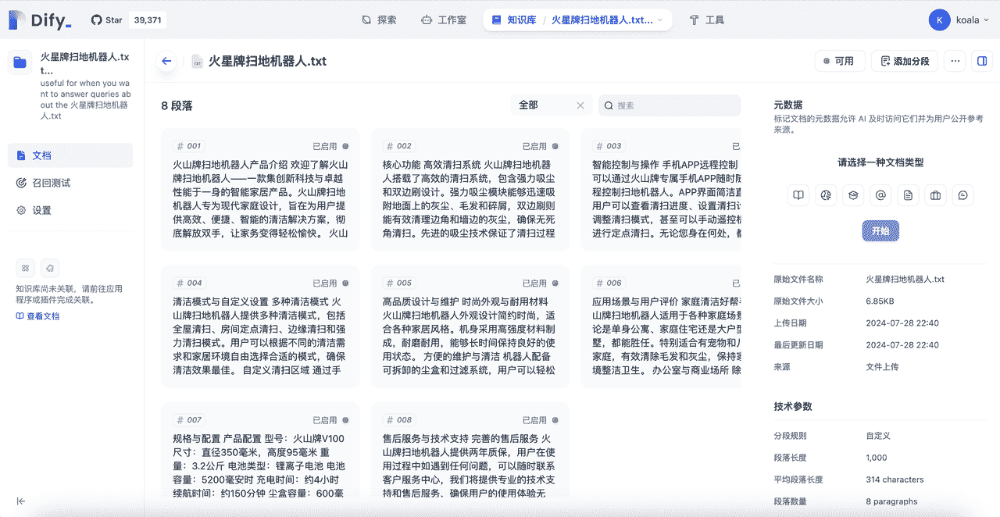

### 检查分段质量

文档分段对于知识库应用的问答效果有明显影响，在将知识库与应用关联之前，建议人工检查分段质量。

检查分段质量时，一般需要关注以下几种情况：

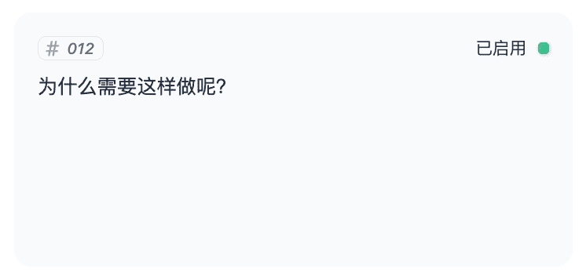

+   过短的文本分段，导致语义缺失

+   过长的文本分段，导致语义噪音影响匹配准确性

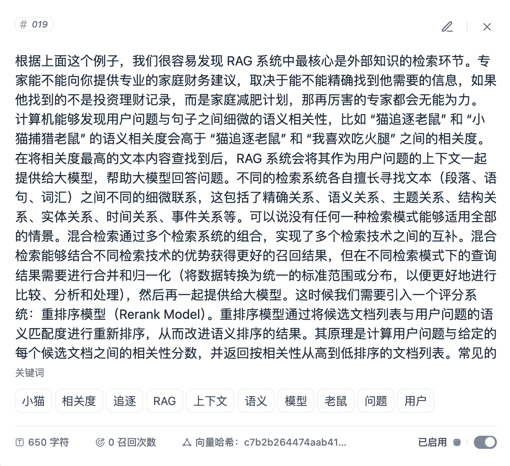

+   明显的语义截断，在使用最大分段长度限制时会出现强制性的语义截断，导致召回时缺失内容

### 添加文本分段

在分段列表内点击添加分段 ，可以在文档内自行添加一个或批量添加多个自定义分段。

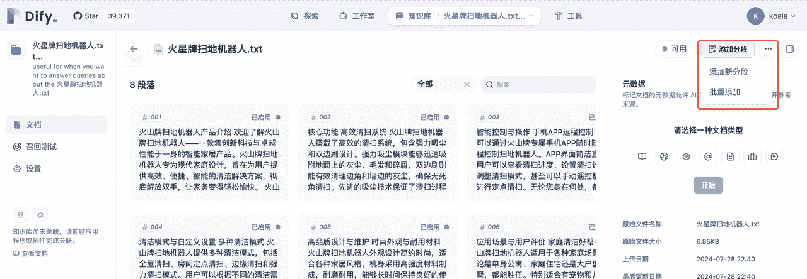

### 编辑文本分段

在分段列表内，你可以对已添加的分段内容直接进行编辑修改。包括分段的文本内容和关键词。

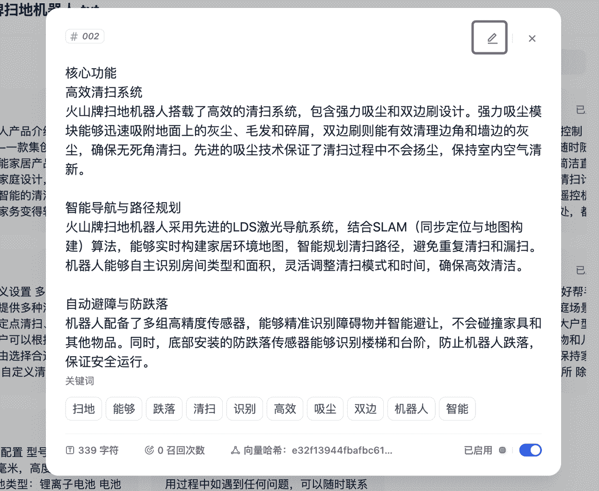

### 元数据管理

除了用于标记不同来源文档的元数据信息，例如网页数据的标题、网址、关键词、描述等。元数据将被用于知识库的分段召回过程中，作为结构化字段参与召回过滤或者显示引用来源。

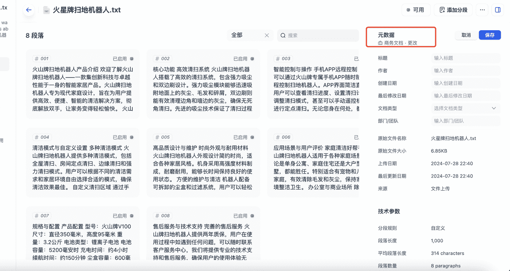

### 添加文档

知识库（Knowledge）是一些文档（Documents）的集合。文档由开发者或运营人员上传。

### 文档禁用和归档

+   禁用：数据集支持将暂时不想被索引的文档或分段进行禁用，在数据集文档列表，点击禁用按钮，则文档被禁用；也可以在文档详情，点击禁用按钮，禁用整个文档或某个分段，禁用的文档将不会被索引。禁用的文档点击启用，可以取消禁用。

+   归档：一些不再使用的旧文档数据，如果不想删除可以将它进行归档，归档后的数据就只能查看或删除，不可以进行编辑。在数据集文档列表，点击归档按钮，则文档被归档，也可以在文档详情，归档文档。归档的文档将不会被索引。归档的文档也可以点击撤销归档。

### 知识库 API 管理

例如我们企业内部有一个FAQ后台管理系统，管理员可以在后台管理系统新增FAQ问题和答案，我们如何将FAQ同步到Dify知识库呢？手动的方式当然可以，但是太low了，我们可以通过知识库API管理来同步：

[知识库 API 管理](https://docs.dify.ai/v/zh-hans/guides/knowledge-base/maintain-dataset-via-api)

## 应用内集成知识库

搭建一个基于工作流的聊天应用，将知识库集成到应用内，用户可以在应用内直接使用知识库进行问答。

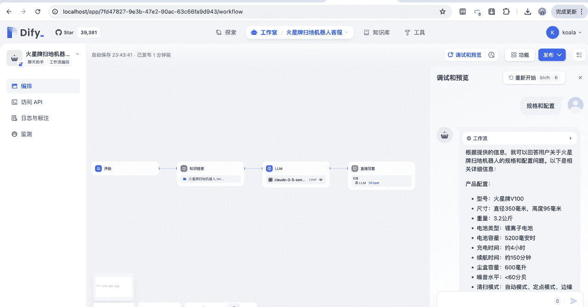