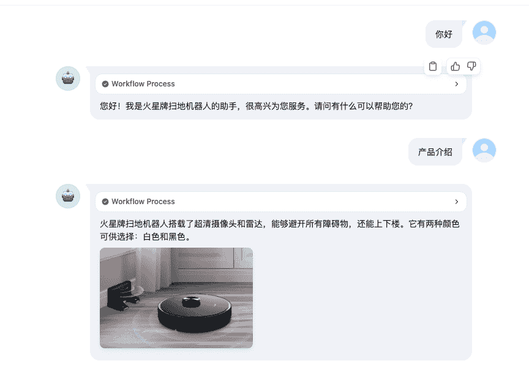
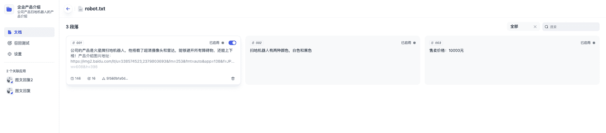
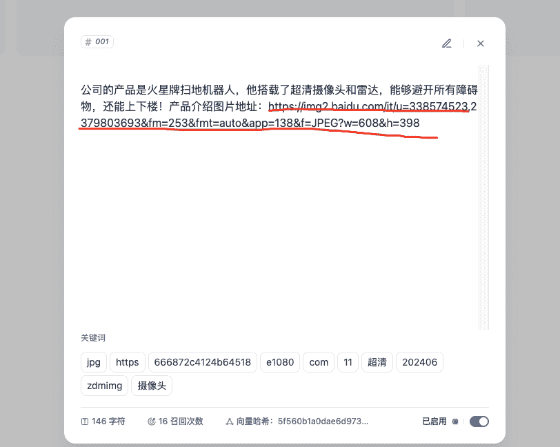
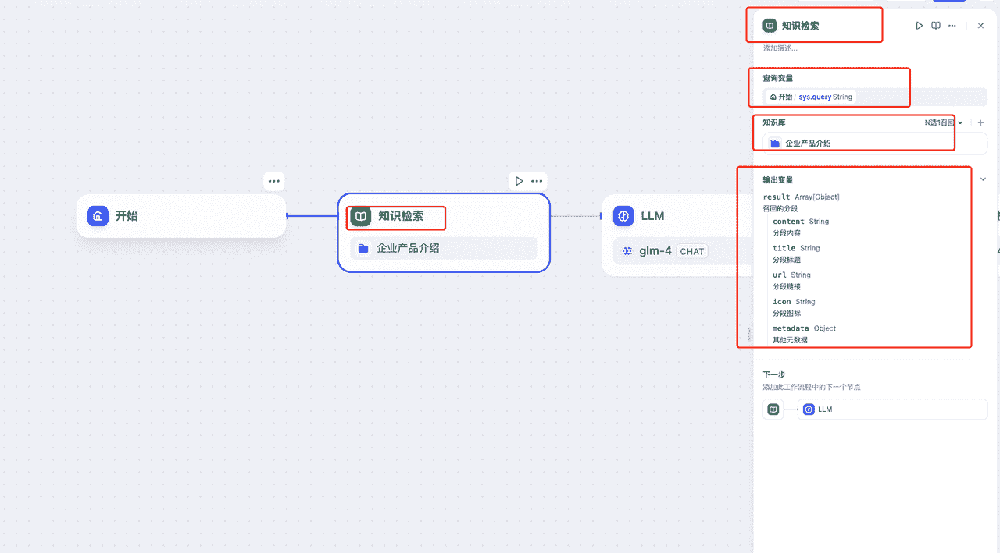
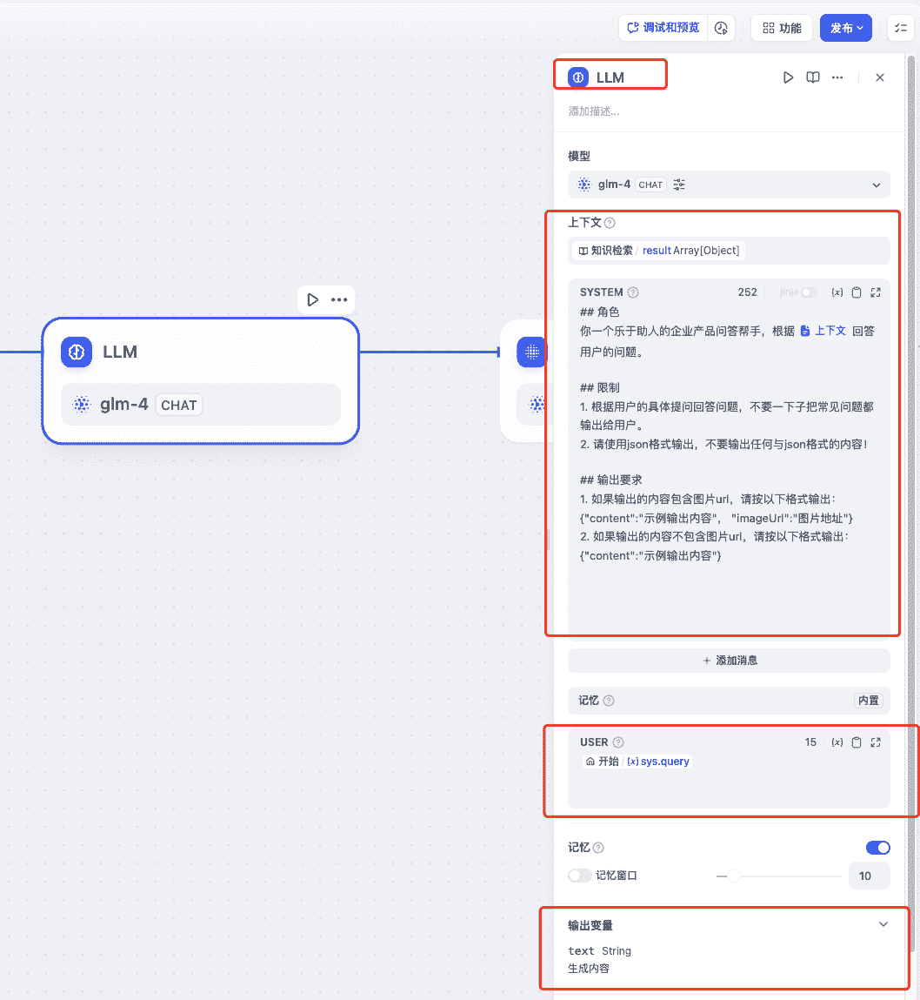
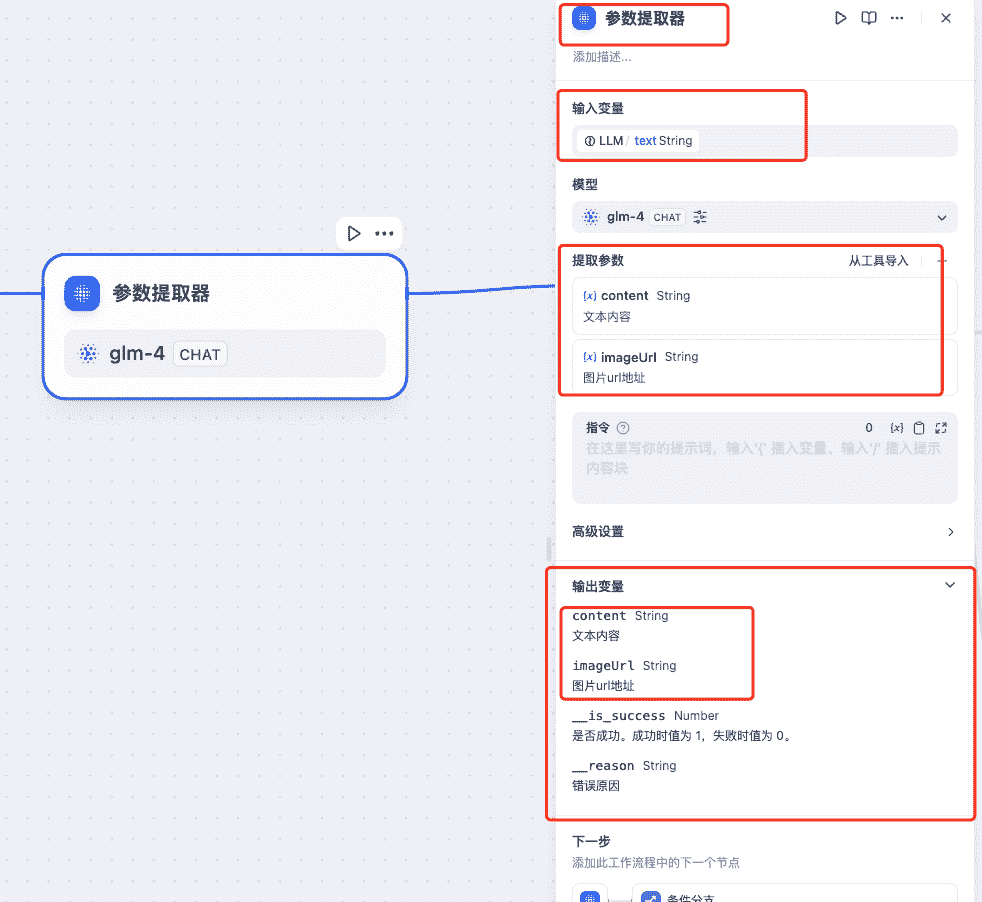
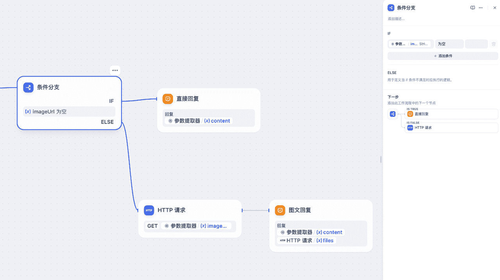
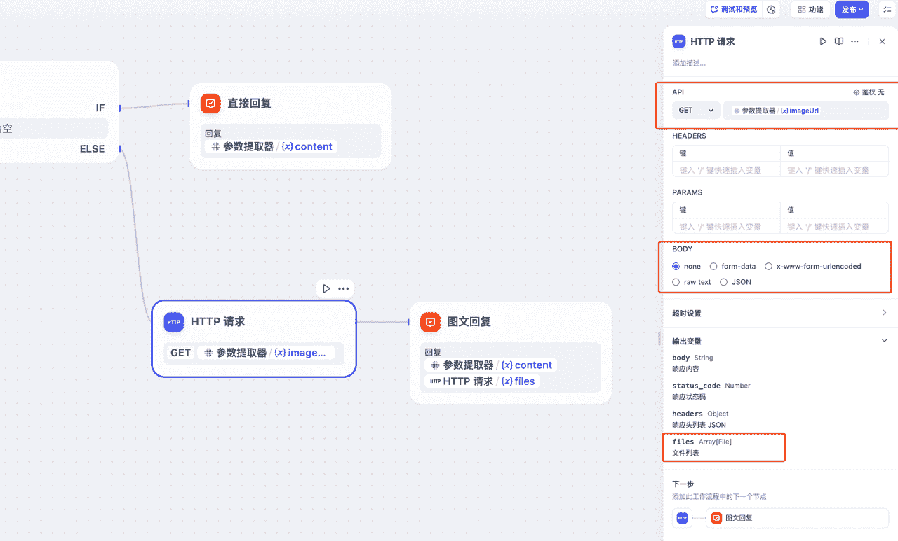
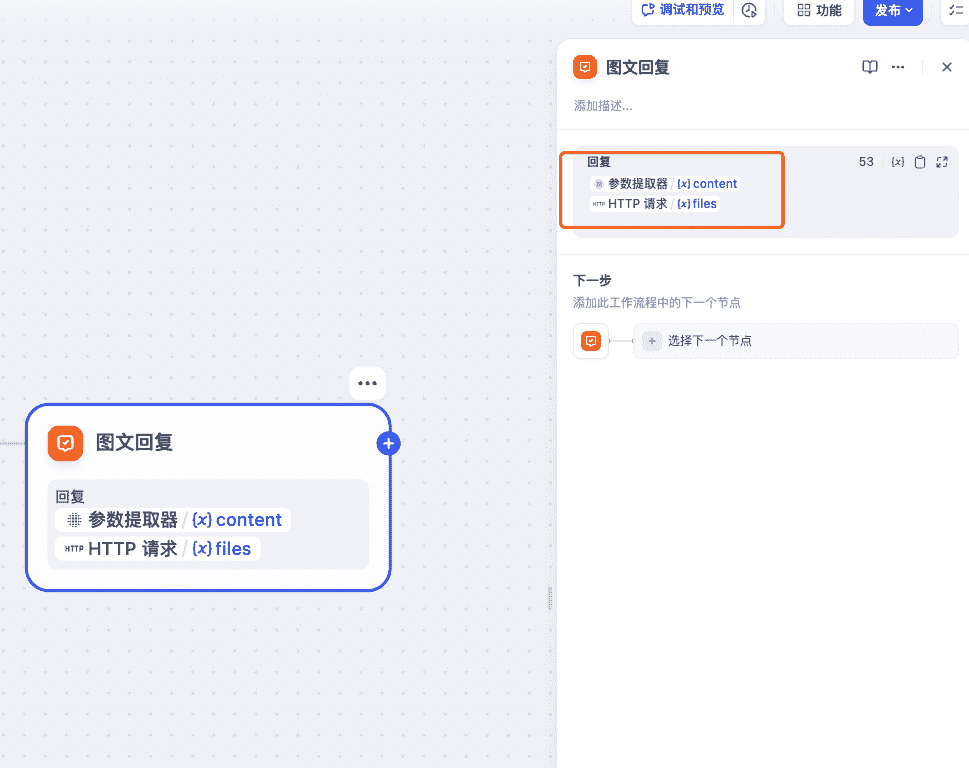
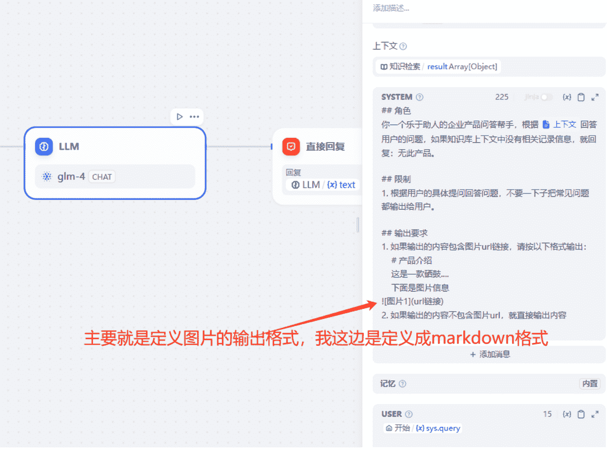

# Dify图文回复

> 来源：[https://qqs7y1hozd1.feishu.cn/docx/AbcRdS34Bo2jzmxkOuXcWNh6nFf](https://qqs7y1hozd1.feishu.cn/docx/AbcRdS34Bo2jzmxkOuXcWNh6nFf)

## 实现效果

在Dify自带的前端页面中实现图文回复，效果如下：

## 知识库

知识库不是本小节重点内容，我们将在之后的小节中详细讲解知识库。

这个小节，我们新建了一个简单的公司产品介绍知识库 - 扫地机器人介绍，在知识文档中存在扫地机器人介绍的图片。

我们的需求就是根据这个知识库对用户的问题进行回答，当回答中包含图片时，将图片在聊天窗口展示出来。

## 关键节点

### 知识索引

知识索引节点就是根据用户的输入，从知识库中匹配出最适合的片段，交给下一个LLM节点。

### LLM

LLM节点就是根据用户的输入（问题）和从知识库节点中检索出的知识片段，生成符合用户问题的回答。这个例子中，LLM节点输出的是JSON字符串文本，便于下一个节点使用JSON结构化数据。

## 参数提取器

参数提取器节点就是从LLM节点输出的JSON字符串中提取出回答文本和图片Url字段。

## 条件分支

条件分支节点就是根据参数提取器节点中提取出的回答文本和图片Url字段，判断是否包含图片Url字段，如果包含图片，则将图片Url传递给下一个HTTP请求节点，下载图片，在回复节点展示图文；如果不包含图片，回复节点只展示文本。

## HTTP请求节点

HTTP请求节点的作用就是根据Url下载图片，用户在最后的回复节点中展示。注意HTTP请求节点的返回参数是Array[File]类型。

## 回复节点

图文回复

## 导出DSL

图文回复应用可以导出为DSL，方便你在Dify[工作区中导入查看](https://personel-zhouxinle888-a66353926f9185cff28f2bd374a5c3a9dd89d5206.gitlab.io/dify/%E5%9B%BE%E6%96%87%E5%9B%9E%E5%A4%8D.yml)整个应用的编排。点击 图文回复.yml下载。

创建应用时，选择导入DSL文件即可。

## 其他实现方法

根据群友的补充，也可以在LLM节点的提示词中指定Markdown的图片展示语法，也可以展示。

Dify的前端展示页面应该是解析的富文本，所以也可以在LLM节点的提示词中指定<image src='图片链接'>的输出形式展示图片。