# 基于API调用Dify应用

> 来源：[https://qqs7y1hozd1.feishu.cn/docx/WFuGdkojYosw5oxgYzgcxAEvncc](https://qqs7y1hozd1.feishu.cn/docx/WFuGdkojYosw5oxgYzgcxAEvncc)

Dify 基于“后端即服务”理念为所有应用提供了 API，为 AI 应用开发者带来了诸多便利。通过这一理念，开发者可以直接在前端应用中获取大型语言模型的强大能力，而无需关注复杂的后端架构和部署过程。

## 使用 Dify API 的好处

+   让前端应用直接安全地调用 LLM 能力，省去后端服务的开发过程

+   在可视化的界面中设计应用，并在所有客户端中实时生效

+   对 LLM 供应商的基础能力进行了良好封装

+   随时切换 LLM 供应商，并对 LLM 的密钥进行集中管理

每一个大模型，GPT-4，Claude3.5都提供了 API，开发者可以轻松地使用这些 API 来构建自己的应用。但如果你需要 更换大模型，可能就需要更改代码，这会增加开发成本。

+   在可视化的界面中运营你的应用，例如分析日志、标注及观察用户活跃

+   持续为应用提供更多工具能力、插件能力和数据集

## 构建聊天应用

### 创建应用

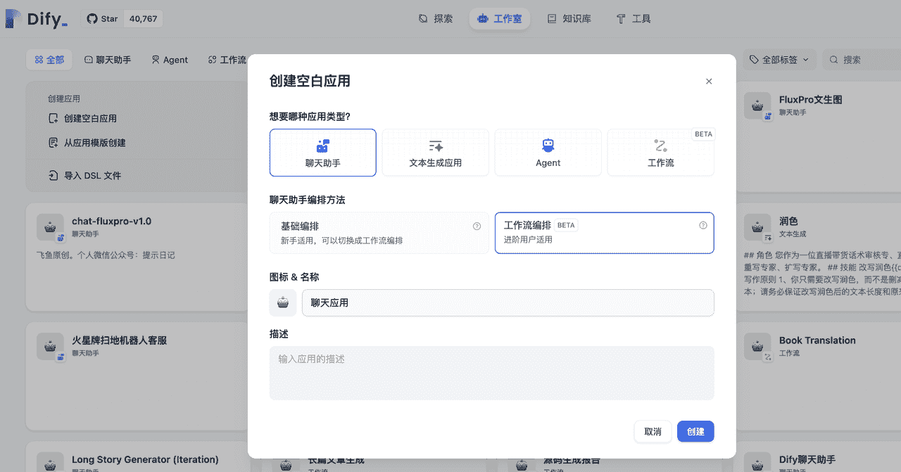

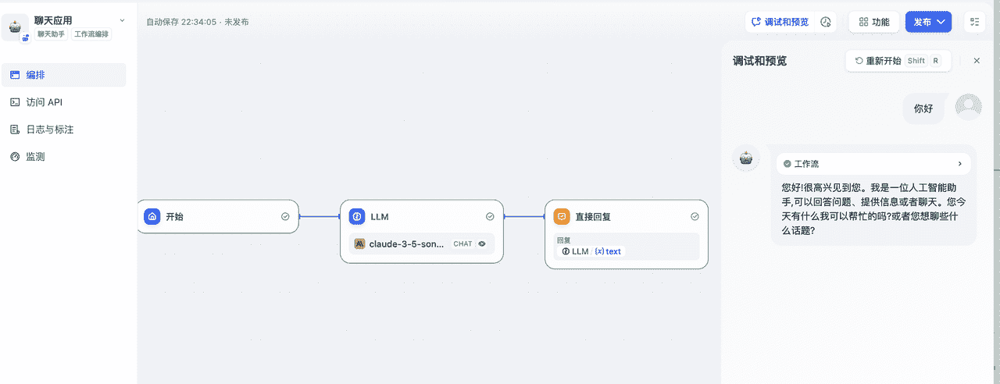

### 发布应用

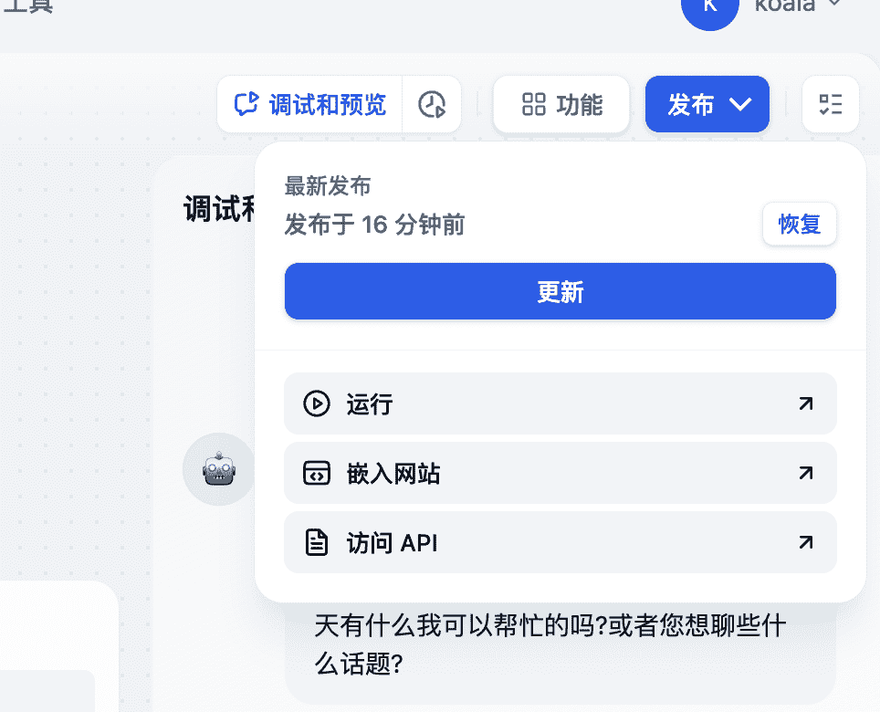

#### 直接运行

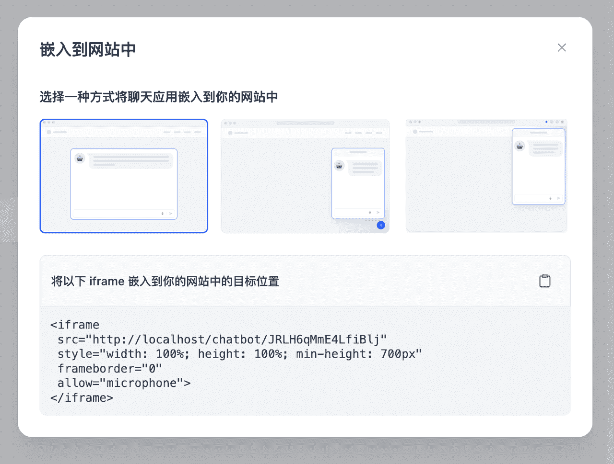

#### 嵌入网站

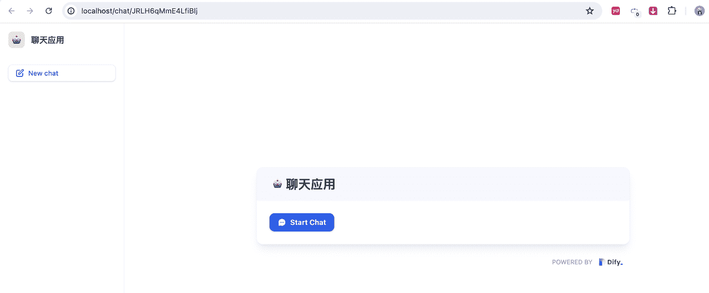

#### 访问API

为什么需要提供API的访问方式？

直接运行和嵌入网站，前端聊天页面都是Dify定义好的。如果我们想开发自己的聊天页面，那显然直接运行和嵌入网站是不能满足需求的。我们需要自定义聊天页面，调用Dify应用的API即可。

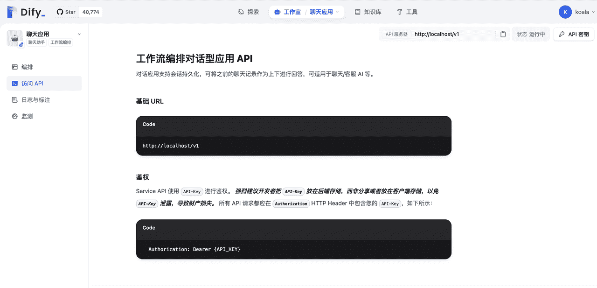

1.  获取API Key

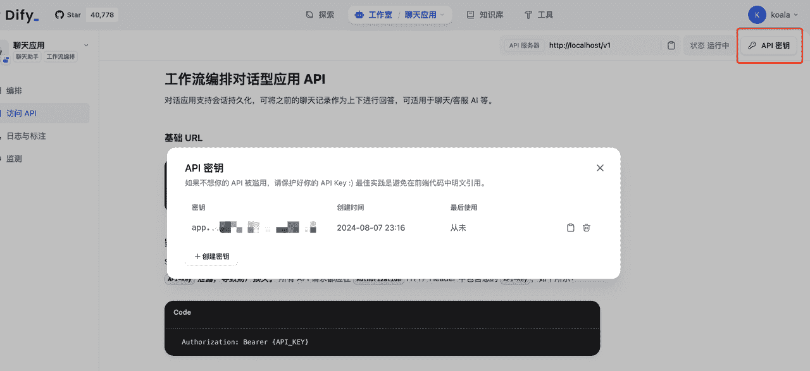

Service API 使用 API-Key 进行鉴权。 强烈建议开发者把 API-Key 放在后端存储，而非分享或者放在客户端存储，以免 API-Key 泄露，导致财产损失。 所有 API 请求都应在 Authorization HTTP Header 中包含您的 API-Key。

```
Authorization: Bearer {API_KEY}
```

基础URL

```
http://localhost/v1
```

+   发送对话消息 /chat-messages

1.  Blocking模式

等待执行完毕后返回结果。（请求若流程较长可能会被中断）。

1.  Streaming流式模式

基于 SSE（Server-Sent Events）实现类似打字机输出方式的流式返回。

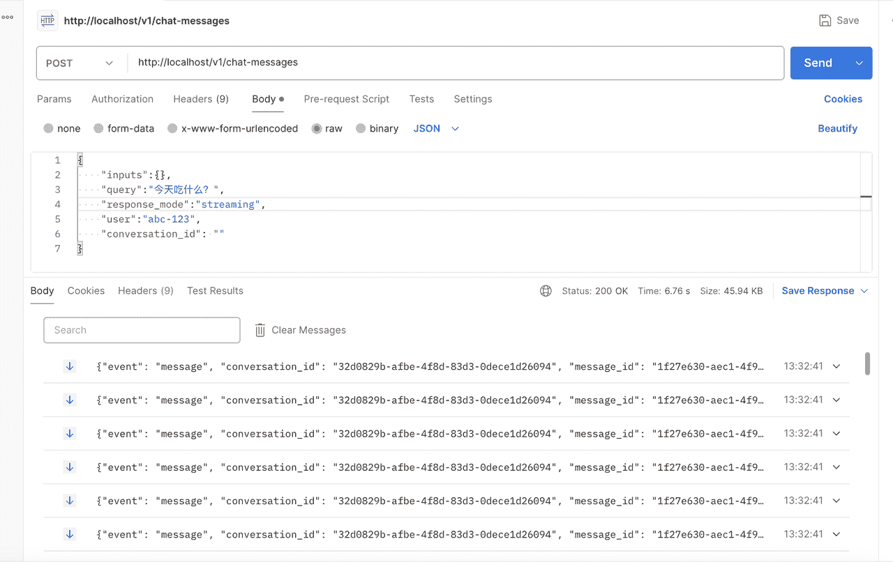

参数 conversation_id 理解

（选填）会话 ID，这个参数应用在多会话中。如果不传，则开启一个新的对话。 需要基于之前的聊天记录继续对话，必须传之前消息的 conversation_id。

返回错误码：

```
404，对话不存在
400，invalid_param，传入参数异常
400，app_unavailable，App 配置不可用
400，provider_not_initialize，无可用模型凭据配置
400，provider_quota_exceeded，模型调用额度不足
400，model_currently_not_support，当前模型不可用
400，completion_request_error，文本生成失败
500，服务内部异常
```

+   上传文件 /files/upload

上传文件（目前仅支持图片）并在发送消息时使用，可实现图文多模态理解。 支持 png, jpg, jpeg, webp, gif 格式。

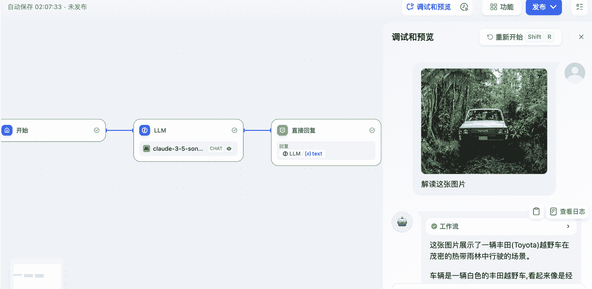

+   停止响应 /chat-messages/:task_id/stop

仅支持流式模式。

参数 task_id理解

Pathtask_id (string) 任务 ID，可在流式返回 Chunk 中获取

+   消息反馈（点赞）/messages/:message_id/feedbacks

消息终端用户反馈、点赞，方便应用开发者优化输出预期。

参数 message_id理解

每一个消息回复都包含message_id。

这些标记将在 Dify 的后续版本中供模型微调使用，以提升模型的准确性与回复风格，当前预览版仅支持标记。

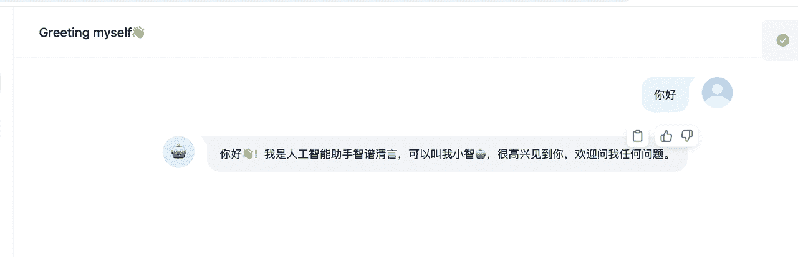

1.  对表现较佳的消息点赞

1.  对表现不佳的消息点踩

1.  对改进的结果标记改进回复，这代表了你期望 AI 回复的文本

+   获取下一轮建议问题列表 /messages/{message_id}/suggested

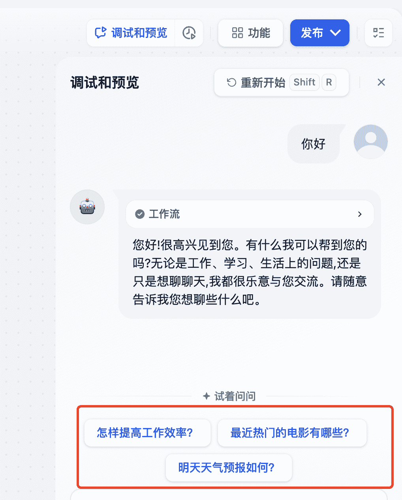

+   获取会话历史消息 /messages

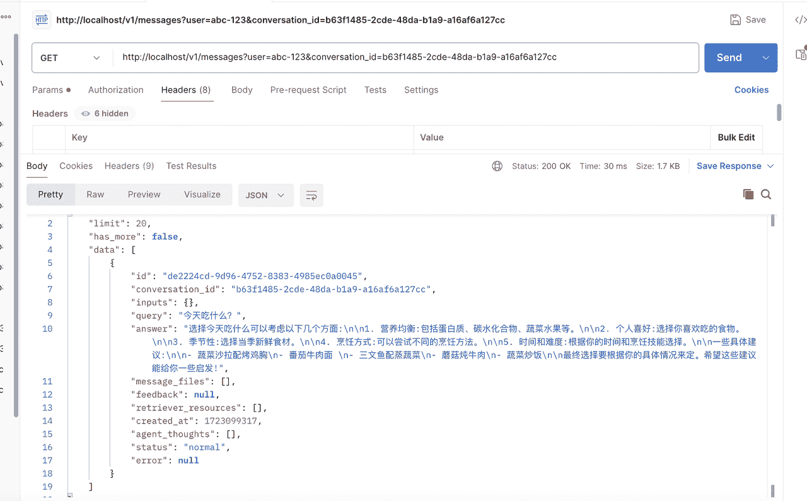

+   获取会话列表 /conversations

+   删除会话 /conversations/:conversation_id

+   会话重命名 /conversations/:conversation_id/name

+   语音转文字 /audio-to-text

+   文字转语音 /text-to-audio

+   获取应用配置信息 /parameters

+   获取应用Meta信息 /meta