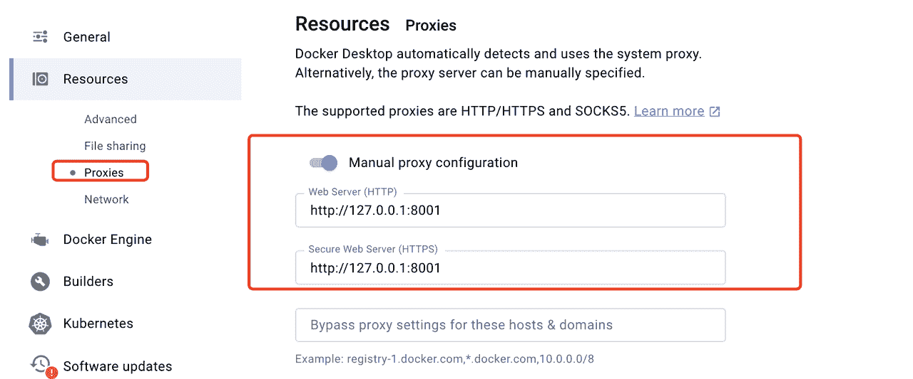
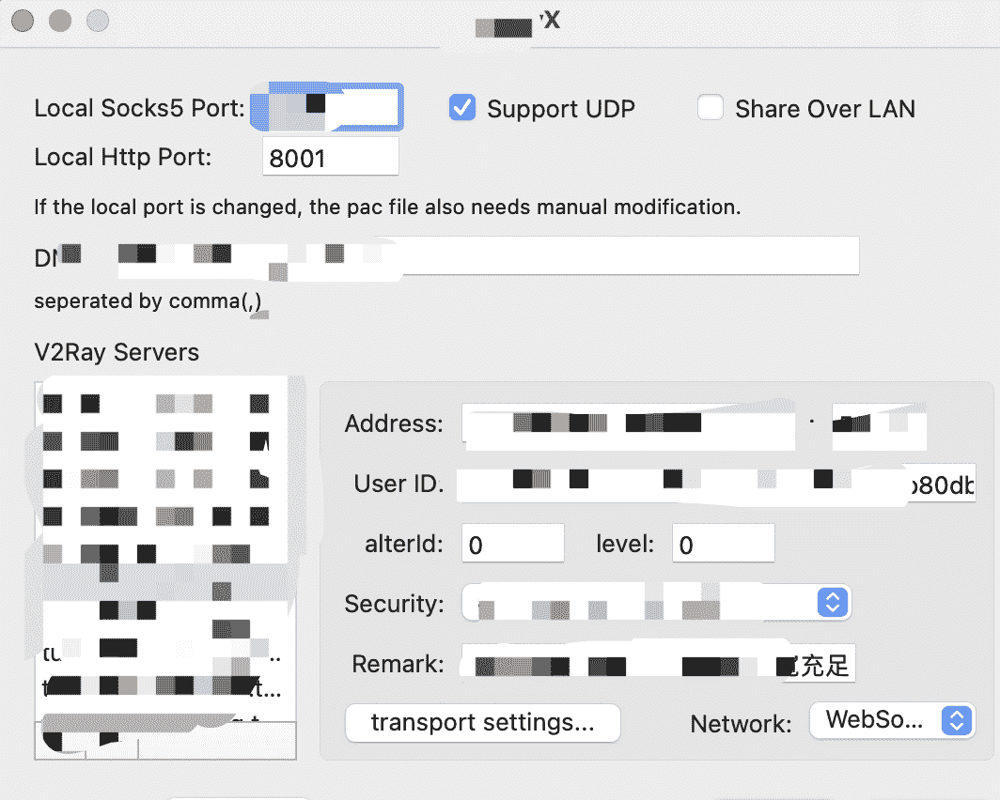

# Dify连接Claude 3.5, Azure OpenAI

> 来源：[https://qqs7y1hozd1.feishu.cn/docx/NodldWRpqoceEnxovrOchXFEnOe](https://qqs7y1hozd1.feishu.cn/docx/NodldWRpqoceEnxovrOchXFEnOe)

## 连接Claude 3.5

白嫖Claude 3.5详见B站本人视频。

通过CloudFlare中转访问Claude 3.5，国内访问需要🪜。由于Dify是使用Docker部署的，所以需要在Docker中配置本机🪜的代理地址，如下图：



在Mac终端访问Claude 3.5时，需要通过CloudFlare中转，也需要给终端设置代理：

```
export http_proxy=&quot;http://127.0.0.1:8001&quot;;export https_proxy=&quot;http://127.0.0.1:8001&quot;
```

## 连接Azure OpenAI

而Azure OpenAI在国内访问是不需要🪜的，所以当关闭🪜的时候，上图中的本机🪜的代理地址也要关闭。

下图是🪜设置本机代理端口的入口：



## Dify

本机Dify是Docker部署的，Docker设置了代理，代理到了🪜，所以🪜必须开着。🪜一旦关了，Docker代理到了一个127.0.0.1的地址，是无法访问网络的。