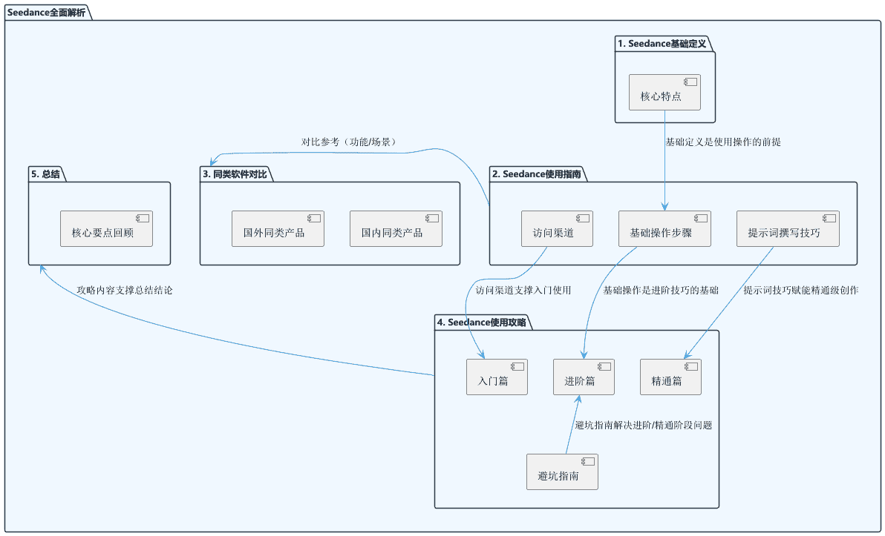

# Seedance 全面解析：定义、使用指南、同类软件与完整攻略

> 来源：[https://qqs7y1hozd1.feishu.cn/docx/CvztdAbQVoo8U0xTQeKcazx9nib](https://qqs7y1hozd1.feishu.cn/docx/CvztdAbQVoo8U0xTQeKcazx9nib)

## 一、Seedance 是什么？

Seedance 是**字节跳动基于自研** **Seed 大模型打**造的 AI 视频生成模型，目前已更新至 2.0 版本，主打电影级多镜头叙事和原生音视频同步生成能力，能从文本、图片、音频、视频混合输入，生成 1080p~2K、5~60 秒连贯视频，让 AI 视频从 "拼片段" 升级到 "能叙事"，具备 "导演思维"字节跳动Seed。

#### 基础操作步骤 (保姆级)

1.  **登录账号**：使用抖音 / 头条 / 手机号登录字节账号

1.  **选择生成模式**：

+   文生视频：纯文本描述生成视频

+   图生视频：上传图片生成视频

+   首尾帧模式：上传首图和尾图，AI 自动生成中间过渡

+   多模态参考：混合输入文本、图片、视频、音频

1.  **输入内容**：

+   文本提示词：遵循 "五要素模板"(主体 + 动作 + 场景 + 镜头 + 风格)

+   上传参考素材：图片 / 视频 / 音频 (视频总时长不超过 30 秒)

+   使用 "@" 指令引用素材：如 "@图 1 的角色在 @视频 2 的场景中做 @音频 3 的动作"

1.  **设置参数**：

+   时长：4-15 秒 (基础版)，最长可达 60 秒 (专业版)

+   分辨率：1080p (默认) 或 2K

+   风格：选择预设风格或自定义描述

+   其他：帧率、运镜方式、音效等

1.  **点击生成**：等待几秒到几十秒 (取决于时长和复杂度)

1.  **编辑优化**：在剪映中进一步调整 (剪辑、调色、加字幕等)

1.  **导出分享**：直接导出 MP4 格式，分享至抖音 / 头条等平台

#### 提示词撰写技巧 (核心)

1.  **五要素公式**(必用)：

1.  plaintext

1.  主体描述 + 动作描述 + 场景描述 + 镜头运动 + 风格描述

1.  示例："穿汉服的少女 (主体) 在竹林舞剑 (动作)，阳光透过竹叶洒下 (场景)，镜头从下至上仰拍 (镜头)，水墨动画风格，1080P (风格)"

1.  **专业电影术语**(提升质感)：

+   运镜：推拉摇移、跟拍、环绕、俯拍、仰拍、特写、全景

+   光线：自然光、侧光、逆光、柔光、硬光、黄金时刻

+   画质：4K、锐度清晰、Ultra HD、超高清、无闪烁、细节丰富Seadance AI

1.  **连续动作描述**(避免跳切)：

+   加入过渡词："直接过渡到"、"紧接着"、"流畅地"、"自然地"

+   示例："角色从跳跃直接过渡到翻滚，保持动作连贯流畅"

1.  **@指令高级用法**：

+   引用角色："@图 1 的女孩 (穿红裙的) 在公园跳舞"

+   引用场景："女孩在 @图 2 的海边 (日落时) 散步"

+   引用动作："@视频 1 的舞蹈动作 (街舞) 在雨中表演"

+   引用运镜："使用 @视频 2 的运镜方式 (环绕) 拍摄"

### 三、国内外同类软件对比

#### 国内同类产品

表格

#### 国外同类产品

表格

### 四、Seedance 使用攻略 (从入门到精通)

#### 入门篇：快速上手 (10 分钟学会)

1.  **选择最简单的生成方式**：新手建议先使用 "首尾帧模式" 或 "文生视频"

1.  **提示词极简模板**：主体 + 动作 + 场景 + 风格 (如 "小猫在草地上打滚，卡通风格")

1.  **参数默认设置**：时长选 5-8 秒，分辨率 1080p，风格选预设的 "电影感"

1.  **生成后直接导出**：先体验基础效果，不要急于复杂操作

1.  **每日免费次数**：即梦 AI 新用户有免费次数，每日签到可获积分Seadance AI

#### 进阶篇：提升视频质量 (核心技巧)

1.  **提示词优化三步法**：

+   第一步：明确主体和核心动作 (如 "宇航员在月球行走")

+   第二步：添加场景细节和镜头语言 (如 "环形山背景，低角度跟拍")

+   第三步：加入风格和画质描述 (如 "科幻电影质感，2K，光线来自地球")

1.  **多模态参考高级用法**：

+   上传参考图：确保角色特征一致 (如 "@图 1 的角色发型和服装")

+   视频参考：提取动作和运镜 (如 "@视频 2 的跑步动作和推拉镜头")

+   音频参考：让视频节奏匹配音乐 (如 "@音频 1 的鼓点节奏，动作卡点")

1.  **角色一致性保障技巧**：

+   在提示词中反复强调角色特征 (如 "穿蓝色连衣裙的小女孩，全程保持相同发型和服装")

+   使用同一参考图的不同角度作为多个输入

+   避免过于复杂的场景转换，保持背景相对稳定微博

1.  **运镜与叙事技巧**：

+   开场用全景 (建立场景)→中景 (展示动作)→特写 (突出细节) 的经典镜头组合

+   加入过渡镜头 (如 "镜头缓缓推进"、"从远处拉回")

+   动作场景用跟拍，情感场景用固定镜头

#### 精通篇：高级玩法与创意应用

1.  **视频续接功能**：生成一段视频后，使用 "接着拍" 功能，让 AI 继续生成后续内容，保持连贯性

1.  **视频风格迁移**：上传一段视频，用 Seedance 将其转换为不同风格 (如 "将 @视频 1 转换为水墨动画风格")

1.  **舞蹈视频创作**：

+   上传舞蹈视频作为参考

+   上传自己的照片作为角色

+   提示词："@图 1 的人物跳 @视频 2 的舞蹈，镜头环绕拍摄，高清 1080p"

1.  **短剧制作**：

+   分镜头生成：每个镜头单独生成，保持角色和场景一致

+   在剪映中拼接：添加转场和音效

+   提示词中加入 "连续镜头，角色一致，场景连贯"

1.  **电商广告制作**：

+   上传产品图片和使用场景图

+   提示词："@图 1 的手机在 @图 2 的办公桌上展示，镜头从不同角度拍摄功能，专业广告风格"

#### 避坑指南：常见问题与解决方案

表格

### 摘要

**Seeda**n**ce 2.**0** 是当前 **AI 视频生成领域的佼佼者，凭借多模态输入、电影级叙事和强大可控性三大核心优势，让普通人也能轻松创作出专业级视频内容。从简单的文本生成到复杂的多素材混合创作，从短视频到短剧制作，Seedance 都能满足不同用户的需求。

通过本攻略的学习，你可以快速掌握 Seedance 的使用方法，从入门到精通，创作出令人惊艳的 AI 视频作品。同时，也可以根据自身需求选择合适的同类软件，在 AI 视频创作的浪潮中找到最适合自己的工具。