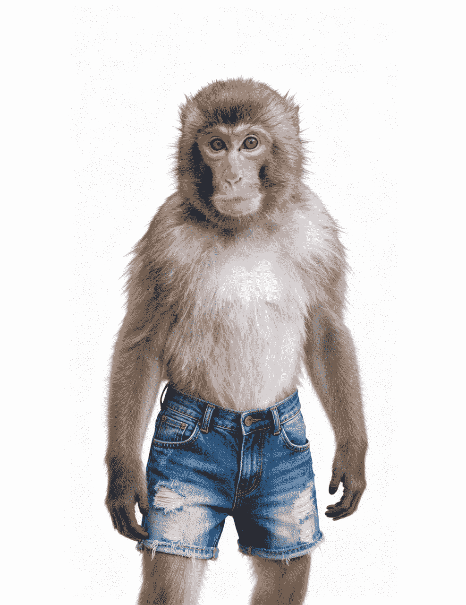
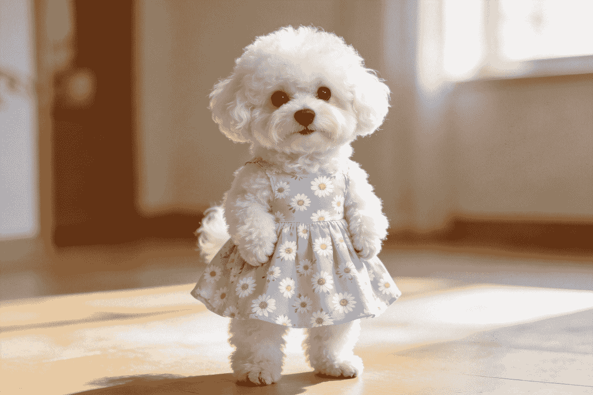
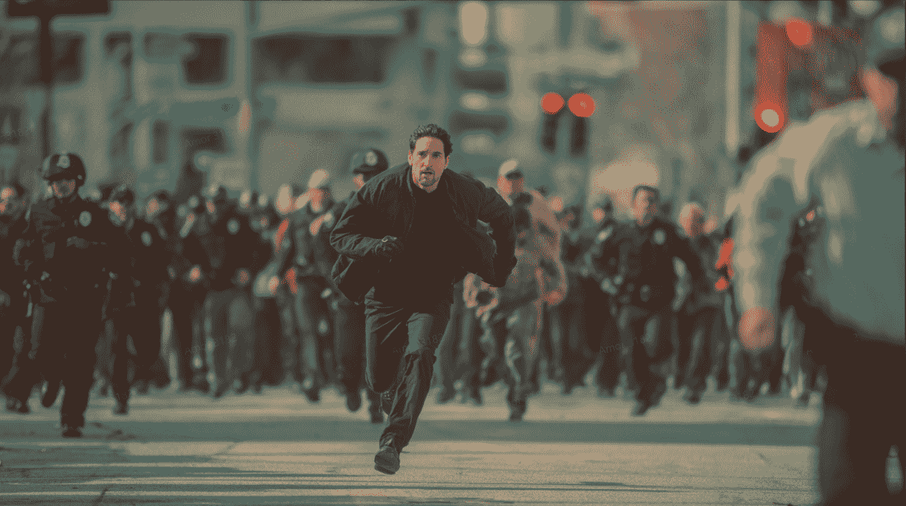
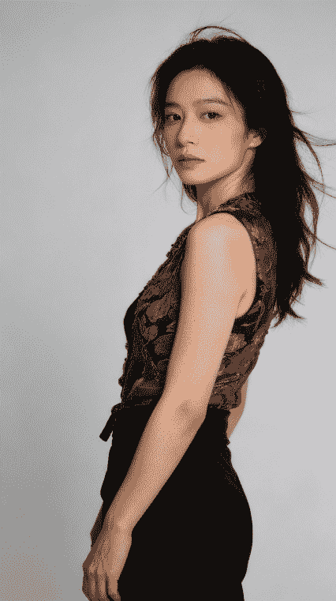
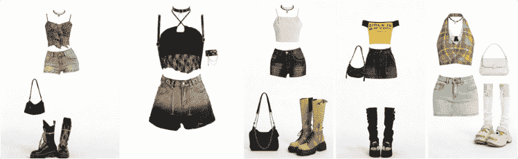

# 字节Seedance 2.0实操手册：5种超好玩的AI视频玩法与详细提示词

> 来源：[https://qqs7y1hozd1.feishu.cn/docx/RyV5d0WfbocbS6xg01hciB7Unhg](https://qqs7y1hozd1.feishu.cn/docx/RyV5d0WfbocbS6xg01hciB7Unhg)

近期，一封产品文档在飞书上悄然流传。

这个字节跳动的AI视频生成模型升级版，不仅解决了传统AI视频的抽卡难题，还提供了前所未有的多模态创作能力。从电商广告到短视频制作，从小说视觉化到故事片创作，Seedance 2.0正以前所未有的方式降低视频创作门槛。

这次升级中，“参考能力”是最大亮点：

+   📷 参考图像可精准还原画面构图、角色细节

+   🎥 参考视频支持镜头语言、复杂的动作节奏、创意特效的复刻

+   ⏱ 视频支持平滑延长与衔接，可按用户提示生成连续镜头，不止生成，还能“接着拍”

+   ✂️ 编辑能力同步增强，支持对已有视频进行角色更替、删减、增加

### 一、 AI动物短视频：参考角色生成

上传一张角色图，Seedance 2.0就能让TA在你设定的任何场景里动起来，保持角色的一致性，彻底告别“换个角色就变脸”的抽卡噩梦。

首先，设计并上传主角角色设定图，然后输入场景描述：

> **提示词指令**：图片中的猴子走向奶茶店柜台，镜头跟随在他身后，一位比熊服务员正在吧台处擦拭制作工具，猴子向服务员用四川口音点单：“幺妹儿，霸王别姬有得没得？”

> 切镜，特写。

> 服务员放下手里的活，怪异地看了老头一眼后回答：“没得，美式要不要得嘛”

> 切镜，镜头给到猴子。

> 他挠了挠头念念有词：“没事……？我有事！孙儿叫我来买个奶茶，就叫个撒子霸王别姬嘛”

<https://live.csdn.net/v/embed/514610>

视频8

Seedance 2.0会根据角色设定图，在生成的所有视频中保持角色外貌、颜色和风格一致。这意味着你可以使用同一角色设定，生成无数不同场景的短视频。

### 二、 电商创意广告：参考图生成视觉震撼

想象一下，你有一个产品照片，需要为它制作一条创意广告。传统方法需要找模特、摄影师、后期制作，至少需要几天时间和数千元预算。

Seedance 2.0的参考图生视频功能让这一切变得简单。

上传一张产品照片作为参考，加上一段精心设计的提示词：

> **提示词指令**：画里面的人物心虚的表情，眼睛左右看了看探出画框，快速的将手伸出画框拿起可乐喝了一口，然后露出一脸满足的表情，这时传来脚步声，画中的人物赶紧将可乐放回原位，此时一位西部牛仔拿起杯子里的可乐走了，最后镜头前推画面慢慢变得纯黑背景只有顶光照耀的罐装可乐，画面最下方出现艺术感字幕和旁白：“宜口可乐，不可不尝！

<https://live.csdn.net/v/embed/514082>

视频1

A**I会根据参考图的色**调、质感和产品形态，自动生成一段专业级广告视频。不仅能保持产品外观一致，还能智能添加合适的光影效果和运动轨迹，使静态产品“活”起来。

### 三、AI故事片：多场景角色一致性突破

传统AI视频生成在多场景故事片中最大的挑战是角色一致性——主角在不同镜头中常常“变脸”。Seedance 2.0通过参考图生视频技术彻底解决了这一问题。

> **提示词指令**：男人下班后疲惫的走在走廊，脚步变缓，最后停在家门口，脸部特写镜头，男人深呼吸，调整情绪，收起了负面情绪，变得轻松，然后特写翻找出钥匙，插入门锁，进入家里后，他的小女儿和一只宠物狗，欢快的跑过来迎接拥抱，室内非常的温馨，全程自然对话

<https://live.csdn.net/v/embed/514112>

视频5

Seedance 2.0能够在不同场景、不同光线、不同角度下保持角色外貌的一致性，同时还能根据场景调整光影对角色面部的影响，保持真实感。

### 四、 小说一键成片：文字直接变电影

对于小说作者和内容创作者来说，将文字转化为视觉内容一直是高门槛任务。Seedance 2.0的文生视频功能正改变这一现状。

输入文字，即可生成相应场景视频：

> **提示词指令**：镜头跟随黑衣男子快速逃亡，后面一群人在追，镜头转为侧面跟拍，人物惊慌撞倒路边的水果摊爬起来继续逃，人群慌乱的声音。

<https://live.csdn.net/v/embed/514085>

视频2

**

Seedance** 2.0理解的不只是文字表面意思，还能捕捉 情感基调和场景氛围。它能自动设计运镜方式——从全景到特写的自然过渡，雨滴与烟雾交织的细节处理，光线与阴影的恰当分配。

### 五、 AI服装电商：虚拟模特动态展示

服装电商最头疼的问题之一是如何高效展示商品。传统拍摄需要模特、摄影师、场地和后期处理，成本高且周期长。

Seedance 2.0的参考图生视频功能为服装电商提供全新解决方案。

上传服装平铺图或穿在模特身上的照片，配合提示词：

> **提示词指令**：参考第一张图片里模特的五官长相。模特分别穿着第2-6张参考图里的服装凑近镜头，做出调皮、冷酷、可爱、惊讶、耍帅的造型，每一个造型穿着不同服装，每次更换，画面伴随会切镜，参考视频里的鱼眼镜头效果、重影闪烁的炫影画面效果。

<https://live.csdn.net/v/embed/514083>

视频3

AI不仅能保持服装设计细节不变，还能生成符合服装风格的模特动作和场景。更惊人的是，它可以为同一服装生成不同身材、肤色的模特展示视频，真正实现多元化展示。

### 从工具到创作伙伴

当**这些案例放在**一起，一个清晰的图景显现：Seedance 2.0不再只是一个视频生成工具，它正在成为创作者的智能合作伙伴。

AI视频生成从“能看”到“能用”的转变正在重塑整个行业。对于创作者来说，这既意味着新的机遇，也代表着需要适应新的工作方式。