# 用LLM实现客户细分

> 来源：[https://qqs7y1hozd1.feishu.cn/docx/PfAZdVIkoo7r70xM5SIcumN7nyc](https://qqs7y1hozd1.feishu.cn/docx/PfAZdVIkoo7r70xM5SIcumN7nyc)

## **概述**

实践中可以采用多种方式处理**客户细分**项目，在本文中，将介绍一些高阶技术，不仅可以定义聚类，还可以分析结果。

**本文包含哪些内容？**

看一下处理客户细分项目的3种方法：

+   Kmeans

+   K-Prototype

+   LLM+Kmeans

**作为项目结果预览，**先展示用不同方法创建不同模型的2D表示（PCA）比较图：

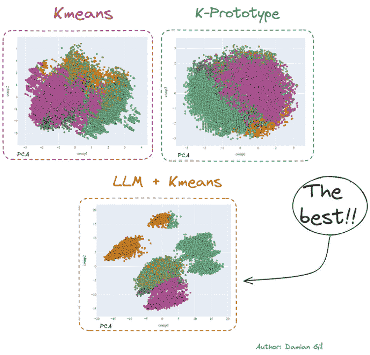

**还将学到以下降维技术：**

+   PCA

+   t-SNE

+   MCA

**其中一些结果如下：**

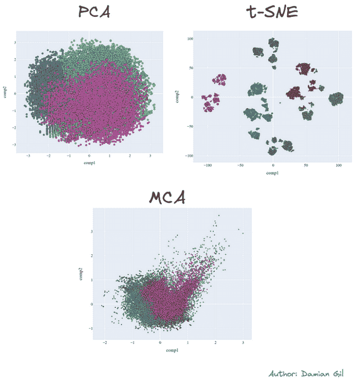

这不是一个端到端的项目，

在这里，

**跳过了该类项目中最重要的部分：**

**探索性****数据分析****（EDA）阶段或变量选择阶段。**

## **数据**

本项目中使用到的原始数据来自：银行数据集-市场营销目标。此数据集中的每一行均包含有相关公司客户的信息，其中某些数据域是数值，而另一些数据域为分类信息，对解决问题的方法做了有效的扩展。

仅选取数据的前8列，数据集如下图所示：

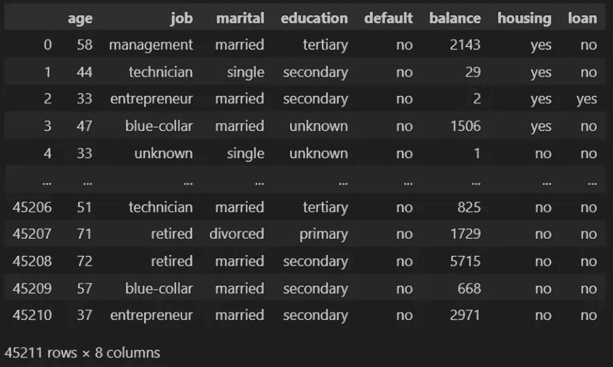

> **对数据集的列作简要描述：**

+   **年龄**（数值）

+   **工作**（分类为：“管理人员”、“未知”、“失业”、“经理”、“女佣”、“企业家”、“学生”、“蓝领”、“个体经营者”、“退休”、“技术人员”、“服务”）

+   **婚姻状况**（分类：“已婚”、“离婚”、“单身”。注：“离婚”是指离婚或丧偶）

+   **教育**（分类：“未知”、“中学”、“小学”、“高等教育”）

+   **违约：**是否有违约的信用？（二进制文件：“是”、“否”）

+   **余额：**年平均余额，单位为欧元（数字）

+   **住房：**是否有住房贷款？（二进制文件：“是”、“否”）

+   **贷款：**是否有个人贷款？（二进制文件：“是”、“否”）

本项目中使用了训练数据集。在项目存储库中，可以找到项目中用到数据集的压缩文件的“data”文件夹。此外，还将在压缩文件中找到两个CSV文件，其中一个是由（train.csv）提供的训练数据集，另一个是执行嵌入（embedding_train.csv）后的数据集，将在后面做进一步解释。

为了进一步阐明项目的结构，将项目树显示为：

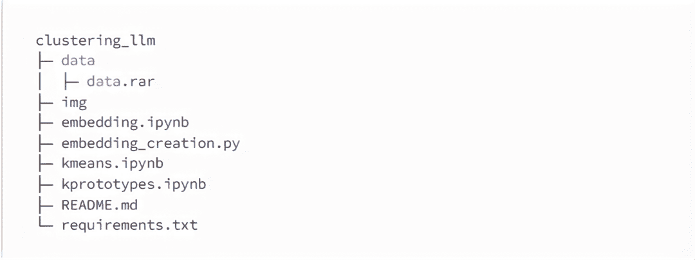

## **方法1：Kmeans**

这是最常用的方法，您或许已经对这一方法有所了解，这里将会再次研究它，一并展示先进的分析技术，可以在笔记本中找到完整的文件k-means.ipynb

## ** 预处理**

**对变量做如下预处理：**

1.  **将分类变量转换为数值变量。**

将Onehot编码器应用于名字变量，将OrdinalEncoder应用于常规特征（教育）。

1.  确保数值变量具有高斯分布，并使用一个PowerTransformer。

看看它的代码。

```
import pandas as pd # dataframe manipulation
import numpy as np # linear algebra
# data visualization
import matplotlib.pyplot as plt
import matplotlib.cm as cm
import plotly.express as px
```

输出：

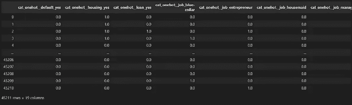

## **异常值**

在数据中很少有异常值，因为K-means对此非常敏感。典型的方法是使用z分数来选取异常值，但在本文中，将展示一个更加先进和更酷的方法。

> 即使用Python离群值检测（PyOD）库。这个库专注于检测不同情况下的异常值。更具体地说，是使用ECOD方法（“离群值检测的经验累积分布函数”）。

**该方法从**获得数据的分布中找出哪些值的概率密度较低（异常值），来看看它的代码。

```
from pyod.models.ecod import ECOD
clf = ECOD()
clf.fit(data)
outliers = clf.predict(data)
data[&quot;outliers&quot;] = outliers
# Data without outliers
data_no_outliers = data[data[&quot;outliers&quot;] == 0]
data_no_outliers = data_no_outliers.drop([&quot;outliers&quot;], axis = 1)
# Data with Outliers
data_with_outliers = data.copy()
data_with_outliers = data_with_outliers.drop([&quot;outliers&quot;], axis = 1)
print(data_no_outliers.shape) -&gt; (40690, 19)
print(data_with_outliers.shape) -&gt; (45211, 19)
```

## **建模**

使用K-means算法的缺点之一是必须选取使用到的聚类数量，为了获得该数据，会用到Elbow 方法，该方法计算簇点与其质心之间的失真。目标十分明确，即获取最小的失真。

**此时，会用到以下代码：**

```
from yellowbrick.cluster import KElbowVisualizer
# Instantiate the clustering model and visualizer
km = KMeans(init=&quot;k-means++&quot;, random_state=0, n_init=&quot;auto&quot;)
visualizer = KElbowVisualizer(km, k=(2,10))
visualizer.fit(data_no_outliers)# Fit the data to the visualizer
visualizer.show()
```

输出：

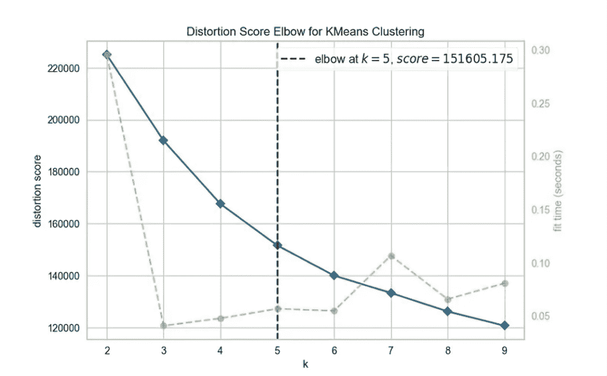

从k=5可以看出，失真没有很大的变化，理想状态下，自k=5始的行为几乎是平坦的。虽然这种情况鲜有发生，但还是可以应用其他方法来确定最优的聚类数量。可以肯定的是，可以执行 Silhoutte可视化，代码如下：

```
from sklearn.metrics import davies_bouldin_score, silhouette_score, silhouette_samples
import matplotlib.cm as cm

def make_Silhouette_plot(X, n_clusters):
plt.xlim([-0.1, 1])
plt.ylim([0, len(X) + (n_clusters + 1) * 10])
clusterer = KMeans(n_clusters=n_clusters, max_iter = 1000, n_init = 10, init = &#x27;k-means++&#x27;, random_state=10)
cluster_labels = clusterer.fit_predict(X)
silhouette_avg = silhouette_score(X, cluster_labels)
print(
&quot;For n_clusters =&quot;, n_clusters,
&quot;The average silhouette_score is :&quot;, silhouette_avg,
)
```

输出：

```
&quot;&quot;&quot;
N cluster: 2
For n_clusters = 2 The average silhouette_score is : 0.18111287366156115
N cluster: 3
For n_clusters = 3 The average silhouette_score is : 0.16787543108034586
N cluster: 4
For n_clusters = 4 The average silhouette_score is : 0.1583411958880734
N cluster: 5
For n_clusters = 5 The average silhouette_score is : 0.1672987260052535
N cluster: 6
For n_clusters = 6 The average silhouette_score is : 0.15485098506258177
N cluster: 7
For n_clusters = 7 The average silhouette_score is : 0.1495307642182009
&quot;&quot;&quot;
```

可以看出，使用n_cluster=9获得了最高的Silhouette分值，但如果与其他分数进行比较之后，会发现分数的变化其实也不大从另一方面来看，上述代码创建了Silhouette可视化，它提供了更多的信息：

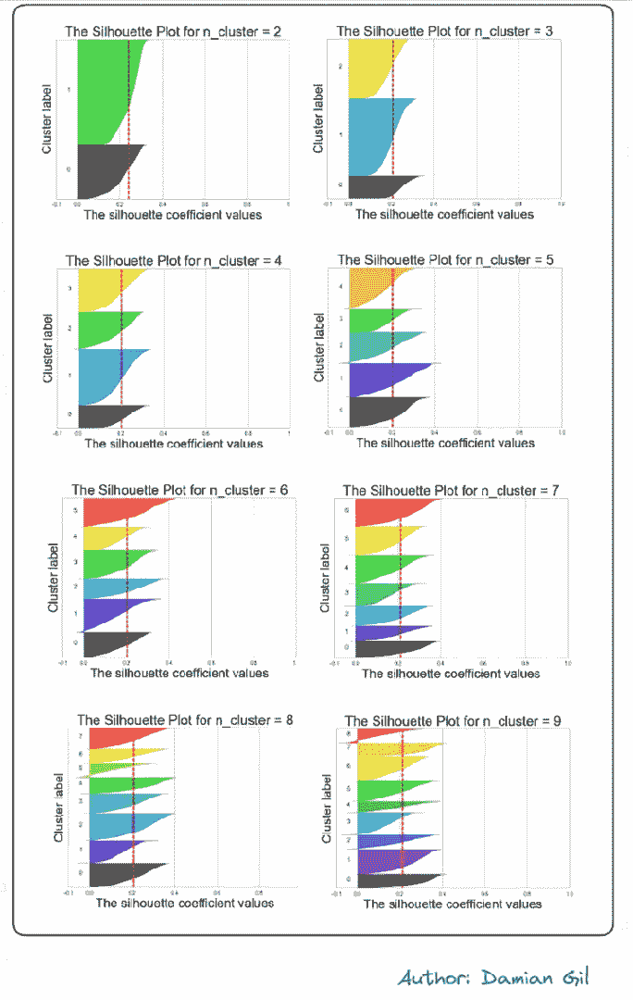

如何理解这些表示并非本博的的最终目标，似乎也无法确定哪个k值是最好的，在查看了所有表示后，可以选取k=5或k=6。

> 因为对于不同的簇聚类，它们的Silhouette得分高于平均值，并且没有不平衡的聚类。此外，在某些情况下，市场营销部门可能对拥有最小数量的聚类/类型的客户感兴趣（这种情况可能发生，也可能不发生）。

最后，选用k=5创建Kmeans模型。

```
km = KMeans(n_clusters=5,
init=&#x27;k-means++&#x27;, 
n_init=10,
max_iter=100, 
random_state=42)
clusters_predict = km.fit_predict(data_no_outliers)
&quot;&quot;&quot;
clusters_predict -&gt; array([4, 2, 0, ..., 3, 4, 3])
np.unique(clusters_predict) -&gt; array([0, 1, 2, 3, 4])
&quot;&quot;&quot;
```

## **评估**

评估kmeans比评估其他模型的方法更具开放性，可以用：

+   指标

+   可视化

+   解释（对公司来说非常重要）

可以使用以下代码获取与模型评估相关指标：

```
from sklearn.metrics import silhouette_score
from sklearn.metrics import calinski_harabasz_score
from sklearn.metrics import davies_bouldin_score
```

输出：

```
&quot;&quot;&quot;Davies bouldin score: 1.676769775662788
Calinski Score: 6914.705500337112
Silhouette Score: 0.16729335453305272
&quot;&quot;&quot;
```

如上所示，并没有得到一个非常好的模型Davies分值，这表明聚类之间的距离相当小。

> 这可能是由多个因素造成的，但务请记住，模型的能量是数据；如果数据没有足够的预测能力，就无法获得期望的结果。

> 关于可视化，可以使用PCA方法来降维，使用Pri**nce库实现探索性分析**和降维，还可以使用Sklearn的PCA，它们都如出一辙。

首先，用三维的方法计算主成分，然后获取表示，以下两个函数执行上述功能：

```
import prince
import plotly.express as px
def get_pca_2d(df, predict):
pca_2d_object = prince.PCA(
n_components=2,
n_iter=3,
rescale_with_mean=True,
rescale_with_std=True,
copy=True,
check_input=True,
engine=&#x27;sklearn&#x27;,
random_state=42
)
```

不要过于担忧上述函数，按照下述方法使用它们：

```
pca_3d_object, df_pca_3d = pca_plot_3d(data_no_outliers, clusters_predict)
plot_pca_3d(df_pca_3d, title =&quot;PCA Space&quot;, opacity=1, width_line = 0.1)
print(&quot;The variability is :&quot;, pca_3d_object.eigenvalues_summary)
```

输出：

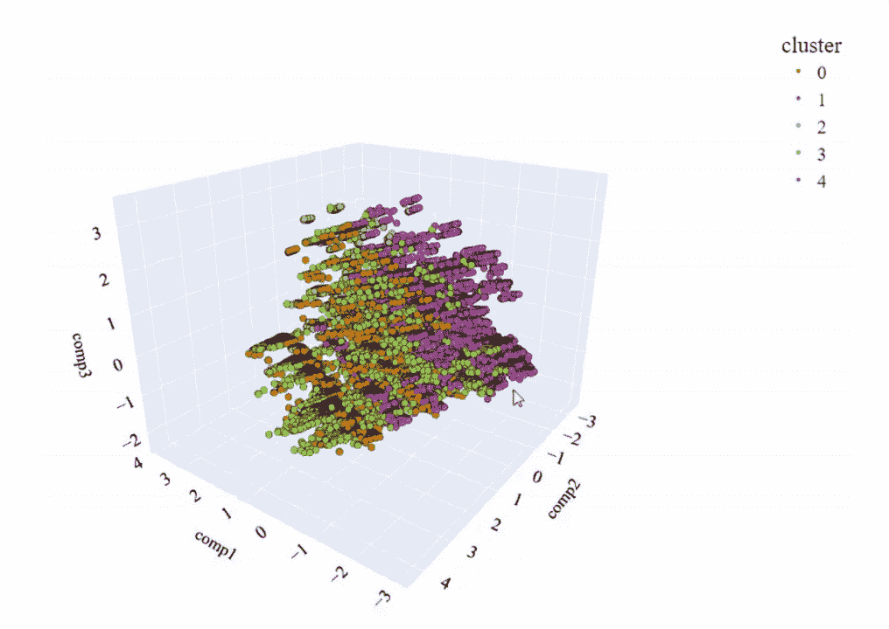

从图中可以看出，聚类间没有得到分离，也没有明确的划分，这与度量指标所提供的信息完全一致。

很少有人会记住主成分分析和特征向量的变化。

假定每个字段中均包含有一定数量的信息，这意味着增加了信息量。如果3个主要成分的累积总和加起来约为80%的离散度，便可以说这是可接受的，在表示中获得的结果良好。如果该数值较低，就应对可视化持保留态度，因为其他特征向量中缺失了大量信息。

**执行PCA的离散度是多少？**

**答案如下：**

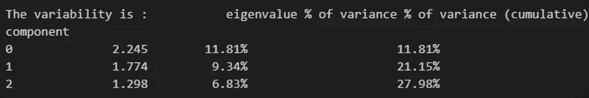

可以看出，前3个成分的离散度为27.98%，这不足以得出合理的结论。

> 当应用主成分分析方法时，由于它是一个线性算法，无法**捕捉到更复**杂的关系。幸运的是，有一种称为t-SNE的方法，它能够捕获复杂的多项式关系，这有助于可视化，使用先前的方法，没有取得太多成功。

如果在电脑上尝试使用**t-SNE**方法，切记它会有更高的计算成本。出于这个原因，对原始数据集进行了采样，但它仍然花了大约5分钟才得出结果。代码如下：

```
from sklearn.manifold import TSNE
sampling_data = data_no_outliers.sample(frac=0.5, replace=True, random_state=1)
sampling_clusters = pd.DataFrame(clusters_predict).sample(frac=0.5, replace=True, random_state=1)[0].values
df_tsne_3d = TSNE(
n_components=3, 
learning_rate=500, 
init=&#x27;random&#x27;, 
perplexity=200, 
n_iter =5000).fit_transform(sampling_data)
df_tsne_3d = pd.DataFrame(df_tsne_3d, columns=[&quot;comp1&quot;, &quot;comp2&quot;,&#x27;comp3&#x27;])
df_tsne_3d[&quot;cluster&quot;] = sampling_clusters
plot_pca_3d(df_tsne_3d, title =&quot;PCA Space&quot;, opacity=1, width_line = 0.1)
```

结果得到了下述图片，它显示出聚类之间有了更清晰的分离，但仍然没有得到完美的结果。

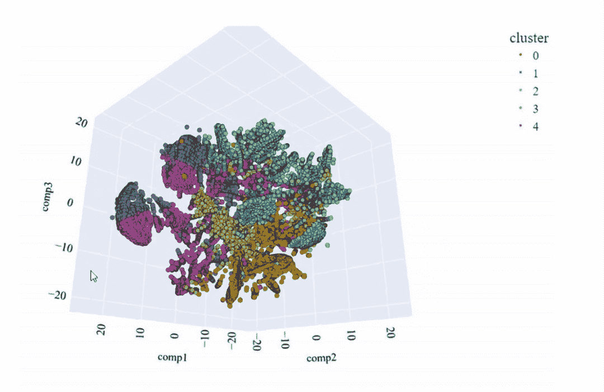

通过在二维空间对PCA和t-SNE进行比较，可以看出，第二种方法的改进比较明显。

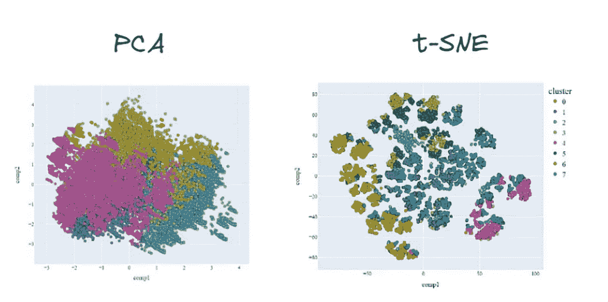

最后，来看看模型是如何工作的？其中哪些特征最为重要？聚类的主要特征又是什么？

> 为了了解每个变量的重要性，在这种情况下使用一**个典型**的**“技巧”，创建**一个分类模型**，其中**“**X”是K-m**eans模型的输入，“y”是Kmeans模型预测的聚类。

所选的模型为 **LGBMClassifier**，该模型非常强大，带有分类变量和数值变量。使用SHAP库训练新模型，可以获得每个特征在预测中的重要程度。代码如下：

```
import lightgbm as lgb
import shap
# We create the LGBMClassifier model and train it
clf_km = lgb.LGBMClassifier(colsample_by_tree=0.8)
clf_km.fit(X=data_no_outliers, y=clusters_predict)
#SHAP values
explainer_km = shap.TreeExplainer(clf_km)
shap_values_km = explainer_km.shap_values(data_no_outliers)
shap.summary_plot(shap_values_km, data_no_outliers, plot_type=&quot;bar&quot;, plot_size=(15, 10))
```

输出：

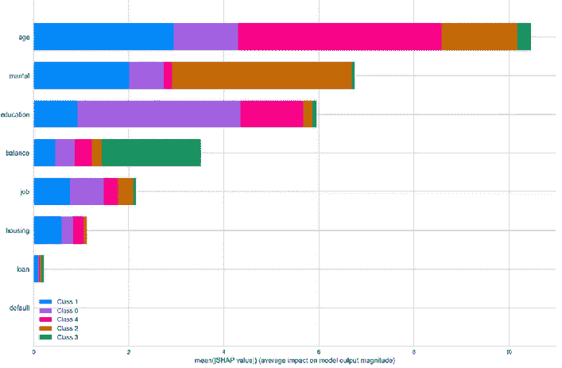

可以看出，特征“年龄”的预测能力最大，同时可以看出，3号聚类（绿色）主要由平衡变量来区分。

最后，必须分析聚类的特征，这部分是企业决策的决定性因素，为此，将获取各个聚类数据集特征的平均值（对于数值变量）和最频繁的值（分类变量）：

```
df_no_outliers = df[df.outliers ==0]
df_no_outliers[&quot;cluster&quot;] = clusters_predict
df_no_outliers.groupby(&#x27;cluster&#x27;).agg(
{
&#x27;job&#x27;: lambda x: x.value_counts().index[0],
&#x27;marital&#x27;: lambda x: x.value_counts().index[0],
&#x27;education&#x27;: lambda x: x.value_counts().index[0],
&#x27;housing&#x27;: lambda x: x.value_counts().index[0],
&#x27;loan&#x27;: lambda x: x.value_counts().index[0],
&#x27;contact&#x27;: lambda x: x.value_counts().index[0],
&#x27;age&#x27;:&#x27;mean&#x27;,
&#x27;balance&#x27;: &#x27;mean&#x27;,
&#x27;default&#x27;: lambda x: x.value_counts().index[0],
}
).reset_index()
```

输出：

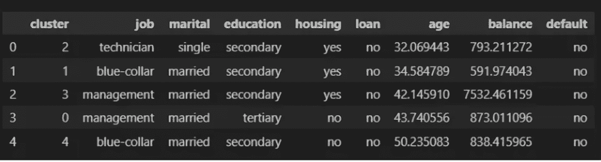

> 可以看出，工作=蓝领的聚类，除了年龄特征外，它们的特征没有很大的不同。这是不可取的，因为很难区分这一聚类中的客户。在工作=经理的案例中，获得了更好的离散度。

**在以不同的方式进**行分析后，得出了一致的结论：“需要改进结果”。

```
import prince
import plotly.express as px


def get_pca_2d(df, predict):

pca_2d_object = prince.PCA(
n_components=2,
n_iter=3,
rescale_with_mean=True,
rescale_with_std=True,
copy=True,
check_input=True,
engine=&#x27;sklearn&#x27;,
random_state=42
)

pca_2d_object.fit(df)

df_pca_2d = pca_2d_object.transform(df)
df_pca_2d.columns = [&quot;comp1&quot;, &quot;comp2&quot;]
df_pca_2d[&quot;cluster&quot;] = predict

return pca_2d_object, df_pca_2d


def get_pca_3d(df, predict):

pca_3d_object = prince.PCA(
n_components=3,
n_iter=3,
rescale_with_mean=True,
rescale_with_std=True,
copy=True,
check_input=True,
engine=&#x27;sklearn&#x27;,
random_state=42
)

pca_3d_object.fit(df)

df_pca_3d = pca_3d_object.transform(df)
df_pca_3d.columns = [&quot;comp1&quot;, &quot;comp2&quot;, &quot;comp3&quot;]
df_pca_3d[&quot;cluster&quot;] = predict

return pca_3d_object, df_pca_3d


def plot_pca_3d(df, title = &quot;PCA Space&quot;, opacity=0.8, width_line = 0.1):

df = df.astype({&quot;cluster&quot;: &quot;object&quot;})
df = df.sort_values(&quot;cluster&quot;)

fig = px.scatter_3d(
df, 
x=&#x27;comp1&#x27;, 
y=&#x27;comp2&#x27;, 
z=&#x27;comp3&#x27;,
color=&#x27;cluster&#x27;,
template=&quot;plotly&quot;,

# symbol = &quot;cluster&quot;,

color_discrete_sequence=px.colors.qualitative.Vivid,
title=title).update_traces(
# mode = &#x27;markers&#x27;,
marker={
&quot;size&quot;: 4,
&quot;opacity&quot;: opacity,
# &quot;symbol&quot; : &quot;diamond&quot;,
&quot;line&quot;: {
&quot;width&quot;: width_line,
&quot;color&quot;: &quot;black&quot;,
}
}
).update_layout(
width = 800, 
height = 800, 
autosize = True, 
showlegend = True,
legend=dict(title_font_family=&quot;Times New Roman&quot;,
font=dict(size= 20)),
scene = dict(xaxis=dict(title = &#x27;comp1&#x27;, titlefont_color = &#x27;black&#x27;),
yaxis=dict(title = &#x27;comp2&#x27;, titlefont_color = &#x27;black&#x27;),
zaxis=dict(title = &#x27;comp3&#x27;, titlefont_color = &#x27;black&#x27;)),
font = dict(family = &quot;Gilroy&quot;, color = &#x27;black&#x27;, size = 15))


fig.show()
```

```
from sklearn.metrics import silhouette_score
from sklearn.metrics import calinski_harabasz_score
from sklearn.metrics import davies_bouldin_score

&quot;&quot;&quot;
The Davies Bouldin index is defined as the average similarity measure 
of each cluster with its most similar cluster, where similarity 
is the ratio of within-cluster distances to between-cluster distances.

The minimum value of the DB Index is 0, whereas a smaller 
value (closer to 0) represents a better model that produces better clusters.
&quot;&quot;&quot;
print(f&quot;Davies bouldin score: {davies_bouldin_score(data_no_outliers,clusters_predict)}&quot;)

&quot;&quot;&quot;
Calinski Harabaz Index -&gt; Variance Ratio Criterion.

Calinski Harabaz Index is defined as the ratio of the 
sum of between-cluster dispersion and of within-cluster dispersion.

The higher the index the more separable the clusters.
&quot;&quot;&quot;
print(f&quot;Calinski Score: {calinski_harabasz_score(data_no_outliers,clusters_predict)}&quot;)


&quot;&quot;&quot;
The silhouette score is a metric used to calculate the goodness of 
fit of a clustering algorithm, but can also be used as 
a method for determining an optimal value of k (see here for more).

Its value ranges from -1 to 1.
A value of 0 indicates clusters are overlapping and either
the data or the value of k is incorrect.

1 is the ideal value and indicates that clusters are very 
dense and nicely separated.
&quot;&quot;&quot;
print(f&quot;Silhouette Score: {silhouette_score(data_no_outliers,clusters_predict)}&quot;)
```

```
from sklearn.metrics import davies_bouldin_score, silhouette_score, silhouette_samples
import matplotlib.cm as cm

def make_Silhouette_plot(X, n_clusters):
plt.xlim([-0.1, 1])
plt.ylim([0, len(X) + (n_clusters + 1) * 10])
clusterer = KMeans(n_clusters=n_clusters, max_iter = 1000, n_init = 10, init = &#x27;k-means++&#x27;, random_state=10)
cluster_labels = clusterer.fit_predict(X)
silhouette_avg = silhouette_score(X, cluster_labels)
print(
&quot;For n_clusters =&quot;, n_clusters,
&quot;The average silhouette_score is :&quot;, silhouette_avg,
)
# Compute the silhouette scores for each sample
sample_silhouette_values = silhouette_samples(X, cluster_labels)
y_lower = 10
for i in range(n_clusters):
ith_cluster_silhouette_values = sample_silhouette_values[cluster_labels == i]
ith_cluster_silhouette_values.sort()
size_cluster_i = ith_cluster_silhouette_values.shape[0]
y_upper = y_lower + size_cluster_i
color = cm.nipy_spectral(float(i) / n_clusters)
plt.fill_betweenx(
np.arange(y_lower, y_upper),
0,
ith_cluster_silhouette_values,
facecolor=color,
edgecolor=color,
alpha=0.7,
)
plt.text(-0.05, y_lower + 0.5 * size_cluster_i, str(i))
y_lower = y_upper + 10
plt.title(f&quot;The Silhouette Plot for n_cluster = {n_clusters}&quot;, fontsize=26)
plt.xlabel(&quot;The silhouette coefficient values&quot;, fontsize=24)
plt.ylabel(&quot;Cluster label&quot;, fontsize=24)
plt.axvline(x=silhouette_avg, color=&quot;red&quot;, linestyle=&quot;--&quot;)
plt.yticks([]) 
plt.xticks([-0.1, 0, 0.2, 0.4, 0.6, 0.8, 1])

range_n_clusters = list(range(2,10))

for n_clusters in range_n_clusters:
print(f&quot;N cluster: {n_clusters}&quot;)
make_Silhouette_plot(data_no_outliers, n_clusters) 
plt.savefig(&#x27;Silhouette_plot_{}.png&#x27;.format(n_clusters))
plt.close()
```

```
import pandas as pd # dataframe manipulation
import numpy as np # linear algebra
# data visualization
import matplotlib.pyplot as plt
import matplotlib.cm as cm
import plotly.express as px
import plotly.graph_objects as go
import seaborn as sns
import shap
# sklearn
from sklearn.cluster import KMeans
from sklearn.preprocessing import PowerTransformer, OrdinalEncoder
from sklearn.pipeline import Pipeline
from sklearn.manifold import TSNE
from sklearn.metrics import silhouette_score, silhouette_samples, accuracy_score, classification_report
from pyod.models.ecod import ECOD
from yellowbrick.cluster import KElbowVisualizer
import lightgbm as lgb
import prince
# Read file
df = pd.read_csv(&quot;train.csv&quot;, sep = &quot;;&quot;)
df = df.iloc[:,0:8]
# Preprocessing part
categorical_transformer_onehot = Pipeline(
steps=[
(&quot;encoder&quot;, OneHotEncoder(handle_unknown=&quot;ignore&quot;, drop=&quot;first&quot;, sparse=False))
])
categorical_transformer_ordinal = Pipeline(
steps=[
(&quot;encoder&quot;, OrdinalEncoder())
])
num = Pipeline(
steps=[
(&quot;encoder&quot;, PowerTransformer())
])
preprocessor = ColumnTransformer(transformers = [
(&#x27;cat_onehot&#x27;, categorical_transformer_onehot, [&quot;default&quot;, &quot;housing&quot;, &quot;loan&quot;, &quot;job&quot;, &quot;marital&quot;]),
(&#x27;cat_ordinal&#x27;, categorical_transformer_ordinal, [&quot;education&quot;]),
(&#x27;num&#x27;, num, [&quot;age&quot;, &quot;balance&quot;])
])
pipeline = Pipeline(
steps=[(&quot;preprocessor&quot;, preprocessor)]
)
pipe_fit = pipeline.fit(df)
data = pd.DataFrame(pipe_fit.transform(df), columns = pipe_fit.get_feature_names_out().tolist())
print(data.columns.tolist())
# OUTPUT
[&#x27;cat_onehot__default_yes&#x27;,
&#x27;cat_onehot__housing_yes&#x27;,
&#x27;cat_onehot__loan_yes&#x27;,
&#x27;cat_onehot__job_blue-collar&#x27;,
&#x27;cat_onehot__job_entrepreneur&#x27;,
&#x27;cat_onehot__job_housemaid&#x27;,
&#x27;cat_onehot__job_management&#x27;,
&#x27;cat_onehot__job_retired&#x27;,
&#x27;cat_onehot__job_self-employed&#x27;,
&#x27;cat_onehot__job_services&#x27;,
&#x27;cat_onehot__job_student&#x27;,
&#x27;cat_onehot__job_technician&#x27;,
&#x27;cat_onehot__job_unemployed&#x27;,
&#x27;cat_onehot__job_unknown&#x27;,
&#x27;cat_onehot__marital_married&#x27;,
&#x27;cat_onehot__marital_single&#x27;,
&#x27;cat_ordinal__education&#x27;,
&#x27;num__age&#x27;,
&#x27;num__balance&#x27;]
```