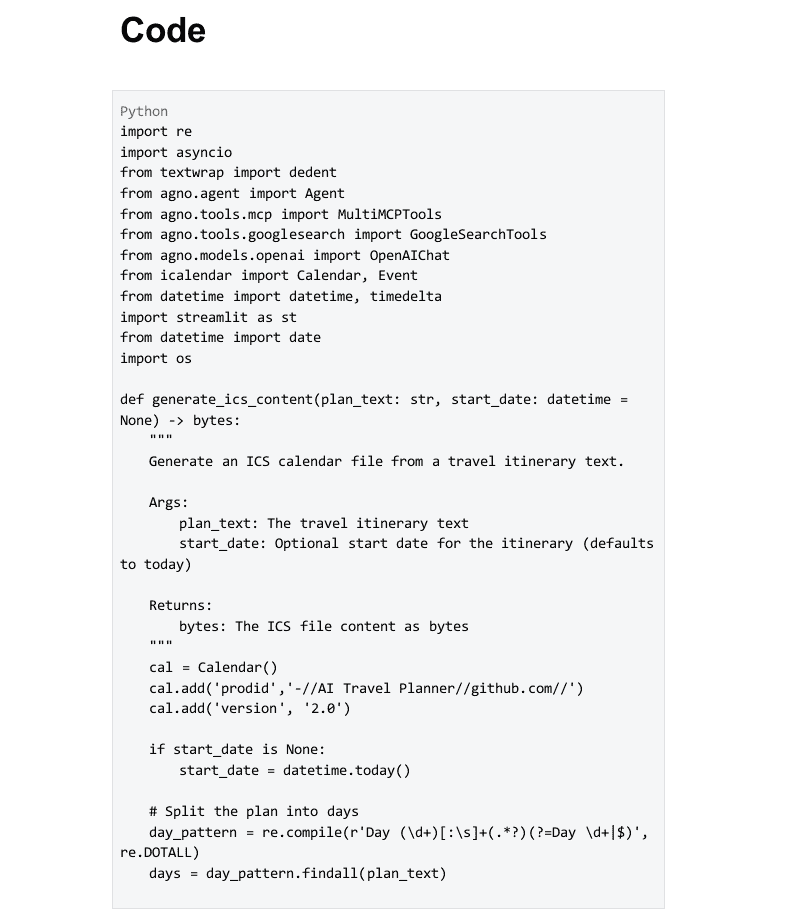
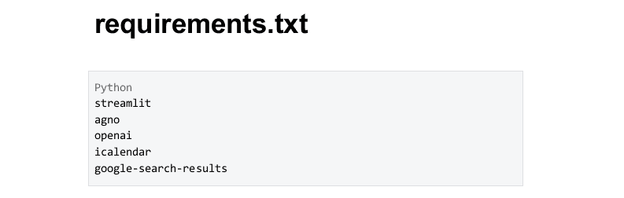

# MCP旅行规划代理团队

> 来源：<https://qqs7y1hozd1.feishu.cn/docx/LD7jdXcOHoUuKAxH72AcrlsCnFf>

> 一款基于 Streamlit 的先进 AI 旅行规划应用程序。它利用多个 MCP 服务器和 Google 地图集成，创建极其详细、个性化的旅行行程。该应用使用 Airbnb MCP 获取真实的住宿数据，并使用自定义的 Google 地图 MCP 进行精确的距离计算和位置服务。

- [Code](https://qqs7y1hozd1.feishu.cn/wiki/P3hlw2BhHifL12kPmZccA1jvnJc)
- [requirements.txt](https://qqs7y1hozd1.feishu.cn/wiki/HD0cw6qO2imDUMk7tkMcffSznLc)



[Code.docx](https://internal-api-drive-stream.feishu.cn/space/api/box/stream/download/all/B6zKb9izcoieq2xbzhQclAavnOb)



[requirements.txt.docx](https://internal-api-drive-stream.feishu.cn/space/api/box/stream/download/all/QO3AbyWwcoNu6hxc3nOcW93DnPf)

## ✨ 功能

### 🤖 AI 驱动的旅行规划

- 超详细行程安排：制定包含具体时间、地址和费用的全面每日行程表
- 距离计算：使用 Google 地图 MCP 计算所有地点之间的精确距离和行程时间
- 实时住宿数据：与爱彼迎 MCP 集成，获取当前定价和房源信息
- 个性化推荐：根据用户偏好和预算限制定制行程

### 🏨 Airbnb MCP 集成

- 真实的住宿房源，提供当前价格和可用性信息
- 物业详情，包括便利设施、客人评价和预订可用性
- 根据位置和偏好筛选的经济实惠的推荐
- 提供实时价格的直接预订信息

### 🗺️ Google 地图 MCP 集成

- 精确计算行程中所有地点之间的距离
- 交通规划中的出行时间估算
- 兴趣点和导航的定位服务
- 对所有推荐地点进行地址验证
- 具备逐向导航的运输优化

### 🔍 谷歌搜索集成

- 当前天气预报及详细的穿衣建议
- 对特定地址、价格范围和评论的餐厅进行研究
- 景点详情，包括开放时间、门票价格和最佳游览时间
- 本地见解和文化信息
- 实用旅行小贴士，包括货币兑换和安全信息

### 📅 附加功能

- 日历导出：将行程下载为 `.ics` 文件，用于 Google 日历、Apple 日历或 Outlook
- 全面成本明细：对所有旅行组成部分进行详细的预算分析
- 缓冲时间规划：在日程安排中包含出行时间和意外延误
- 多种住宿选择：提供 3 种住宿选择，并标注与市中心的距离

## 设置

### 要求

1. API 密钥（两者均需）：
   - [OpenAI API 密钥](https://platform.openai.com/api-keys)：从 OpenAI 平台获取 API 密钥
   - [Google 地图 API 密钥](https://console.cloud.google.com/apis/credentials)：从 Google Cloud 控制台获取 API 密钥
2. Python 3.8+：确保已安装 Python 3.8 或更高版本。
3. MCP 服务器：应用程序会自动连接到：
   - Airbnb MCP 服务器：提供真实的 Airbnb 房源和定价数据
   - 自定义 Google 地图 MCP：支持精确的距离计算和定位服务

### 安装

1. 克隆仓库：

   ```bash
   git clone https://github.com/Shubhamsaboo/awesome-llm-apps.git
   cd awesome-llm-apps/mcp_ai_agents/ai_travel_planner_mcp_agent_team
   ```

2. 安装所需的 Python 包：

   ```bash
   pip install -r requirements.txt
   ```

### 运行应用程序

1. 启动 Streamlit 应用程序：

   ```bash
   streamlit run app.py
   ```

2. 在应用程序界面中：
   - 在侧边栏中输入 OpenAI API 密钥
   - 在侧边栏中输入 Google 地图 API 密钥
   - 指定目的地、旅行时长、预算和偏好
   - 点击“🎯 生成行程”来创建详细旅行计划

3. 可选：将行程下载为日历文件（`.ics`），以便导入 Google 日历、Apple 日历或 Outlook

## 故障排除

### 常见问题与解决方案

- `"错误: [错误信息]"`：检查互联网连接和 API 密钥
- 验证 OpenAI 和 Google 地图 API 密钥是否已正确输入
- 几分钟后再试 - MCP 服务器可能暂时不可用
- 缺少距离信息：Google 地图 MCP 连接问题
- 检查 Google 地图 API 密钥是否有效
- 确保 API 密钥具有地图 API 的必要权限
- 尝试刷新页面并再次输入密钥
- 响应时间慢：MCP 服务器可能需要一些时间来响应
- 应用程序配置了 60 秒的超时时间
- 等待流程完成 - 详细行程需要时间生成
- 网络/防火墙问题：某些企业网络可能会阻止 MCP 连接
- 尝试从不同网络访问
- 如有必要，请使用 VPN
- 如果 MCP 服务器无法访问，应用程序将显示连接错误

### API 密钥问题

- OpenAI API 密钥：确保 OpenAI 账户中有余额，且密钥有效
- Google 地图 API 密钥：确保该密钥已启用地图 API 并正确设置了计费

### 工具状态

应用程序会展示哪些数据源已成功使用：

- 🏨 “您的旅行行程已根据爱彼迎数据准备就绪！” = 爱彼迎 MCP 已成功连接
- 📝 “使用常识提供住宿建议” = Airbnb MCP 失败，使用常识作为备用方案

该应用程序旨在可靠运行！即使 MCP 连接失败，它也会使用可用工具和信息生成全面的行程安排。

## 项目结构

```
├── app.py              # Main Streamlit application with MCP integration
├── requirements.txt    # Python dependencies
└── README.md          # This documentation
```

## 工作原理

AI 旅行规划代理团队采用复杂的多步骤流程来创建极其详细的旅行行程：

### 🤖 AI 智能体架构

- GPT-4o 模型：凭借先进的推理能力为智能旅行规划提供支持
- 多 MCP 集成：结合 Airbnb 和 Google 地图 MCP 服务器以获取实时数据
- 谷歌搜索工具：提供当前天气、评论和本地洞察
- 直接响应生成：无需询问澄清问题即可创建完整行程

## 英文版

### 🌍 MCP Travel Planner Agent Team

A sophisticated Streamlit-based AI travel planning application that creates extremely detailed, personalized travel itineraries using multiple MCP servers and Google Maps integration. The app uses Airbnb MCP for real accommodation data and a custom Google Maps MCP for precise distance calculations and location services.

### ✨ Features

#### 🤖 AI-Powered Travel Planning

- Extremely Detailed Itineraries: Creates comprehensive day-by-day schedules with specific timing, addresses, and costs
- Distance Calculations: Uses Google Maps MCP to calculate precise distances and travel times between all locations
- Real-Time Accommodation Data: Integrates with Airbnb MCP for current pricing and availability
- Personalized Recommendations: Customizes itineraries based on user preferences and budget constraints

#### 🏨 Airbnb MCP Integration

- Real accommodation listings with current pricing and availability
- Property details including amenities, guest reviews, and booking availability
- Budget-conscious recommendations filtered by location and preferences
- Direct booking information with real-time rates

#### 🗺️ Google Maps MCP Integration

- Precise distance calculations between all locations in the itinerary
- Travel time estimates for transportation planning
- Location services for points of interest and navigation
- Address verification for all recommended places
- Transportation optimization with turn-by-turn guidance

#### 🔍 Google Search Integration

- Current weather forecasts with detailed clothing recommendations
- Restaurant research with specific addresses, price ranges, and reviews
- Attraction details including opening hours, ticket prices, and best visiting times
- Local insights and cultural information
- Practical travel tips including currency exchange and safety information

#### 📅 Additional Features

- Calendar Export: Download your itinerary as a `.ics` file for Google Calendar, Apple Calendar, or Outlook
- Comprehensive Cost Breakdown: Detailed budget analysis for all trip components
- Buffer Time Planning: Includes travel time and unexpected delays in scheduling
- Multiple Accommodation Options: Provides 3 accommodation choices with distances from city center

### Setup

#### Requirements

1. API Keys (Both Required):
   - OpenAI API Key: Get your API key from OpenAI Platform
   - Google Maps API Key: Get your API key from Google Cloud Console
2. Python 3.8+: Ensure you have Python 3.8 or higher installed.
3. MCP Servers: The app automatically connects to:
   - Airbnb MCP Server: Provides real Airbnb listings and pricing data
   - Custom Google Maps MCP: Enables precise distance calculations and location services

#### Installation

1. Clone this repository:

   ```bash
   git clone https://github.com/Shubhamsaboo/awesome-llm-apps.git
   cd awesome-llm-apps/mcp_ai_agents/ai_travel_planner_mcp_agent_team
   ```

2. Install the required Python packages:

   ```bash
   pip install -r requirements.txt
   ```

#### Running the App

1. Start the Streamlit app:

   ```bash
   streamlit run app.py
   ```

2. In the app interface:
   - Enter your OpenAI API key in the sidebar
   - Enter your Google Maps API key in the sidebar
   - Specify your destination, trip duration, budget, and preferences
   - Click "🎯 Generate Itinerary" to create your detailed travel plan

3. Optional: Download your itinerary as a calendar file (`.ics`) for import into Google Calendar, Apple Calendar, or Outlook

### Troubleshooting

#### Common Issues & Solutions

- "Error: [error message]": Check your internet connection and API keys
- Verify both OpenAI and Google Maps API keys are entered correctly
- Try again in a few minutes - the MCP servers may be temporarily unavailable
- Missing distance information: Google Maps MCP connection issue
- Check your Google Maps API key validity
- Ensure your API key has the necessary permissions for Maps API
- Try refreshing the page and entering the keys again
- Slow response times: MCP servers can take time to respond
- The app has a 60-second timeout configured
- Wait for the process to complete - detailed itineraries take time to generate
- Network/Firewall issues: Some corporate networks may block MCP connections
- Try from a different network
- Use a VPN if necessary
- The app will show connection errors if MCP servers are unreachable

#### API Key Issues

- OpenAI API Key: Make sure you have credits in your OpenAI account and the key is valid


+ Google Maps API Key: Ensure the key has Maps API enabled and proper billing setup

## Tool Status

The app will show you which data sources were successfully used:

+ 🏨 "Your travel itinerary is ready with Airbnb data!" = Airbnb MCP connected successfully

+ 📝 "Used general knowledge for accommodation suggestions" = Airbnb MCP failed, using general knowledge as fallback

The app is designed to work reliably! Even if MCP connections fail, it will generate comprehensive itineraries using available tools and information.

## Project Structure

```
├── app.py              # Main Streamlit application with MCP integration
├── requirements.txt    # Python dependencies
└── README.md          # This documentation
```

## How It Works

The AI Travel Planner Agent Team uses a sophisticated multi-step process to create extremely detailed travel itineraries:

### 🤖 AI Agent Architecture

+ GPT-4o Model: Powers the intelligent travel planning with advanced reasoning capabilities

+ Multi-MCP Integration: Combines Airbnb and Google Maps MCP servers for real-time data

+ Google Search Tools: Provides current weather, reviews, and local insights

+ Direct Response Generation: Creates complete itineraries without asking clarifying questions
