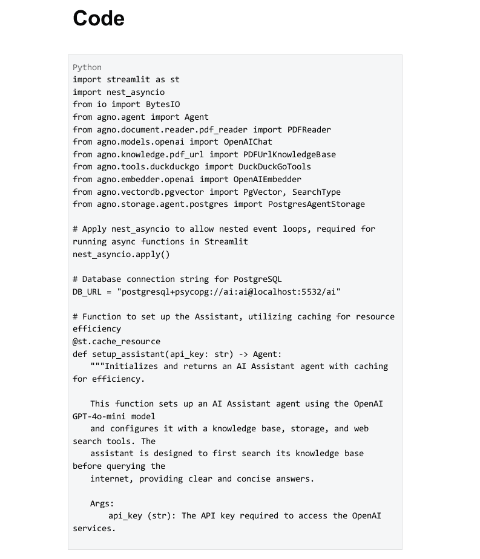
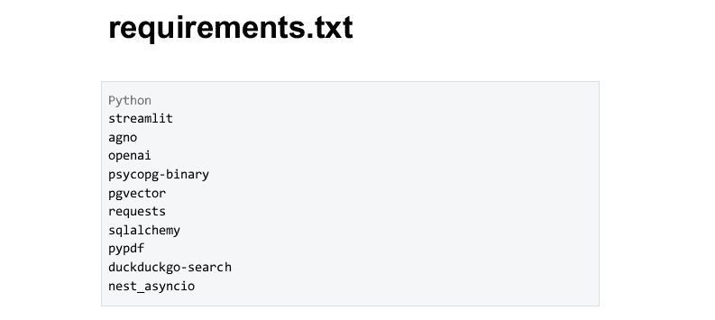

# 🤖 AutoRAG：结合GPT-4o和向量数据库的自主RAG

> 来源：[https://qqs7y1hozd1.feishu.cn/docx/CRGqdUqUZo7KTNxNQAnc1WQOnzg](https://qqs7y1hozd1.feishu.cn/docx/CRGqdUqUZo7KTNxNQAnc1WQOnzg)

## 🤖 AutoRAG：结合GPT-4o和向量数据库的自主RAG

> **这个Streamlit应用程序实**现了一个自主检索增强生成（RAG）系统。

> 使用OpenAI的GPT-4o模型和PgVector数据库，它允许用户上传PDF文档，将其添加到知识库中，并结合知识库和网络搜索的上下文向AI助手提问。

[Code](https://qqs7y1hozd1.feishu.cn/wiki/QkalwXi9CiKtc5kLezXcfinDn1g)

[requirements.txt](https://qqs7y1hozd1.feishu.cn/wiki/VqVHwPNPqiA7jYkLimRc7hPvnIh)



[Code (1).docx](https://internal-api-drive-stream.feishu.cn/space/api/box/stream/download/all/Jf4XbliKWovJ7QxktwrchLgbnps)



[requirements.txt (1).docx](https://internal-api-drive-stream.feishu.cn/space/api/box/stream/download/all/S1tOb9ttCorAhZxwRzfcukVTn0f)

### 功能

+   与AI助手交互的聊天界面

+   PDF文档上传与处理

+   使用PostgreSQL和Pgvector进行知识库集成

+   使用 DuckDuckGo 的网络搜索功能

+   持久存储助手数据和对话

### 如何开始？

##### 克隆GitHub仓库

**git clone ：**[**仓库**](https://github.com/Shubhamsaboo/awesome-llm-apps.git)

cd awesome-llm-apps/rag_tutorials/autonomous_rag

##### 安装所需依赖项：

pip install -r requirements.txt

##### 确保PgVector数据库正在运行：

应用程序期望PgVector在[**localhost:5532**](http://localhost:5532/)上运行。如果你的设置不同，请调整代码中的配置。

```
docker run -d \
  -e POSTGRES_DB=ai \
 -e POSTGRES_USER=ai \
  -e POSTGRES_PASSWORD=ai \
 -e PGDATA=/var/lib/postgresql/data/pgdata \
  -v pgvolume:/var/lib/postgresql/data \
 -p 5532:5432 \
 --name pgvector 
  phidata/pgvector:16
```

##### 运行Streamlit应用程序

streamlit run autorag.py

# 🤖 AutoRAG: Autonomous RAG with GPT-4o and Vector Database

This Streamlit application implements an Autonomous Retrieval-Augmented Generation (RAG) system using OpenAI's GPT-4o model and PgVector database. It allows users to upload PDF documents, add them to a knowledge base, and query the AI assistant with context from both the knowledge base and web searches. Features

### Freatures

+   Chat interface for interacting with the AI assistant

+   PDF document upload and processing

+   Knowledge base integration using PostgreSQL and Pgvector

+   Web search capability using DuckDuckGo

+   Persistent storage of assistant data and conversations

### How to get Started?

1.  Clone the GitHub repository

git clone https://github.com/Shubhamsaboo/awesome-llm-apps.git

cd awesome-llm-apps/rag_tutorials/autonomous_rag

1.  Install the required dependencies:

pip install -r requirements.txt

1.  Ensure PgVector Database is running: Th[e app expects ](http://localhost:5532/)PgVector to be running on localhost:5532. Adjust the configuration in the code if your setup is different.

docker run -d \

-e POSTGRES_DB=ai \

-e POSTGRES_USER=ai \

-e POSTGRES_PASSWORD=ai \

-e PGDATA=/var/lib/postgresql/data/pgdata \

-v pgvolume:/var/lib/postgresql/data \

-p 5532:5432 \

--name pgvector \

phidata/pgvector:16

1.  Run the Streamlit App

streamlit run autorag.py