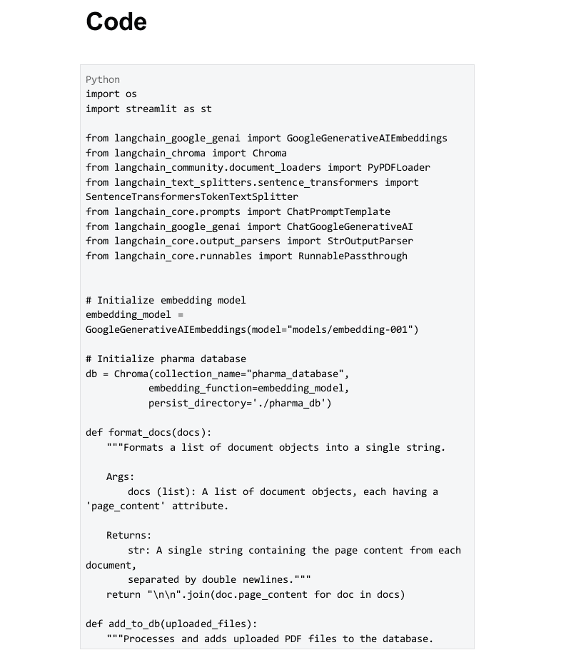
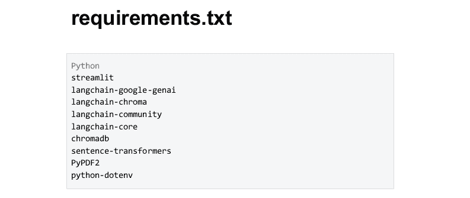

# PharmaQuery

> 来源：[https://qqs7y1hozd1.feishu.cn/docx/RAIBd6Yf4ohiDExO8nVcucbKnhh](https://qqs7y1hozd1.feishu.cn/docx/RAIBd6Yf4ohiDExO8nVcucbKnhh)

## PharmaQuery

## 概述

> PharmaQuery是一款先进的制药洞察检索系统。

> 旨在帮助用户从制药领域的研究论文和文档中获取有价值的见解。

[Code](https://qqs7y1hozd1.feishu.cn/wiki/WUmhw9v31i3gIfkkY5ucJaignHe)

[requirements.txt](https://qqs7y1hozd1.feishu.cn/wiki/JaYCwoY8ciPcshkHekGcF2U9nHf)

[Code (5).docx](https://internal-api-drive-stream.feishu.cn/space/api/box/stream/download/all/OuKsbZYeeoNHBKx1K62c5tyAntb)

[requirements.txt (5).docx](https://internal-api-drive-stream.feishu.cn/space/api/box/stream/download/all/TKVnbFdO0oPiONxATGJcPq2snXc)

## 功能

+   **自然语言查询：**询问有关制药行业的复杂问题，并获得简洁、准确的答案。

+   **自定义数据库：**上传您自己的研究文档，以增强检索系统的知识库。

+   **相似性搜索：**使用AI嵌入技术为您的查询检索最相关的文档。

+   **Streamlit界面：**用户友好的查询和文档上传界面。

## 使用的技术

+   编程语言：[Python 3.10+](https://www.python.org/downloads/release/python-31011/)

+   框架：[LangChain](https://www.langchain.com/)

+   数据库：[ChromaDB](https://www.trychroma.com/)

+   模型：

+   嵌入向量：谷歌Gemini API（embedding-001）

+   聊天：谷歌双子星API（gemini-1.5专业版）

+   PDF处理：[PyPDFLoader](https://python.langchain.com/docs/integrations/document_loaders/pypdfloader/)

+   文档拆分器：[句子转换器令牌文本拆分器](https://python.langchain.com/api_reference/text_splitters/sentence_transformers/langchain_text_splitters.sentence_transformers.SentenceTransformersTokenTextSplitter.html)

## 要求

##### 安装依赖项：

pip install -r requirements.txt

##### 运行应用程序：

streamlit run app.py

##### 使用应用程序：

+   在侧边栏中粘贴您的 Google API 密钥。

+   在主界面中输入您的查询。

+   您也可以选择在侧边栏上传研究论文，以增强数据库。

# PharmaQuery

## Overview

PharmaQuery is an advanced Pharmaceutical Insight Retrieval System designed to help users gain meaningful insights from research papers and documents in the pharmaceutical domain.

## Features

+   Natural Language Querying: Ask complex questions about the pharmaceutical industry and get concise, accurate answers.

+   Custom Database: Upload your own research documents to enhance the retrieval system's knowledge base.

+   Similarity Search: Retrieves the most relevant documents for your query using AI embeddings.

+   Streamlit Interface: User-friendly interface for queries and document uploads.

## Technologies Used

+   [Programming ](https://www.python.org/downloads/release/python-31011/)Language: Python 3.10+

+   Framework: [LangChain](https://www.langchain.com/)

+   Database: [ChromaDB](https://www.trychroma.com/)

+   Models:

+   Embeddings: Google Gemini API (embedding-001)

+   Chat: Google Gemini API (gemini-1.5-pro)

+   [PDF Process](https://python.langchain.com/docs/integrations/document_loaders/pypdfloader/)ing: PyPDFLoader

+   [Document Splitter](https://python.langchain.com/api_reference/text_splitters/sentence_transformers/langchain_text_splitters.sentence_transformers.SentenceTransformersTokenTextSplitter.html): SentenceTransformersTokenTextSplitter

## Requirements

1.  Install Dependencies:

1.  pip install -r requirements.txt

1.  Run the Application:

1.  streamlit run app.py

1.  Use the Application:

+   Paste your Google API Key in the sidebar.

+   Enter your query in the main interface.

+   Optionally, upload research papers in the sidebar to enhance the database.