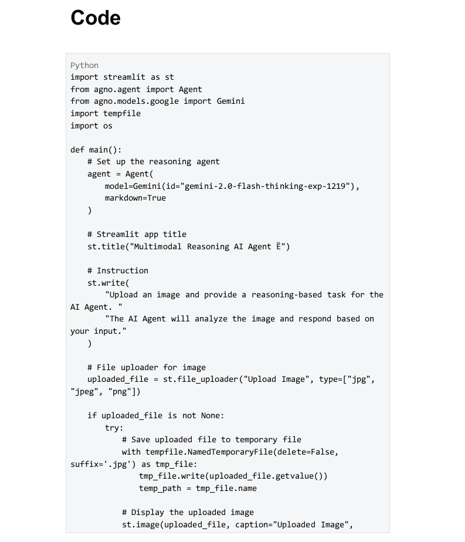

# 🧬多模态AI智能体

> 来源：[https://qqs7y1hozd1.feishu.cn/docx/FdxudxF2zonLSBxPSYlcZDEgnmf](https://qqs7y1hozd1.feishu.cn/docx/FdxudxF2zonLSBxPSYlcZDEgnmf)

## 🧬多模态AI智能体

> 一款结合视频分析和网络搜索功能的Streamlit应用程序。

> 该智能体可以分析上传的视频，使用谷歌的Gemini 2.0模型，并通过结合视觉理解和网络搜索来回答问题。

[Code](https://qqs7y1hozd1.feishu.cn/wiki/VvNkwfPFLi33TgkSIakcek7kn41)

[requirements.txt](https://qqs7y1hozd1.feishu.cn/wiki/TtmVwIXhYiVSTnkAIO5ctamrnsd)

[Code (9).docx](https://internal-api-drive-stream.feishu.cn/space/api/box/stream/download/all/WEYTb8o9PoxFx7xwKBqcfIaOnqd)

[requirements.txt (9).docx](https://internal-api-drive-stream.feishu.cn/space/api/box/stream/download/all/ZHTcb9YVjoE9RQxTGK1cSmzEnNe)

### 特性

+   使用Gemini 2.0 Flash进行视频分析

+   通过 DuckDuckGo 集成网络研究

+   支持多种视频格式（MP4、MOV、AVI）

+   实时视频处理

+   视觉与文本综合分析

### 如何开始？

##### 克隆GitHub仓库

**git clone **[**仓库**](https://github.com/Shubhamsaboo/awesome-llm-apps.git)

cd ai_agent_tutorials/multimodal_ai_agent

##### 安装所需依赖项：

pip install -r requirements.txt

##### 获取您的Google Gemini API密钥

注册一个Google AI Studio账户并获取你的API密钥。

##### 将您的Gemini API密钥设置为环境变量

GOOGLE_API_KEY=your_api_key_here

##### 运行Streamlit应用程序

streamlit run multimodal_agent.py

## 🧬 Multimodal AI Agent

A Streamlit application that combines video analysis and web search capabilities using Google's Gemini 2.0 model. This agent can analyze uploaded videos and answer questions by combining visual understanding with web-search.

### Features

+   Video analysis using Gemini 2.0 Flash

+   Web research integration via DuckDuckGo

+   Support for multiple video formats (MP4, MOV, AVI)

+   Real-time video processing

+   Combined visual and textual analysis

### How to get Started?

1.  Clone the GitHub repository

git clone https://github.com/Shubhamsaboo/awesome-llm-apps.git

cd ai_agent_tutorials/multimodal_ai_agent

1.  Install the required dependencies:

pip install -r requirements.txt

1.  Get your Google Gemini API Key

+   Sign up for an Google AI Studio account and obtain your API key.

1.  Set up your Gemini API Key as the environment variable

GOOGLE_API_KEY=your_api_key_here

1.  Run the Streamlit App

streamlit run multimodal_agent.py