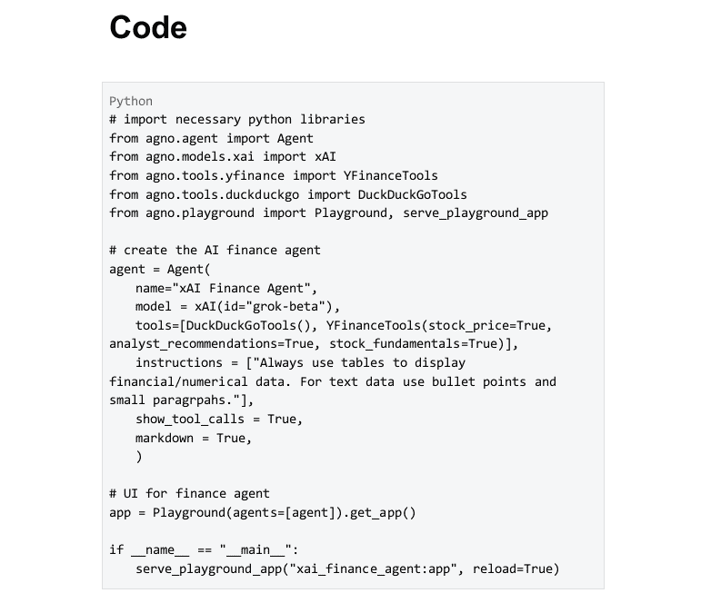
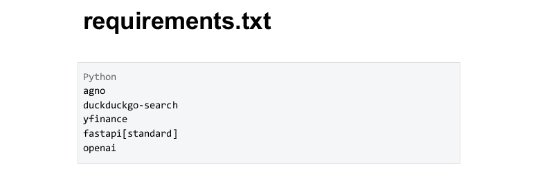

# 📊 AI金融Agent与xAI Grok

> 来源：[https://qqs7y1hozd1.feishu.cn/docx/Ln04dp09uoXX3JxaLegcFHyenLc](https://qqs7y1hozd1.feishu.cn/docx/Ln04dp09uoXX3JxaLegcFHyenLc)

## 📊 AI金融代理与xAI Grok

> 通过交互式的实验场界面提供结构化的金融洞察。

> 此应用程序创建了一个由xAI的Grok模型驱动的金融分析代理，将实时股票数据与网络搜索功能相结合。

[Code](https://qqs7y1hozd1.feishu.cn/wiki/TJZ5wtIuQijuiSksPPIczLTynj9)

[requirements.txt](https://qqs7y1hozd1.feishu.cn/wiki/OyDWw7j9SisGqKkgJWmcaxFinAc)

[Code (11).docx](https://internal-api-drive-stream.feishu.cn/space/api/box/stream/download/all/V7HlbmMzMoEg0SxCOKocjt1qnoG)

[requirements.txt (11).docx](https://internal-api-drive-stream.feishu.cn/space/api/box/stream/download/all/Mv7WbEYIHoFhfvxqylgcU5UVnod)

### 特性

+   由xAI的Grok-beta模型提供支持

+   通过YFinance进行实时股票数据分析

+   通过 DuckDuckGo 实现的网络搜索功能

+   带有表格的格式化输出，用于呈现财务数据

+   交互式游乐场界面

### 如何开始？

##### 克隆GitHub仓库

**git clone **[**仓库**](https://github.com/Shubhamsaboo/awesome-llm-apps.git)

cd awesome-llm-apps/ai_agent_tutorials/xai_finance_agent

##### 安装所需的依赖项：

cd awesome-llm-apps/ai_agent_tutorials/xai_finance_agent

pip install -r requirements.txt

##### 获取你的OpenAI API密钥

+   注册[xAI API账户](https://console.x.ai/)

+   设置你的XAI_API_KEY环境变量。

export XAI_API_KEY='your-api-key-here'

##### 管理AI智能体团队

python xai_finance_agent.py

##### 打开网络浏览器

导航到控制台输出中提供的 URL，通过游乐场界面与 AI 金融代理进行交互。

## 📊 AI Finance Agent with xAI Grok

This application creates a financial analysis agent powered by xAI's Grok model, combining real-time stock data with web search capabilities. It provides structured financial insights through an interactive playground interface.

### Features

+   Powered by xAI's Grok-beta model

+   Real-time stock data analysis via YFinance

+   Web search capabilities through DuckDuckGo

+   Formatted output with tables for financial data

+   Interactive playground interface

### How to get Started?

1.  Clone the GitHub repository

git clone https://github.com/Shubhamsaboo/awesome-llm-apps.git

cd awesome-llm-apps/ai_agent_tutorials/xai_finance_agent

1.  Install the required dependencies:

cd awesome-llm-apps/ai_agent_tutorials/xai_finance_agent

pip install -r requirements.txt

1.  Get your OpenAI API Key

+   Sign up for an [xAI API account](https://console.x.ai/)

+   Set your XAI_API_KEY environment variable.

export XAI_API_KEY='your-api-key-here'

1.  Run the team of AI Agents

python xai_finance_agent.py

1.  Open your web browser and navigate to the URL provided in the console output to interact with the AI financial agent through the playground interface.