# 大语言模型的预训练，微调，强化学习

> 来源：[https://qqs7y1hozd1.feishu.cn/docx/WkiwdOfEKoTVz5x58wLcGnsAn9c](https://qqs7y1hozd1.feishu.cn/docx/WkiwdOfEKoTVz5x58wLcGnsAn9c)

拆解一下LLM的基本原理——完整展示这些模型是如何构建、训练和微调，最终成为我们今天所使用的AI大模型的。

## **一、大模型训练的步骤**

从整体上看，训练LLM主要包括两个关键阶段：预训练（Pre-training）后训练（Post-training）：微调、RL和RLHF。

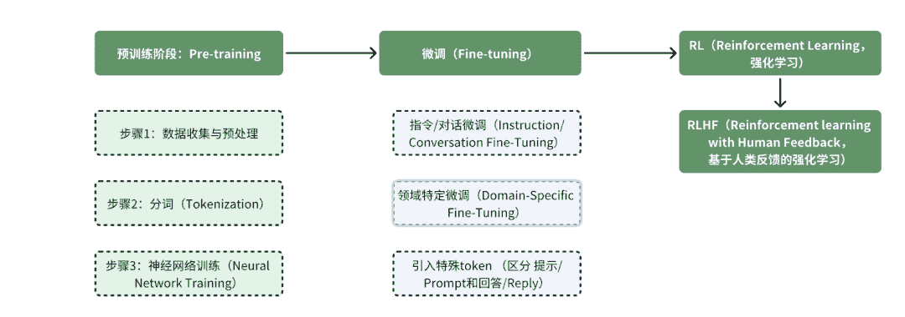

上述流程整合了预训练、微调、RLHF等阶段，适用于自然语言处理和多模态大模型：

#### 1.**数据准备**

• **数据收集**：根据目标领域收集海量无标注数据（预训练）或少量标注数据（微调）。

• **清洗与增强**：去除噪声、重复项，进行分词/标准化（文本）或裁剪/旋转（图像）。

• **划分数据集**：预训练无需标注；微调需划分训练集/验证集/测试集（比例通常为8:1:1）。

#### 2.预训练（Pre-training）

• **模型架构选择**：如Transformer（文本）、ViT（图像）或混合架构（多模态）。

• **训练策略**：

◦ 无监督学习：掩码语言建模（BERT）、自回归生成（GPT）。

◦ 分布式训练：使用GPU/TPU集群加速，如Megatron-LM框架。

#### 3.任务适配：微调（Fine-tuning）

• **方法选择**：

◦ **全量微调**：调整所有参数，适合数据充足场景（如金融风控）。

◦ **参数高效微调（PEFT）**：

◦ **LoRA**：低秩矩阵分解，减少90%训练参数。

◦ **Adapter**：插入小型网络模块，保持原模型权重。

• **优化目标**：最小化任务损失函数（如交叉熵损失）。

#### 4.**强化学习优化（RL/RLHF）**

• **奖励模型训练**：用人类标注的偏好数据（如答案质量排序）训练奖励模型（Reward Model）。

• **策略优化**：

◦ **RL**：通过环境反馈（如游戏得分）调整策略，无需人类干预。

◦ **RLHF**：结合奖励模型和PPO算法优化模型输出，例如提升对话流畅度。

• **关键步骤**：KL散度惩罚防止模型偏离原始分布。

#### 5.**评估与调优**

• **指标选择**：准确率、BLEU（文本生成）、ROUGE（摘要）或人工评估（复杂任务）。

• **过拟合处理**：

◦ 正则化：Dropout、权重衰减。

◦ 早停法（Early Stopping）。

#### 6.**部署与监控**

• **模型压缩**：量化（INT8/INT4）、剪枝，降低推理成本。

• **持续学习**：根据用户反馈（如日志分析）进行在线微调。

**关键步骤区别与适用场景**

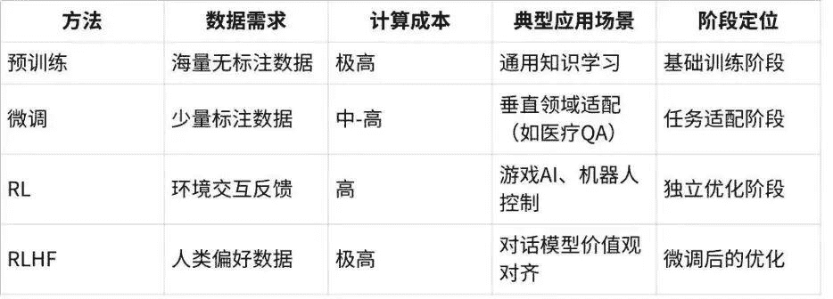

接下来我们详细的介绍下每一个步骤的详细内容。

## 二、预训练（Pre-training）

**为什么需要预训练？**

预训练是为了让模型在见到特定任务数据（比如生成文本）之前，先通过学习大量通用数据来捕获广泛有用的特征，熟悉语言的工作方式，从而提升模型在目标任务上的表现和泛化能力，而这一过程就是预训练——一个极其计算密集的任务。

预训练技术通过从大规模未标记数据中学习通用特征和先验知识。

减少对标记数据的依赖，加速并优化在有限数据集上的模型训练。

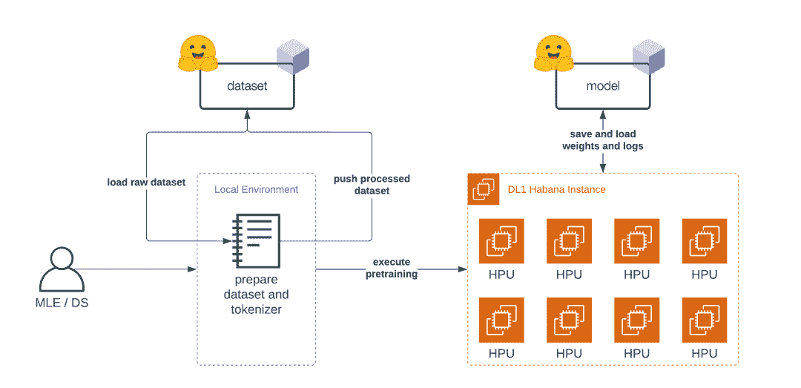

为什么要用大量未标记的数据做预训练呢？

1）**数据稀缺性**：

> 在现实世界的应用中，收集并标注大量数据往往是一项既耗时又昂贵的任务。

> 特别是在某些专业领域，如医学图像识别或特定领域的文本分类，标记数据的获取更是困难重重。

2）**先验知识问题**：

> 在深度学习中，模型通常从随机初始化的参数开始学习。

> 然而，对于许多任务来说，具备一些基本的先验知识或常识会更有帮助。

预训练模型通过在大规模数据集上进行训练，已经学习到了许多有用的先验知识，如语言的语法规则、视觉的底层特征等。这些先验知识为模型在新任务上的学习提供了有力的支撑。

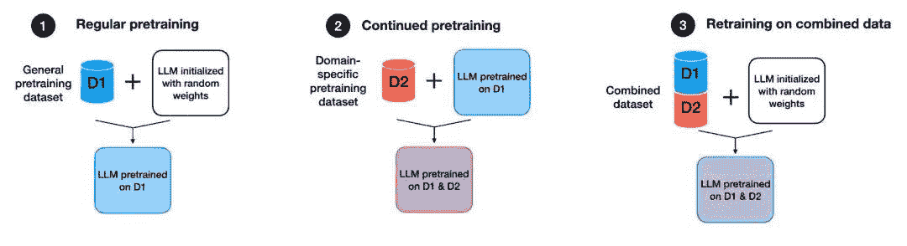

预训练是语言模型学习的初始阶段。在预训练期间，模型会接触大量未标记的文本数据，例如书籍、文章和网站。目标是捕获文本语料库中存在的底层模式、结构和语义知识。

**本阶段大模型主要学习的方式是：**

**无监督学习：**预训练通常是一个无监督学习过程，模型在没有明确指导或标签的情况下从未标记的文本数据中学习。

**屏蔽语言建模：**模型经过训练可以预测句子中缺失或屏蔽的单词、学习上下文关系并捕获语言模式。

**具体的执行步骤如下：**

### **步骤1：数据收集与预处理**

训练LLM的第一步是收集尽可能多的高质量文本数据。目标是创建一个庞大且多样化的数据集，涵盖广泛的人类知识。

**一个常见的数据来源是Common Crawl，包**含过去18年间约2500亿个网页的数据。

> 原始网页数据往往比较嘈杂——其中包含垃圾信息、重复内容和低质量文本，因此数据预处理至关重要。

FineWeb提供了一个整理后的Common Crawl版本，并已在Hugging Face上公开可用。

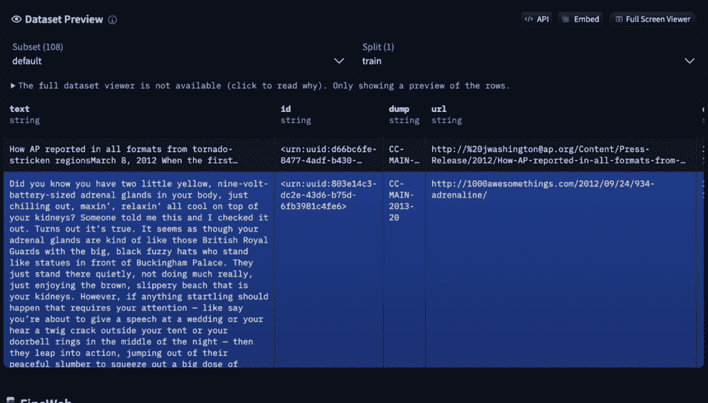

一旦文本语料库经过清理，就可以进行分词（Tokenization）处理。

### 步骤2：分词（Tokenization）

在神经网络处理文本之前，文本必须先转换为数值形式。这一过程就是分词，它将单词、子词或字符映射为唯一的数值token。

可以把token想象成构建语言模型的基本单元——所有语言模型的核心组件。在GPT-4中，可能的token数量为100277个。

**一个常见的分词工具是Tiktokenizer，允许进行分词实验**，并查看文本是如何被拆解为token的。

可以尝试输入一句话，看看每个单词或子词是如何被分配一系列数值ID的。

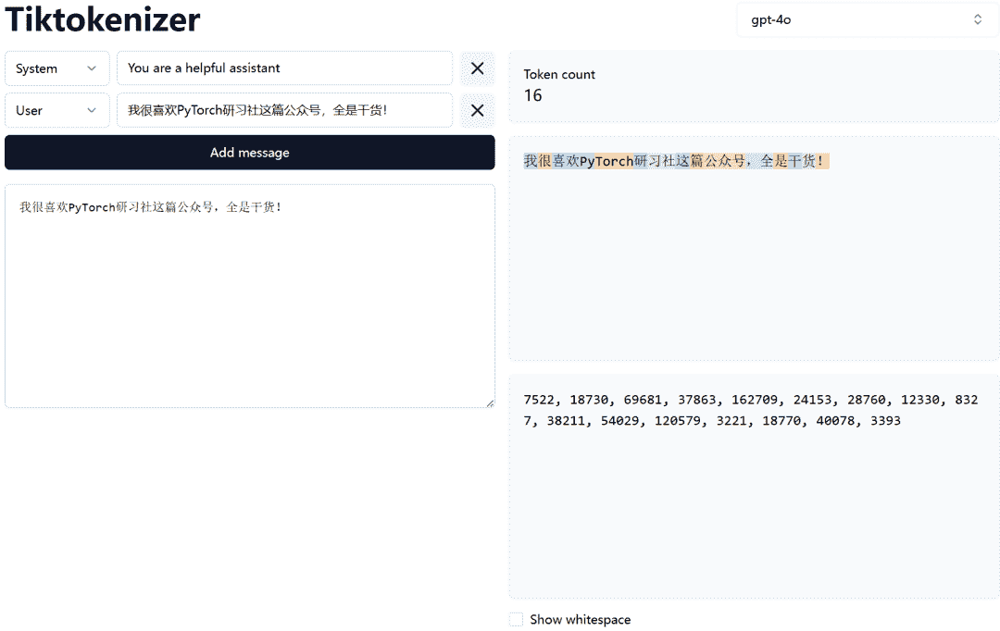

### 步骤3：神经网络训练（Neural Network Training）

**一旦文本被分词处理，神经网络就**会学习根据上下文预测下一个token。

**模型会接收一串输**入token（例如“我正在烹饪”），然后通过一个庞大的数学表达式——即模型的架构（如:Transformer）——进行处理，以预测下一个token。

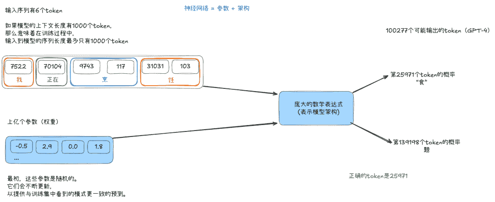

一个神经网络主要由两个关键部分组成：

1）参数（参数权重，Weights）：

> 通过训练学习得到的数值，用于表达每一个Token的具体语义，比如是否是动词/名称、是动物/植物等。

> 维度越多越能够精准的描述一个token，但是参数都增多算量会指数级增长，所以需要在准确率和算量之间找到平衡。

2）架构（数学表达式，Architecture）：

> 定义输入token如何被处理以生成输出的结构。

> 比如现在最常用的架构就是Transformer架构。

最初，模型的预测是随机的，但随着训练的进行，它逐渐学会为下一个token分配概率。

**当**正确的token（例如“食”）被识别后，模型会通过反向传播（Backpropagation）来调整数十亿个参数（权重）。

这个过程会在海量数据集上重复数十亿次。

预训练通常采用基于 Transformer 的架构，擅长捕获远程依赖关系和上下文信息。

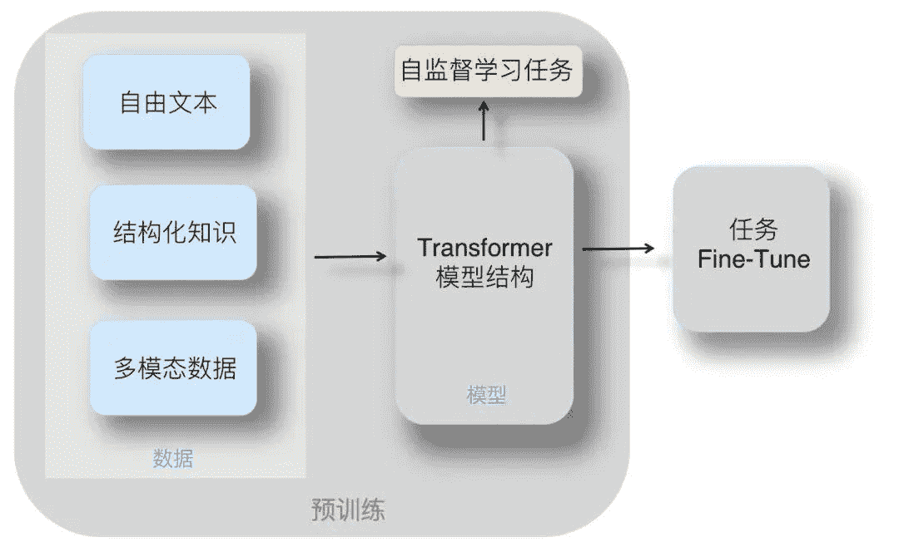

基础模型（Base Model）：预训练的产物

在这一阶段，基础模型已经学会了：

• 单词、短语和句子之间的关联

•  训练数据中的统计模式

然而，基础模型并未针对真实世界任务进行优化。你可以将其类比为一个高级自动补全系统——它能够基于概率预测下一个token，但缺乏良好的指令跟随能力。

基础模型有时会逐字复述训练数据，并且可以通过上下文学习（In-Context Learning）进行特定应用，即在提示（Prompt）中提供示例来引导模型的响应。但为了让模型真正有用且可靠，它还需要进一步训练。

## **三、后训练（Post-Traini**ng）/ 微调（Fine-tuning）

基**础模型是未经打磨的。为了让它更**加实用、可靠、安全，需要进行后训练（Post-Training），即在更小、更专业的数据集上进行微调（Fine-tuning）。

### **为什么需要微调？**

尽管预训练模型已经在大规模数据集上学到了丰富的通用特征和先验知识，但这些特征和知识可能并不完全适用于特定的目标任务。

**微调**通过在新任务的少量标注数据上进一步训练预训练模型，使模型能够学习到与目标任务相关的特定特征和规律，从而更好地适应新任务。

1）模型微调可以更好地利用预训练模型的知识，加速和优化新任务的训练过程，同时减少对新数据的需求和降低训练成本。

**2）减少对新数据的需求：**从头开始训练一个大型神经网络通常需要大量的数据和计算资源，而在实际应用中，我们可能只有有限的数据集。

**3）降低训练成本：**由于我们只需要调整预训练模型的部分参数，而不是从头开始训练整个模型，因此可以大大减少训练时间和所需的计算资源。

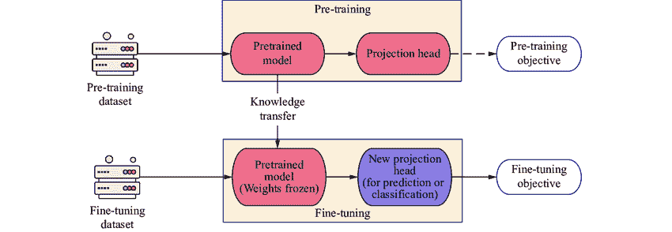

由于神经网络无法像传统软件那样被显式编程，我们只能通过训练它来“编程”它，即让它学习有结构的、带标注的数据集，这些数据代表了理想的交互示例。

### **微调的技术原理是什么？**

在预训练模型的基础上，针对特定任务或数据领域。

通过在新任务的小规模标注数据集上进一步训练和调整模型的部分或全部参数，使模型能够更好地适应新任务，提高在新任务上的性能。

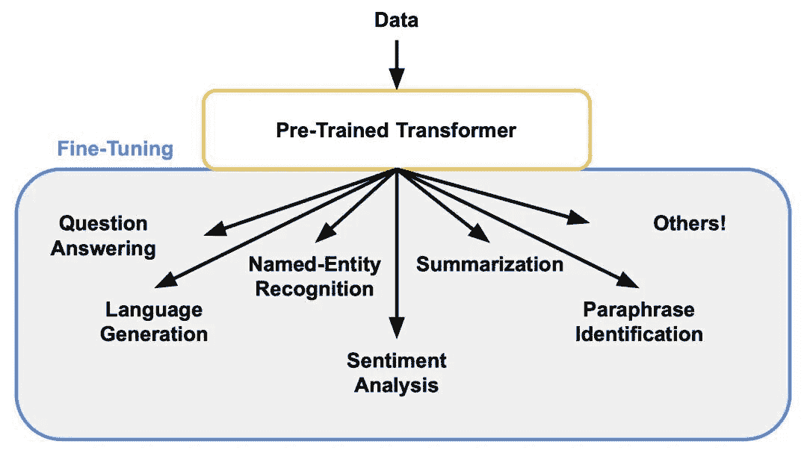

**在小规模标注数据集上进一步训练**

**微调发方式：**问题回答、语言生成、命名实体识别、释义识别、摘要、情绪分析、其他

### **微调如何分类？**

微调分为在新任务数据集上全面或基于人类反馈的监督训练（SFT与RLHF），以及调整模型全部或部分参数以高效适应新任务（Full Fine-tuning与PEFT）

**这种方式通常使用预训练模型作为基础，并在新任**务的小规模标注数据集上进行进一步的训练。

> 这种训练过程可以根据具体的训练方法和目标细分为不同的策略，如监督微调（Supervised Fine-tuning, SFT）和基于人类反馈的强化学习微调（Reinforcement Learning with Human Feedback, RLHF）。

#### 监督微调（Supervised Fine-tuning, SFT）

**定义：**在新任务的小规模标注数据集上，使用有监督学习的方法对预训练模型进行微调，以使其适应新任务。

**步骤：**加载预训练模型 → 准备新任务的数据集 → 调整模型输出层 → 在新任务数据集上训练模型。

应用：适用于那些有明确标注数据集的任务，如文本分类、命名实体识别等。

1.**指令/对话微调（Instruction/Conve**rsation Fine-Tuning）

**本质：**准备好相关问题，并准备好标准答案，让模型进行学习。

**目标：**让模型学会遵循指令、执行任务、进行多轮对话、遵守安全规范、拒绝恶意请求等。

**训练使用的数据主要来源于两个方面**：一是人工进行标注，二是通过类似ChatGPT这样的模型自动生成训练数据。 后者减少了人工构建数据集的成本，也能够更快地生成大量的训练样例。

2.领域特定微调（Domain-Specific Fine-Tuning）

目标：使模型适应特定**领域，如医学、**法律、编程等。

此外，后训练还会引入特殊token——这些token在预训练阶段并未使用，它们有助于模型理解交互的结构。这些token可以标记用户输入的起始与结束，以及AI响应的起始位置，确保模型能够正确区分提示（Prompt）和回答（Reply）。

### RL（Reinforcement Learning）强化学习

现在，深入探讨下一个主要阶段：**R**L（Reinforcement Learning，强化学习），本质上来说RL也属于微调（Fine tunning）阶段。尽管预训练和SFT已经是成熟的方法，但RL仍在不断发展，并且已成为训练流程中的关键环节。

##### **RL基础回顾**

快速回顾一下典型RL设置的关键组成部分：

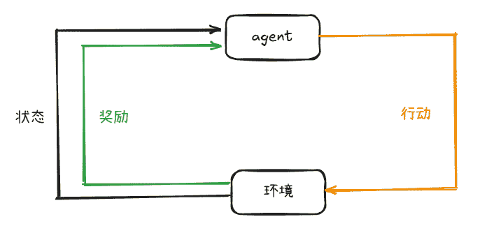

1）Agent（智能体） 学习者或决策者。它观察当前的状态（state），选择一个动作（action），然后根据结果（reward）更新其行为。

2）Environment（环境）智能体所操作的外部系统。

3）State（状态）在给定时间步t的环境快照。

在每个时间戳，agent在环境中执行一个动作，该动作将环境的状态改变为新的状态。智能体还会收到反馈，表明该动作的好坏。这个反馈称为奖励（reward），并以数字形式表示。正奖励鼓励该行为，负奖励则不鼓励该行为。

##### **价值函数**

估计处于某个状态下的好坏程度，考虑长期期望奖励。对于LLM（大语言模型）而言，奖励可能来自人类反馈或奖励模型。

##### **Actor-Critic架构**

这是一个流行的强化学习设置，结合了两个组件：

**Actor（演员）**学习并更新策略（πθ），决定在每个状态下应该采取哪个动作。

**Critic（评论者）**评估价值函数（V(s)），为演员提供反馈，告知其选择的动作是否导致了好的结果。

**工作原理：**

演员基于当前策略选择一个动作。

评论者评估结果（奖励 + 下一个状态）并更新其价值估计。

评论者的反馈帮助演员优化策略，使未来的动作能够获得更高的奖励。

##### **将其与LLM结合**

状态可以是当前的文本（提示或对话），而动作则是生成的下一个token（词或子词）。奖励模型（例如人类反馈）告诉模型它生成的文本是好是坏。

策略是模型选择下一个token的策略，而价值函数则估计当前文本上下文在最终生成高质量响应方面的有益程度。

## 四、RLHF（基于人工反馈的强化学习）

**定义**：RLHF（Reinforcement learning with Human Feedback，基于人工反馈的强化学习）是在SFT的基础上，通过强化学习和人类反馈来进一步微调模型，使其输出更加符合人类的偏好或期望。

**步骤**：首先进行**SFT → 收集人类反馈数据 → 训练奖励模型 → **使用奖励模型指导强化学习过程来微调模型。

**应用：**适用于那些需要高度人类判断或创造力的任务，如对话生成、文本摘要等。这一部分比较复杂。

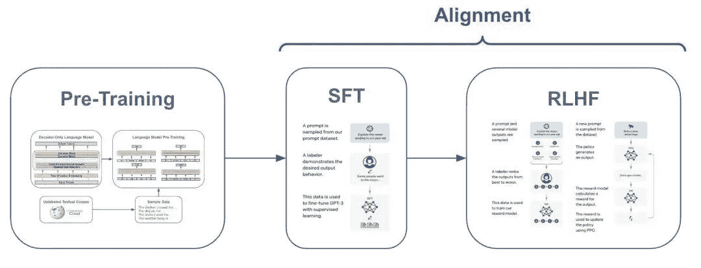

对于具有可验证输出的任务（例如数学问题、事实问答），AI的回答可以轻松评估。但对于像总结或创意写作这样没有单一“正确”答案的领域，如何处理呢？

**这就是人工反馈的**作用所在——但是天真的强化学习（RL）方法是不可扩展的。

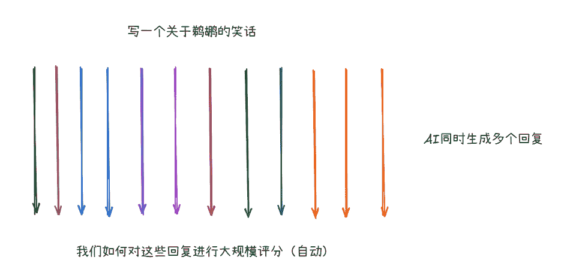

用一些任意数字来看一下朴素的方法。

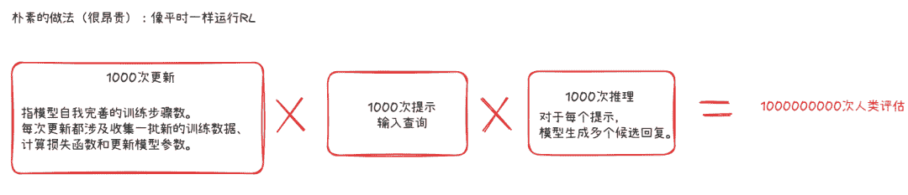

这需要十亿次人工评估！这太昂贵、缓慢且不可扩**展。因此，一个更**智能的解决方案是训练一个AI“奖励模型”来学习人类的偏好，从而大大减少人工工作量。

### **训练奖励模型形成过程**

#### **（1）训练数据（人工排序数据）**

奖励模型的训练数据通常由人工标注人员对模型输出进行排序生成。在训练过程中，标注人员会根据多个生成回答的质量进行排序，而不是为每个答案打分。

**数据格式：**

```

//基于比较的数据格式
{
    &quot;input&quot;: &quot;用户输入的文本&quot;,
    &quot;choices&quot;: [
        {&quot;text&quot;: &quot;候选输出 1&quot;, &quot;rank&quot;: 1},
        {&quot;text&quot;: &quot;候选输出 2&quot;, &quot;rank&quot;: 2}
    ]
}
//基于评分的数据格式
{
    &quot;input&quot;: &quot;用户输入的文本&quot;,
    &quot;output&quot;: &quot;生成模型的输出文本&quot;,
    &quot;score&quot;: 4.5
}
```

奖励模型的输入包括：

**输入文本**：用户给定的提示或问题，作为上下文。

**输出文本**：生成模型的候选答案，用于评估质量。

**上下文和候选文本拼接**：奖励模型通常会将 input（上下文）和每个 choice（候选文本）进行拼接，然后输入到模型中。这样，模型就能够理解生成文本与上下文之间的关系，并基于该关系来评估生成文本的质量。

**下面是一个简单的例子：**

```

Plain Text
//原始数据
{
    &quot;input&quot;: &quot;What is the capital of France?&quot;,
    &quot;choices&quot;: [
        {&quot;text&quot;: &quot;The capital of France is Paris.&quot;, &quot;rank&quot;: 1},
        {&quot;text&quot;: &quot;The capital of France is Berlin.&quot;, &quot;rank&quot;: 3},
        {&quot;text&quot;: &quot;Paris is the capital of France.&quot;, &quot;rank&quot;: 2}
    ]
}
//应输入到模型的数据
[Input] What is the capital of France? [SEP] The capital of France is Paris.
[Input] What is the capital of France? [SEP] The capital of France is Berlin.
[Input] What is the capital of France? [SEP] Paris is the capital of France.
```

#### **（2）上下文建模**

奖**励模型会基于 T**ransformer（如 BERT、RoBERTa）等架构对整个拼接后的文本进行编码处理。对于每个候选文本，模型会生成一个上下文感知的表示，其中考虑了 input 和该候选 choice 之间的语义关系。

#### **（3）计算得分或排序**

**回归任务**：如果任务是回归类型的（例如预测一个分数），奖励模型会为每个候选文本生成一个预测的质量分数。

**排序任务**：如果任务是基于排序（例如选择哪个候选文本质量更好），奖励模型会通过对所有候选文本进行打分，计算并比较它们的得分，确保高质量文本的得分高于低质量文本。

#### **（4）损失函数**

在训练过程中，模型会通过比较候选文本的预测得分与实际的标签（排名或评分）之间的差异来计算损失，并进行反向传播优化：

**回归任务**使用均方误差（MSE）损失来最小化预测分数与真实评分之间的差距。

**排序任务**通常使用对比损失（Contrastive Loss）或者排名损失（例如 Hinge Loss），优化模型以便正确排序候选文本。

#### **RLHF框架的核心组件**

基于人类反馈的强化学习（Reinforcement Learning from Human Feedback，RLHF）是一种将强化学习与人类反馈结合的方法，旨在优化模型的行为和输出，使其更加符合人类的期望。

通过引入人类反馈作为奖励信号指导模型更好地理解和满足人类的偏好，生成更自然、更符合人类意图的输出。

#### **RLHF的优点：**

可以应用于任何领域，包括创意写作、诗歌、总结以及其他开放性任务。

对输出进行排名比人工标签生成创意输出更容易。

#### **RLHF的缺点：**

奖励模型是近似的——它可能无法完美反映人类的偏好。

RL擅长利用奖励模型的漏洞——如果运行时间过长，模型可能会利用这些漏洞，生成荒谬的输出但仍获得高分。

### RLHF与Transformer架构是如何协同工作的

**RLHF**/RL微调技术与Transformer的协作可分为三个阶段，其中Transformer承担生成和特征提取任务，RLHF/RL负责策略优化与偏好对齐。

**具体流程如下：**

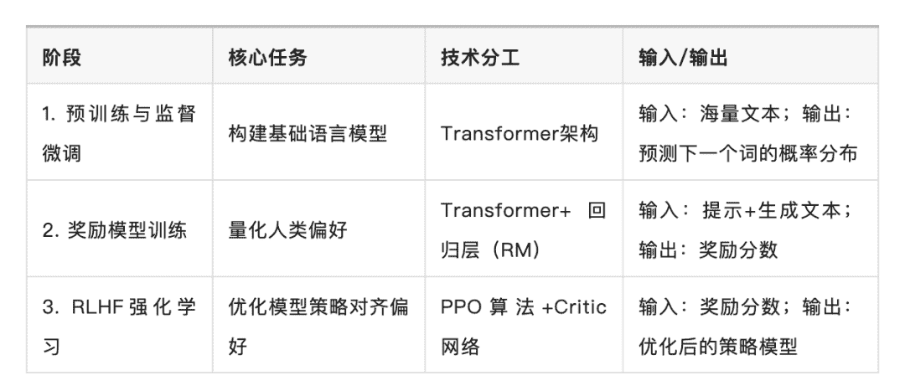

#### 第一步：预训练与监督微调（Transformer主导）

• 目标：训练一个具备基础语言能力的Transformer模型。

• 步骤：

1）**无监督预训练**：

◦ 输入：大规模未标注文本（如网页、书籍等）。

◦ 输出：预训练模型（如GPT-3、Llama），通过预测下一个词的概率分布完成自监督学习。

◦ 技术分工：Transformer架构通过自注意力机制捕捉长距离依赖关系。

2）**监督微调（SFT）**：

◦  输入：人工标注的<提示, 理想回答>对数据集。

◦ 输出：微调后的模型（SFT模型），能生成符合指令的响应。◦

◦ 技术分工：在预训练模型基础上，通过交叉熵损失函数调整参数。

#### 第二步：奖励模型训练（RLHF主导，基于Transformer）

**• 目标：**构建一个量化人类偏好的奖励模型（Reward Model, RM）。

**• 步骤： **

1）**数据收集**：

◦ 输入：通过SFT模型生成多个候选回答，人工对回答质量进行排序或评分。

2）**模型构建**：

◦ 输入：基于SFT模型架构，替换最后一层为回归层（输出标量奖励）。

◦ 输出：奖励模型（RM），对任意<提示, 回答>对输出奖励分数。

3）**训练目标**：◦ 损失函数：最小化人类偏好排序的负对数似然损失，例如对比学习损失。

4）**技术分工**：◦ Transformer作为特征提取器，RM通过强化学习框架学习人类偏好模式。

#### 第三步：RLHF强化学习优化（RL主导，结合Transformer）

• 目标：通过奖励信号优化策略模型（Policy Model），使其生成更符合人类偏好的文本。

• 步骤：

1）**策略初始化**：

◦ 输入：SFT模型作为初始策略（Actor）。

2）**生成响应**：

◦ 输入：用户提示（Prompt）。

◦ 输出：生成多个候选回答（由Transformer完成）。

3）**奖励计算**：

◦ 输入：候选回答通过RM生成奖励分数。

◦ 输出：每个回答的标量奖励值。

3）**策略优化（PPO）**：

◦ 输入：奖励分数 + KL散度约束（防止偏离SFT模型太远）。

◦ 输出：更新后的策略模型参数。

**4）技术流程： **

◦ Actor（策略模型）：基于Transformer生成回答。

◦ Critic（价值函数）：预测部分生成序列的预期累积奖励（基于Transformer架构）。

◦ 优势计算：通过GAE（Generalized Advantage Estimation）平衡偏差与方差。

◦ 参数更新：最大化奖励的同时约束策略变化幅度（PPO-Clip算法）。

####  汇总步骤如下：

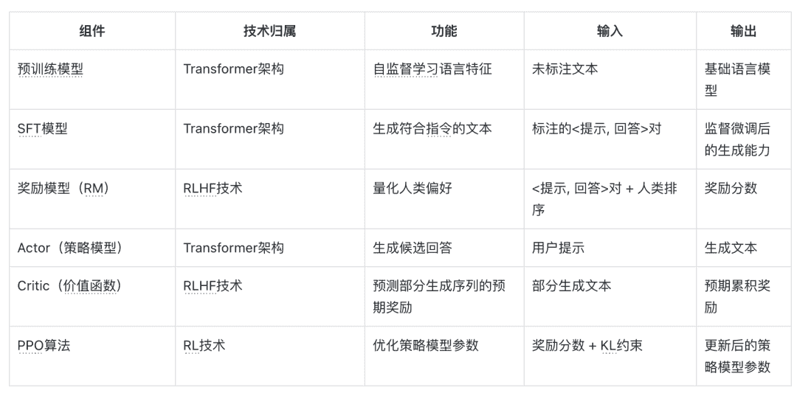

### 技术协作示例

**场景**：用户提问“如何泡茶？”

1.  **Transformer生成**：Actor模型（基于Transformer）生成多个候选回答（如步骤列表、简答等）。

1.  **奖励评分**：RM模型（基于Transformer+回归层）对每个回答打分（如安全性、有用性）。

1.  **策略优化**：PPO算法根据奖励分数调整Actor模型参数，提升未来生成优质回答的概率。

## **五、调整模型的部分或全部参数**

这种方式更加关注于模型参数层面的调整，根据是否调整全部参数，可以细分为全面微调（Full Fine-tuning）和部分/参数高效微调（Parameter-Efficient Fine-tuning, PEFT）。

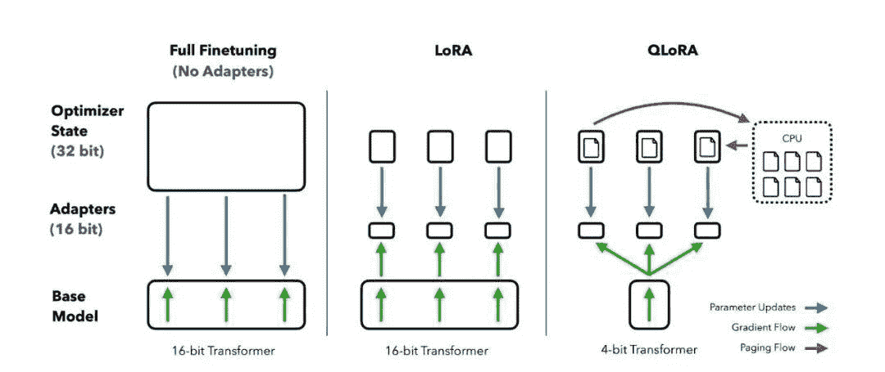

### Full Fine-tuning or PEFT

#### 1.全面微调（Full Fine-tuning）

定义：在新任务上调整模型的全部参数，以使其完全适应新任务。

步骤：加载预训练模型 → 在新任务数据集上训练模型，调整所有参数。

应用**：当新任务与预训练任务差异较大，或者想要充**分利用新任务数据集时，可以选择全面微调。

#### 2.部分/参数高效微调（PEFT）

**定义：**仅调整模型的部分参数，如添加一些可训练的适配器（adapters）、前缀（prefixes）或微调少量的参数，以保持模型大部分参数不变的同时，实现对新任务的适应。

**步骤：**加载预训练模型 → 在模型中添加可训练的组件或选择部分参数 → 在新任务数据集上训练这些组件或参数。

**应**用：当计算资源有限，或者想要快速适应新任务而不影响模型在其他任务上的性能时，PEFT是一个很好的选择。

技术：仅调整少量参数或添加额外模块，显著降低计算需求。常见技术包括：

**LoRA（低秩适应）**

通过低秩矩阵分解冻结原权重，仅训练小规模参数，推理时合并矩阵。例如GPT-3微调时参数量减少90%以上。

**Adapter（适配器）**

在模型层间插入小型神经网络模块（如全连接层），仅优化适配器参数。适配器参数量通常为原模型的0.1%-1%。

Prefix-Tuning（前缀调优）

在输入前添加可学习的连续向量（“虚拟Token”），引导模型生成特定输出。适用于生成任务，如文本摘要。

### ** BitFit（偏置项微调**）  仅调整模型中的偏置参数，其余权重冻结。在中小规模数据上表现优异

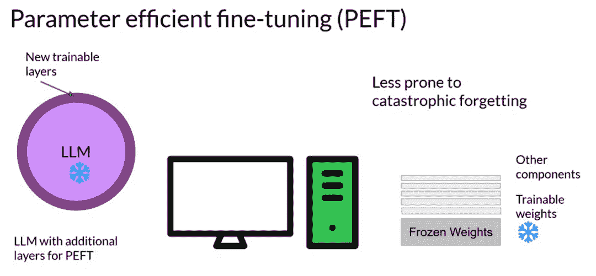

## 六、推理（Inference）——模型如何生成新文本

推理（Inference）可以在任何阶段进行，甚至可以在预训练中途执行，以评估模型的学习效果。

> 当模型接收到一组输入token后，它会根据在训练过程中学到的模式，为所有可能的下一个token分配概率。

> 但模型并非总是选择最可能的token，而是会在概率分布中进行采样——类似于抛掷一个带偏向的硬币，其中高概率的token更有可能被选中。

这个过程会迭代进行，每个新生成的token都会成为下一次预测的输入。

由于token选择是随机的，即使相同的输入也可能产生不同的输出。随着推理的进行，模型可以生成并未直接出现在训练数据中，但符合统计模式的文本。

## 七、幻觉（Hallucinations）——当LLM生成错误信息

幻觉（Hallucination）是指LLM生成虚假或错误的信息。

其根本原因在于：**LLM并不“知道”事实**——它只是根据**训练数据预测最可能的单词序列**。

在早期，LLM的幻觉问题十分严重。

**例如，**在下图的案例中，如果训练数据包含大量类似“谁是…”的问题，并且这些问题都有明确答案，那么模型会学习到：这类查询应该总是有一个自信的回答，即使它并没有相关知识。

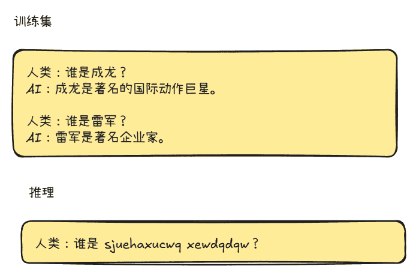

因此，当被问到一个未知人物时，模型不会默认回答“我不知道”，因为这种模式在训练过程中并未被强化。相反，它会基于已有模式生成最可能的猜测，这往往会导致编造的信息。

**如何减少幻觉？**

**方法一：说“我不知道”**

提高事实准确性需要明确地训练模型去识别它不知道的内容——这比看起来要复杂得多。

这是通过自我询问（Self-Interrogation）来完成的，这是一个帮助定义模型知识边界的过程。

自我询问可以通过另一个AI模型来自动化，该模型生成问题以探测知识盲点。如果它生成了错误的答案，就会加入新的训练示例，其中正确的回应是：“我不确定。能否提供更多上下文？”

如果模型在训练中多次看到一个问题，它将为正确答案分配较高的概率。

如果模型以前没有遇到过这个问题，它会在多个可能的token之间更均匀地分配概率，从而使输出更加随机。没有单一token被认为是最可能的选择。

微调显式地训练模型处理低置信度的输出，并用预定义的回答来应对。

> 例如，当我问ChatGPT-4o，“谁是 sjuehaxucwq xewdqdqw?”时，它正确地回应：“我不确定那是谁。能否提供更多上下文？”

**方法二：进行网络搜索**

一种更先进的方法是通过给予模型访问外部搜索工具，从而扩展模型的知识范围，超出其训练数据。

从高层来看，当模型检测到不确定性时，它可以触发一次网络搜索。

然后，搜索结果会被插入到模型的上下文窗口中——本质上允许这些新数据成为模型的工作记忆的一部分。模型在生成响应时会参考这些新信息。