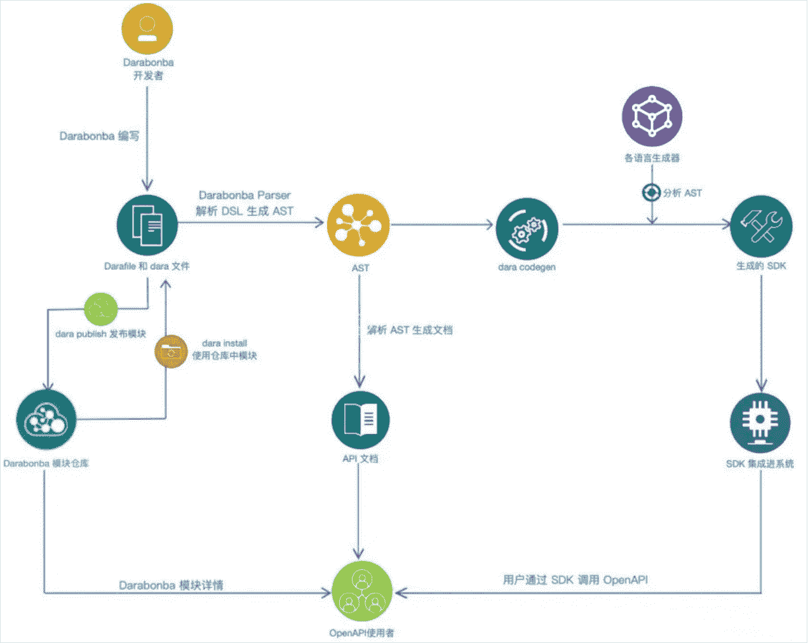
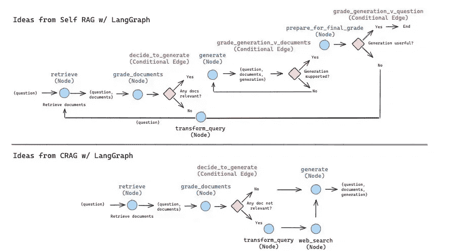
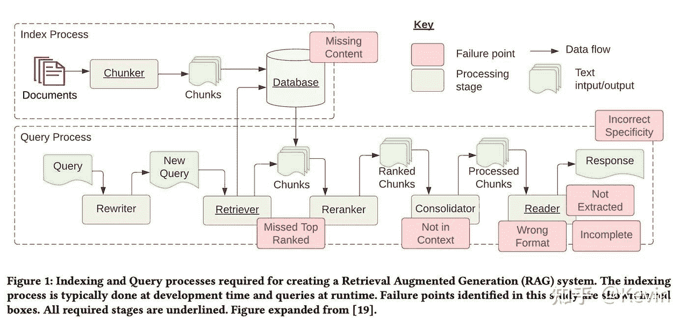
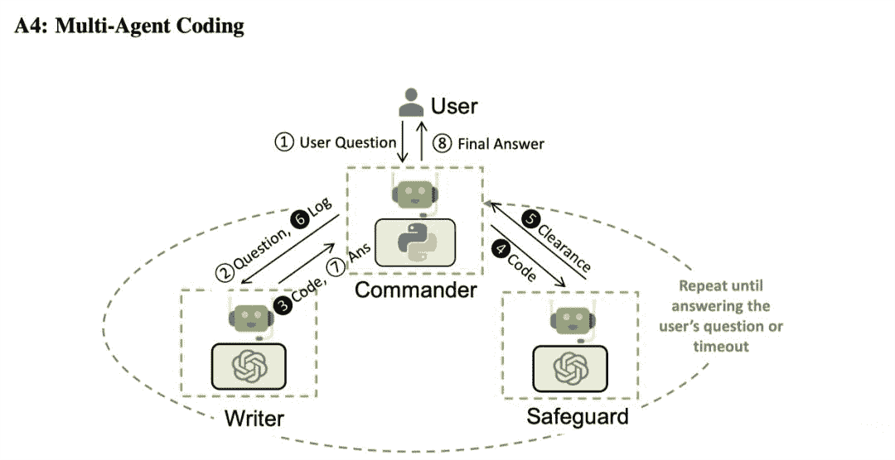
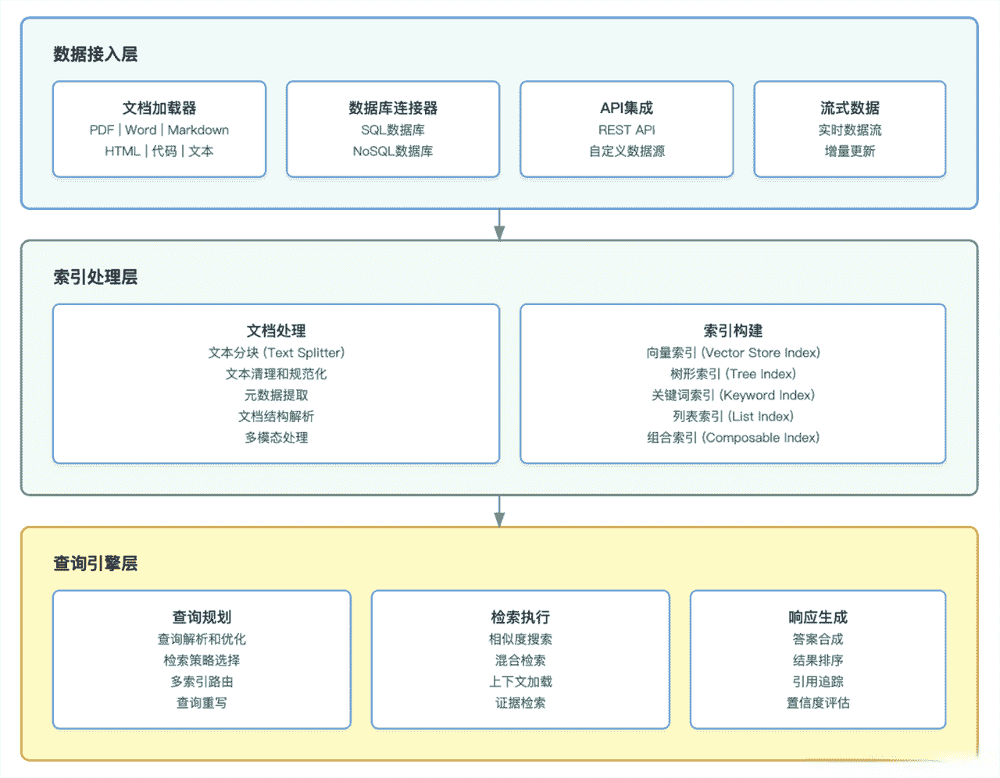
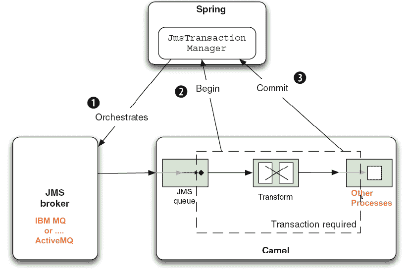
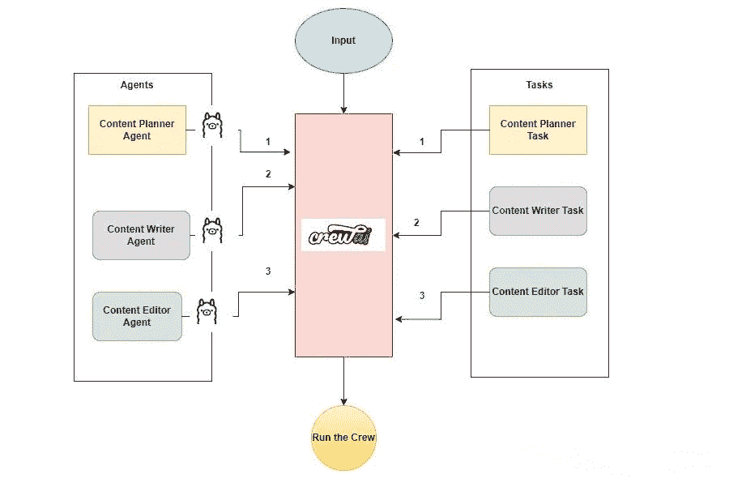

# 8种主流Agent框架与MCP的集成

> 来源：[https://qqs7y1hozd1.feishu.cn/docx/HloSdfIkMoIQ91xRh8kciOhMnkc](https://qqs7y1hozd1.feishu.cn/docx/HloSdfIkMoIQ91xRh8kciOhMnkc)

## 01 Open AI Agents SDK

### 【框架简介】

> 方便开发者构建多Agent协作的智能体系统。

> `OpenAI Agents SDK`，是`OpenAI`官方推出的轻量级Agent开发框架。



该SDK源于`OpenAI`内部实验项目`Swarm`，并在近期正式推出生产版本。

> `OpenAI Agents SDK`的特点是：

> 简单易用、轻量级，专注在最小集功能，并支持转交（`Handoffs`）、护栏（`Guardrails`）等很有特点的功能。

### 【集成MCP】

以下代码展示如何将`OpenAI Agent`实例连接到一个搜索的`MCP Server`，并将其中的工具集成`Agent`中。

```
import asyncio, os
from agents import Agent, Runner, AsyncOpenAI, OpenAIChatCompletionsModel, RunConfig
from agents.mcp import MCPServerStdio

async def main():
    # 1. 创建MCP Server实例
    search_server = MCPServerStdio(
        params={
            "command": "npx",
            "args": ["-y", "@mcptools/mcp-tavily"],
            "env": {**os.environ}
        }
    )
    await search_server.connect()

    # 2. 创建Agent并集成MCP Server
    agent = Agent(
        name="助手Agent",
        instructions="你是一个具有网页搜索能力的助手，必要时使用搜索工具获取信息。",
        mcp_servers=[search_server], # 将MCP Server列表传入Agent
    )

    # 3. 运行Agent，让其自动决定何时调用搜索工具
    result = await Runner.run(agent, "Llama4.0发布了吗？", run_config=RunConfig(tracing_disabled=True))
    print(result.final_output)

    await search_server.cleanup()

if __name__ == "__main__":
    asyncio.run(main())
```

## 02 LangGraph

### 【框架简介】

> 一个用于构建`Agentic Workflow`的强大框架。

> `LangGraph`来自著名的`LangChain`，它将任务过程建模为有状态的`Graph`结构，从而可以实现更复杂和结构化的交互。

> 在该框架内可以实现复杂的`Agentic`系统。

> 集成`MCP Server`可以在工作流程的各个阶段更精确地控制何时以及如何调用外部工具。



`LangGraph`的特点是功能强大。

> 可以使用`Prebuilt`的接口快速创建`Agent`，也可以使用`Graph`定义复杂的`Agentic`工作流与多Agent系统；缺点是略显复杂。

### 【集成MCP】

将`LangGraph`+`MCP Server`的代码实现：

```
import asyncio, os
from langchain_mcp_adapters.client import MultiServerMCPClient
 
from langchain_core.messages import SystemMessage, HumanMessage
from langchain_openai import ChatOpenAI
from dotenv import load_dotenv
from langgraph.prebuilt import create_react_agent
 
# 加载环境变量
load_dotenv()
 
# 定义大语言模型
model = ChatOpenAI(model="gpt-4o-mini")
 
# 定义并运行agent
async def run_agent():
    # 定义MCP服务器，用于访问Tavily搜索工具
    async with MultiServerMCPClient(
        {
            "tavily": {
            "command": "npx",
            "args": ["-y", "@mcptools/mcp-tavily"],
            "env": {**os.environ} # 传递环境变量给MCP工具
            }
        }
    ) as client:
 
        # 创建ReAct风格的agent
        agent = create_react_agent(model, client.get_tools())
 
        # 定义系统消息，指导如何使用工具
        system_message = SystemMessage(content=(
                "你是一个具有网页搜索能力的助手，必要时使用搜索工具获取信息。"
        ))
 
        # 处理查询
        agent_response = await agent.ainvoke({"messages": [system_message, HumanMessage(content="Llama4.0发布了吗？")]})
 
        # 返回agent的回答
        return agent_response["messages"][-1].content
 
# 运行agent
if __name__ == "__main__":
    response = asyncio.run(run_agent())
    print("\n最终回答:", response)
```

## 03 LlamaIndex

### 【框架简介】

> `LlamaIndex`是一个专注于构建基于外部数据的`LLM`应用程序的框架。

> 其独特之处在于构建以数据为中心的`LLM`应用的能力，特别是复杂的企业级`RAG`应用。



> 是全能的专注于企业级`RAG`+`Agent`系统的开发框架。

> 但随着`LlamaIndex Workflows`与`AgentWorkflow`功能的推出，`LlamaIndex`也发展为一个更全能的专注于企业级`RAG`+`Agent`系统的开发框架。

特点是功能强大、预置大量`RAG`应用优化模块。

> 事件驱动的`Workflows`在`Agent`开发上比`LangGraph`更简单。

### 【集成MCP】

`LlamaIndex`目前也支持与`MCP Server`集成，快速导入`Tools`使用：

```
from llama_index.tools.mcp import McpToolSpec, BasicMCPClient
import asyncio
from llama_index.llms.openai import OpenAI
from llama_index.core.agent import ReActAgent
import os
 
llm = OpenAI(model="gpt-4o-mini")
 
async def main():
 
    mcp_client = BasicMCPClient("npx", ["-y", "@mcptools/mcp-tavily"], env={**os.environ})
    mcp_tool = McpToolSpec(client=mcp_client)
    tools = await mcp_tool.to_tool_list_async()
 
    agent = ReActAgent.from_tools(
        tools,
        llm=llm,
        verbose=True,
        system_prompt="你是一个具有网页搜索能力的助手，必要时使用搜索工具获取信息。"
    )
 
    response = await agent.aquery("Llama4.0发布了吗？")
    print(response) 
 
if __name__ == "__main__":
    asyncio.run(main())
```

## 04 AutoGen 0.4+

### 【框架简介】

> `AutoGen`是微软开发的一个框架。

> 用于构建具有多`Agent`对话的企业级`AI`应用。



其独特之处在于专注于通过多个`Agent`之间的协调交互来实现协作和解决复杂任务。

> 在最新的`AutoGen 0.4`中，微软进行了颠覆性的架构修改，特别是开放了`AutoGen-Core`这一更底层的`API`层，可用于构建更底层与细粒度控制的分布式多`Agent`系统。

> 其特点是功能强大，支持分布式多`Agent`。

> 可根据需要选择不同层次的`API`使用；缺点是较复杂。

### 【集成MCP】

在`Autogen 0.4`的扩展中提供了`MCP`集成的组件：

```
from autogen_ext.tools.mcp import StdioServerParams, mcp_server_tools
...
 
async def get_mcp_tools():
    server_params = StdioServerParams(
        command="npx", 
        args = [
        "-y",
        "@mcptools/mcp-tavily",
      ], env={**os.environ}
    )
    tools = await mcp_server_tools(server_params)
    return tools
...
 
 
class ToolUseAgent(RoutedAgent):
...
 
async def main():
    """主函数，设置并运行agent系统"""
    # 创建单线程agent运行时
    runtime = SingleThreadedAgentRuntime()
 
    mcp_tools = await get_mcp_tools()
    tools = [*mcp_tools]
 
    # 注册agent类型
    await ToolUseAgent.register(runtime, "my_agent", lambda: ToolUseAgent(tools))
...
 
    message = Message('Llama4.0发布了吗？')
    response = await runtime.send_message(message, AgentId("my_agent", "default"))
```

## 05 Pydantic AI

### 【框架简介】

> `Pydantic AI`来自于著名的`Pydantic`库开发者。

> 是一个将`Pydantic`与`LLM`集成的`Agents`开发框架。



> 专注于在AI应用中利用`Pydantic`的类型验证。

> 其独特之处在于专注于在AI应用中利用`Pydantic`的类型验证、序列化与结构化输出等功能。

`Pydantic AI`的特点是天然的结构化输出与强类型验证。

> 且简洁易用，与其他框架也有良好的集成，可以结合使用。

### 【集成MCP】

使用`Pydantic AI`集成`MCP Server`中的工具非常简单（与`OpenAI Agents SDK`非常类似），只需要简单的提供Server配置即可：

```
from pydantic_ai import Agent
from pydantic_ai.mcp import MCPServerStdio
import os
 
server = MCPServerStdio( 
    'npx',
    ["-y", "@mcptools/mcp-tavily"],
    env={**os.environ} 
)
 
agent = Agent(
        name="助手Agent",
        system_prompt="你是一个具有网页搜索能力的助手，必要时使用搜索工具获取信息。",
        model='openai:gpt-4o-mini', 
        mcp_servers=[server])
 
async def main():
    async with agent.run_mcp_servers():
        result = await agent.run("Llama4.0发布了吗?")
    print(result.data)
 
if __name__ == "__main__":
    import asyncio
    asyncio.run(main())
```

## 06 SmolAgents

### 【框架简介】

> `Smloagents`是`Hugging Face`开发的一个轻量级`Agent`开发框架。

> 其特点在于简洁易用、基于生成代码的工具调用（核心抽象叫`CodeAgent`）以及与`Hugging Face`生态系统的集成。

> `Smloagents`与`MCP`的集成提供了一种直接的方式。

> 可以为`Agent`添加复杂的功能，而无需为每个工具进行自定义编码。

### 【MCP集成】

以下代码初始化一个`SmolAgent`并将其连接到`MCP Server`：

```
from smolagents import ToolCollection, CodeAgent
from smolagents.agents import ToolCallingAgent
from smolagents import tool, LiteLLMModel
from mcp import StdioServerParameters
import os
 
model = LiteLLMModel(model_id="gpt-4o-mini")
 
server_parameters = StdioServerParameters(
    command="npx",
    args=["-y", "@mcptools/mcp-tavily"],
    env={**os.environ},
)
 
with ToolCollection.from_mcp(server_parameters, trust_remote_code=True) as tool_collection:
    agent = ToolCallingAgent(tools=[*tool_collection.tools], model=model)
    response = agent.run("llama4.0发布了吗？")
    print(response)
```

## 07 Camel

### 【框架简介】

`Camel`是一个专注于创建能够进行复杂对话以解决任务的强大的多智能体构建框架。

> 使用`AI Agent`之间的角色扮演和交互协作来完成任务。

> 并内置了多种角色的`Agent`抽象及大量组件，`Camel`也可以用来开发`RAG`应用。



现在这些`Agent`也可以通过`MCP Server`得到增强。

`Camel`还提供了一个将`Camel`中创建的工具集发布成`MCP Server`的功能。


## 【MCP集成】

将基于`Camel`的`Agent`与`MCP Server`做集成：

```python
import asyncio
from mcp.types import CallToolResult
from camel.toolkits.mcp_toolkit import MCPToolkit, MCPClient
import os
from camel.agents import ChatAgent
 
async def run_example():
    
    mcp_client = MCPClient(
        command_or_url=&quot;npx&quot;,
        args=[&quot;-y&quot;, &quot;@mcptools/mcp-tavily&quot;],
        env={**os.environ}
    )
    await mcp_client.connect()
    mcp_toolkit = MCPToolkit(servers=[mcp_client])
    tools = mcp_toolkit.get_tools()
 
    try:
        agent = ChatAgent(system_message=&#x27;根据任务描述，使用网页搜索工具获取信息。&#x27;,
                          tools=tools)
        response = await agent.astep(&quot;llama4.0发布了吗？&quot;)
        print(&quot;Response:&quot;, response.msgs[0].content)
    except Exception as e:
        print(f&quot;Error during agent execution: {e}&quot;)
    finally:
        # 确保在任何情况下都会断开连接
        await mcp_client.disconnect()
 
if __name__ = &quot;__main__&quot;:
    asyncio.run(run_example())
```

# 08 CrewAI

## 【框架简介】

CrewAI是一个用于编排自主AI智能体像团队一样协作完成复杂任务的多智能系统开发框架。



> 其独特之处在于其“角色扮演”的设计。

> **专注于创建**具有特定角色和职责的结构化`Agent`团队（称为`Crew`），最新的`Flow`功能可用于创建更可靠的Agentic Workflow。

## 【MCP集成】

```python
import os
from crewai import Agent, Crew, Task # type: ignore 
from mcp import StdioServerParameters
from mcpadapt.core import MCPAdapt
from mcpadapt.crewai_adapter import CrewAIAdapter
 
with MCPAdapt(
    StdioServerParameters(
        command=&quot;npx&quot;,
        args=[&quot;-y&quot;, &quot;@mcptools/mcp-tavily&quot;],
        env={**os.environ}
    ),
    CrewAIAdapter(),
) as tools:
    print(f&quot;Tools: {tools}&quot;)
    agent = Agent(
        role=&quot;MyAgent&quot;,goal=&quot;根据任务描述，使用网页搜索工具获取信息。&quot;,backstory=&quot;你是一个中文搜索助手&quot;,
        tools=tools,llm=&#x27;gpt-4o-mini&#x27;,
    )
 
    # Create a task
    task = Task(
        description=&quot;llama4.0的最新消息&quot;,agent=agent,expected_output=&quot;消息列表&quot;)
 
    task.execute_sync()
```
