# n8n 自动化工作流，并与 Al Agent 进行集成

> 来源：[https://qqs7y1hozd1.feishu.cn/docx/UPvcdHsNmooNJix0FqucomYLnuy](https://qqs7y1hozd1.feishu.cn/docx/UPvcdHsNmooNJix0FqucomYLnuy)

> **n8n**可以互联的流程包括 Gighub、Google、RSS、Slack、Telegram、Gitlab、Redist、RabbitMq等。

> 使用n8n可以方便的实现当A条件发生，触发B服务这样的自动工作流程。

### **n8n 几个突出优势：**

+   完全可自托管，数据掌握在自己手中 - 400+ 集成

+   覆盖几乎所有主流服务 - **内置 AI 能力**

+   支持 LangChain 和自定义模型 - 公平代码许可，核心功能完全免费

---

### n8n部署运行

**立即尝试使用 ****npx**** 的 n8n（需要 ****Node.js****）：**

```
npx n8n
```

**或者使用****Docker****:**

```
docker volume create n8n_data
docker run -it --rm --name n8n -p 5678:5678 -v n8n_data:/home/node/.n8n docker.n8n.io/n8nio/n8n
```

#### **解决办法**

```
# 使用Docker 拉取命令
docker pull swr.cn-east-3.myhuaweicloud.com/kubesre/docker.n8n.io/n8nio/n8n:latest
# 给这个镜像打上标签，在后续就可以直接使用新名字作为镜像了（所以这一步可走可不走）
docker tag swr.cn-east-3.myhuaweicloud.com/kubesre/docker.n8n.io/n8nio/n8n:latest docker.n8n.io/n8nio/n8n:latest
# 然后启动
# 或者直接执行如下命令
docker run -d --name n8n -p 5678:5678 swr.cn-east-3.myhuaweicloud.com/kubesre/docker.n8n.io/n8nio/n8n:latest

# 使用Containerd 拉取命令
ctr images pull swr.cn-east-3.myhuaweicloud.com/kubesre/docker.n8n.io/n8nio/n8n:latest
ctr images tag swr.cn-east-3.myhuaweicloud.com/kubesre/docker.n8n.io/n8nio/n8n:latest docker.n8n.io/n8nio/n8n:latest

# 当你想要使用Docker Compose 来简化容器管理，创建了一个docker-compose.yml文件，可以使用Shell 快速替换命令
# 将这个.yml文件中的字符串docker.n8n.io/n8nio/n8n:latest全部替换为swr.cn-east- 3.myhuaweicloud.com/kubesre/docker.n8n.io/n8nio/n8n:latest,
# 之后就可以直接使用docker-compose up -d来启动这个容器了

sed -i s#docker.n8n.io/n8nio/n8n:latest#swr.cn-east-3.myhuaweicloud.com/kubesre/docker.n8n.io/n8nio/n8n:latest#g 你的文件名
```

---

之后运行成功就可以在5678段口看到你的n8n容器了

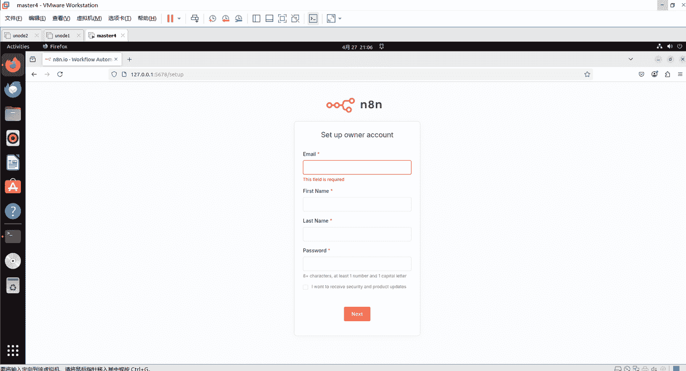

> 所以需要在容器中设置**TLS/HTTPS**，或本地，另一个不推荐的解决办法是将环境变量设置为 -e N8N_SECURE_COOKIE=false

**注册账号后登录好效果如下：**

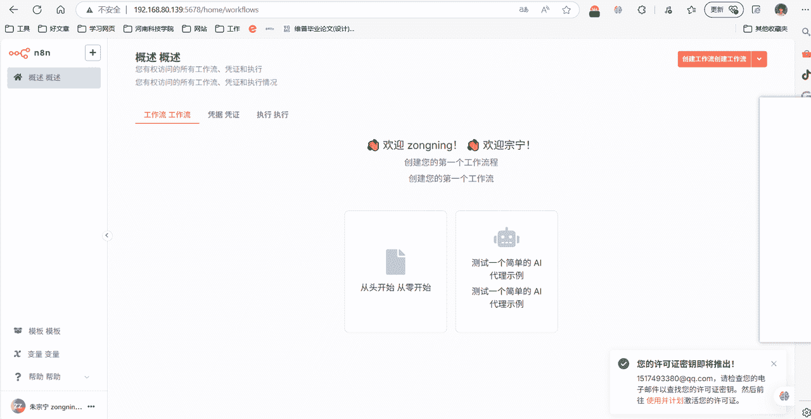

也可以在官网的云平台可以快速开始：

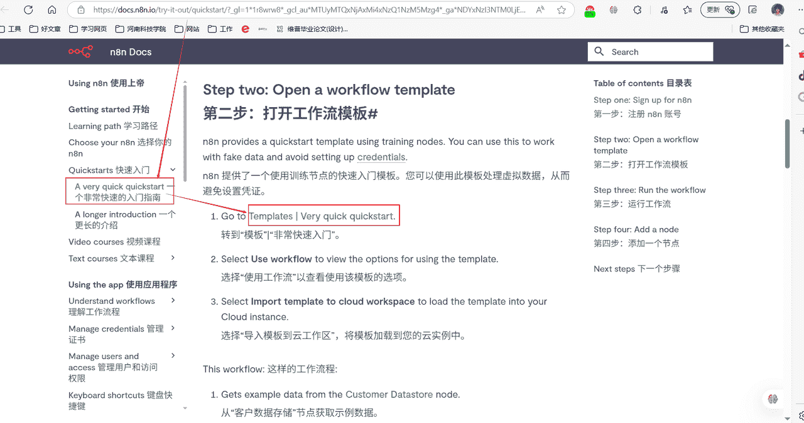

然后再选择在n8n cloud上进行快速开始：

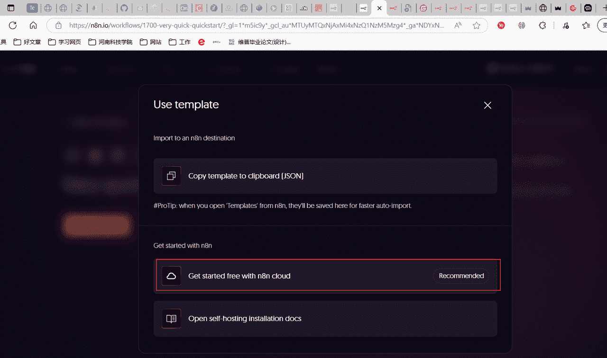

**在这里就可以操作自己的工作流：**

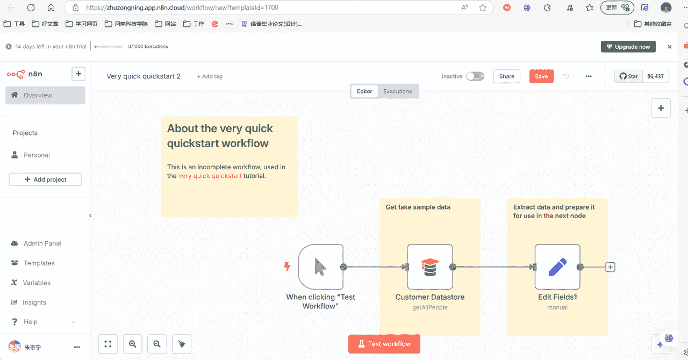

---

## n8n使用

### n8n中的节点

在页面的右侧的Open nodes panel中有所有的节点，也支持模糊查询，找自己想要的节点（可以通过点右边的➕打开，也可以Tab键打开）

> 每个节点（Node）是工作流的基本构建单元，每个节点负责执行特定任务。

> 数据流转的过程在一个个节点中穿过，每个节点对这段数据进行操作、更改等然后再传递给下一个节点。

节点接收上游输入 → 处理 → 输出给下游节点

数据以 JSON 格式 在节点间传递

节点分很多种类，人工智能、第三方程序应用、数据转换（时间转换、限制合并等）等

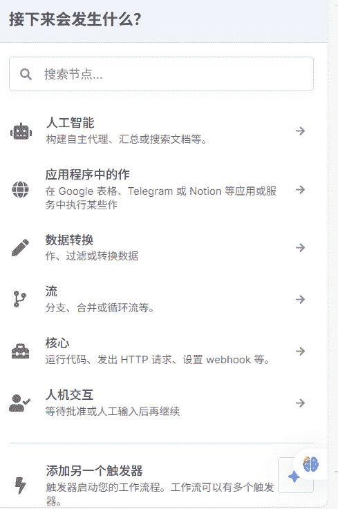

节点是属于开放式的，既可以使用现有的节点，也可以使用第三方应用的节点（其他app比如facebook类似的 ）

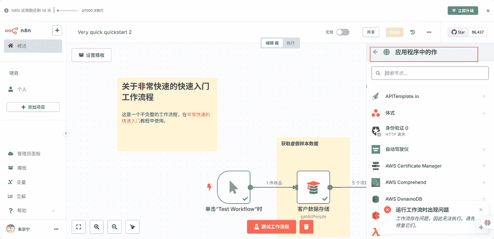

**此外如果你认****为官方的节点还**是不够**用，官方提供了co**de节点，搜索框搜索code即可，然后可以使用node.js或者说python.py通过ai智能自己写一个节点使用（就是自己写脚本了）

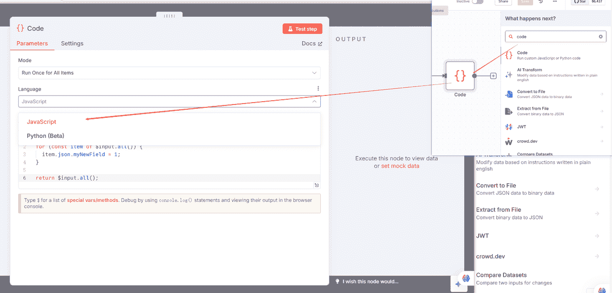

另一个很厉害的是**n8n提供了社区**，因为它是开源项目，有很多人撰写了自己的节点，然后上传到社区中，我们是可以直接拿来用

在这里，一些小众需求，也就是官方没有开发的，我们就可以直接拿来用

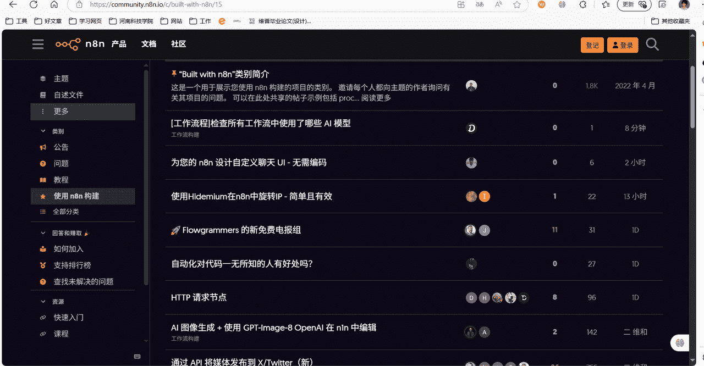

在n8n中的AI Agent是可定义自己的api的，其本身的服务器是国外的如果是在官方云服务器上使用国外服务都不需要做转发，相对更安全一点

---

**第一个节点：触发节点**

+   **手动触发**（在当前页面点击触发这个工作流）

+   **应用内时间**（监听GitHub 的新提交、Slack 的新消息等。）

+   **按计划**（配置每天的几点触发、或者每隔几分钟触发，定时任务）

+   **Webhook调用**（监听一个url，只有有人给这个url发请求，就触发这个工作流）

+   **提交表单时**（监听这个表单的变化）

+   **由另一个工作流执行时**（由另一个工作流调用）

+   **聊天消息**（监听聊天应用）

+   **其他方式**（在工作流错误、文件更改问题上运行）

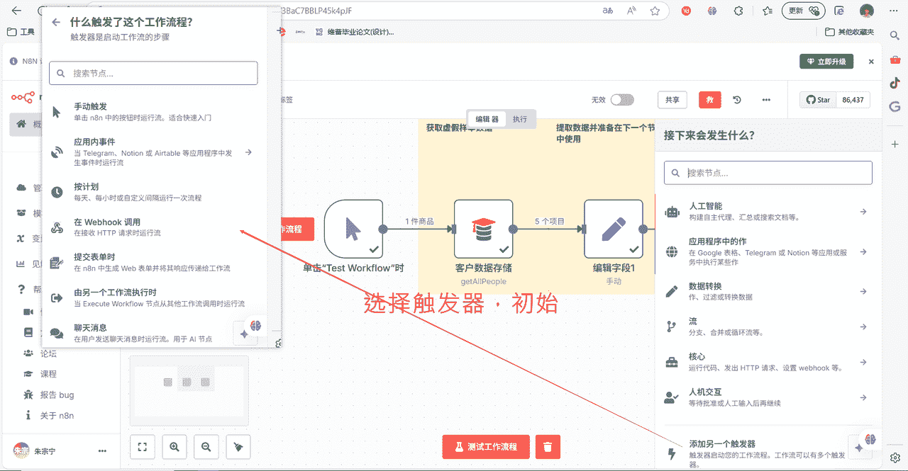

---

## 案例

> 接下来做一个自动同步指定ai咨询网站的信息 通过rss节点同步过来转换成md格式，然后信息丢给ai，总结之后发给某个地方，然后总结到表格供我下载。

### 第一个节点：手动触发

这里测试直接使用手动触发

### 第二个节点采用RSS Read

#### **RSS简单介绍**

使用RSS阅读器，用户只需添加订阅链接，阅读器会自动抓取支持RSS的文章内容。

> 比如网站A提供了RSS订阅服务，就可以通过RSS阅读器拿到这个网站A的文章内容

> 这里是使用了aibase的的AI新闻资讯的最新新闻的rss链接、

> （具体这个链接的获得需要下载插件来得到这个网页的rss链接）

rss不是本篇的重点，所以仅需了解它有什么功能就够了

需要url即你要聚合网站的**rss链接**

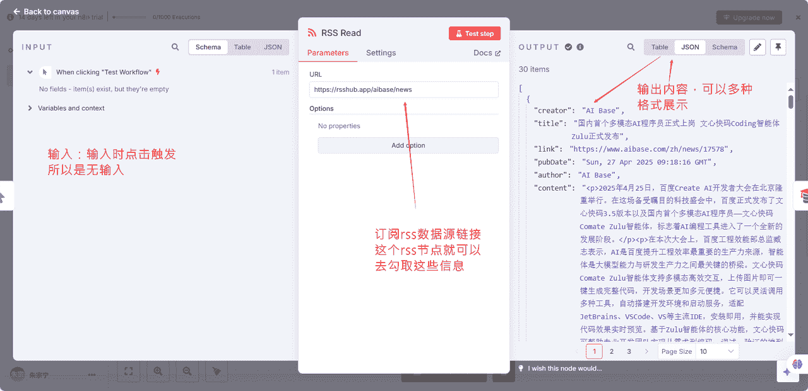

n8n节点是支持多线运行的，可以一对多，也可以多对一，

### 第三个节点limit，

就是每个节点的入参都是上一个节点的出参，RSS阅读出参了10条消息，这里不想要十条，使用limit可以进行删减

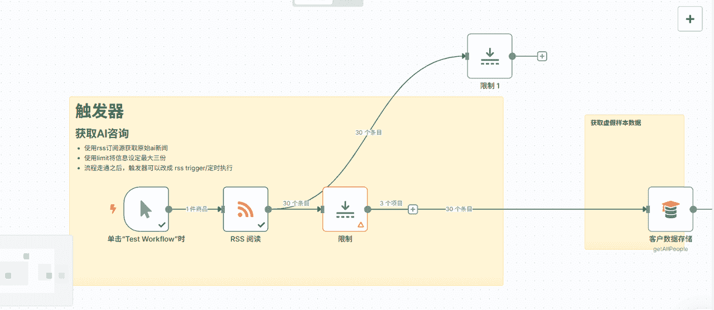

### 第四个节点Markdown

作用是前面拉取的rss阅读中的内容是html内容，有标签也有属性，我需要给它转换成markdown格式

> 具体的选择模式HTML to Markdown模式，然后在INPUT中将你想要操作的内容拉过来。

> （鼠标左键点住content然后话到fx的操作框松手就可）之后通过Test step就可以看到结果


下方还有一个Destination Key 意思就是Markdown解析后的数据放到哪里，再右边的输出狂往下滑就会看到有一个data字段，存储的就是这段转换后的数据

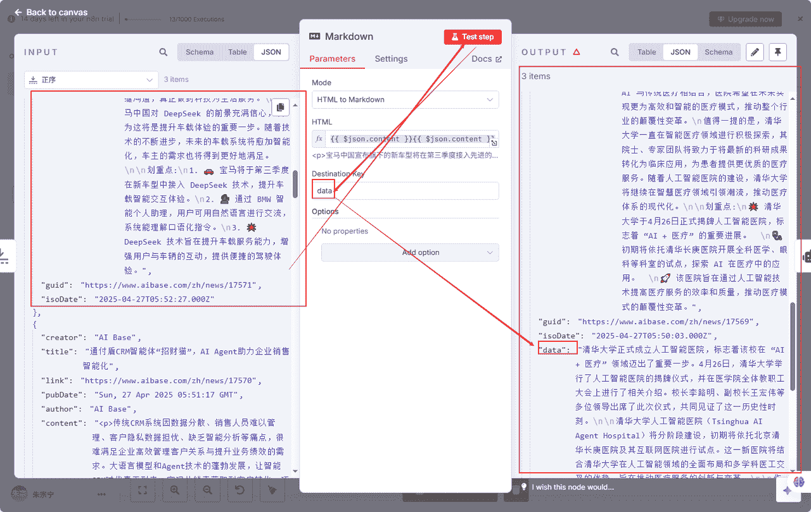

---

### 第五个节点AI Agent节点

先搜索AI Agent 搜搜这个节点放到工作流中将其与上一个节点做链接

> 可以看到下面有四条子链、分别连接语言模型、记忆 、外部工具 （1对多）、 输出格式。

> 其中输出格式是要在AI 代理设置需要特定的输出格式才会显示第四条线的

+   **聊天模型：**就是引入大模型去处理的你的输入以及输出

+   **记忆：**使AI Agent能够存储和回忆用户的上下文信息、比如跟踪用户偏好、历史信息等作用

+   **外部工具：**用户可以根据需要选择不同的工具，对数据进行处理，构建更复杂的自动化流程。

+   **输出格式：**简单理解为将这个AI Agent的结果转换一下特定的输出格式

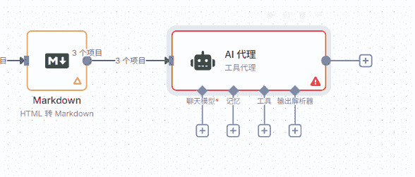

---

## AI Agent 聊天模型

**连接第一条线：**聊天模型

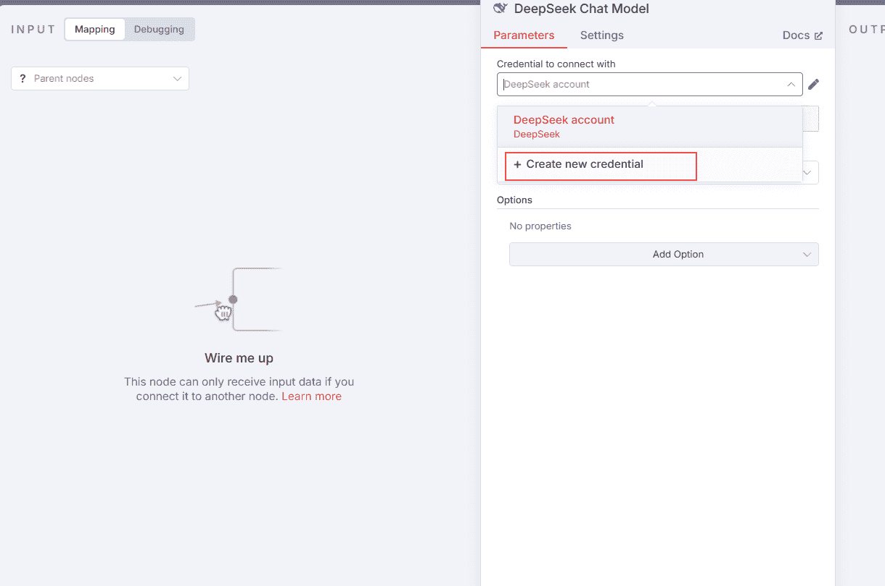

> **这里还有一个n8n**的优点就是这个密钥的配置可以直接点击上方的Open docs可以打开n8n给你写好的文档。

> 在这个文档中会详细说介绍你要怎么获取这个密钥，具体可以点进去看，进去就翻译成中文然后跟着操作拿到这个大模型的密钥了。

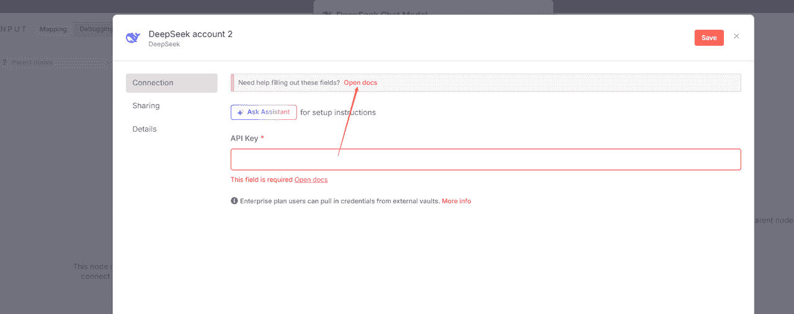

> 配置好之后模型就不用操作了，只需要把这个模型连接上AI Agent就行了，这个时候看其他的。

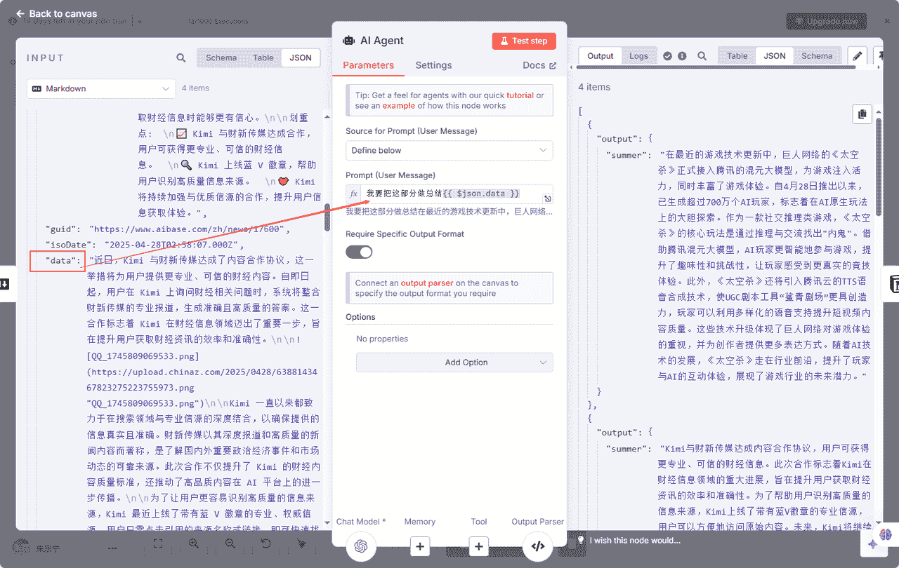

---

### AI Agent 记忆

**记忆**，因为这次工作流无需记忆，所以只写一个简单介绍，比如用户的输入就一个内容content，Context Window Length=5

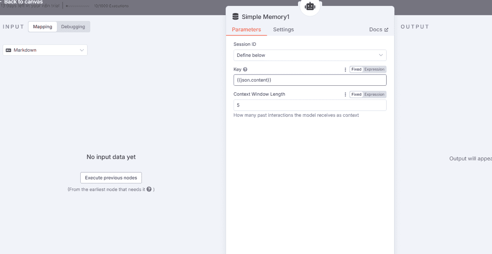

**例子**

```
第5轮 (最新)
用户：我的检查报告出来了，能帮我看下吗？
AI：请提供报告中的关键数值（如HDL、LDL等）。

第4轮
用户：最近总是头晕，血压140/90
AI：建议监测晨起和睡前血压，避免高盐饮食。

第3轮
用户：我有青霉素过敏史
AI：已记录过敏史，后续用药会避开β-内酰胺类抗生素。

第2轮
用户：预约了清华长庚医院心血管科
AI：需要帮您查询该科室的候诊人数吗？

第1轮 (最早，即将被遗忘)
用户：我的医保卡号是京A12345
AI：医保信息已关联，就诊时可自动结算。

🔄 窗口滚动机制
当用户发起第6轮新对话时：

第1轮（医保卡信息）会被移出上下文
窗口保持最新5轮对话（第2-6轮）
🎯 实际效果
若用户此时问：&quot;需要做哪些检查？&quot;
AI会结合：

已知的头晕症状（第4轮）
高血压数据（第4轮）
心血管科预约（第2轮）
→ 优先推荐动态血压监测+血脂检测

```

---

### AI Agent 工具

> 可以有很多工具，比如**代码工具**（自己编写代码操作输出内容）**HTTP请求工具。**

> **（可以发送一个请求获取**天气等来配合前面的大模型做数据处理）还可以接入MCP Serve工具

这里是一个**AI Agent的整个流程例子**协助理解：

```
示例场景
用户输入：“我明天要去北京，天气怎么样？顺便帮我查一下明天的会议安排。”

工作流程
用户输入

用户通过聊天界面输入：“我明天要去北京，天气怎么样？顺便帮我查一下明天的会议安排。”
语言模型

处理：AI Agent 接收用户输入，并将其传递给语言模型（如 GPT）。
意图识别：
识别出两个主要意图：查询天气和查询会议安排。
生成初步响应框架，例如：“让我为您查询明天在北京的天气和会议安排。”
记忆

存储上下文：
AI Agent 查询记忆模块，检查是否有关于用户的上下文信息，比如用户的常用城市、会议安排或之前的对话历史。
如果没有相关记忆，AI Agent 可能会询问用户：“请问您之前的会议安排是什么？”并将用户的回答存储在记忆中，以便未来使用。
更新记忆：将用户的出行信息（去北京）及查询的时间（明天）存储在记忆中，方便后续的对话使用。
外部工具（1对多）
调用天气 API：
AI Agent 确定需要通过外部工具查询天气信息。
发送请求到天气 API（如 OpenWeatherMap），包含城市（北京）和日期（明天）。
调用日历 API：
同时，AI Agent 会查询日历 API（如 Google Calendar）以获取用户的会议安排。
发送请求，查询用户在明天的所有会议事件。
接收响应：
天气 API 返回明天的天气数据，如温度、湿度、天气状况等。
日历 API 返回用户的会议安排，可能包含时间、地点和会议主题。
输出格式
格式化响应：
AI Agent 将天气数据和会议安排进行处理，并生成用户友好的响应。
例如：
复制
明天在北京的天气是晴天，气温在20°C到25°C之间。
您的会议安排是：上午10点与团队会议，地点在会议室A；下午2点与客户的电话会议。
返回结果：将格式化后的响应发送回用户界面。
```

---

### AI Agent 输出格式

> **可以直接选择输出解析器以j**son格式返回，下面的json格式是自己定义的。

> 同时在ai智能解析完数据后就会按照这个格式将内容发送到下一个节点。

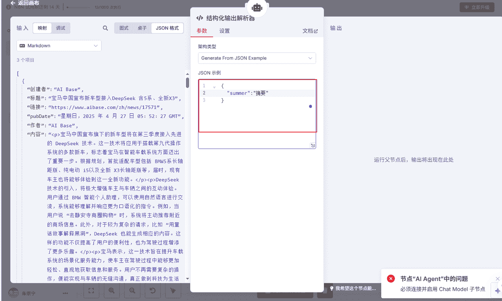

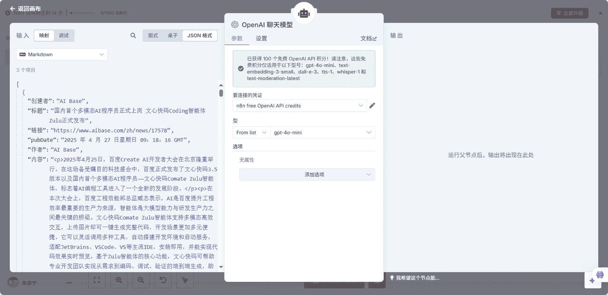

---

### AI Agent Options

此时AI的四个连接线都介绍过了，AI Agent Options是在AI Agent自身做的配置（此处做简单介绍）

### System Message

**作用：**插入系统级指令（如角色设定/格式要求）

> **示例：**

> "你是一名医疗AI，回答需引用权威指南"

### Max Iterations

作用：限制AI处理复杂任务时的最大推理步数

> **示例：**

> 设置3 → 若AI在3步内未得出结果，则终止并返回当前结论

### Return Intermediate Steps

作用：在输出中显示推理过程（而不仅是最终答案）

> **示例：**

> 数学题解答时会展示"步骤1：分解因式 → 步骤2：代入求解"

---

Automatically Passthrough Binary Images

**作用：**遇到二进制图片（如二维码/条形码）时直接原样传输，不进行OCR识别

**典型场景：**

需要保持扫描码机器可读性的场景

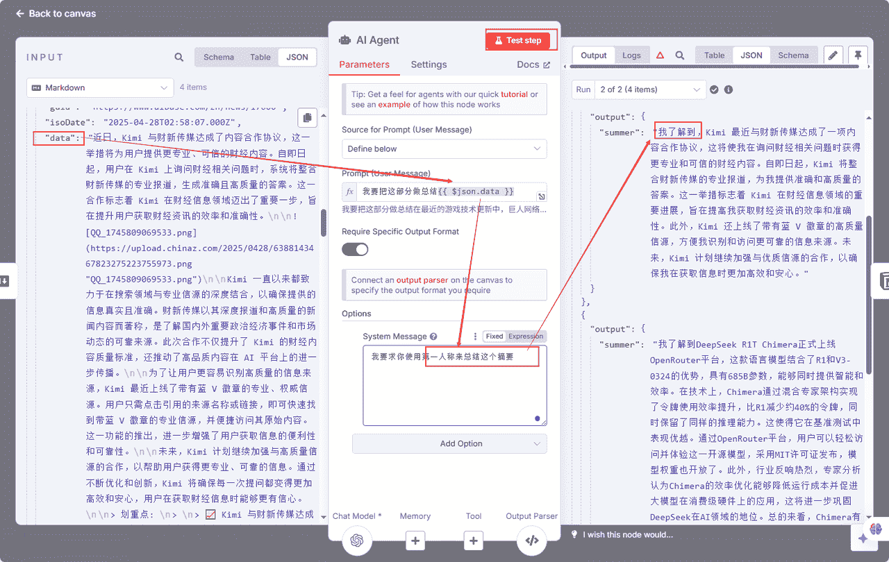

---

### 第六个节点 Notion

Notion就理解为是一个**在线文档**就好，通过配置密钥，可以将上一个节点输入的内容我给输出到我的在线文档中

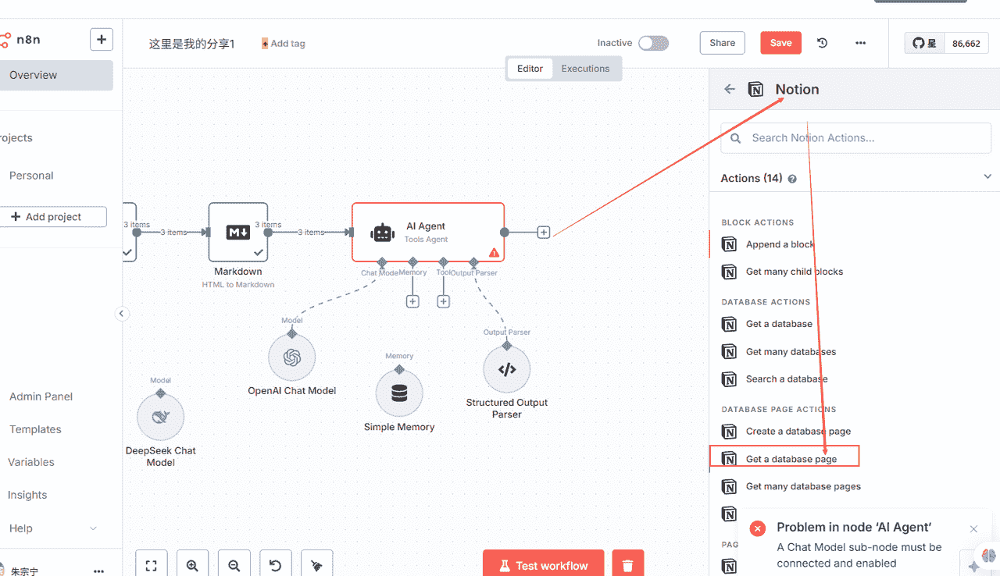

同样选好了之后需要配置你的账号密钥，和前面的deepseek的过程一样，点击去然后看n8n的文档就好

> 下面的这些操作就是要操作一个页（Database Page）、操作是创作数据（Create）、操作的哪个页面。

> 然后再下面要存储到notion中的数据进行分段分url是哪段数据，然后添加其他的Properities。

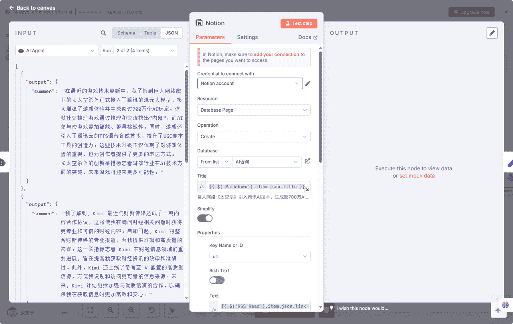

这里有一点，在每一个节点是可以直接操作之前的所有节点数据的，我们在notion节点是可以直接拉取Markdown节点的数据的

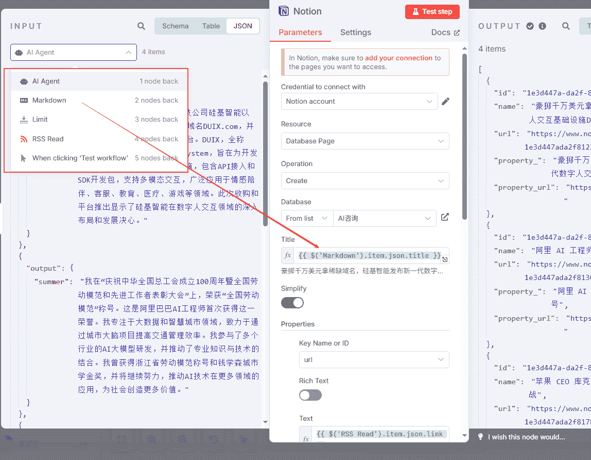

在这个流程之后数据就会自动的create到我的notion集合中了。

按照自己的分类，自动的完成一系列的操作

---

第七个节点Edit Fields

> 其实前面6个节点已经基本了解到了这个n8n是怎么用的了。

> 后面两个节点就是Edit Fields和Convert to File即将json数据转换为Map字段，然后转成file文件

> Edit Field很容易理解，将前面的字段设为类似于map的，name就是json中name字段。

> 内容就是选用markdown中的content字段，同时也支持该字段类型，这里统一用的是string


### 第八个节点Convert to File

简单理解，转换然后下载，下载后，几个字段就刚好和xls文件中的字段对应。

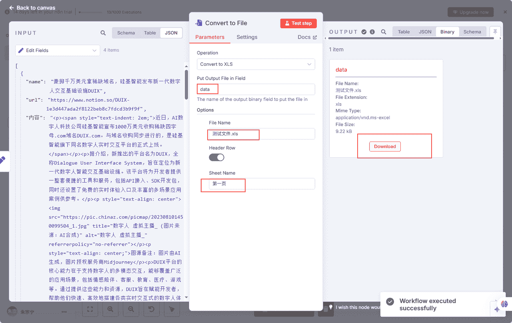