# MCP + 数据库，比RAG检索效果更好的新方式！

> 来源：[https://qqs7y1hozd1.feishu.cn/docx/C49Ud4HFNo0mOMxlN1JcjsOoneX](https://qqs7y1hozd1.feishu.cn/docx/C49Ud4HFNo0mOMxlN1JcjsOoneX)

> 以下完整展现基于 MCP 提高大模型检索外部**知识精**度的新思路，实测比 RAG 效果优30%。

从这样一个实际的案例出发来跟大家聊一聊 MCP，整体的学习路径如下：

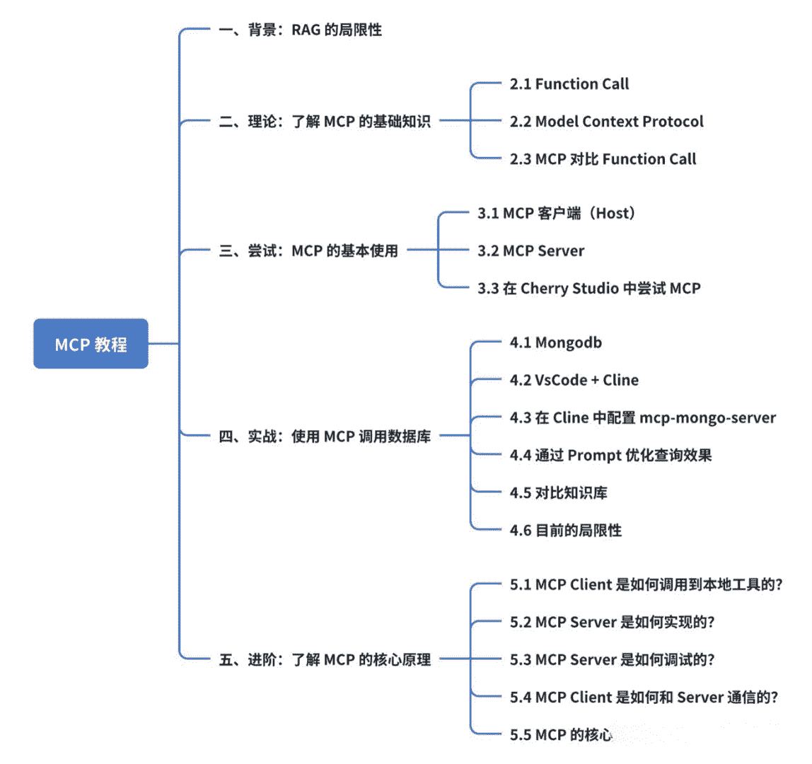

在开始学习之前，我们先了解一下，RAG 技术目前的局限性。

## 一、背景

**从 ****RAG** 本身技术原理的角度出发，目前存在着以下问题：

+   **检索精度不足：**首先，RAG 最核心的就是先将知识转换成 “向量“ ，导入 “向量数据库“，然后在将用户输入的信息也转换成 “向量” ，然后再去向量数据库匹配出相似的 “向量“，最后再由大模型去总结检索到的内容。

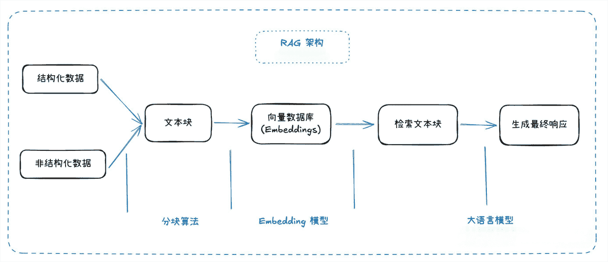

## 二、理论：了解 MCP 的基础知识

**在开始学习 MCP 之前，****有一个绕不开的话题，**就是 Function Call，我们先来回顾一下。

### 2.1 Function Call

> 以前的 AI 大模型就像一个知识丰富但被困在屋子里的人，只能依靠自己已有的知识回答问题，无法直接获取实时数据或与外部系统交互。

> **比如不能直接访问数据库里的最新信息**，也不能使用一些外部工具来完成特定任务。

**Function Call**** 是 ****OPEN AI**** 在 ****2023**** 年推出的一个非常重要的概念：**

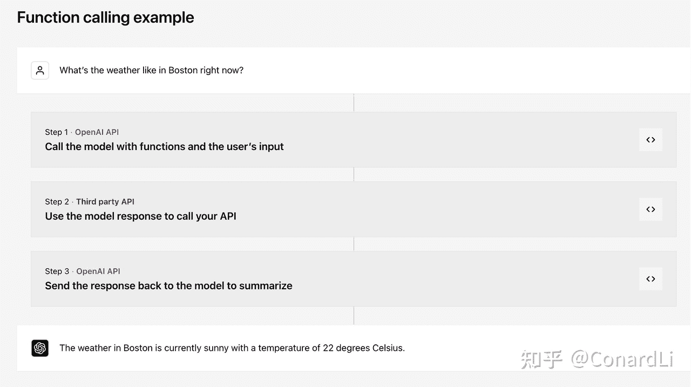

> **Function Call**（函数调用） 本质上就是提供了大模型与外部系统交互的能力，类似于给大模型安装一个 “外挂工具箱”。当大模型遇到自己无法直接回答的问题时，它会主动调用预设的函数（如查询天气、计算数据、访问数据库等），获取实时或精准信息后再生成回答。

**比如，我们在 ****Coze**** 这种零代码 Agent ****搭建平台上看到的插**件，其实都是基于 Function Call 的思路来封装的：

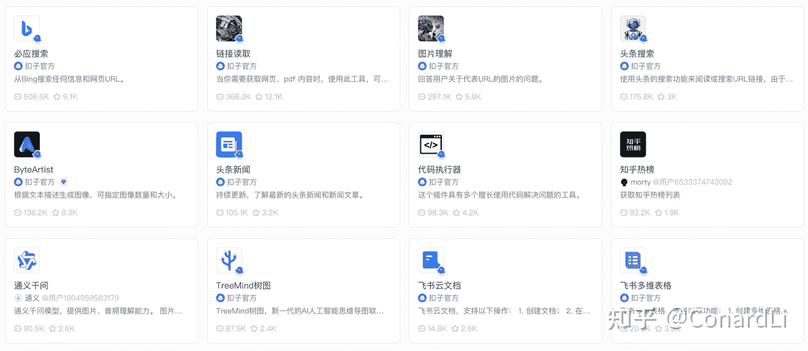

这个能力确实是挺好的，给了大模型更多的可能性，但是它有一个比较大的缺点，就是实现成本太高了。

> 在 **MCP** 出现之前，开发者想实现 **Function Call**** 的成本是比较高的，首先得**需要模型本身能够稳定支持 Function Call 的调**用，比如我们在 Coze **中选择某些模型时提示，选择的模型不支持插件的调用，其实就是不支持 Function Call 的调用：

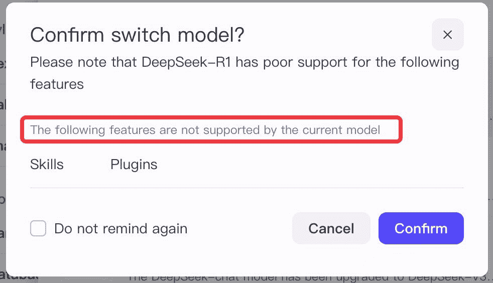

在标准的 **sharegpt**** 风格的数据集中就提供了专**门用于 Function Call 训练的特殊字段。

```
[
  {
    &quot;conversations&quot;: [
      {
        &quot;from&quot;: &quot;human&quot;,
        &quot;value&quot;: &quot;人类指令&quot;
      },
      {
        &quot;from&quot;: &quot;function_call&quot;,
        &quot;value&quot;: &quot;工具参数&quot;
      },
      {
        &quot;from&quot;: &quot;observation&quot;,
        &quot;value&quot;: &quot;工具结果&quot;
      },
      {
        &quot;from&quot;: &quot;gpt&quot;,
        &quot;value&quot;: &quot;模型回答&quot;
      }
    ],
    &quot;system&quot;: &quot;系统提示词（选填）&quot;,
    &quot;tools&quot;: &quot;工具描述（选填）&quot;
  }
]
```

**这也就意味着模型本身需要进**行过专门的 Function Call 调用微调才能稳定支持这种能力。

> 另外还有一个比较大的问题，**OPEN AI** 最开始提出这项技术的时候，并没有想让它成为**一项标准，所以虽然后续很多**模型也支持了 Function Call 的调用，但是各自实现的方式都不太一样。

**这也就意味着，如果我们要发**开一个 Function Call 工具，需要对不同的模型进行适配，比如参数格式、触发逻辑、返回结构等等，这个成本是非常高的。

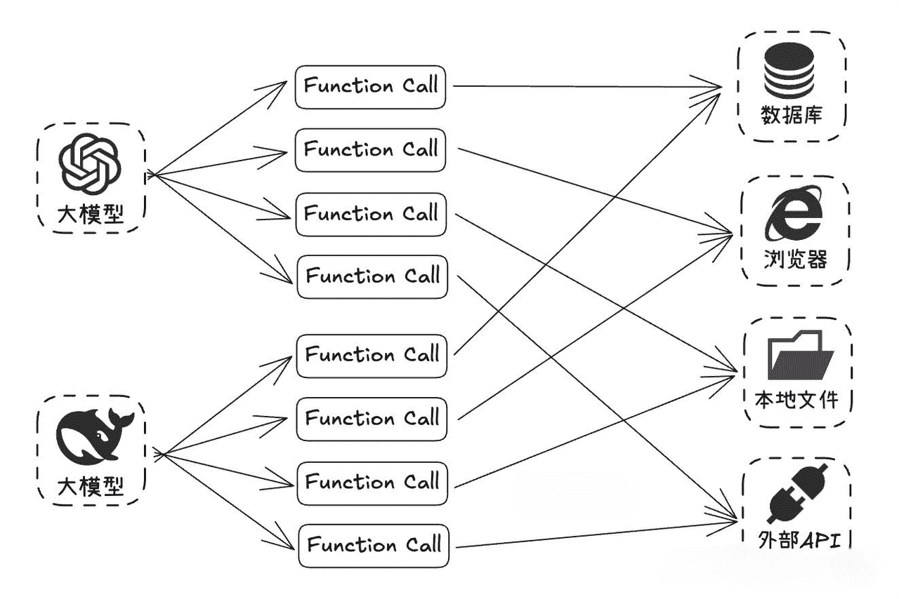

这也大大提高了 **AI Agent** 的开发门槛，所以在以前我们大部分情况下只能通**过 Dif**y、Coze 这些平台来构建 Agent。

**核心特点**

+   **模型专属：**不同模型（GPT/Claude/DeepSeek）的调用规则不同

+   **即时触发：**模型解析用户意图后直接调用工具

+   **简单直接：**适合单一功能调用（如"查北京温度"→调用天气API）

**痛点**

+   **协议碎片化：**需为每个模型单独开发适配层

+   **功能扩展难：**新增工具需重新训练模型或调整接口

**类比**

+   不同品牌手机的充电接口（Lightning/USB-C），设备间无法通用

### 2.2 MCP

> MCP（Model Context Protocol，模型上下文协议）是一种由 Anthropic 公司（也就是开发 Claude 模型的公司）推出的一个开放标准协议。

> 目的就是为了解决 AI 模型与外部数据源、工具交互的难题。

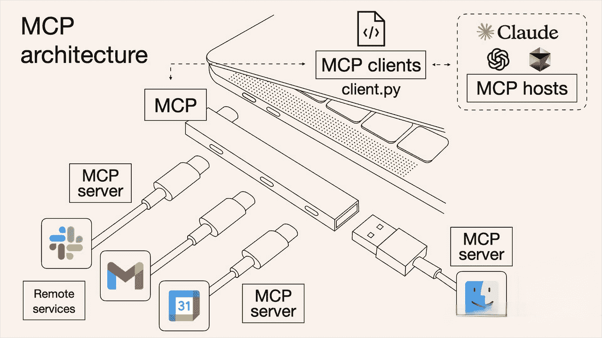

**通过 ****Function Call**** ，**每次要让模型连接新的数据源或使用新工具，开发者都得专门编写大量代码来进行对接，既麻烦又容易出错。

> 而 MCP 的出现就是为了解决这些问题，它就像是一个 “通用插头” 或者 “USB 接口”，制定了统一的规范，不管是连接数据库、第三方 API，还是本地文件等各种外部资源，都可以通过这个 “通用接口” 来完成，让 AI 模型与外部工具或数据源之间的交互更加标准化、可复用。

**这让我真正的感觉到，****MCP** 真的做到了，它已经成为 AI 工具调用的 “行业标准”。

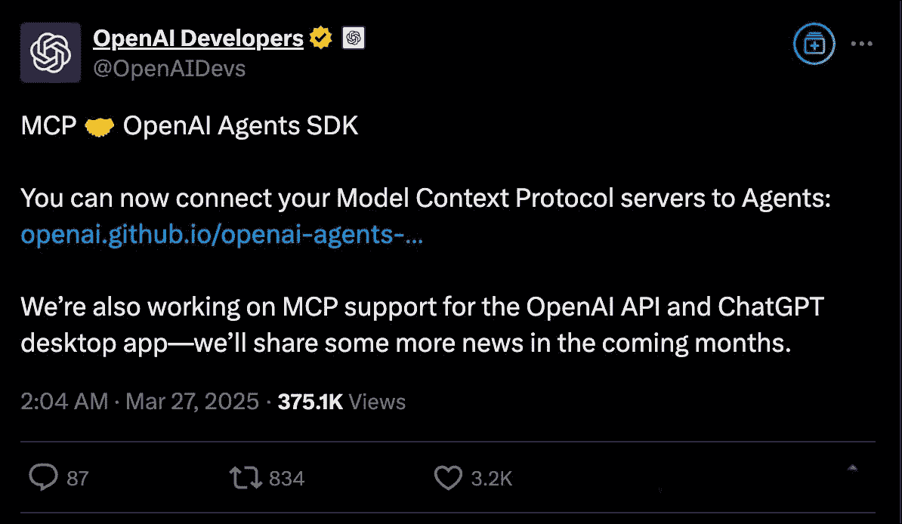

> M**CP Host，比如 Claude Deskto**p、Cursor 这些工具，在内部实现了 MCP Client，然后 MCP Client 通过标准的 MCP 协议和 MCP Server 进行交互，由各种三方开发者提供的 MCP Server 负责实现各种和三方资源交互的逻辑，比如访问数据库、浏览器、本地文件，最终再通过 标准的 MCP 协议返回给 MCP Client，最终在 MCP Host 上展示。

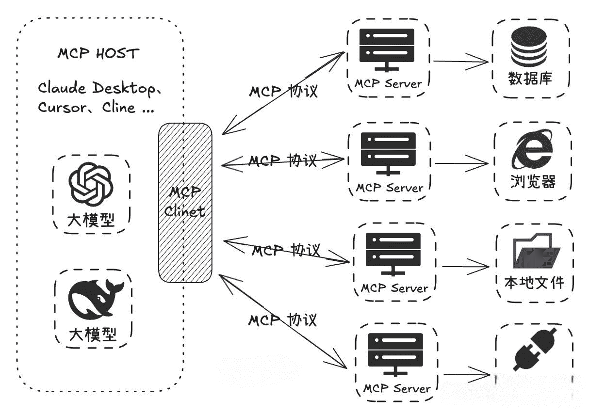

> 开发者按照 MCP 协议进行开发，无需为每个模型与不同资源的对接重复编写适配代码，可以大大节省开发工作量，另外已经开发出的 MCP Server，因为协议是通用的，能够直接开放出来给大家使用，这也大幅减少了开发者的重复劳动。

比如，你如果想开发一个同样逻辑的插件，你不需要在 Coze 写一遍，再去 Dify 写一遍，如果它们都支持了 MCP，那就可以直接使用同一个插件逻辑。

**核心特点**

+   **协议标准化：**统一工具调用格式（请求/响应/错误处理）

+   **生态兼容性：**一次开发即可对接所有兼容MCP的模型

+   **动态扩展：**新增工具无需修改模型代码，即插即用

**核心价值，解决三大问题**

+   数据孤岛 → 打通本地/云端数据源

+   重复开发 → 工具开发者只需适配MCP协议

+   生态割裂 → 形成统一工具市场

**类比**

+   **USB-C 接口：**手机/电脑/外设通过统一标准互联

### 2.3 MCP 对比 Function Call

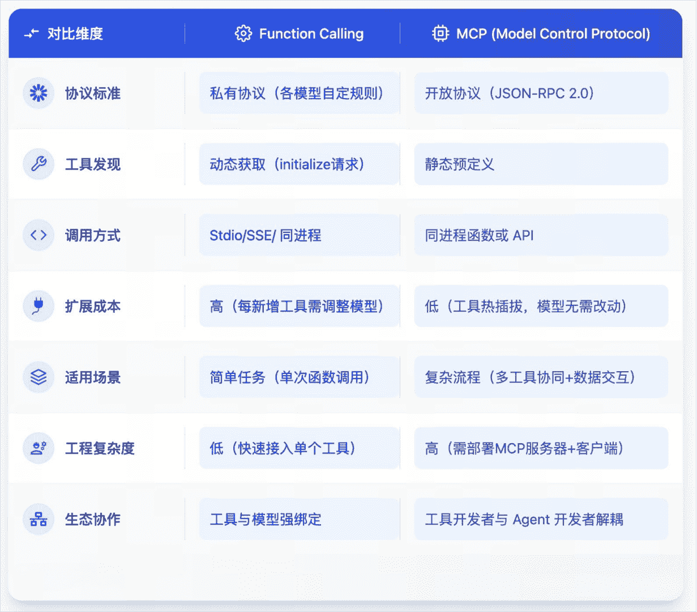

## 三、尝试：学会 MCP 的基本使用

从上面 MCP 的架构图中我们可以看到，想要使用 MCP 技术，首先就是得找到一个支持 MCP 协议的客户端，然后就是找到符合我们需求到 MCP 服务器，然后在 MCP 客户端里调用这些服务。

### 3.1 MCP 客户端（Host）

**在 MCP 官方文档中，我们看到已经支持**了 MCP 协议的一些客户端/工具列表：

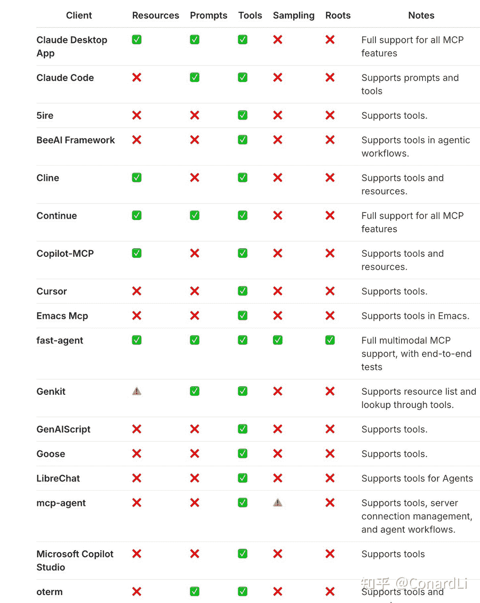

**从表格里，我们可以看到，MCP 对支持的客户端**划分了五大能力，这里我们先简单了解即可：

+   **Tools：**服务器暴露可执行功能，供 LLM 调用以与外部系统交互。

+   **Resources：**服务器暴露数据和内容，供客户端读取并作为 LLM 上下文。

+   **Prompts：**服务器定义可复用的提示模板，引导 LLM 交互。

+   **Sampling：**让服务器借助客户端向 LLM 发起完成请求，实现复杂的智能行为。

+   **Roots：**客户端给服务器指定的一些地址，用来告诉服务器该关注哪些资源和去哪里找这些资源。

目前最常用，并且被支持最广泛的就是 Tools 工具调用。

对于上面这些已经支持 MCP 的工具，其实整体划分一下就是这么几类：

+   **AI 聊天工具：**如 5ire、LibreChat、Cherry Studio

+   **AI 编码工具：**如 Cursor、Windsurf、Cline

+   **b**如 Genkit、GenAIScript、BeeAI

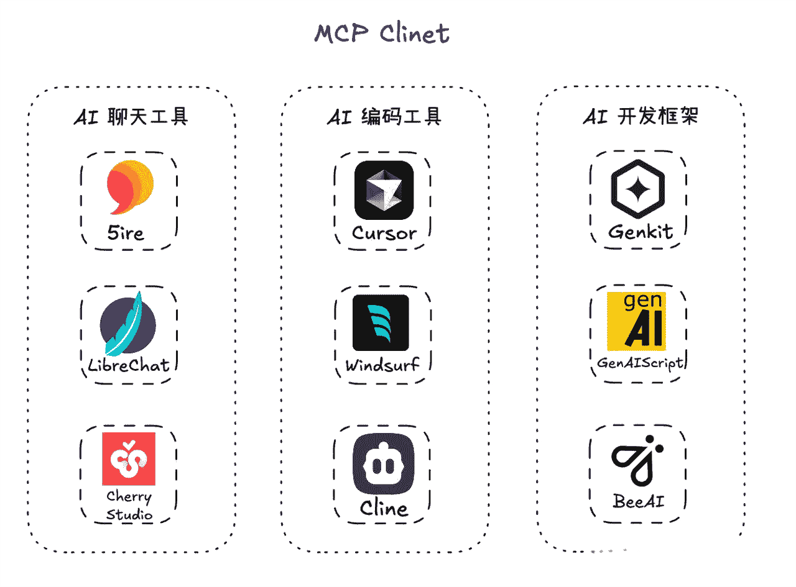

### 3.2 MCP Server

**MCP Server**** **的官方描述：一个轻量级程序，每个程序都通过标准化模型上下文协议公开特定功能。

简单理解，就是通过标准化协议与客户端交互，能够让**模型调用特定的数据源**或工具功能。常见的 MCP Server 有：

+   **文件和数据访问类：**让大模型能够操作、访问本地文件或数据库，如 File System MCP Server；

+   **Web 自动化类：**让大模型能够操作浏览器，如 Pupteer MCP Server；

+   **三方工具集成类：**让大模型能够调用三方平台暴露的 API，如 高德地图 MCP Server；

**下面是一些可以查找到你需要的 ****MCP Server**** 的途径：**

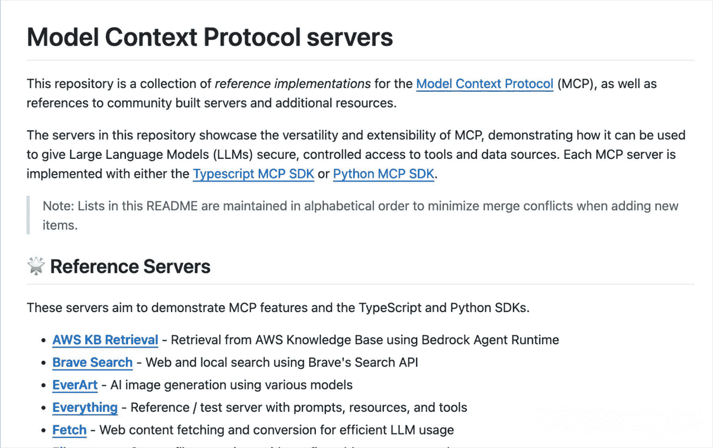

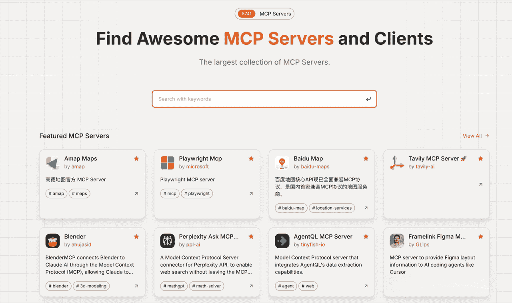

**其提供了非常友好的展示方式，每个 M**CP Server 都有具体的配置示例：

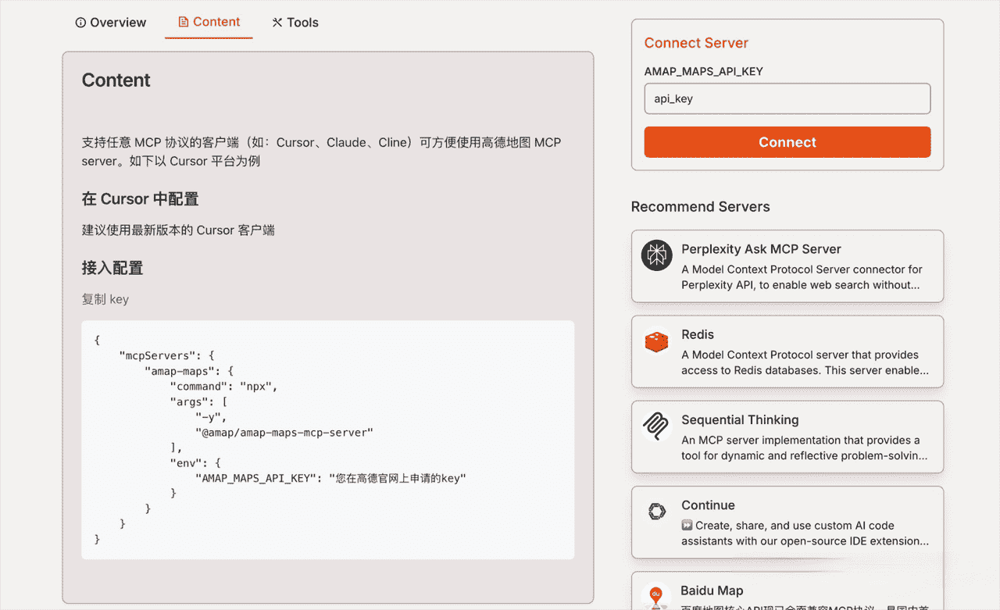

### 3.3 在 Cherry Studio 中尝试 MCP

**先来尝试一个最简单的 MC****P** 接入示例，这里我们选择 Cherry Studio。

> Cherry Studio 对于小白用户还是比较友好的，可以让你在客户端一键完成必备环境（这些环境是什么意思我们后面会讲）的安装：

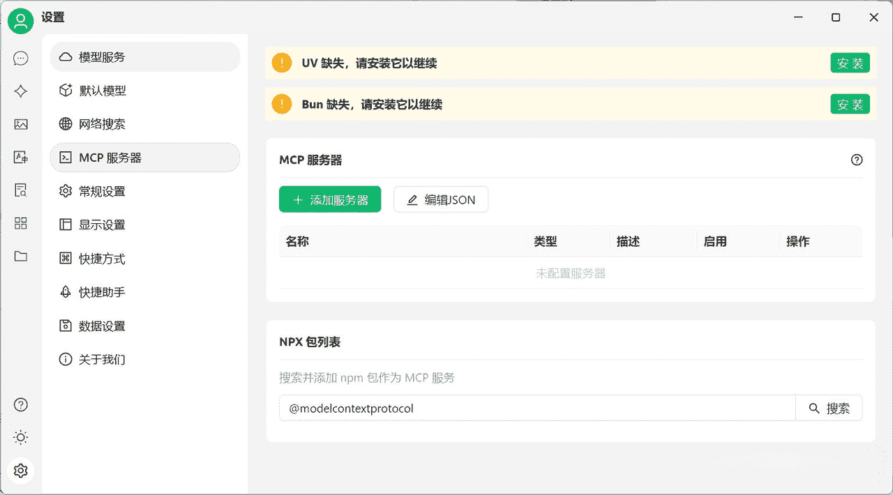

**在很多其他工具中****，**需要用户手动在自己的电脑上安装这些环境，比如 Windsurf：

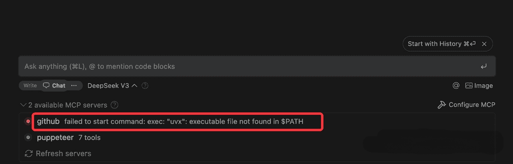

所以对小白用户，我建议先使用 **Cherry Studio** 上手尝试。

**打开 ****Cherry Studio**** 客户端，我们到「设置 - MCP** 服务器」把上面提示的两个环境完成安装：


**然后，我们在搜索框搜索 ****@modelcontextprotoc**ol/server-filesystem，这里我们接入一个简单的文件系统 MCP：


点击 + ，它会帮我们默认创建好一些 MCP Server 的配置，这里我们要补充一个参数，你允许让它访问的文件夹路径，比如 ~/Desktop：


然后我们点击保存，如果服务器的绿灯亮起，说明配置成功：


> 下面，我们到聊天区域选择一个模型，** **注意这里一定要选择带扳手 图标的模型，只有这种工具才支持 MCP（因为 Cherry Studio 其实本质上还是基于 Function Call 实现的 MCP，所以只有部分模型支持）


然后我们发现下面工具箱多了 MCP 的开关，我们把它打开：


然后我们尝试让他访问我桌面上有哪些文件：

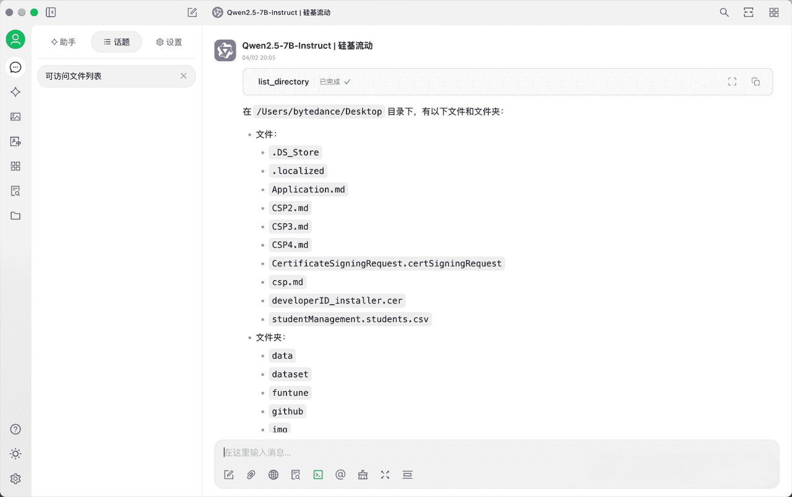

调用成功，这就是一个最简单的 MCP 调用示例了。

> 但是，因为 **Cherry Studio** 是刚刚支持的 **MCP**，在实际测试中，我发现体验并不是那么好，支持调用的模型种类比较少，而且在调用过程中不是很稳定。

**所以在后续的****实战章节，我们使****用 VsC****ode**** **+ Cline 来调用 MCP。

> 不过这里用什么工具大家不用太纠结，目前 MCP 的发展势头非常迅猛，从最开始只有 Claude 支持，到现在已经有几十个工具提供了支持，后续生态一定是会更加繁荣，各种工具也会越来越成熟，所以大家核心是掌握使用的思路。

## 四、实战：使用 MCP 调用数据库

首先，为了方便给大家进行演示，我们先来构造一个简单的数据库案例。

### 4.1 Mongodb

这里我们选择的数据库是 MongoDB：一款流行的开源的文档型数据库。

**MongoDB**** 使用文档型数据模型，数据以 ****JSON**** 格式存储。**

> 为什么选择 MongoDB 而不是 sqlite 之类的关系型数据库呢，主要还是因为在关系型数据库中，表结构是固定的，若要添加新字段或修改表结构，往往需要进行复杂的迁移操作。

> **而 MongoDB 的文档型数据模型**，允许在同一个集合中存储不同结构的文档。

> 应用程序可以根据需要灵活地添加或修改字段，无需事先定义严格的表结构，这对于我们想构建一个持续补充的结构化知识库的场景，是非常友好的。

**大**家可以直接在官方文档下载安装 MongoDB Community Server（MongoDB 的免费开源版本）：

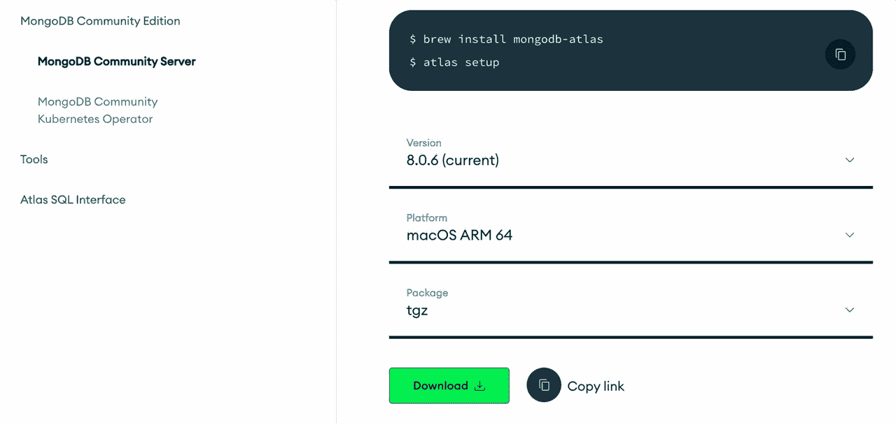

安装完成后，其会默认监听我们本地的 27017 端口：

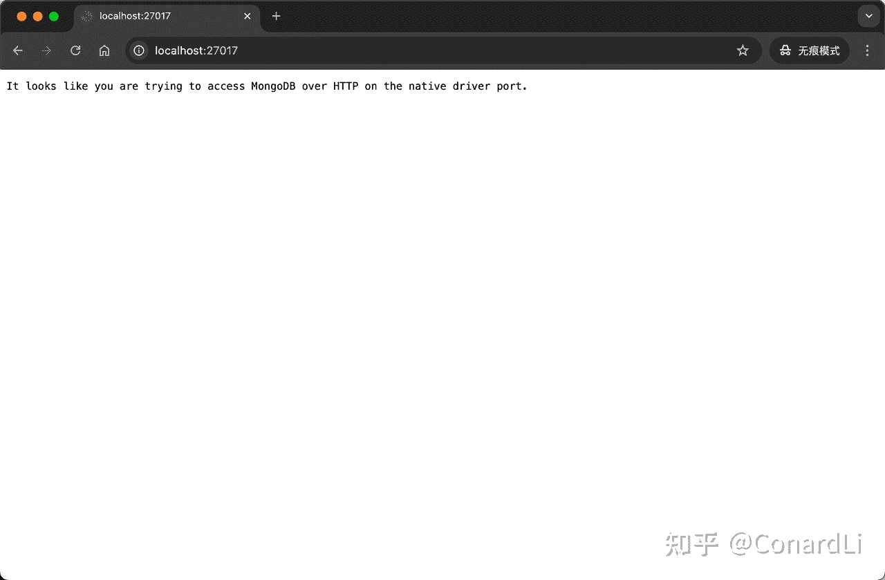

然后，为了可视化查看数据，我们还需要安装 MongoDB Compass (MongoDB 提供的本地 GUI 可视化工具)

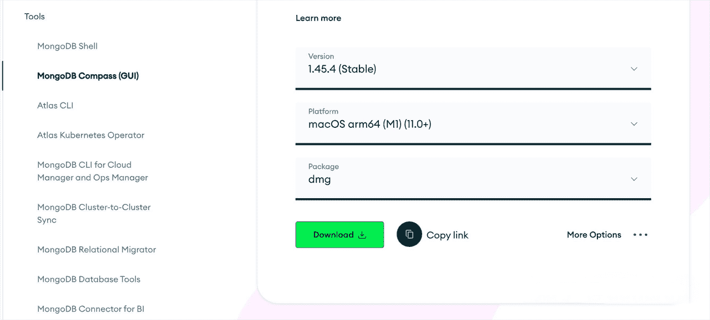

安装完成后，我们通过 MongoDB Compass 客户端链接到本地的 MongoDB Server：

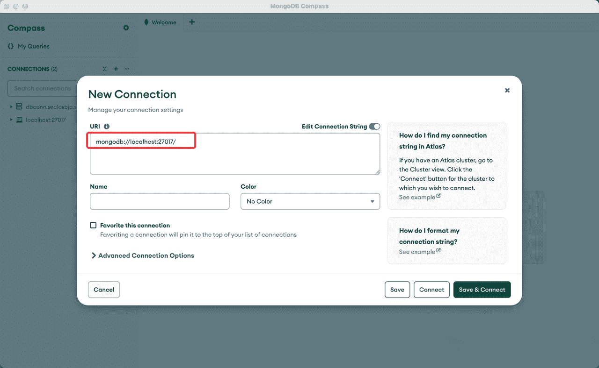

随后，大家就可以通过客户端将自己的数据导入 MongoDB 数据库：

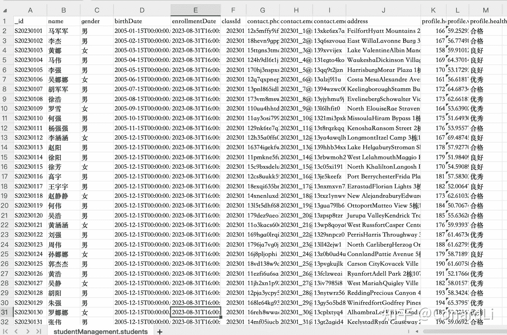

### 4.2 VsCode + Cline

> 通过对几个支持了 **MCP** 的客户端进行测试，发现 **Cline** 对 MCP 的兼容效果还是不错的，也是开源、**免费、国内都可以直接使用的**，但是相对于 **Cherr****y Stud**io **这种**客户端，Cline 的使用对于小白用户还是有点成本的，因为它本质上是一个基于 VsCode 的 AI 编码辅助插件。

> **Cursor、Windsurf**** 这种****付****费的 AI **编程客户端，其实都是基于微软开源的编程 IDE VsCode 二次开发、包装出来的，在其中内置了一些 AI 代码编辑能力，一般都需要按月付费，并且走海外的支付渠道。

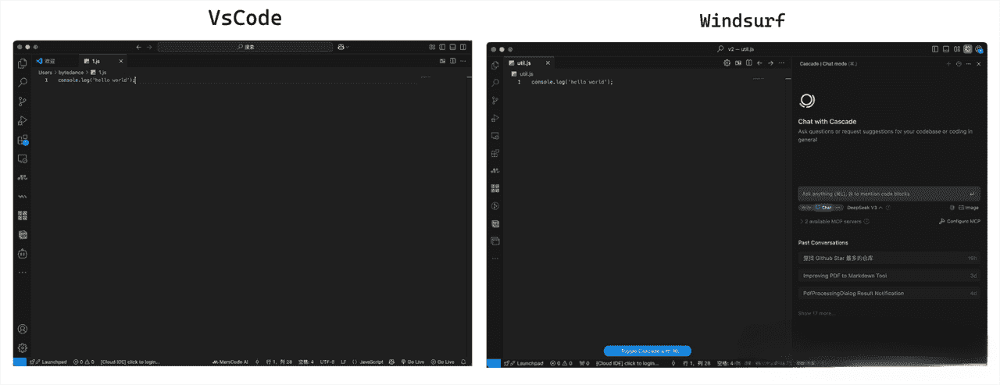

> 而 **Cline** 则是完全开源，并且直接作为 **VsCode** **插件提供，并且支持配置各种三**方的 AI API，非常灵活，所以如果你是 AI 编程小白，也是推荐使用 VsCode + Cline 来进行入门。

Cline 的安装也比较简单，直接在 VsCode 插件市场搜索，Cline 找到后点击安装即可（注意这里还有很多非官方的版本，直接安装那个下载量最大的就好）：


安装完成后，我们在左侧工具栏找到 Cline 的图标，点击打开设置，然后进行模型配置：

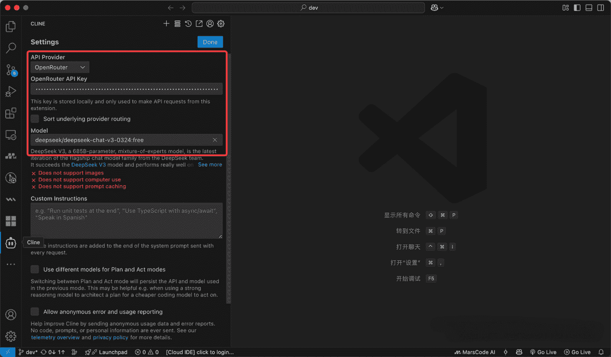

这里支持了多种模型提供商，大家按需选择即可：

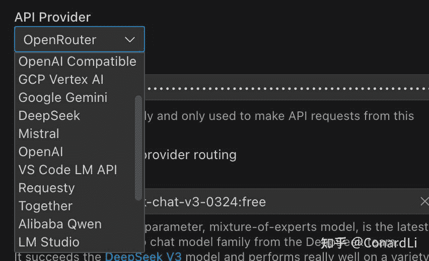

模型配置完成之后，我们可以在聊天窗口进行测试，如果正常输出则说明配置成功：

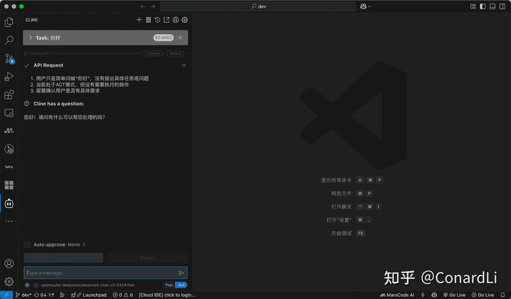

### 4.3 在 Cline 中配置 mcp-mongo-server

接下来，我们需要找到一个支持 MongoDB 的 MCP Server，本来想自己开发一个，但是简单搜了一下，发现已经有几个了：

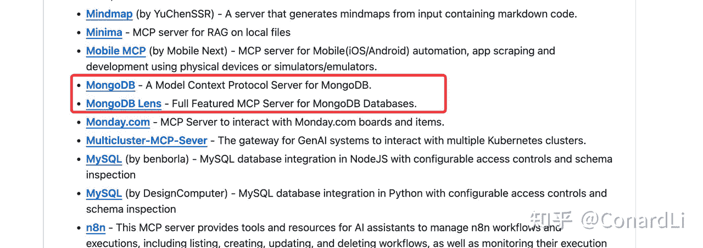

**这里我们选择使用 ****m**cp-mongo-server：

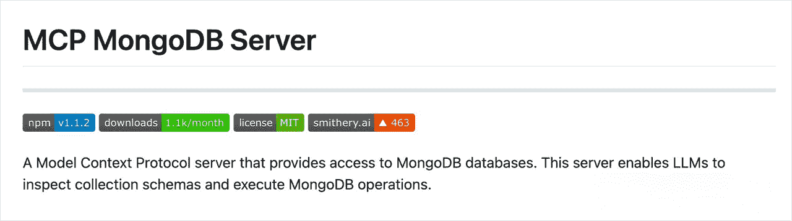

**可以发现这里内置了一批 MCP **Server 列表，并且也支持一键安装：

> 下面我们开始在 Cline 中配置 MCP Server，首先点击上方工具栏的 MCP Server 图标


**然**后发现打开了一个 JSON 文件，这就是 Cline 用于存放 MCP 配置的地方，里面只有一个空对象：

> 但是搜了下我们选择的 MCP Server 并没有在这个内置列表里，所以我们选择手动配置，其实手动配置也非常简单，我们点击 installed tab，然后点击下方的 Configure MCP Servers，

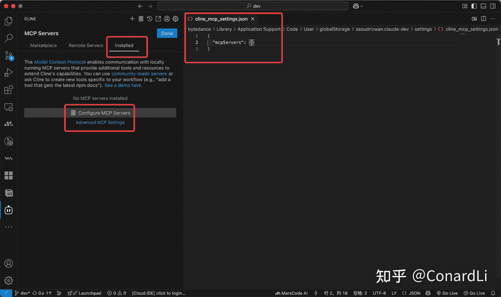

其实在任何支持了 MCP 的客户端中都可以这样配置：

> 每个 MCP Server 都会提供这份配置的写法，比如我们选择的 mcp-mongo-server，这里所说的在 Claude Desktop 中使用

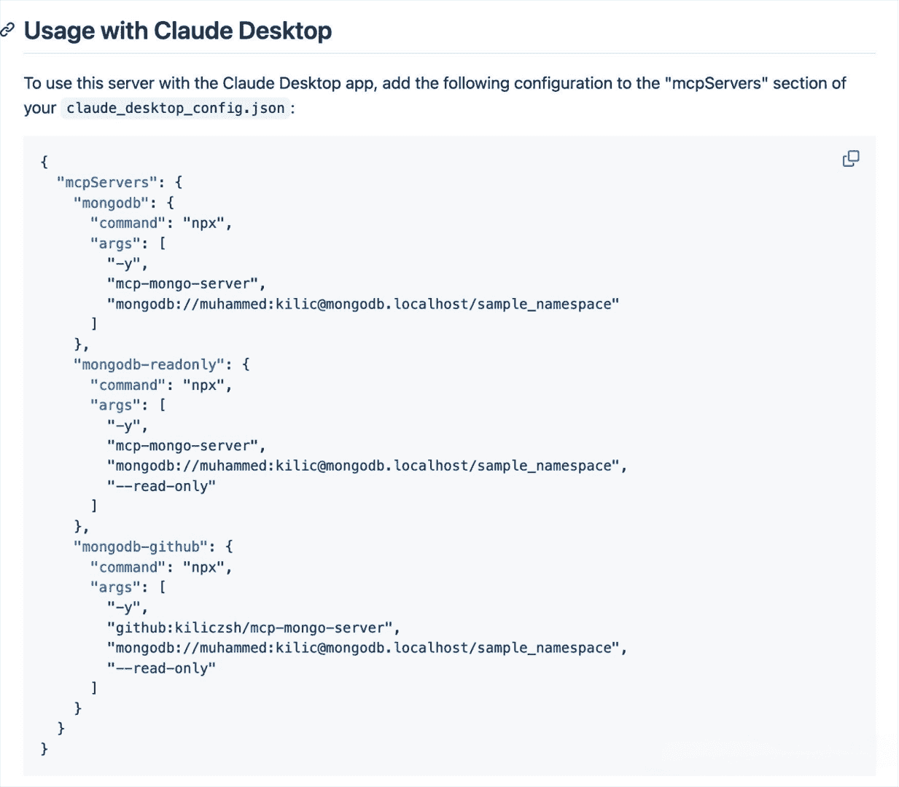

**配置看着挺复杂的，但实际上它支持提供了三种配置不同的**写法，其实每个配置中只包含两个关键参数：

+   **command：**指定在命令行中通过什么命令进行执行，在这个例子中，所有配置都使用 npx 命令（也就是 Node.js 环境）。

+   **args：**是一个数组，包含传递给 command 的参数。

**这三个配置的意思分别是：**

+   **mongodb**：运行 mcp-mongo-server npm 包，并且使用指定的 MongoDB 连接字符串，默认是读写模式。

+   mongodb-readonly：同样运行 mcp-mongo-server npm 包，使用相同的 MongoDB 连接字符串，但增加了--read-only 参数，意味着这个配置会以只读模式运行。

+   **mongodb-github**：从 GitHub 上的 kiliczsh/mcp-mongo-server 仓库获取包来运行，而不是 npm 包，使用相同的 MongoDB 连接字符串，并且也设置了只读模式。

可以直接到客户端查看这个数据库的连接地址：

> 这里我们直接使用其最简单的配置，本地 mongo 一般不会设置用户名密码。

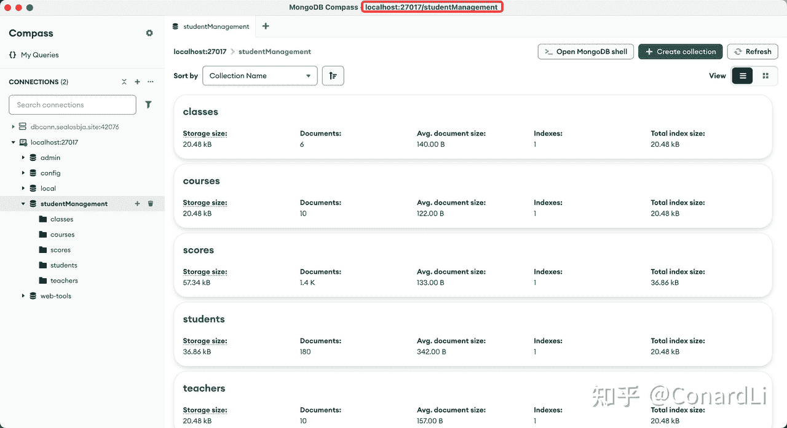

**然后配置如下：**

```
{
    &quot;mongodb&quot;: {
      &quot;command&quot;: &quot;npx&quot;,
      &quot;args&quot;: [
        &quot;mcp-mongo-server&quot;,
        &quot;mongodb://localhost:27017/studentManagement?authSource=admin&quot;
      ]
    }
  }
}
```

粘贴到 Cline 的 MCP 配置文件，然后我们发现左侧的 mongodb 绿灯亮起，说明配置成功：


### 4.4 通过 Prompt 优化查询效果

> **MCP Server**** 为模型提供了访问数据库的能力，但**是数据库的表结构对于模型还是完全黑盒的。

> 所**以模型只能**靠猜，或者去先获取一下表结构，再进行后续操作，猜还是有可能会出错的，多获取一次表结构也会让回答速度变慢，以及消耗更多的 Token。

关于表结构的说明大家可以去用 DeepSeek 来生成：

> 所以这里有个优化技巧，我们直接在全局提示词里将表结构的关键信息，和我们的明确要求告诉模型，就能让模型更准确、高效的响应了

```
使用中文回复。

当用户提问中涉及学生、教师、成绩、班级、课程等实体时，需要使用 MongoDB MCP 进行数据查询和操作，表结构说明如下：

# 学生管理系统数据库表结构说明

## 1. 教师表 (teachers)

| 字段名 | 类型 | 描述 | 约束 | 示例 |
|--------|------|------|------|------|
| _id | String | 教师ID | 主键 | &quot;T001&quot; |
| name | String | 教师姓名 | 必填 | &quot;张建国&quot; |
| gender | String | 性别 | &quot;男&quot;或&quot;女&quot; | &quot;男&quot; |
| subject | String | 教授科目 | 必填 | &quot;数学&quot; |
| title | String | 职称 | 必填 | &quot;教授&quot; |
| contact.phone | String | 联系电话 | 必填 | &quot;13812345678&quot; |
| contact.office | String | 办公室位置 | 必填 | &quot;博学楼301&quot; |
| contact.wechat | String | 微信(可选) | 可选 | &quot;lily_teacher&quot; |
| isHeadTeacher | Boolean | 是否为班主任 | 可选 | true |

## 2. 班级表 (classes)

| 字段名 | 类型 | 描述 | 约束 | 示例 |
|--------|------|------|------|------|
| _id | String | 班级ID | 主键 | &quot;202301&quot; |
| className | String | 班级名称 | 必填 | &quot;2023级计算机1班&quot; |
| grade | Number | 年级 | 必填 | 2023 |
| headTeacherId | String | 班主任ID | 外键(teachers._id) | &quot;T003&quot; |
| classroom | String | 教室位置 | 必填 | &quot;1号楼302&quot; |
| studentCount | Number | 学生人数 | 必填 | 35 |
| remark | String | 备注信息 | 可选 | &quot;市级优秀班集体&quot; |

```

**然**后我们到 Cline 设置中找到 Custom Instructions ，把这段提示词粘贴进去，点击 Done：


然后我们开一个新的聊天窗口，重新来问这个问题：

> 有哪些同学期末考试比平时的考试成绩好？


在最后的结论中，按课程进行分组，给出了具体的各个科目期末考试大于平时考试的情况：

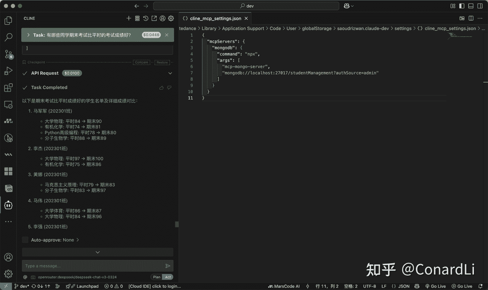

### 4.5 对比知识库

然后，我们将同样的数据集导入知识库，这里我们使用 Coze 进行演示，先来试试一张表的情况：

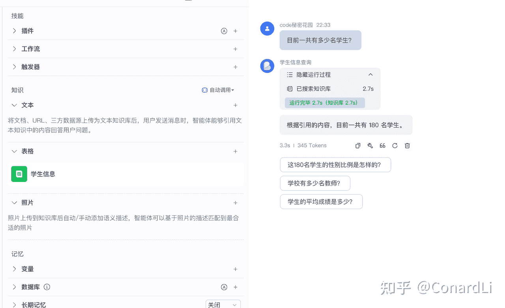

效果还可以，然后换上我们刚刚复杂一点的问题：


模型依然无法分析出准确信息，这个对比就很明显了，在这种数据的检索场景下，MCP + 数据库明显优于传统 RAG 的方式。