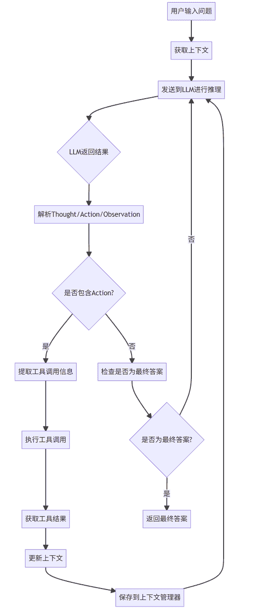
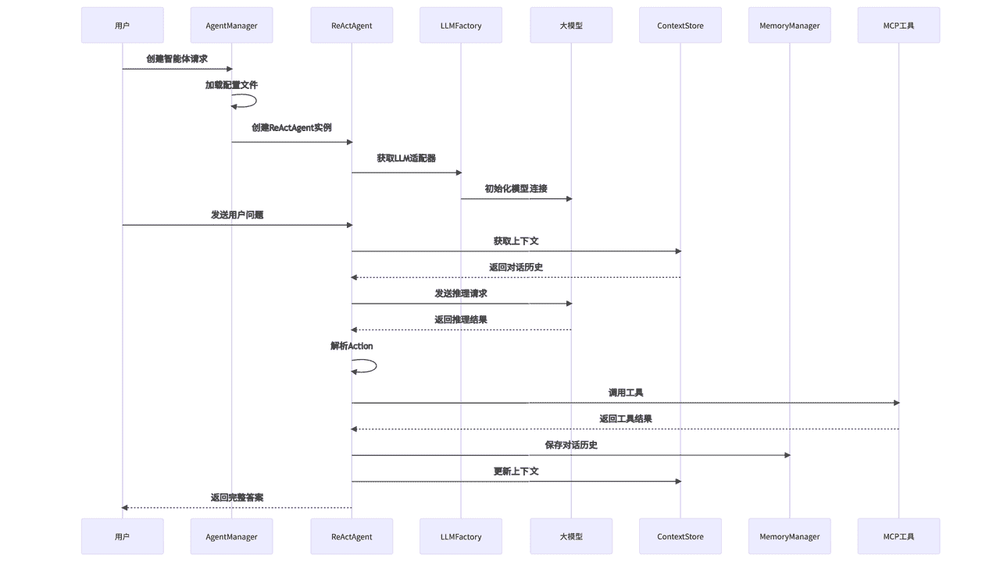
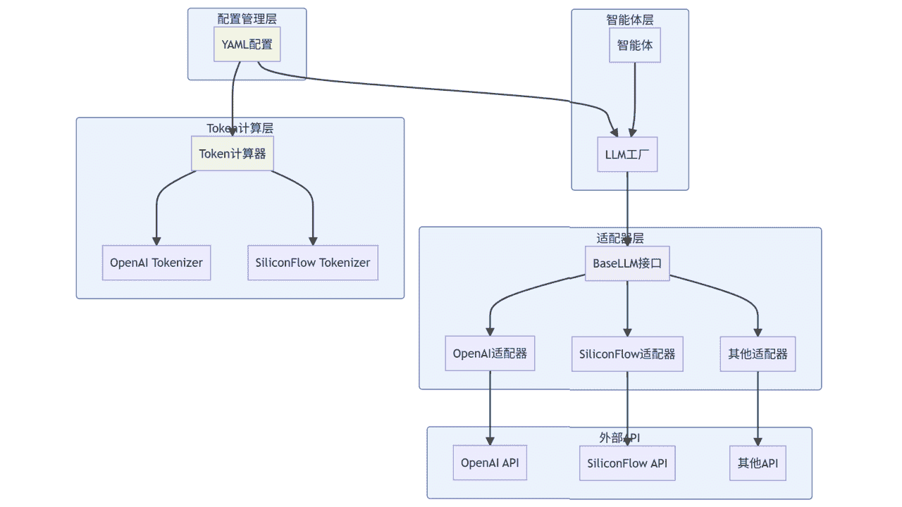
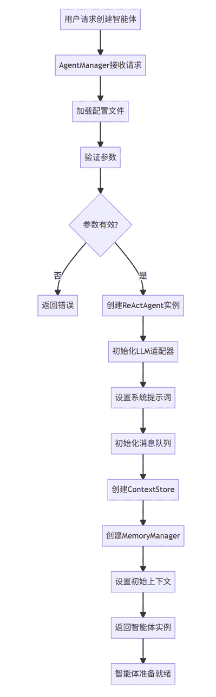
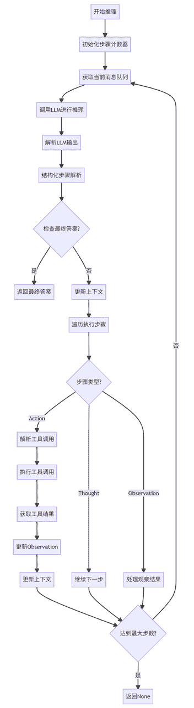
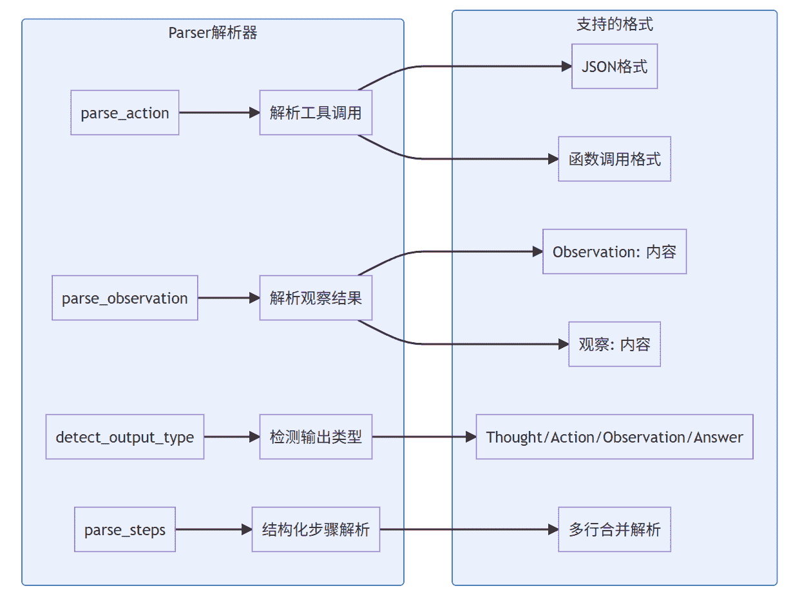
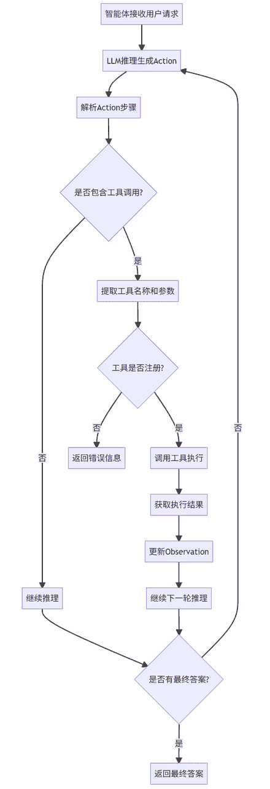

# 手搓一个会调用MCP的智能体，（架构+代码实现）

> 来源：[https://qqs7y1hozd1.feishu.cn/docx/V5vLd7bgSodySuxLMfMcMTxPnwh](https://qqs7y1hozd1.feishu.cn/docx/V5vLd7bgSodySuxLMfMcMTxPnwh)

## 前期准备

### 1.1 运行环境准备

+   Python 3.8+

+   一个可以本地运行的mcp工具

+   一个大模型API KEY

```
pip install -r requirements.txt
```

#### 1.2 配置大模型和角色

编辑 llm_config.yaml，配置你的API Key、模型、角色等参数。

llm_config.yaml 配置文件详解：

```
# 大模型提供商配置
providers:
  # OpenAI 提供商配置
  openai:
    # API密钥 - 从OpenAI官网获取
    api_key: &quot;sk-xxx&quot;
    # API基础URL - OpenAI官方API地址
    api_base: &quot;https://api.openai.com&quot;
    # API类型 - 用于选择对应的适配器
    api_type: &quot;openai&quot;
    # 默认模型 - 当未指定模型时使用的默认模型
    default_model: &quot;gpt-3.5-turbo&quot;
    # 请求超时时间（秒）
    timeout: 60
    # 重试次数 - API调用失败时的重试次数
    retry_times: 3
    # 重试延迟（秒） - 每次重试之间的等待时间
    retry_delay: 1
    # 聊天配置模板
    chat:
      # 默认聊天模板
      default:
        # 请求模板 - 定义发送给API的请求格式
        request_template:
          # 模型名称 - 使用配置中的模型
          model: &quot;{model_name}&quot;
          # 消息列表 - 对话历史
          messages: &quot;{messages}&quot;
          # 温度参数 - 控制输出的随机性（0-1），值越高越随机
          temperature: 0.7
          # Top-p参数 - 核采样参数，控制词汇选择的多样性
          top_p: 0.9
          # Top-k参数 - 限制每次选择时考虑的词汇数量
          top_k: 50
          # 最大token数 - 限制回复的最大长度
          max_tokens: 2048
        # 响应路径 - 从API响应中提取内容的路径
        response_path: &quot;choices.0.message.content&quot;   
  
  # DeepSeek V3 提供商配置（通过SiliconFlow API）
  DeepSeekV3:
    # API密钥 - 从SiliconFlow获取的DeepSeek API密钥
    api_key: &quot;sk-xxx&quot;
    # API基础URL - SiliconFlow的API地址
    api_base: &quot;https://api.siliconflow.cn&quot;
    # API类型 - 使用siliconflow适配器
    api_type: &quot;siliconflow&quot;
    # 默认模型 - DeepSeek V3模型
    default_model: &quot;deepseek-ai/DeepSeek-V3&quot;
    # 请求超时时间（秒）- DeepSeek模型推理较慢，设置更长超时
    timeout: 120
    # 重试次数
    retry_times: 3
    # 重试延迟（秒）
    retry_delay: 1
    # 聊天配置模板
    chat:
      default:
        request_template:
          model: &quot;{model_name}&quot;
          messages: &quot;{messages}&quot;
          # DeepSeek模型推荐参数
          temperature: 0.7
          top_p: 0.7
          top_k: 50
          max_tokens: 2048
        response_path: &quot;choices.0.message.content&quot; 

# 角色配置（可选）
roles:
  # 助手角色
  assistant:
    # 系统提示词 - 定义AI助手的角色和行为
    system_prompt: &quot;你是一个有用的AI助手，能够帮助用户解决各种问题。&quot;
    # 角色特定参数
    temperature: 0.7
    max_tokens: 1024
  
  # 代码助手角色
  code_assistant:
    system_prompt: &quot;你是一个专业的编程助手，擅长代码编写、调试和优化。&quot;
    temperature: 0.3  # 代码生成需要更确定性
    max_tokens: 2048


```

### 1.3 ReAct智能体框架（Reasoning and Acting）

#### 1.3.1 工作流程

+   **思考（Thought）：**分析当前情况

+   **行动（Action）：**决定下一步操作

+   观察（Observation）：获取行动结果

+   **循环：**直到解决问题

#### 1.3.2 实现方式

```
[系统提示]
你是一个智能助手，可以思考问题并调用工具。请按照以下格式输出：
思考（Thought）：分析当前情况
行动（Action）：选择要执行的操作
观察（Observation）：记录操作结果

[示例]
问题（Question）:&quot;今天天津天气如何？&quot;

思考（Thought）：我需要调用 get_weather 工具来查天气。
行动（Action）：调用get_weather(&quot;天津&quot;)
观察（Observation）：当前天津天气为 12℃，多云。

思考（Thought）：已获取答案，可以回答了。
行动（Action）：返回天气信息
观察（Observation）：天津今日天气为 12℃，多云。

最终答案（Answer）：天津今日天气为 12℃，多云。
```

> 在实际应用中，主机端可以实现一个"文本提取器"，自动从行动（Action）中提取函数名和参数（function name & arguments），然后将其发送给本地的 mcp 工具或通过 function call 的方式进行实际执行。

这样，模型只需专注于**推理和决策**，具体的工具调用和结果获取由主机端自动完成，实现推理与行动的闭环。

#### 1.3.3 ReAct推理提示词

```
# 智能体配置
agent:
  # 系统提示词 - ReAct智能体的核心提示词
  system_prompt: |
    你是一个智能 Agent，具备思考、调用工具和观察结果的能力,请根据用户的问题，灵活选择直接回复还是调用工具。请严格按照以下格式输出：
    Thought: &lt;你在思考什么？&gt;  
    Action: 如果你需要调用工具，只输出如下JSON格式（不要加任何markdown代码块或```json）：
      {
        &quot;method&quot;: &quot;tools/call&quot;,
        &quot;params&quot;: {
          &quot;name&quot;: &quot;工具名&quot;,
          &quot;arguments&quot;: { &quot;参数名&quot;: &quot;参数值&quot; }
        }
      }
    Observation:如果你需要调用工具，请放空,等待Action调用成功后返回结果再进行观察。
    Answer: 如果你需要调用工具，请放空，否则请按照如下输出&lt;你的最终回答&gt;，如果有工具调用结果，请严格按工具调用结果输出，不要编造默认值。
    注意：
    - Action 必须为标准 JSON 格式，method 固定为 tools/call，name 为工具名，arguments 为参数字典。
    - Action 步骤只输出纯JSON，不要加任何markdown代码块（如```json）。
    - 每次调用工具失败，应重新思考并调整策略；
  # 智能体参数 - 控制推理过程
  temperature: 0.1    # 低温度确保输出格式的一致性
  top_p: 0.9         # 保持词汇选择的多样性
  top_k: 20          # 限制词汇选择范围
  frequency_penalty: 0.5  # 减少重复内容
  max_tokens: 1024   # 限制单次回复长度
```

#### 1.3.4 ReAct推理循环流程



## agent系统架构与调用流程

主机agent是整个智能体系统的"大脑"和"指挥官"，负责统筹全局、协调资源、管理安全。

> 在MCP（Model Context Protocol）架构中，主机是连接用户、大模型和外部工具的核心枢纽。

**agent架构概览如下：**

### 2.1 系统架构概览

```
┌─────────────────┐    ┌─────────────────┐    ┌─────────────────┐
│   用户输入      │    │   配置文件      │    │   外部工具      │
│   (User Input)  │    │  (Config Files) │    │  (MCP Tools)    │
└─────────┬───────┘    └─────────┬───────┘    └─────────┬───────┘
          │                      │                      │
          ▼                      ▼                      ▼
┌─────────────────────────────────────────────────────────────────┐
│                    智能体系统 (Agent System)                     │
├─────────────────┬─────────────────┬─────────────────┬───────────┤
│   AgentManager  │   ReActAgent    │   LLMFactory    │  MCPClient│
│   (智能体管理)   │   (推理执行)     │   (模型工厂)     │  (工具管理)│
├─────────────────┼─────────────────┼─────────────────┼───────────┤
│   ContextStore  │   MemoryManager │   AdapterMgr    │  Logger   │
│   (上下文管理)   │   (记忆管理)     │   (适配器管理)   │  (日志)   │
└─────────────────┴─────────────────┴─────────────────┴───────────┘
          │                      │                      │
          ▼                      ▼                      ▼
┌─────────────────┐    ┌─────────────────┐    ┌─────────────────┐
│   大模型API     │    │   本地工具      │    │   结果输出      │
│  (LLM APIs)     │    │  (Local Tools)  │    │  (Output)       │
└─────────────────┘    └─────────────────┘    └─────────────────┘

```

### 2.2 核心调用流程

#### 2.2.1 基础调用流程



### 2.3 详细流程说明

#### 2.3.1 第一步：系统初始化

1.  **配置文件加载**

```
# 加载配置文件
config = YAMLConfig()
config.load(&quot;llm_config.yaml&quot;)

```

1.  **组件初始化**

+   AgentManager：管理智能体生命周期

+   LLMFactory：创建大模型适配器

+   ContextStore：管理对话上下文

+   MemoryManager：管理对话历史

#### 2.3.2 第二步：智能体创建

**创建ReActAgent实例**

```
agent = ReActAgent(
    provider=&quot;openai&quot;,
    role=&quot;assistant&quot;, 
    user_content=&quot;用户问题&quot;,
    config=config
)

```

**初始化上下文**

+   从ContextStore获取历史上下文

+   设置系统参数

+   初始化对话历史

#### 2.3.3 第三步：ReAct推理循环

**思考阶段（Thought）**

+   LLM分析当前问题

+   生成推理思路

+   决定下一步行动

**行动阶段（Action）**

+   解析工具调用需求

+   提取工具名称和参数

+   验证工具可用性

观察阶段（Observation）

+   执行工具调用

+   获取执行结果

+   更新ContextStore

**循环判断**

+   检查是否为最终答案

+   决定是否继续推理

+   管理循环次数限制

#### 2.3.4 第四步：结果输出

**答案格式化**

+   提取最终答案

+   格式化输出内容

+   清理中间过程信息

**上下文更新**

+   保存对话历史到MemoryManager

+   更新ContextStore

+   优化上下文长度

### 2.4 各组件职责

主要要实现以下五大组件：

#### 2.4.1 AgentManager（智能体管理器）

**职责：**统一管理智能体的创建、配置和生命周期

**功能：**

+   加载和验证配置文件

+   创建不同类型的智能体

+   管理智能体实例池

+   提供统一的调用接口

#### 2.4.2 ReActAgent（推理执行器）

**职责：**实现ReAct推理循环，协调LLM和工具调用

**功能：**

+   解析LLM输出中的Thought/Action/Observation

+   管理推理循环逻辑

+   处理工具调用请求

+   生成最终答案

#### 2.4.3 LLMFactory（模型工厂）

**职责：**创建和管理不同大模型的适配器

**功能：**

+   根据配置创建适配器实例

+   管理API连接和认证

+   处理模型调用错误

+   支持流式输出

#### 2.4.4 ContextStore（上下文存储）

**职责：**管理对话上下文和历史记录

**功能：**

+   维护对话上下文

+   智能裁剪消息

+   管理结构化步骤

+   提供上下文统计

#### 2.4.5 MemoryManager（记忆管理器）

**职责：**管理智能体的对话历史

**功能：**

+   存储对话历史

+   按agent_id组织数据

+   提供历史查询

+   清理历史记录

## 统一的API调用与Token计算

在业务中经常会使用多个大模型api，甚至自主搭建的模型，统一api调用方便业务层进行统一的调度，同时token计算在上下文中十分关键。

> 很多大模型调用工具失败就源于超过大模型上下文token限制,导致内容备截断，后续我们在上下文管理中也需要用到token计算。

### 3.1 系统架构图



**架构说明**：

+   **智能体层**：通过统一的接口调用大模型

+   **适配器层**：为不同API提供商提供统一接口

+   **Token计算层**：支持不同模型的token计算

+   **配置管理层**：通过YAML文件管理所有配置

+   **外部API**：各种大模型服务提供商

### 3.2 API调用流程图


**流程说明：**

+   **用户请求：**智能体接收用户输入

+   **工厂创建：**根据配置创建对应的LLM适配器

+   **配置读取：**从YAML文件读取API密钥、模型等配置

+   **适配器调用：**通过统一接口调用具体API

+   **结果返回：**将API响应返回给用户

### 3.3 Token计算流程图


**流程说明：**

> **文本输入：**接收需要计算token的文本

> **提供商选择：**根据配置选择合适的tokenizer

**计算方式：**

> **OpenAI：**使用tiktoken库精确计算

> SiliconFlow/DeepSeek：使用字符级计算

> **结果返回：**返回包含token数量和token列表的字典

### 3.4 基础接口定义

首先定义统一的接口规范：

```
# llm/adapters/base_llm.py
from typing import List, Dict, Any, Optional, AsyncGenerator
from llm.logging.decorators import log_method

class BaseLLM:
    def __init__(self, config: Any = None, **kwargs):
        self.config = config or kwargs

    @log_method(module=&quot;llm&quot;, level=&quot;INFO&quot;)
    async def chat(self, messages: List[Dict[str, str]]) -&gt; str:
        raise NotImplementedError(&quot;chat 方法需要子类实现&quot;)

    @log_method(module=&quot;llm&quot;, level=&quot;INFO&quot;)
    async def stream_chat(self, messages: List[Dict[str, str]]) -&gt; AsyncGenerator[str, None]:
        raise NotImplementedError(&quot;stream_chat 方法需要子类实现&quot;)

    @log_method(module=&quot;llm&quot;, level=&quot;INFO&quot;)
    async def get_embedding(self, text: str) -&gt; List[float]:
        raise NotImplementedError(&quot;get_embedding 方法需要子类实现&quot;)

    @log_method(module=&quot;llm&quot;, level=&quot;INFO&quot;)
    async def get_embeddings_batch(self, texts: List[str], batch_size: int = 32) -&gt; List[List[float]]:
        raise NotImplementedError(&quot;get_embeddings_batch 方法需要子类实现&quot;)

    @log_method(module=&quot;llm&quot;, level=&quot;INFO&quot;)
    async def rerank(self, query: str, documents: List[str], top_n: Optional[int] = None) -&gt; List[Dict[str, Any]]:
        raise NotImplementedError(&quot;rerank 方法需要子类实现&quot;)

```

**代码解释：**

> **BaseLLM：**定义了大模型适配器的统一接口

> **chat：**同步聊天接口，返回完整的回复内容

> **stream_chat：**流式聊天接口，支持实时返回

> get_embedding和get_embeddings_batch：获取文本嵌入向量

> **rerank：**文档重排序功能

使用装饰器进行日志记录，便于调试和监控

### 3.5 SiliconFlow适配器实现

```
# llm/adapters/siliconflow_llm.py
from typing import List, Dict, Any, Optional, AsyncGenerator
import json
import logging
import httpx
import asyncio
from .base_llm import BaseLLM
from llm.logging.decorators import log_method

logger = logging.getLogger(__name__)

class SiliconFlowChat(BaseLLM):
    def __init__(self, config: Any = None, **kwargs):
        self.api_key = kwargs.get(&#x27;api_key&#x27;)
        self.api_base = kwargs.get(&#x27;api_base&#x27;, &#x27;https://api.siliconflow.cn&#x27;)
        self.model = kwargs.get(&#x27;model_name&#x27;, &#x27;Qwen/QwQ-32B&#x27;)
        self.timeout = kwargs.get(&#x27;timeout&#x27;, 30)
        self.retry_times = kwargs.get(&#x27;retry_times&#x27;, 3)
        self.retry_delay = kwargs.get(&#x27;retry_delay&#x27;, 1)
        self.system_prompt = kwargs.get(&#x27;system_prompt&#x27;)
        super().__init__(config or kwargs)

    def _validate_config(self) -&gt; None:
        if not self.api_key:
            raise ValueError(&quot;API key is required&quot;)
        if not self.model:
            raise ValueError(&quot;Model name is required&quot;)
        if not self.api_base:
            raise ValueError(&quot;API base URL is required&quot;)

    async def _call_api(self, *args, **kwargs) -&gt; Any:
        headers = {
            &#x27;Authorization&#x27;: f&#x27;Bearer {self.api_key}&#x27;,
            &#x27;Content-Type&#x27;: &#x27;application/json&#x27;
        }
        is_stream = kwargs.get(&#x27;data&#x27;, {}).get(&#x27;stream&#x27;, False)
        try:
            async with httpx.AsyncClient(timeout=self.timeout) as client:
                response = await client.post(
                    f&#x27;{self.api_base}{kwargs.get(&quot;endpoint&quot;, &quot;&quot;)}&#x27;,
                    headers=headers,
                    json=kwargs.get(&#x27;data&#x27;)
                )
                response.raise_for_status()
                if is_stream:
                    return response
                return response.json()
        except httpx.HTTPError as e:
            logger.error(f&quot;HTTP Error: {str(e)}&quot;)
            logger.error(f&quot;Response: {e.response.text if hasattr(e, &#x27;response&#x27;) else &#x27;No response&#x27;}&quot;)
            raise
        except Exception as e:
            logger.error(f&quot;Error calling API: {str(e)}&quot;)
            raise

    @log_method(module=&quot;llm&quot;, level=&quot;INFO&quot;)
    async def chat(self, messages: List[Dict[str, str]]) -&gt; str:
        if self.system_prompt:
            messages = [{&quot;role&quot;: &quot;system&quot;, &quot;content&quot;: self.system_prompt}] + messages
        data = {
            &#x27;model&#x27;: self.model,
            &#x27;messages&#x27;: messages,
            &#x27;stream&#x27;: False,
            &#x27;temperature&#x27;: getattr(self, &#x27;temperature&#x27;, 0.7),
            &#x27;top_p&#x27;: getattr(self, &#x27;top_p&#x27;, 0.7),
            &#x27;top_k&#x27;: getattr(self, &#x27;top_k&#x27;, 50),
            &#x27;frequency_penalty&#x27;: getattr(self, &#x27;frequency_penalty&#x27;, 0.5),
            &#x27;max_tokens&#x27;: getattr(self, &#x27;max_tokens&#x27;, 512)
        }
        result = await self._call_api(endpoint=&#x27;/v1/chat/completions&#x27;, data=data)
        return result[&#x27;choices&#x27;][0][&#x27;message&#x27;][&#x27;content&#x27;]

    @log_method(module=&quot;llm&quot;, level=&quot;INFO&quot;)
    async def stream_chat(self, messages: List[Dict[str, str]]) -&gt; AsyncGenerator[str, None]:
        if self.system_prompt:
            messages = [{&quot;role&quot;: &quot;system&quot;, &quot;content&quot;: self.system_prompt}] + messages
        data = {
            &#x27;model&#x27;: self.model,
            &#x27;messages&#x27;: messages,
            &#x27;stream&#x27;: True,
            &#x27;temperature&#x27;: getattr(self, &#x27;temperature&#x27;, 0.7),
            &#x27;top_p&#x27;: getattr(self, &#x27;top_p&#x27;, 0.7),
            &#x27;top_k&#x27;: getattr(self, &#x27;top_k&#x27;, 50),
            &#x27;frequency_penalty&#x27;: getattr(self, &#x27;frequency_penalty&#x27;, 0.5),
            &#x27;max_tokens&#x27;: getattr(self, &#x27;max_tokens&#x27;, 512)
        }
        for retry in range(self.retry_times):
            try:
                response = await self._call_api(endpoint=&#x27;/v1/chat/completions&#x27;, data=data)
                async for line in response.aiter_lines():
                    if line:
                        line = line.strip()
                        if line.startswith(&#x27;data: &#x27;):
                            line = line[6:]
                            if line == &#x27;[DONE]&#x27;:
                                break
                            try:
                                chunk = json.loads(line)
                                if chunk[&#x27;choices&#x27;][0][&#x27;delta&#x27;].get(&#x27;content&#x27;):
                                    yield chunk[&#x27;choices&#x27;][0][&#x27;delta&#x27;][&#x27;content&#x27;]
                            except json.JSONDecodeError as e:
                                logger.warning(f&quot;Failed to parse chunk: {e}&quot;)
                                continue
                break
            except Exception as e:
                if retry == self.retry_times - 1:
                    logger.error(f&quot;Failed after {self.retry_times} retries: {e}&quot;)
                    raise
                logger.warning(f&quot;Retry {retry + 1}/{self.retry_times} due to error: {e}&quot;)
                await asyncio.sleep(self.retry_delay)

    @log_method(module=&quot;llm&quot;, level=&quot;INFO&quot;)
    async def chat_with_context(self, messages: List[Dict[str, str]], context: Dict[str, Any]) -&gt; str:
        if self.system_prompt:
            context_str = &quot;\n&quot;.join([f&quot;{k}: {v}&quot; for k, v in context.items()])
            system_message = f&quot;{self.system_prompt}\n\nContext:\n{context_str}&quot;
            messages = [{&quot;role&quot;: &quot;system&quot;, &quot;content&quot;: system_message}] + messages
        return await self.chat(messages)

```

**代码解释：**

> SiliconFlowChat：SiliconFlow API的完整实现

> _validate_config：验证配置参数的有效性

> **_call_api：**统一的API调用方法，支持错误处理和重试

> **chat：**同步聊天接口，支持系统提示和参数配置

> **stream_chat：**流式聊天接口，支持实时返回和重试机制

> chat_with_context：支持上下文的聊天接口

### 3.6 OpenAI适配器实现

```
# llm/adapters/openai_llm.py
from typing import List, Dict, Any, Optional, AsyncGenerator
import openai
from .base_llm import BaseLLM

class OpenAIChat(BaseLLM):
    def __init__(self, config: Any = None, **kwargs):
        self.api_key = kwargs.get(&#x27;api_key&#x27;)
        self.api_base = kwargs.get(&#x27;api_base&#x27;, &#x27;https://api.openai.com/v1&#x27;)
        self.model = kwargs.get(&#x27;model_name&#x27;, &#x27;gpt-3.5-turbo&#x27;)
        self.timeout = kwargs.get(&#x27;timeout&#x27;, 30)
        self.system_prompt = kwargs.get(&#x27;system_prompt&#x27;)
        super().__init__(config or kwargs)
        openai.api_key = self.api_key
        openai.api_base = self.api_base

    async def chat(self, messages: List[Dict[str, str]]) -&gt; str:
        if self.system_prompt:
            messages = [{&quot;role&quot;: &quot;system&quot;, &quot;content&quot;: self.system_prompt}] + messages
        response = await openai.ChatCompletion.acreate(
            model=self.model,
            messages=messages,
            timeout=self.timeout
        )
        return response[&#x27;choices&#x27;][0][&#x27;message&#x27;][&#x27;content&#x27;]

    async def stream_chat(self, messages: List[Dict[str, str]]) -&gt; AsyncGenerator[str, None]:
        # 可选实现
        yield &quot;&quot;

    async def get_embedding(self, text: str) -&gt; List[float]:
        # 可选实现
        return []

    async def get_embeddings_batch(self, texts: List[str], batch_size: int = 32) -&gt; List[List[float]]:
        # 可选实现
        return []

    async def rerank(self, query: str, documents: List[str], top_n: Optional[int] = None) -&gt; List[Dict[str, Any]]:
        # 可选实现
        return []

```

**代码解释**：

+   **OpenAIChat****：**OpenAI API的简洁实现

+   使用官方SDK进行API调用

+   支持自定义API基础URL和超时设置

+   自动添加系统提示到消息列表

### 3.7 Token计算实现

```
# llm/adapters/tokenizer.py
import importlib
from typing import List, Tuple, Dict, Any

class BaseTokenizer:
    def count_tokens(self, text: str) -&gt; Tuple[int, List[str]]:
        raise NotImplementedError

class OpenAITokenizer(BaseTokenizer):
    def __init__(self, model_name: str = &quot;gpt-3.5-turbo&quot;):
        try:
            self.tiktoken = importlib.import_module(&quot;tiktoken&quot;)
        except ImportError:
            raise ImportError(&quot;请先安装tiktoken库: pip install tiktoken&quot;)
        self.model_name = model_name
        self.encoder = self.tiktoken.encoding_for_model(model_name)

    def count_tokens(self, text: str) -&gt; Tuple[int, List[str]]:
        tokens = self.encoder.encode(text)
        token_strs = [self.encoder.decode([t]) for t in tokens]
        return len(tokens), token_strs

class SiliconFlowTokenizer(BaseTokenizer):
    def __init__(self, model_name: str = &quot;text-embedding-v1&quot;):
        self.model_name = model_name
        
    def count_tokens(self, text: str) -&gt; Tuple[int, List[str]]:
        tokens = list(text)
        return len(tokens), tokens

def get_tokenizer(provider: str, model_name: str = None) -&gt; BaseTokenizer:
    provider = provider.lower()
    # DeepSeek系列模型使用SiliconFlowTokenizer
    if provider in [&quot;deepseekv3&quot;, &quot;deepseekr1&quot;] or provider.startswith(&quot;deepseek&quot;):
        return SiliconFlowTokenizer(model_name or &quot;text-embedding-v1&quot;)
    elif provider == &quot;openai&quot;:
        return OpenAITokenizer(model_name or &quot;gpt-3.5-turbo&quot;)
    elif provider == &quot;siliconflow&quot;:
        return SiliconFlowTokenizer(model_name or &quot;text-embedding-v1&quot;)
    else:
        raise ValueError(f&quot;暂不支持的provider: {provider}&quot;)

def count_tokens(text: str, provider: str = &quot;openai&quot;, model_name: str = None) -&gt; Dict[str, Any]:
    &quot;&quot;&quot;
    计算文本的token数量
    Args:
        text: str，输入文本
        provider: str，模型提供商
        model_name: str，可选，模型名
    Returns:
        dict，包含token数量和token列表
    &quot;&quot;&quot;
    tokenizer = get_tokenizer(provider, model_name)
    token_count, tokens = tokenizer.count_tokens(text)
    return {
        &quot;token_count&quot;: token_count,
        &quot;tokens&quot;: tokens
    }

```

**代码解释：**

> **BaseTokenizer：**Token计算器的基类

> OpenAITokenizer：使用tiktoken库进行精确的token计算

> SiliconFlowTokenizer：简单的字符级token计算

> **get_tokenizer：**根据提供商选择合适的tokenizer

> **count_tokens：**统一的token计算接口

### 3.8 工厂模式创建适配器

```
# llm/adapters/llm_factory.py
from llm.config.config import YAMLConfig
from .openai_llm import OpenAIChat
from .siliconflow_llm import SiliconFlowChat

class DummyLLM:
    def __init__(self, **kwargs):
        self.config = kwargs
    async def chat(self, messages):
        return &quot;[模拟回复]&quot; + str(messages[-1][&quot;content&quot;])

class LLMFactory:
    @classmethod
    def create_from_yaml(cls, provider_name: str, role_name: str, yaml_path: str = &quot;llm_config.yaml&quot;, user_content: str = None):
        config = YAMLConfig(yaml_path)
        provider = config.get_provider(provider_name)
        role = config.get_role(role_name)
        chat_template = config.get_chat_template(provider_name, role_name)
        api_type = provider[&quot;api_type&quot;]
        params = {**chat_template, **role}
        params[&quot;model_name&quot;] = provider[&quot;default_model&quot;]
        params[&quot;api_key&quot;] = provider[&quot;api_key&quot;]
        params[&quot;api_base&quot;] = provider[&quot;api_base&quot;]
        params[&quot;system_prompt&quot;] = role.get(&quot;system_prompt&quot;)
        # 选择对应的 LLM 实现
        if api_type == &quot;openai&quot;:
            llm = OpenAIChat(**params)
        elif api_type == &quot;siliconflow&quot;:
            llm = SiliconFlowChat(**params)
        else:
            llm = SiliconFlowChat(**params)
        return llm

```

**代码解释**：

+   **LLMFactory****：**统一的LLM创建工厂

+   **c**reate_from_yaml：从YAML配置文件创建LLM实例

+   支持多种提供商和角色配置

+   自动合并聊天模板和角色配置

+   提供DummyLLM用于测试

### 3.9 使用示例

```
# examples/llm_usage_example.py
import asyncio
from llm.adapters.llm_factory import LLMFactory
from llm.adapters.tokenizer import count_tokens

async def main():
    # 从配置文件创建SiliconFlow LLM
    siliconflow_llm = LLMFactory.create_from_yaml(
        provider_name=&quot;siliconflow&quot;,
        role_name=&quot;assistant&quot;,
        yaml_path=&quot;llm_config.yaml&quot;
    )
    
    # 从配置文件创建OpenAI LLM
    openai_llm = LLMFactory.create_from_yaml(
        provider_name=&quot;openai&quot;,
        role_name=&quot;assistant&quot;,
        yaml_path=&quot;llm_config.yaml&quot;
    )
    
    # 统一的消息格式
    messages = [
        {&quot;role&quot;: &quot;user&quot;, &quot;content&quot;: &quot;你好，请介绍一下Python编程语言的特点。&quot;}
    ]
    
    # 使用SiliconFlow
    print(&quot;=== SiliconFlow响应 ===&quot;)
    response1 = await siliconflow_llm.chat(messages)
    print(f&quot;内容: {response1}&quot;)
    
    # 使用OpenAI
    print(&quot;\n=== OpenAI响应 ===&quot;)
    response2 = await openai_llm.chat(messages)
    print(f&quot;内容: {response2}&quot;)
    
    # Token计算示例
    text = &quot;这是一个测试文本，用于计算token数量。&quot;
    token_info = count_tokens(text, provider=&quot;siliconflow&quot;)
    print(f&quot;\nToken计算: {token_info[&#x27;token_count&#x27;]} tokens&quot;)
    
    # 流式聊天示例
    print(&quot;\n=== 流式聊天 ===&quot;)
    async for chunk in siliconflow_llm.stream_chat(messages):
        print(chunk, end=&quot;&quot;, flush=True)

if __name__ == &quot;__main__&quot;:
    asyncio.run(main())

```

**代码解释：**

> 展示了如何使用工厂模式创建不同的LLM实例

> 演示了同步和流式聊天功能

> 包含token计算的使用示例

> 使用统一的配置管理

**通过这样的设计，实现了：**

> **统一接口：**所有大模型都使用相同的调用方式

> **易于扩展：**添加新的模型提供商只需实现BaseLLM接口

> **配置灵活：**通过YAML配置文件管理不同环境的设置

> **功能完整：**支持同步/流式聊天、token计算、嵌入向量等

> **错误处理：**完善的错误处理和重试机制

> **日志记录：**使用装饰器进行统一的日志记录

## 上下文管理实现

上下文管理是智能体系统的核心组件，负责维护对话历史、管理token使用、优化内存占用。一个好的上下文管理系统能够显著提升智能体的对话质量和响应效率。

### 4.1 ContextStore 核心实现

ContextStore是系统中负责管理对话上下文的核心组件，基于agent_id来组织和管理不同智能体的上下文数据。

```
# llm/memory/context_store.py
from llm.memory.message_utils import trim_messages

class ContextStore:
    def __init__(self):
        self.contexts = {}

    def set_context(self, agent_id, context: dict):
        &quot;&quot;&quot;设置智能体的上下文&quot;&quot;&quot;
        self.contexts[agent_id] = context

    def get_context(self, agent_id):
        &quot;&quot;&quot;获取智能体的上下文&quot;&quot;&quot;
        return self.contexts.get(agent_id, {})

    def clear_context(self, agent_id):
        &quot;&quot;&quot;清空智能体的上下文&quot;&quot;&quot;
        if agent_id in self.contexts:
            del self.contexts[agent_id]

    def trim_context_messages(self, agent_id, max_tokens=4096, provider=&quot;openai&quot;, model_name=None):
        &quot;&quot;&quot;智能裁剪上下文消息&quot;&quot;&quot;
        ctx = self.get_context(agent_id)
        if &quot;messages&quot; in ctx:
            ctx[&quot;messages&quot;] = trim_messages(ctx[&quot;messages&quot;], max_tokens=max_tokens, provider=provider, model_name=model_name)

    # 结构化步骤管理
    def set_steps(self, agent_id, steps):
        &quot;&quot;&quot;设置智能体的执行步骤&quot;&quot;&quot;
        ctx = self.get_context(agent_id)
        ctx[&quot;steps&quot;] = steps
        self.set_context(agent_id, ctx)

    def get_steps(self, agent_id):
        &quot;&quot;&quot;获取智能体的执行步骤&quot;&quot;&quot;
        ctx = self.get_context(agent_id)
        return ctx.get(&quot;steps&quot;, [])

    def replace_step(self, agent_id, step_index, new_step):
        &quot;&quot;&quot;替换指定步骤&quot;&quot;&quot;
        ctx = self.get_context(agent_id)
        steps = ctx.get(&quot;steps&quot;, [])
        if 0 &lt;= step_index &lt; len(steps):
            steps[step_index] = new_step
            ctx[&quot;steps&quot;] = steps
            self.set_context(agent_id, ctx)

    def insert_step(self, agent_id, step_index, new_step):
        &quot;&quot;&quot;插入新步骤&quot;&quot;&quot;
        ctx = self.get_context(agent_id)
        steps = ctx.get(&quot;steps&quot;, [])
        if 0 &lt;= step_index &lt;= len(steps):
            steps.insert(step_index, new_step)
            ctx[&quot;steps&quot;] = steps
            self.set_context(agent_id, ctx)

```

**核心功能说明：**

> **上下文存储：**使用字典结构按agent_id存储上下文

> **智能裁剪：**调用trim_messages函数进行token优化

> **步骤管理：**支持ReAct推理步骤的增删改查

> **内存管理：**提供上下文清理功能

### 4.2 MemoryManager 实现

MemoryManager负责管理智能体的对话历史，提供简单的历史记录功能。

```
# llm/memory/memory_manager.py
class MemoryManager:
    def __init__(self):
        self.histories = {}

    def add_message(self, agent_id, message):
        &quot;&quot;&quot;添加消息到历史记录&quot;&quot;&quot;
        if agent_id not in self.histories:
            self.histories[agent_id] = []
        self.histories[agent_id].append(message)

    def get_history(self, agent_id):
        &quot;&quot;&quot;获取智能体的历史记录&quot;&quot;&quot;
        return self.histories.get(agent_id, [])

    def clear_history(self, agent_id):
        &quot;&quot;&quot;清空智能体的历史记录&quot;&quot;&quot;
        if agent_id in self.histories:
            self.histories[agent_id] = []

```

**核心功能说明**：

+   **历史存储**：按agent_id组织对话历史

+   **消息管理**：支持消息的添加和查询

+   **内存清理**：提供历史记录清理功能

### 4.3 智能消息裁剪

**message_utils**模块提供了智能的消息裁剪和token计算功能。

```
# llm/memory/message_utils.py
from llm.adapters.tokenizer import count_tokens
from typing import List, Dict, Any
import logging

logger = logging.getLogger(__name__)

def calculate_message_tokens(message: Dict[str, Any], provider: str = &quot;openai&quot;, model_name: str = None) -&gt; int:
    &quot;&quot;&quot;计算单条消息的token数量&quot;&quot;&quot;
    content = message.get(&quot;content&quot;, &quot;&quot;)
    if not content:
        return 0
        
    try:
        token_info = count_tokens(content, provider=provider, model_name=model_name)
        return token_info[&quot;token_count&quot;]
    except Exception as e:
        logger.error(f&quot;计算token数量时出错: {str(e)}&quot;)
        # 如果出错，返回一个安全的估计值
        return len(content) // 4  # 假设每个token平均4个字符

def trim_messages(messages: List[Dict[str, Any]], max_tokens: int = 4096, provider: str = &quot;openai&quot;, model_name: str = None) -&gt; List[Dict[str, Any]]:
    &quot;&quot;&quot;智能裁剪多轮对话消息&quot;&quot;&quot;
    if not messages:
        return []

    # 计算每条消息的token数
    message_tokens = [(msg, calculate_message_tokens(msg, provider, model_name)) for msg in messages]
    total_tokens = sum(tokens for _, tokens in message_tokens)
    
    # 如果总token数在限制范围内，直接返回
    if total_tokens &lt;= max_tokens:
        return messages

    # 动态窗口裁剪策略
    trimmed = []
    current_tokens = 0
    
    # 1. 始终保留系统提示词
    system_messages = [(msg, tokens) for msg, tokens in message_tokens if msg.get(&quot;role&quot;) == &quot;system&quot;]
    for msg, tokens in system_messages:
        trimmed.append(msg)
        current_tokens += tokens
    
    # 2. 保留最新的用户和助手消息对
    remaining_messages = [(msg, tokens) for msg, tokens in message_tokens if msg.get(&quot;role&quot;) != &quot;system&quot;]
    remaining_messages.reverse()  # 从最新的消息开始处理
    
    for msg, tokens in remaining_messages:
        if current_tokens + tokens &gt; max_tokens:
            break
        trimmed.insert(len(system_messages), msg)  # 在系统消息后插入
        current_tokens += tokens
    
    # 记录裁剪信息
    removed_count = len(messages) - len(trimmed)
    if removed_count &gt; 0:
        logger.info(f&quot;上下文裁剪: 移除了 {removed_count} 条消息，从 {total_tokens} tokens 减少到 {current_tokens} tokens&quot;)
    
    return trimmed

def get_context_window(messages: List[Dict[str, Any]], max_tokens: int = 4096, provider: str = &quot;openai&quot;, model_name: str = None) -&gt; Dict[str, Any]:
    &quot;&quot;&quot;获取当前上下文的统计信息&quot;&quot;&quot;
    total_tokens = sum(calculate_message_tokens(msg, provider, model_name) for msg in messages)
    system_tokens = sum(calculate_message_tokens(msg, provider, model_name) 
                       for msg in messages if msg.get(&quot;role&quot;) == &quot;system&quot;)
    user_tokens = sum(calculate_message_tokens(msg, provider, model_name) 
                     for msg in messages if msg.get(&quot;role&quot;) == &quot;user&quot;)
    assistant_tokens = sum(calculate_message_tokens(msg, provider, model_name) 
                          for msg in messages if msg.get(&quot;role&quot;) == &quot;assistant&quot;)
    
    return {
        &quot;total_tokens&quot;: total_tokens,
        &quot;max_tokens&quot;: max_tokens,
        &quot;system_tokens&quot;: system_tokens,
        &quot;user_tokens&quot;: user_tokens,
        &quot;assistant_tokens&quot;: assistant_tokens,
        &quot;remaining_tokens&quot;: max_tokens - total_tokens,
        &quot;message_count&quot;: len(messages),
        &quot;system_messages&quot;: len([m for m in messages if m.get(&quot;role&quot;) == &quot;system&quot;]),
        &quot;user_messages&quot;: len([m for m in messages if m.get(&quot;role&quot;) == &quot;user&quot;]),
        &quot;assistant_messages&quot;: len([m for m in messages if m.get(&quot;role&quot;) == &quot;assistant&quot;])
    }

```

**核心功能说明**：

+   **Token计算**：支持多种模型的token计算

+   **智能裁剪**：优先保留系统消息和最新对话

+   **统计信息**：提供详细的上下文使用统计

+   **错误处理**：包含完善的异常处理机制

### 4.4 上下文管理流程


### 4.5 上下文数据结构使用范例

```
# llm/memory/context.py
from dataclasses import dataclass, field
from typing import List, Dict, Any, Optional
from datetime import datetime
from enum import Enum

class MessageRole(Enum):
    &quot;&quot;&quot;消息角色枚举&quot;&quot;&quot;
    SYSTEM = &quot;system&quot;
    USER = &quot;user&quot;
    ASSISTANT = &quot;assistant&quot;
    TOOL = &quot;tool&quot;

@dataclass
class ContextMessage:
    &quot;&quot;&quot;上下文消息&quot;&quot;&quot;
    role: MessageRole
    content: str
    timestamp: datetime = field(default_factory=datetime.now)
    metadata: Dict[str, Any] = field(default_factory=dict)
    token_count: Optional[int] = None

@dataclass
class ConversationContext:
    &quot;&quot;&quot;对话上下文&quot;&quot;&quot;
    session_id: str
    messages: List[ContextMessage] = field(default_factory=list)
    max_tokens: int = 4000  # 最大token限制
    current_tokens: int = 0
    created_at: datetime = field(default_factory=datetime.now)
    updated_at: datetime = field(default_factory=datetime.now)
    
    def add_message(self, message: ContextMessage):
        &quot;&quot;&quot;添加消息到上下文&quot;&quot;&quot;
        self.messages.append(message)
        self.current_tokens += message.token_count or 0
        self.updated_at = datetime.now()
        
        # 如果超出token限制，进行裁剪
        if self.current_tokens &gt; self.max_tokens:
            self._trim_context()
    
    def _trim_context(self):
        &quot;&quot;&quot;裁剪上下文，保留最重要的消息&quot;&quot;&quot;
        # 保留系统消息和最新的消息
        system_messages = [msg for msg in self.messages if msg.role == MessageRole.SYSTEM]
        other_messages = [msg for msg in self.messages if msg.role != MessageRole.SYSTEM]
        
        # 从最新的消息开始，逐步添加直到接近token限制
        trimmed_messages = system_messages.copy()
        current_tokens = sum(msg.token_count or 0 for msg in system_messages)
        
        for msg in reversed(other_messages):
            if current_tokens + (msg.token_count or 0) &lt;= self.max_tokens * 0.8:  # 保留20%缓冲
                trimmed_messages.insert(len(system_messages), msg)
                current_tokens += msg.token_count or 0
            else:
                break
        
        self.messages = trimmed_messages
        self.current_tokens = current_tokens

```

通过这样的上下文管理系统，实现了：

> **智能裁剪：**自动管理token使用，避免超出限制

> **类型安全：**使用枚举和类型注解，确保代码质量

> **持久化存储：**支持会话的保存和恢复

> **性能优化：**异步操作和智能缓存策略

> **易于监控：**提供详细的统计信息

## 智能体搭建详解

智能体是系统的核心执行单元，负责协调LLM推理、工具调用和上下文管理。本节将详细介绍智能体的搭建过程、架构设计和实现细节。

### 5.1 智能体架构设计

#### 5.1.1 整体架构图


#### 5.1.2 组件关系图


### 5.2 智能体创建流程

#### 5.2.1 创建流程图



#### 5.2.2 代码实现详解

1.  AgentManager - 智能体管理器

```
# llm/agent/agent_manager.py
from llm.agent.react_agent import ReActAgent
from llm.config.config import YAMLConfig

class AgentManager:
    def __init__(self, provider_path=&quot;llm_config.yaml&quot;, roles_path=&quot;roles.yaml&quot;):
        # 初始化配置管理器
        self.config = YAMLConfig(provider_path, roles_path)
        # 智能体实例池
        self.agents = {}

    def create_agent(self, provider, role, user_content, max_steps=5, agent_id=None):
        &quot;&quot;&quot;
        创建智能体实例
        Args:
            provider: 大模型提供商 (openai, siliconflow, deepseek等)
            role: 角色名称 (assistant, coder, analyst等)
            user_content: 用户输入内容
            max_steps: 最大推理步数
            agent_id: 智能体唯一标识
        Returns:
            ReActAgent: 智能体实例
        &quot;&quot;&quot;
        agent = ReActAgent(
            provider=provider,
            role=role,
            user_content=user_content,
            config=self.config,
            max_steps=max_steps
        )
        # 如果指定了agent_id，则保存到实例池
        if agent_id:
            self.agents[agent_id] = agent
        return agent

    def get_agent(self, agent_id):
        &quot;&quot;&quot;获取已创建的智能体&quot;&quot;&quot;
        return self.agents.get(agent_id)

    def remove_agent(self, agent_id):
        &quot;&quot;&quot;移除智能体实例&quot;&quot;&quot;
        if agent_id in self.agents:
            del self.agents[agent_id]

```

1.  ReActAgent - 核心智能体

```
# llm/agent/react_agent.py
class ReActAgent:
    def __init__(self, provider, role, user_content, config, max_steps=5, agent_id=None):
        &quot;&quot;&quot;
        初始化ReAct智能体
        Args:
            provider: 大模型提供商
            role: 角色名称
            user_content: 用户输入
            config: 配置对象
            max_steps: 最大推理步数
            agent_id: 智能体ID
        &quot;&quot;&quot;
        Logger.info(f&quot;初始化ReActAgent: provider={provider}, role={role}&quot;)
        
        # 基础属性设置
        self.provider = provider
        self.role = role
        self.user_content = user_content
        self.config = config
        self.max_steps = max_steps
        self.agent_id = agent_id or f&quot;agent-{id(self)}&quot;
        
        # 创建LLM适配器
        self.llm = LLMFactory.create_from_yaml(
            provider_name=provider,
            role_name=role,
            yaml_path=config.provider_path,
            user_content=user_content
        )
        
        # 初始化消息队列
        system_prompt = config.get_role(role).get(&quot;system_prompt&quot;, &quot;&quot;)
        self.messages = [
            {&quot;role&quot;: &quot;system&quot;, &quot;content&quot;: system_prompt},
            {&quot;role&quot;: &quot;user&quot;, &quot;content&quot;: user_content}
        ]
        
        # 初始化上下文和历史管理
        self.context_store = ContextStore()
        self.memory_manager = MemoryManager()
        self.context_store.set_context(self.agent_id, {&quot;messages&quot;: list(self.messages)})
        self.memory_manager.clear_history(self.agent_id)

```

### 5.3 推理执行流程

#### 5.3.1 ReAct推理循环流程图



#### 5.3.2 核心推理方法

```
@log_method(module=&quot;agent&quot;, level=&quot;INFO&quot;)
async def run(self):
    &quot;&quot;&quot;
    执行ReAct推理循环
    Returns:
        str: 最终答案或None
    &quot;&quot;&quot;
    for step in range(self.max_steps):
        Logger.info(f&quot;第{step+1}轮对话开始，当前消息: {self.messages}&quot;)
        
        try:
            # 1. 调用LLM进行推理
            reply = await self.llm.chat(self.messages)
            Logger.info(f&quot;LLM回复: {reply}&quot;)
            
            # 2. 解析结构化步骤
            steps = parse_steps(reply)
            
            # 3. 检查是否有最终答案
            has_answer, answer = self._check_final_answer(steps)
            if has_answer:
                Logger.info(f&quot;获得最终答案: {answer}&quot;)
                return answer
            
            # 4. 更新上下文
            self._update_context(reply, steps)
            
        except Exception as e:
            Logger.error(f&quot;LLM调用异常: {e}&quot;)
            return None

        # 5. 执行工具调用
        for i, step_item in enumerate(steps):
            if step_item[&quot;type&quot;].lower() in [&quot;action&quot;, &quot;行动&quot;]:
                # 解析工具调用
                func, args = parse_action(step_item[&quot;content&quot;])
                
                if func and func in TOOLS:
                    try:
                        # 执行工具调用
                        if isinstance(args, dict):
                            result = call_tool(func, **args)
                        elif isinstance(args, (list, tuple)):
                            result = call_tool(func, *args)
                        else:
                            result = call_tool(func, args)
                        
                        Logger.info(f&quot;工具调用结果: {result}&quot;)
                        
                        # 处理工具结果
                        result_str = self._process_tool_result(result)
                        
                        # 更新上下文中的Observation
                        self._update_observation(i, steps, result_str)
                        
                    except Exception as e:
                        result = f&quot;工具调用出错: {e}&quot;
                        Logger.error(result)
                else:
                    result = &quot;Thought: 我不太确定如何处理，请重试。&quot;
                    Logger.warning(f&quot;未识别的工具或参数: {func}&quot;)
                
                break  # 只处理第一个Action

    Logger.warning(&quot;未获得最终答案，请检查模型输出或工具注册。&quot;)
    return None

```

### 5.4 输出解析器

#### 5.4.1 解析器架构



#### 5.4.2 核心解析方法

```
# llm/agent/parsers.py

def parse_action(text):
    &quot;&quot;&quot;
    解析Action步骤，支持多种格式
    Args:
        text: 包含Action的文本
    Returns:
        tuple: (工具名称, 参数)
    &quot;&quot;&quot;
    # 1. 优先解析JSON格式
    pattern = r&#x27;Action[：:][ \t]*(.*)&#x27;
    for line in text.splitlines():
        match = pattern.match(line)
        if match:
            action_content = match.group(1).strip()
            
            # 尝试JSON解析
            try:
                action_json = json.loads(action_content)
                if (isinstance(action_json, dict) 
                    and action_json.get(&quot;method&quot;) == &quot;tools/call&quot;
                    and &quot;params&quot; in action_json):
                    name = action_json[&quot;params&quot;].get(&quot;name&quot;)
                    arguments = action_json[&quot;params&quot;].get(&quot;arguments&quot;, {})
                    return name, arguments
            except Exception:
                pass
            
            # 2. 兼容函数调用格式
            pattern_func = r&#x27;([a-zA-Z_][a-zA-Z0-9_]*)\((.*)\)&#x27;
            match_func = re.search(pattern_func, action_content)
            if match_func:
                func_name = match_func.group(1)
                arg_str = match_func.group(2)
                try:
                    args = ast.literal_eval(f&quot;[{arg_str}]&quot;)
                    return func_name, args
                except Exception as e:
                    return func_name, [f&quot;参数解析失败：{e}&quot;]
    
    return None, None

def parse_steps(text):
    &quot;&quot;&quot;
    解析多行推理步骤
    Args:
        text: LLM输出的完整文本
    Returns:
        list: 结构化步骤列表
    &quot;&quot;&quot;
    pattern = re.compile(
        r&quot;^(?P&lt;step&gt;\d+)?\s*(?P&lt;type&gt;思考|Thought|行动|Action|观察|Observation|最终答案|Answer)[：:][ \t]*(?P&lt;content&gt;.*)&quot;,
        re.I
    )
    
    results = []
    lines = text.splitlines()
    i = 0
    step_counter = 1
    
    while i &lt; len(lines):
        match = pattern.match(lines[i])
        if match:
            step = match.group(&quot;step&quot;)
            type_ = match.group(&quot;type&quot;)
            content_lines = [match.group(&quot;content&quot;).strip()]
            i += 1
            
            # 收集后续内容行
            while i &lt; len(lines) and not pattern.match(lines[i]):
                content_lines.append(lines[i].rstrip())
                i += 1
            
            content = &quot;\n&quot;.join(content_lines).strip()
            results.append({
                &quot;step&quot;: int(step) if step else step_counter,
                &quot;type&quot;: type_,
                &quot;content&quot;: content
            })
            step_counter += 1
        else:
            i += 1
    
    return results

```

### 5.5 上下文管理集成

#### 5.5.1 上下文更新流程


#### 5.5.2 上下文更新实现

```
def _update_context(self, reply: str, steps: list):
    &quot;&quot;&quot;
    更新上下文，包括消息队列和步骤
    Args:
        reply: LLM的回复
        steps: 结构化步骤
    &quot;&quot;&quot;
    # 1. 获取当前上下文
    context = self.context_store.get_context(self.agent_id)
    messages = context.get(&quot;messages&quot;, [])
    
    # 2. 添加新的助手回复
    messages.append({&quot;role&quot;: &quot;assistant&quot;, &quot;content&quot;: reply})
    
    # 3. 更新步骤
    self.context_store.set_steps(self.agent_id, steps)
    
    # 4. 获取上下文统计信息
    context_info = get_context_window(messages, provider=self.provider)
    Logger.info(f&quot;上下文统计: {context_info}&quot;)
    
    # 5. 智能裁剪（如果Token接近限制）
    if context_info[&quot;remaining_tokens&quot;] &lt; 1000:  # 安全阈值
        Logger.info(&quot;Token数接近限制，进行上下文裁剪&quot;)
        messages = trim_messages(messages, provider=self.provider)
        context_info = get_context_window(messages, provider=self.provider)
        Logger.info(f&quot;裁剪后上下文统计: {context_info}&quot;)
    
    # 6. 更新上下文
    context[&quot;messages&quot;] = messages
    self.context_store.set_context(self.agent_id, context)
    
    # 7. 更新记忆
    self.memory_manager.add_message(self.agent_id, reply)
    
    # 8. 更新当前消息队列
    self.messages = messages

```

### 5.6 使用示例

#### 5.6.1 基础智能体创建

```
from llm.agent.agent_manager import AgentManager

# 1. 创建智能体管理器
agent_manager = AgentManager()

# 2. 创建智能体
agent = agent_manager.create_agent(
    provider=&quot;openai&quot;,
    role=&quot;assistant&quot;,
    user_content=&quot;请帮我分析一下今天的天气情况&quot;,
    max_steps=5
)

# 3. 执行推理
result = await agent.run()
print(&quot;智能体回答:&quot;, result)

```

#### 5.6.2 多轮对话智能体

```
# 创建智能体
agent = agent_manager.create_agent(
    provider=&quot;openai&quot;,
    role=&quot;coder&quot;,
    user_content=&quot;请帮我写一个Python函数来计算斐波那契数列&quot;,
    agent_id=&quot;my_coder_agent&quot;
)

# 第一轮对话
result1 = await agent.run()
print(&quot;第一轮回答:&quot;, result1)

# 继续对话（智能体会记住上下文）
agent.user_content = &quot;能优化一下这个函数的性能吗？&quot;
result2 = await agent.run()
print(&quot;第二轮回答:&quot;, result2)

# 获取智能体历史
history = agent.memory_manager.get_history(&quot;my_coder_agent&quot;)
print(&quot;对话历史:&quot;, history)

```

#### 5.6.3 流式输出智能体

```
# 创建支持流式输出的智能体
agent = agent_manager.create_agent(
    provider=&quot;openai&quot;,
    role=&quot;assistant&quot;,
    user_content=&quot;请详细解释一下机器学习的基本概念&quot;
)

# 流式执行
async for chunk in agent.run_stream():
    print(chunk, end=&quot;&quot;, flush=True)

```

## MCP工具系统详解

MCP（Model Context Protocol）工具系统是智能体的重要扩展能力，允许智能体调用外部工具来执行特定任务。下面详细介绍MCP工具的初始化注册、架构设计和智能体调用流程。

### 6.1 MCP工具系统架构

#### 6.1.1 整体架构图


#### 6.1.2 工具类型分类


### 6.2 MCP工具初始化注册

#### 6.2.1 初始化流程图

```
flowchart TD
    A[系统启动] --&gt; B[加载mcp_config.yaml]
    B --&gt; C{配置文件存在?}
    C --&gt;|否| D[跳过MCP初始化]
    C --&gt;|是| E[解析MCP配置]
    E --&gt; F[遍历服务器配置]
    F --&gt; G{传输方式?}
    G --&gt;|stdio| H[创建MCPClientAdapter]
    G --&gt;|其他| I[跳过(暂不支持)]
    H --&gt; J[建立进程通信]
    J --&gt; K[获取工具列表]
    K --&gt; L[动态注册工具函数]
    L --&gt; M[更新TOOL_REGISTRY]
    M --&gt; N[MCP工具注册完成]
    D --&gt; O[系统就绪]
    N --&gt; O

```

#### 6.2.2 核心注册代码

1.  工具注册表 (ToolRegistry)

```
# llm/tools/tool_registry.py
import os
import yaml
from llm.logging.decorators import log_method
from .mcp_tools import register_mcp_tools

# 全局工具注册表
TOOL_REGISTRY = {}

# 加载MCP配置文件
MCP_CONFIG_PATH = os.path.join(os.path.dirname(os.path.dirname(__file__)), &#x27;..&#x27;, &#x27;mcp_config.yaml&#x27;)
MCP_CONFIG_PATH = os.path.abspath(MCP_CONFIG_PATH)

def load_mcp_tools():
    &quot;&quot;&quot;加载MCP工具&quot;&quot;&quot;
    if os.path.exists(MCP_CONFIG_PATH):
        with open(MCP_CONFIG_PATH, &#x27;r&#x27;, encoding=&#x27;utf-8&#x27;) as f:
            mcp_config = yaml.safe_load(f)
        
        servers = mcp_config.get(&#x27;servers&#x27;, {})
        for name, conn in servers.items():
            if conn.get(&#x27;transport&#x27;) == &#x27;stdio&#x27;:
                # 只注册本地stdio方式，后续可扩展其他方式
                tool_funcs = register_mcp_tools(conn)
                TOOL_REGISTRY.update(tool_funcs)
                print(f&quot;已注册MCP工具: {list(tool_funcs.keys())}&quot;)

# 系统启动时自动加载MCP工具
load_mcp_tools()

def register_tool(name):
    &quot;&quot;&quot;工具注册装饰器&quot;&quot;&quot;
    def decorator(func):
        TOOL_REGISTRY[name] = func
        return func
    return decorator

@log_method(module=&quot;tool&quot;, level=&quot;INFO&quot;)
def call_tool(name, *args, **kwargs):
    &quot;&quot;&quot;调用工具&quot;&quot;&quot;
    if name not in TOOL_REGISTRY:
        raise ValueError(f&quot;未注册的工具: {name}&quot;)
    return TOOL_REGISTRY[name](*args, **kwargs)

# 兼容旧代码，导出 TOOLS
TOOLS = TOOL_REGISTRY

```

1.  MCP客户端适配器 (MCPClientAdapter)

```
# llm/tools/mcp_tools.py
import subprocess
import threading
import json
import uuid
import time
from typing import Dict, Any

class MCPClientAdapter:
    &quot;&quot;&quot;MCP客户端适配器，负责与MCP服务器通信&quot;&quot;&quot;
    
    def __init__(self, command, args=None, cwd=None, env=None, encoding=&quot;utf-8&quot;):
        &quot;&quot;&quot;
        初始化MCP客户端
        Args:
            command: MCP服务器命令
            args: 命令行参数
            cwd: 工作目录
            env: 环境变量
            encoding: 编码格式
        &quot;&quot;&quot;
        # 启动MCP服务器进程
        self.proc = subprocess.Popen(
            [command] + (args or []),
            stdin=subprocess.PIPE,
            stdout=subprocess.PIPE,
            stderr=subprocess.PIPE,
            cwd=cwd,
            env=env,
            text=True,
            encoding=encoding,
            bufsize=1
        )
        
        # 线程安全锁和待处理请求
        self.lock = threading.Lock()
        self.pending = {}
        
        # 启动监听线程
        threading.Thread(target=self._listen, daemon=True).start()

    def _listen(self):
        &quot;&quot;&quot;监听MCP服务器响应&quot;&quot;&quot;
        for line in self.proc.stdout:
            try:
                resp = json.loads(line)
                req_id = str(resp.get(&quot;id&quot;))
                if req_id in self.pending:
                    self.pending[req_id] = resp
            except Exception as e:
                print(&quot;[MCPClientAdapter] 解析响应失败:&quot;, e, line)

    def send_request(self, method, params=None, timeout=10):
        &quot;&quot;&quot;
        发送请求到MCP服务器
        Args:
            method: 方法名
            params: 参数
            timeout: 超时时间
        Returns:
            dict: 服务器响应
        &quot;&quot;&quot;
        req_id = str(uuid.uuid4())
        req = {
            &quot;jsonrpc&quot;: &quot;2.0&quot;,
            &quot;id&quot;: req_id,
            &quot;method&quot;: method,
            &quot;params&quot;: params or {}
        }
        
        with self.lock:
            self.pending[req_id] = None
            self.proc.stdin.write(json.dumps(req) + &quot;\n&quot;)
            self.proc.stdin.flush()
        
        # 等待响应
        start = time.time()
        while self.pending[req_id] is None:
            if time.time() - start &gt; timeout:
                raise TimeoutError(f&quot;MCPClient等待响应超时: {method}&quot;)
            time.sleep(0.05)
        
        resp = self.pending.pop(req_id)
        return resp

    def list_tools(self):
        &quot;&quot;&quot;获取可用工具列表&quot;&quot;&quot;
        resp = self.send_request(&quot;tools/list&quot;)
        return resp[&quot;result&quot;][&quot;tools&quot;]

    def call_tool(self, name, arguments):
        &quot;&quot;&quot;调用指定工具&quot;&quot;&quot;
        resp = self.send_request(&quot;tools/call&quot;, {&quot;name&quot;: name, &quot;arguments&quot;: arguments})
        return resp[&quot;result&quot;][&quot;content&quot;]

```

1.  **MCP工具注册函数**

```
# llm/tools/mcp_tools.py

# 全局变量
MCP_TOOL_FUNCS = {}
MCP_CLIENT = None

def register_mcp_tools(config: Dict[str, Any]):
    &quot;&quot;&quot;
    注册MCP工具
    Args:
        config: MCP服务器配置
    Returns:
        dict: 注册的工具函数字典
    &quot;&quot;&quot;
    global MCP_CLIENT, MCP_TOOL_FUNCS
    
    # 解析配置
    command = config[&quot;command&quot;]
    args = config.get(&quot;args&quot;, [])
    cwd = config.get(&quot;cwd&quot;)
    env = config.get(&quot;env&quot;)
    encoding = config.get(&quot;encoding&quot;, &quot;utf-8&quot;)
    
    # 创建MCP客户端
    MCP_CLIENT = MCPClientAdapter(command, args, cwd, env, encoding)
    
    # 获取工具列表
    tools = MCP_CLIENT.list_tools()
    
    # 动态注册每个工具
    for tool in tools:
        name = tool[&quot;name&quot;]
        input_schema = tool[&quot;inputSchema&quot;]
        
        def make_tool_func(tool_name, input_schema):
            &quot;&quot;&quot;创建工具函数&quot;&quot;&quot;
            def tool_func(**kwargs):
                # 参数校验可扩展
                return MCP_CLIENT.call_tool(tool_name, kwargs)
            
            tool_func.__name__ = f&quot;{tool_name}&quot;
            tool_func.__doc__ = f&quot;MCP工具: {tool_name}\n参数: {input_schema}&quot;
            return tool_func
        
        MCP_TOOL_FUNCS[f&quot;{name}&quot;] = make_tool_func(name, input_schema)
    
    return MCP_TOOL_FUNCS

```

### 6.3 内置工具系统

#### 6.3.1 内置工具列表

```
# llm/tools/builtin_tools.py
from llm.tools.tool_registry import register_tool
import re
import json

@register_tool(&quot;add&quot;)
def add(a, b):
    &quot;&quot;&quot;加法运算工具&quot;&quot;&quot;
    return str(float(a) + float(b))

@register_tool(&quot;mul&quot;)
def mul(a, b):
    &quot;&quot;&quot;乘法运算工具&quot;&quot;&quot;
    return str(float(a) * float(b))

@register_tool(&quot;get_weather&quot;)
def get_weather(city):
    &quot;&quot;&quot;获取天气信息工具&quot;&quot;&quot;
    return f&quot;{city}今日天气为12℃，多云。&quot;

@register_tool(&quot;check_answer&quot;)
def check_answer(answer):
    &quot;&quot;&quot;检查答案工具&quot;&quot;&quot;
    return f&quot;{answer} 是合格的题目。&quot;

@register_tool(&quot;extract_json_from_response&quot;)
def extract_json_from_response_tool(response: str) -&gt; str:
    &quot;&quot;&quot;
    从大模型输出中提取JSON字符串
    Args:
        response: 大模型原始输出
    Returns:
        str: 提取到的JSON字符串
    &quot;&quot;&quot;
    response = re.sub(r&#x27;^```\\w*\\n|```$&#x27;, &#x27;&#x27;, response.strip())
    start_idx = response.find(&#x27;{&#x27;)
    end_idx = response.rfind(&#x27;}&#x27;)
    if start_idx &gt;= 0 and end_idx &gt; start_idx:
        json_str = response[start_idx:end_idx + 1]
        try:
            json.loads(json_str)
            return json_str
        except Exception:
            return &quot;&quot;
    return &quot;&quot;

```

#### 6.3.2 插件工具扩展

```
# llm/tools/plugin_tools.py
# 这里可以注册外部API或自定义插件工具
from llm.tools.tool_registry import register_tool

@register_tool(&quot;search&quot;)
def search(query):
    &quot;&quot;&quot;搜索工具示例&quot;&quot;&quot;
    # 调用外部搜索API
    return f&quot;搜索结果：{query}&quot;

@register_tool(&quot;custom_api_call&quot;)
def custom_api_call(endpoint, data):
    &quot;&quot;&quot;自定义API调用工具&quot;&quot;&quot;
    # 实现自定义API调用逻辑
    return f&quot;API调用结果：{endpoint} - {data}&quot;

```

### 6.4 智能体调用MCP工具流程

#### 6.4.1 工具调用流程图



#### 6.4.2 工具调用实现

1.  **智能体中的工具调用处理**

```
# llm/agent/react_agent.py 中的相关代码

from llm.tools.tool_registry import call_tool, TOOLS
from llm.agent.parsers import parse_action

async def run(self):
    &quot;&quot;&quot;执行ReAct推理循环&quot;&quot;&quot;
    for step in range(self.max_steps):
        try:
            # 1. 调用LLM进行推理
            reply = await self.llm.chat(self.messages)
            
            # 2. 解析结构化步骤
            steps = parse_steps(reply)
            
            # 3. 检查是否有最终答案
            has_answer, answer = self._check_final_answer(steps)
            if has_answer:
                return answer
            
            # 4. 更新上下文
            self._update_context(reply, steps)
            
        except Exception as e:
            Logger.error(f&quot;LLM调用异常: {e}&quot;)
            return None

        # 5. 执行工具调用
        for i, step_item in enumerate(steps):
            if step_item[&quot;type&quot;].lower() in [&quot;action&quot;, &quot;行动&quot;]:
                # 解析工具调用
                func, args = parse_action(step_item[&quot;content&quot;])
                
                if func and func in TOOLS:
                    try:
                        # 执行工具调用
                        if isinstance(args, dict):
                            result = call_tool(func, **args)
                        elif isinstance(args, (list, tuple)):
                            result = call_tool(func, *args)
                        else:
                            result = call_tool(func, args)
                        
                        Logger.info(f&quot;工具调用结果: {result}&quot;)
                        
                        # 处理工具结果
                        result_str = self._process_tool_result(result)
                        
                        # 更新上下文中的Observation
                        self._update_observation(i, steps, result_str)
                        
                    except Exception as e:
                        result = f&quot;工具调用出错: {e}&quot;
                        Logger.error(result)
                else:
                    result = &quot;Thought: 我不太确定如何处理，请重试。&quot;
                    Logger.warning(f&quot;未识别的工具或参数: {func}&quot;)
                
                break  # 只处理第一个Action

```

1.  **Action解析器**

```
# llm/agent/parsers.py 中的相关代码

def parse_action(text):
    &quot;&quot;&quot;
    解析Action步骤，支持多种格式
    Args:
        text: 包含Action的文本
    Returns:
        tuple: (工具名称, 参数)
    &quot;&quot;&quot;
    # 1. 优先解析JSON格式
    pattern = r&#x27;Action[：:][ \t]*(.*)&#x27;
    for line in text.splitlines():
        match = re.search(pattern, line)
        if match:
            action_content = match.group(1).strip()
            
            # 尝试JSON解析 (MCP标准格式)
            try:
                action_json = json.loads(action_content)
                if (isinstance(action_json, dict) 
                    and action_json.get(&quot;method&quot;) == &quot;tools/call&quot;
                    and &quot;params&quot; in action_json):
                    name = action_json[&quot;params&quot;].get(&quot;name&quot;)
                    arguments = action_json[&quot;params&quot;].get(&quot;arguments&quot;, {})
                    return name, arguments
            except Exception:
                pass
            
            # 2. 兼容函数调用格式
            pattern_func = r&#x27;([a-zA-Z_][a-zA-Z0-9_]*)\((.*)\)&#x27;
            match_func = re.search(pattern_func, action_content)
            if match_func:
                func_name = match_func.group(1)
                arg_str = match_func.group(2)
                try:
                    args = ast.literal_eval(f&quot;[{arg_str}]&quot;)
                    return func_name, args
                except Exception as e:
                    return func_name, [f&quot;参数解析失败：{e}&quot;]
    
    return None, None

```

### 6.5 MCP配置文件示例

#### 6.5.1 配置文件结构

```
# mcp_config.yaml
servers:
  filesystem:
    transport: stdio
    command: npx
    args: [&quot;-y&quot;, &quot;@modelcontextprotocol/server-filesystem&quot;, &quot;/tmp/mcp-filesystem&quot;]
    env:
      MCP_FILESYSTEM_ROOT: /tmp/mcp-filesystem
  
  sqlite:
    transport: stdio
    command: npx
    args: [&quot;-y&quot;, &quot;@modelcontextprotocol/server-sqlite&quot;, &quot;/tmp/mcp-sqlite.db&quot;]
    env:
      MCP_SQLITE_DB_PATH: /tmp/mcp-sqlite.db
  
  github:
    transport: stdio
    command: npx
    args: [&quot;-y&quot;, &quot;@modelcontextprotocol/server-github&quot;]
    env:
      GITHUB_PERSONAL_ACCESS_TOKEN: your_token_here

```

#### 6.5.2 配置说明

+   **transport**: 传输方式，目前支持stdio

+   **command**: MCP服务器启动命令

+   **args**: 命令行参数

+   **env**: 环境变量配置

+   **cwd**: 工作目录（可选）

### 6.6 使用示例

#### 6.6.1 基础工具调用

```
from llm.agent.agent_manager import AgentManager

# 创建智能体
agent_manager = AgentManager()
agent = agent_manager.create_agent(
    provider=&quot;openai&quot;,
    role=&quot;assistant&quot;,
    user_content=&quot;请计算 15 + 27 的结果&quot;,
    max_steps=5
)

# 执行推理（智能体会自动调用add工具）
result = await agent.run()
print(&quot;计算结果:&quot;, result)

```

#### 6.6.2 MCP工具调用

```
# 创建支持MCP工具的智能体
agent = agent_manager.create_agent(
    provider=&quot;openai&quot;,
    role=&quot;assistant&quot;,
    user_content=&quot;请帮我查看当前目录下的文件列表&quot;,
    max_steps=5
)

# 执行推理（智能体会调用MCP文件系统工具）
result = await agent.run()
print(&quot;文件列表:&quot;, result)

```

#### 6.6.3 自定义工具注册

```
from llm.tools.tool_registry import register_tool

@register_tool(&quot;custom_calculator&quot;)
def custom_calculator(operation, a, b):
    &quot;&quot;&quot;自定义计算器工具&quot;&quot;&quot;
    if operation == &quot;add&quot;:
        return str(float(a) + float(b))
    elif operation == &quot;subtract&quot;:
        return str(float(a) - float(b))
    elif operation == &quot;multiply&quot;:
        return str(float(a) * float(b))
    elif operation == &quot;divide&quot;:
        return str(float(a) / float(b))
    else:
        return &quot;不支持的操作&quot;

# 现在智能体可以使用这个自定义工具了

```