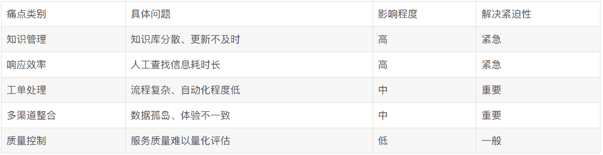
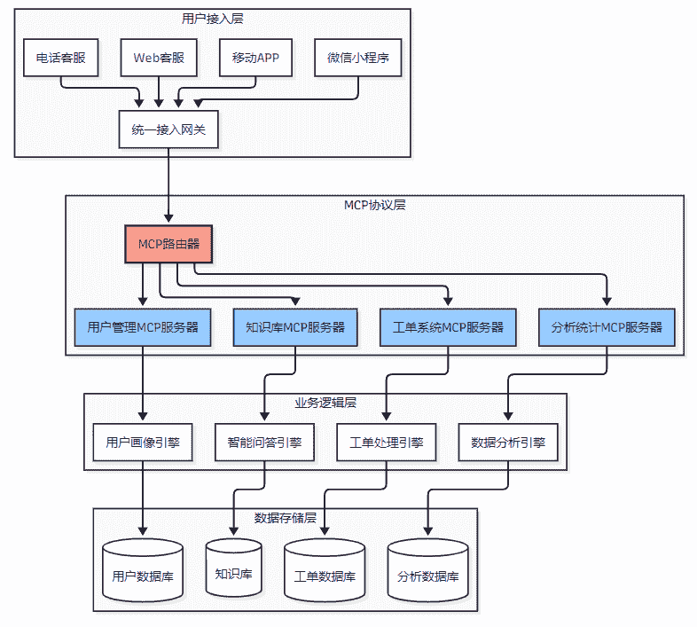
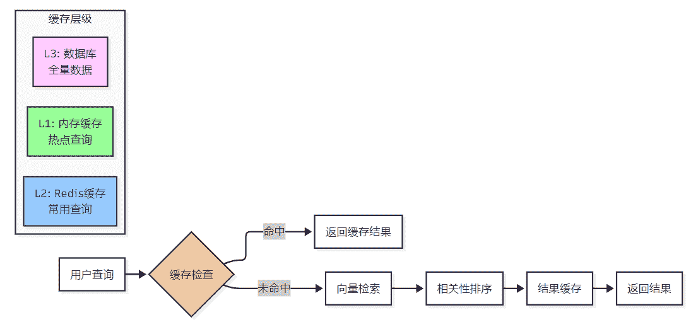
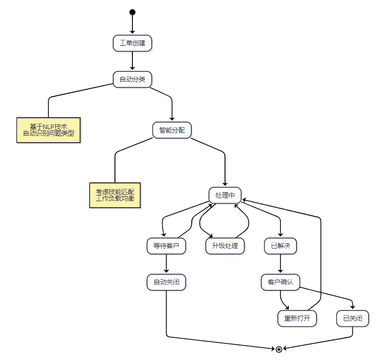
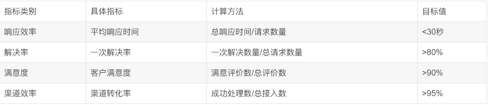
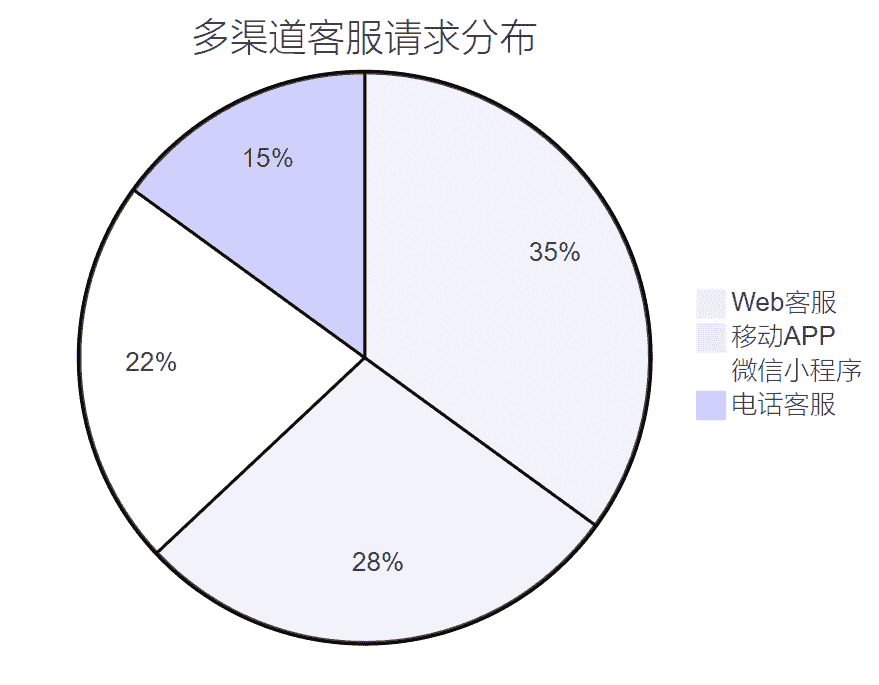
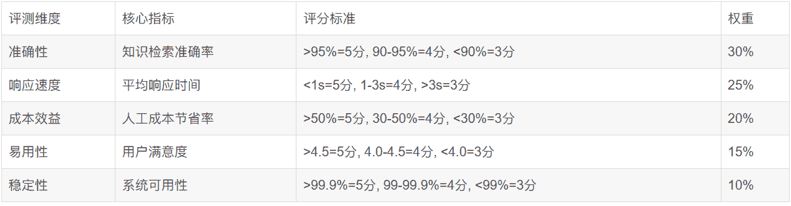
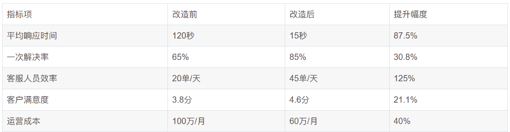
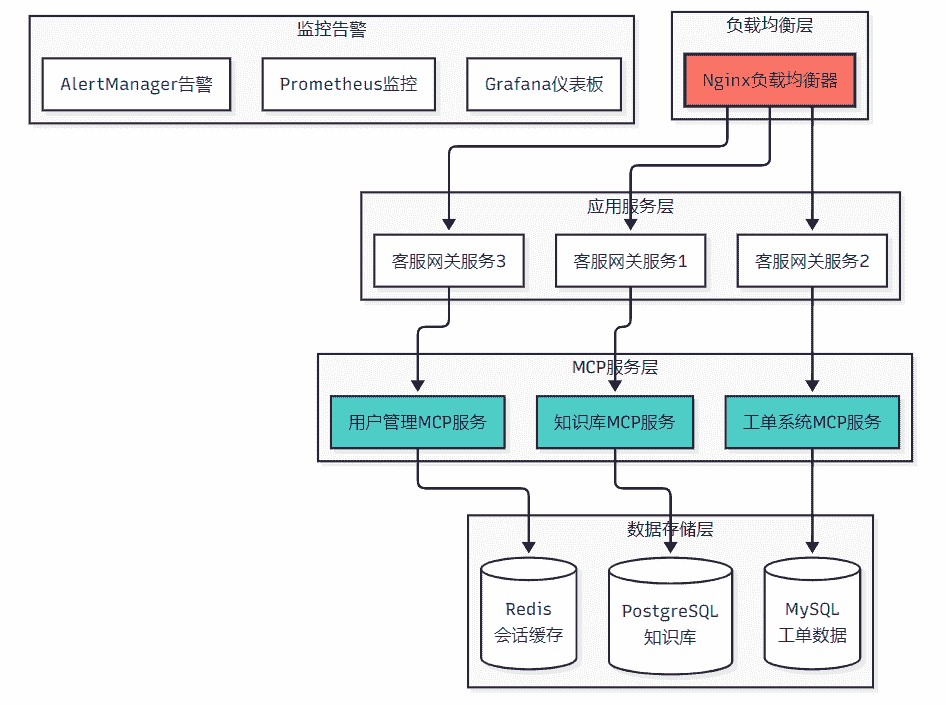
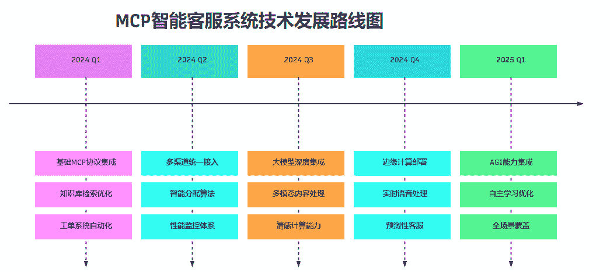

# 0-1MCP智能客服实战项目（已脱敏）

> 来源：[https://qqs7y1hozd1.feishu.cn/docx/LZ3GdDIZMobxrlxGi1ac9luin8d](https://qqs7y1hozd1.feishu.cn/docx/LZ3GdDIZMobxrlxGi1ac9luin8d)

在当今数字化转型的浪潮中，智能客服系统已经成为企业提升服务效率、降低运营成本的关键技术手段。传统的客服系统往往面临着知识库分散、工单处理效率低下、多渠道数据孤岛等痛点问题。而基于`MCP`（Model Context Protocol）的智能客服系统，通过其标准化的协议接口和强大的上下文管理能力，为这些问题提供了全新的解决方案。

> 本文将深入探讨如何构建一个基于`MCP`的智能客服系统，实现知识库与工单系统的深度集成。我们将从客服场景的需求分析开始，详细阐述系统架构设计的核心思路，包括如何利用`MCP`协议实现知识库的智能检索与相关性排序，如何通过工单系统集成实现流程自动化，以及如何构建多渠道接入的统一管理平台。通过本文的学习，读者将掌握`MCP`在客服领域的实际应用方法，了解如何设计高效的知识管理体系，以及如何构建可扩展的智能客服架构。这不仅是一次技术探索，更是对未来客服服务模式的深度思考。

## 客服场景需求分析与架构设计

### 1.1 传统客服系统痛点分析

在深入探讨基于`MCP`的智能客服系统之前，我们需要先了解传统客服系统面临的核心挑战：



### 1.2 `MCP`在客服系统中的优势

`MCP`协议为智能客服系统带来了以下核心优势：

```
# MCP客服系统核心组件示例
class MCPCustomerServiceSystem:
    def __init__(self):
        self.mcp_client = MCPClient()
        self.knowledge_base = KnowledgeBaseServer()
        self.ticket_system = TicketSystemServer()
        self.channel_manager = ChannelManagerServer()
    
    async def initialize_servers(self):
        """初始化MCP服务器连接"""
        await self.mcp_client.connect_server(
            "knowledge-base", 
            self.knowledge_base
        )
        await self.mcp_client.connect_server(
            "ticket-system", 
            self.ticket_system
        )
        await self.mcp_client.connect_server(
            "channel-manager", 
            self.channel_manager
        )
```

### 1.3 系统整体架构设计

基于`MCP`的智能客服系统采用分层架构设计，确保系统的可扩展性和维护性：



## 知识库检索与相关性排序

### 2.1 知识库`MCP`服务器设计

知识库是智能客服系统的核心组件，通过`MCP`协议实现标准化的知识检索接口：

```
from typing import List, Dict, Any
import asyncio
from mcp import MCPServer, Tool, Resource
 
class KnowledgeBaseMCPServer(MCPServer):
    def __init__(self):
        super().__init__("knowledge-base-server")
        self.knowledge_db = KnowledgeDatabase()
        self.vector_search = VectorSearchEngine()
        self.relevance_ranker = RelevanceRanker()
    
    @Tool("search_knowledge")
    async def search_knowledge(self, query: str, limit: int = 10) -> List[Dict]:
        """
        智能知识检索工具
        Args:
            query: 用户查询问题
            limit: 返回结果数量限制
        Returns:
            相关知识条目列表
        """
        # 1. 查询预处理
        processed_query = await self._preprocess_query(query)
        
        # 2. 向量检索
        vector_results = await self.vector_search.search(
            processed_query, 
            top_k=limit * 2
        )
        
        # 3. 相关性排序
        ranked_results = await self.relevance_ranker.rank(
            query, 
            vector_results
        )
        
        return ranked_results[:limit]
    
    async def _preprocess_query(self, query: str) -> str:
        """查询预处理：分词、去停用词、同义词扩展"""
        # 实现查询预处理逻辑
        return processed_query
```

### 2.2 多维度相关性排序算法

为了提高知识检索的准确性，我们设计了多维度相关性排序算法：

```
class RelevanceRanker:
    def __init__(self):
        self.weights = {
            'semantic_similarity': 0.4,  # 语义相似度
            'keyword_match': 0.3,        # 关键词匹配
            'popularity': 0.2,           # 知识条目热度
            'freshness': 0.1             # 内容新鲜度
        }
    
    async def rank(self, query: str, candidates: List[Dict]) -> List[Dict]:
        """多维度相关性排序"""
        scored_results = []
        
        for candidate in candidates:
            score = await self._calculate_relevance_score(query, candidate)
            candidate['relevance_score'] = score
            scored_results.append(candidate)
        
        # 按相关性得分排序
        return sorted(scored_results, 
                     key=lambda x: x['relevance_score'], 
                     reverse=True)
    
    async def _calculate_relevance_score(self, query: str, candidate: Dict) -> float:
        """计算综合相关性得分"""
        semantic_score = await self._semantic_similarity(query, candidate['content'])
        keyword_score = self._keyword_match_score(query, candidate['title'])
        popularity_score = candidate.get('view_count', 0) / 1000  # 归一化
        freshness_score = self._calculate_freshness(candidate['update_time'])
        
        total_score = (
            semantic_score * self.weights['semantic_similarity'] +
            keyword_score * self.weights['keyword_match'] +
            popularity_score * self.weights['popularity'] +
            freshness_score * self.weights['freshness']
        )
        
        return total_score
```

### 2.3 知识库检索性能优化

为了确保系统的高性能，我们实现了多级缓存和索引优化策略：



## 工单系统集成与流程自动化

### 3.1 工单系统`MCP`服务器实现

工单系统通过`MCP`协议提供标准化的工单管理接口：

```
class TicketSystemMCPServer(MCPServer):
    def __init__(self):
        super().__init__("ticket-system-server")
        self.ticket_db = TicketDatabase()
        self.workflow_engine = WorkflowEngine()
        self.notification_service = NotificationService()
    
    @Tool("create_ticket")
    async def create_ticket(self, 
                           customer_id: str, 
                           category: str, 
                           priority: str, 
                           description: str) -> Dict:
        """
        创建工单
        Args:
            customer_id: 客户ID
            category: 工单类别
            priority: 优先级
            description: 问题描述
        Returns:
            工单信息
        """
        # 1. 工单预处理
        ticket_data = {
            'id': self._generate_ticket_id(),
            'customer_id': customer_id,
            'category': category,
            'priority': priority,
            'description': description,
            'status': 'open',
            'created_at': datetime.now(),
            'assigned_to': await self._auto_assign_agent(category, priority)
        }
        
        # 2. 保存工单
        ticket = await self.ticket_db.create(ticket_data)
        
        # 3. 触发工作流
        await self.workflow_engine.trigger('ticket_created', ticket)
        
        # 4. 发送通知
        await self.notification_service.notify_assignment(ticket)
        
        return ticket
    
    @Tool("update_ticket_status")
    async def update_ticket_status(self, 
                                  ticket_id: str, 
                                  status: str, 
                                  comment: str = None) -> Dict:
        """更新工单状态"""
        ticket = await self.ticket_db.get(ticket_id)
        if not ticket:
            raise ValueError(f"Ticket {ticket_id} not found")
        
        # 状态变更记录
        status_change = {
            'from_status': ticket['status'],
            'to_status': status,
            'changed_by': 'system',
            'changed_at': datetime.now(),
            'comment': comment
        }
        
        # 更新工单
        ticket['status'] = status
        ticket['status_history'].append(status_change)
        
        await self.ticket_db.update(ticket_id, ticket)
        
        # 触发状态变更工作流
        await self.workflow_engine.trigger('status_changed', ticket)
        
        return ticket
```

### 3.2 智能工单分配算法

基于机器学习的智能工单分配系统，提高处理效率：


```
class IntelligentTicketAssigner:
    def __init__(self):
        self.ml_model = TicketClassificationModel()
        self.agent_matcher = AgentMatcher()
        self.load_balancer = LoadBalancer()
    
    async def assign_ticket(self, ticket: Dict) -> str:
        """智能工单分配"""
        # 1. 工单分类
        category_prediction = await self.ml_model.predict_category(
            ticket['description']
        )
        
        # 2. 技能匹配
        suitable_agents = await self.agent_matcher.find_suitable_agents(
            category_prediction,
            ticket['priority']
        )
        
        # 3. 负载均衡
        assigned_agent = await self.load_balancer.select_agent(
            suitable_agents
        )
        
        return assigned_agent
    
    async def _calculate_agent_score(self, agent: Dict, ticket: Dict) -> float:
        """计算客服代表匹配得分"""
        skill_score = self._skill_match_score(agent['skills'], ticket['category'])
        workload_score = 1.0 - (agent['current_tickets'] / agent['max_tickets'])
        performance_score = agent['performance_rating'] / 5.0
        
        return (skill_score * 0.5 + 
                workload_score * 0.3 + 
                performance_score * 0.2)
```

### 3.3 工单处理流程自动化

通过工作流引擎实现工单处理的自动化：



## 多渠道接入与统一管理

### 4.1 统一接入网关设计

多渠道接入网关负责处理来自不同渠道的客服请求：

```
class UnifiedGateway:
    def __init__(self):
        self.channel_adapters = {
            'web': WebChannelAdapter(),
            'mobile': MobileChannelAdapter(),
            'wechat': WeChatChannelAdapter(),
            'phone': PhoneChannelAdapter()
        }
        self.session_manager = SessionManager()
        self.message_router = MessageRouter()
    
    async def handle_request(self, channel: str, request: Dict) -> Dict:
        """统一请求处理入口"""
        # 1. 渠道适配
        adapter = self.channel_adapters.get(channel)
        if not adapter:
            raise ValueError(f"Unsupported channel: {channel}")
        
        # 2. 消息标准化
        standardized_message = await adapter.standardize_message(request)
        
        # 3. 会话管理
        session = await self.session_manager.get_or_create_session(
            standardized_message['user_id'],
            channel
        )
        
        # 4. 消息路由
        response = await self.message_router.route_message(
            standardized_message,
            session
        )
        
        # 5. 响应适配
        channel_response = await adapter.adapt_response(response)
        
        return channel_response
```

### 4.2 会话状态管理

跨渠道的会话状态管理确保用户体验的一致性：

```
class SessionManager:
    def __init__(self):
        self.redis_client = RedisClient()
        self.session_timeout = 3600  # 1小时
    
    async def get_or_create_session(self, user_id: str, channel: str) -> Dict:
        """获取或创建会话"""
        session_key = f"session:{user_id}"
        session = await self.redis_client.get(session_key)
        
        if not session:
            session = {
                'user_id': user_id,
                'channels': [channel],
                'context': {},
                'created_at': datetime.now().isoformat(),
                'last_activity': datetime.now().isoformat()
            }
        else:
            # 更新渠道信息
            if channel not in session['channels']:
                session['channels'].append(channel)
            session['last_activity'] = datetime.now().isoformat()
        
        # 保存会话状态
        await self.redis_client.setex(
            session_key, 
            self.session_timeout, 
            json.dumps(session)
        )
        
        return session
    
    async def update_context(self, user_id: str, context_update: Dict):
        """更新会话上下文"""
        session_key = f"session:{user_id}"
        session = await self.redis_client.get(session_key)
        
        if session:
            session['context'].update(context_update)
            await self.redis_client.setex(
                session_key,
                self.session_timeout,
                json.dumps(session)
            )
```

### 4.3 多渠道数据统一分析





## 系统性能评测与优化

### 5.1 性能评测指标体系

建立全面的性能评测指标体系，确保系统的高可用性：



### 5.2 性能监控与告警

实现实时性能监控和智能告警机制：

```
class PerformanceMonitor:
    def __init__(self):
        self.metrics_collector = MetricsCollector()
        self.alert_manager = AlertManager()
        self.dashboard = MonitoringDashboard()
    
    async def collect_metrics(self):
        """收集系统性能指标"""
        metrics = {
            'response_time': await self._measure_response_time(),
            'accuracy_rate': await self._calculate_accuracy_rate(),
            'throughput': await self._measure_throughput(),
            'error_rate': await self._calculate_error_rate(),
            'resource_usage': await self._get_resource_usage()
        }
        
        # 存储指标数据
        await self.metrics_collector.store(metrics)
        
        # 检查告警条件
        await self._check_alerts(metrics)
        
        return metrics
    
    async def _check_alerts(self, metrics: Dict):
        """检查告警条件"""
        alert_rules = [
            {'metric': 'response_time', 'threshold': 3.0, 'operator': '>'},
            {'metric': 'accuracy_rate', 'threshold': 0.9, 'operator': '<'},
            {'metric': 'error_rate', 'threshold': 0.05, 'operator': '>'}
        ]
        
        for rule in alert_rules:
            if self._evaluate_rule(metrics[rule['metric']], rule):
                await self.alert_manager.send_alert(rule, metrics)
```

> "在智能客服系统的设计中，性能监控不仅仅是技术指标的收集，更是服务质量持续改进的基础。只有建立完善的监控体系，才能确保系统在复杂业务场景下的稳定运行。"

> —— 企业级系统架构最佳实践

## 实际部署案例分析

### 6.1 某电商平台客服系统改造

以某大型电商平台的客服系统改造为例，展示`MCP`智能客服系统的实际应用效果：

改造前后对比数据：



### 6.2 系统部署架构



## 未来发展趋势与技术展望

### 7.1 AI技术融合趋势

随着大语言模型技术的快速发展，`MCP`智能客服系统将迎来新的发展机遇：

```
class NextGenCustomerService:
    def __init__(self):
        self.llm_engine = LargeLanguageModel()
        self.multimodal_processor = MultimodalProcessor()
        self.emotion_analyzer = EmotionAnalyzer()
    
    async def handle_complex_query(self, query: Dict) -> Dict:
        """处理复杂多模态查询"""
        # 1. 多模态内容理解
        if query.get('image'):
            image_context = await self.multimodal_processor.analyze_image(
                query['image']
            )
            query['context'] = image_context
        
        # 2. 情感分析
        emotion = await self.emotion_analyzer.analyze(query['text'])
        
        # 3. 智能回复生成
        response = await self.llm_engine.generate_response(
            query, 
            emotion_context=emotion
        )
        
        return response
```

### 7.2 技术发展路线图



## 参考资源

+   `MCP`官方协议文档
+   Anthropic `MCP`开发指南
+   智能客服系统设计模式
+   企业级`MCP`部署最佳实践

## 总结

1. 通过本文的深入探讨，我们全面了解了基于`MCP`的智能客服系统的设计与实现。从传统客服系统的痛点分析开始，我们看到了`MCP`协议在解决知识库分散、工单处理效率低下、多渠道数据孤岛等问题上的独特优势。

2. 通过标准化的协议接口和强大的上下文管理能力，`MCP`为智能客服系统提供了全新的技术架构思路。在知识库检索与相关性排序方面，我们设计了多维度的排序算法，结合语义相似度、关键词匹配、内容热度和新鲜度等因素，显著提升了知识检索的准确性。


1. 工单系统的深度集成实现了从工单创建、智能分配到状态跟踪的全流程自动化，通过机器学习算法优化了客服代表的工作分配，提高了整体处理效率。多渠道接入与统一管理的实现，打破了传统客服系统的数据孤岛，通过统一的接入网关和会话状态管理，为用户提供了一致的服务体验。

1. 性能评测体系的建立，从准确性、响应速度、成本效益、易用性和稳定性等多个维度，为系统的持续优化提供了量化的评估标准。实际部署案例显示，基于MCP的智能客服系统在响应时间、解决率、客服效率和客户满意度等关键指标上都取得了显著的提升。展望未来，随着大语言模型、多模态处理和情感计算等技术的不断发展，MCP智能客服系统将向着更加智能化、人性化的方向演进，为企业数字化转型提供更强有力的技术支撑。
